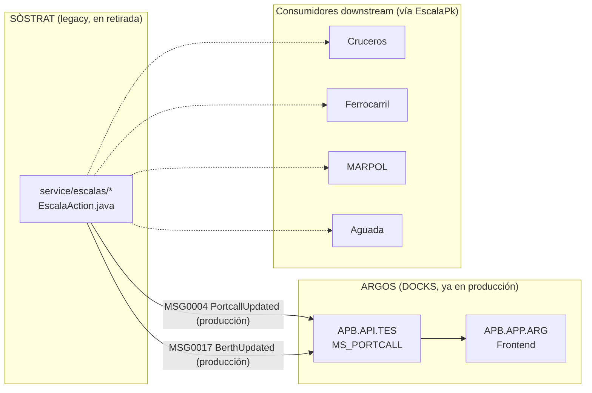

# [IA-GEN] Dossier — Escalas (Migración hacia ARGOS, NO es una aplicación nueva)

> **Borrador generado por IA** (APB AI Framework — síntesis de apb-disc-spec-gen-v1.0/apb-pm-product-analysis-v1.0/apb-arch-c4-model-v1.0/apb-arch-decompose-v1.0) — pendiente validación humana. No distribuir sin revisión.
>
> **Naturaleza de este documento**: a diferencia del resto de dossiers de esta serie, **Escalas no da lugar a una aplicación DOCKS nueva**. Este documento sigue la misma plantilla por consistencia (para que el equipo funcional/desarrollo lo lea igual que los demás), pero su contenido real es una **estrategia de migración de maestría de dato**, no una especificación de construcción.

## 1. Cabecera

- **Nombre**: Escalas (Port Call) — SÒSTRAT legacy
- **Dominio DDD real**: `dom-operaciones-maritimas-v1` (ya `proposed` en `apb-domain-catalog`, operado por ARGOS)
- **Fase del roadmap**: 5
- **Estado**: **NO ES UNA EXTRACCIÓN — ES UNA MIGRACIÓN/RETIRADA**, pendiente de sesión formal con el equipo de ARGOS/AOM
- **Bounded context de origen**: `proposals/bc-escalas-v1.md`
- **Documento base**: `migration-readiness-fase5.md`, `decomposition-roadmap.md` §Fase 5

## 2. Resumen ejecutivo

SÒSTRAT gestiona hoy el ciclo de vida completo de la escala (visita de un buque al puerto) a través de `service/escalas/` y la god class `EscalaAction.java` (7.549 líneas). **Evidencia de código confirma que ARGOS (`APB.API.TES`, microservicio `MS_PORTCALL`) ya consume en producción los eventos reales que SÒSTRAT emite** (`MSG0004 PortcallUpdated`, `MSG0017 BerthUpdated`), con un DTO (`PortCallCreatedDto.cs`) que tiene `Origin=SOSTRAT` por defecto y replica el modelo exacto de SÒSTRAT. **No hace falta construir un microservicio "Escalas" nuevo — hace falta decidir cómo se retira SÒSTRAT como fuente de verdad y se traspasa esa responsabilidad a ARGOS**, que ya la ejerce operativamente.

## 3. Análisis funcional

### Responsabilidad actual en SÒSTRAT
- Registro y gestión de la escala (`Escala.java`, tabla `ESCALA`, PK `idsubport+anyescala+numescala`) y sus atraques (`Atracada.java`, tabla `ATRACADA`).
- 67 interfaces de servicio bajo `service/escalas/` (`CN_*`).
- 112 rutas Struts en el subpaquete `escalas` (+ `escalas.dms` + `escalas.prueba`), confirmadas por conteo exacto.
- Notificación a Cruceros, Ferrocarril, MARPOL y Aguada a través de referencias cruzadas a `EscalaPk`.

### Lo que la evidencia de código desmiente de la propia propuesta original
`bc-escalas-v1.md` afirmaba en su versión inicial una separación limpia ("no incluye facturación ni liquidación"). **Esto NO se sostiene en el código real**: `EscalaAction.java` tiene **81 referencias directas a `Liquidacion`/`Facturacio`** — la lógica de facturación está entrelazada con la gestión de la escala, no separada. Esto es una corrección de la propia propuesta, no una afirmación nueva.

### Actores
- Operador portuario / consignatario (a través de Escalas legacy hoy; a través de ARGOS en destino).
- Torre de control ARGOS (consumidor operativo real, confirmado).
- Cruceros, Ferrocarril, MARPOL, Aguada (consumidores downstream vía `EscalaPk`).

### Qué NO incluye este documento
No incluye el diseño de ARGOS/`APB.API.TES` en sí — ese sistema ya existe y está fuera del alcance de este análisis de SÒSTRAT. Este documento cubre únicamente la estrategia de retirada del lado SÒSTRAT.

## 4. Alcance de migración — qué se retira y qué NO se migra por no estar en uso

- **Se retira** (no se migra a un servicio nuevo, se traspasa la maestría a ARGOS): las 112 rutas Struts de `escalas`, la god class `EscalaAction.java` (una vez separada su lógica de facturación).
- **Código muerto confirmado dentro de este ámbito** (`dead-code-register.md` #2, #3): dos bloques completos comentados en `CN_Escala_Impl.java` (líneas ~10321-10420), con justificación explícita del desarrollador — *"ESCA-1328: (...) Este bloque de código está obsoleto"* y *"ESCA-1654: (...) ANULAMOS EL COMPORTAMIENTO DE LA ESCA-480"*. **Estos dos bloques NO deben migrarse ni replicarse en ARGOS bajo ningún escenario** — están confirmados como obsoletos por el propio desarrollador legacy.
- **Se separa hacia otro destino, no se retira**: la lógica de liquidación/facturación entrelazada (81 referencias) — va hacia `bc-liquidacion-v1`/`bc-facturacion-v1` (Fase 4), no hacia ARGOS.
- **No se ha auditado job a job** el impacto en `sostrat-BATCH` de esta retirada (ver `coverage-audit.md` §4, limitación explícita) — pendiente.

## 5. Modelo de datos

`Escala` (tabla `ESCALA`, PK `idsubport+anyescala+numescala`) — ~45 campos identificados, incluyendo `idestoperatiu`, `datsolicitud`, `datconfirmacio`, `datautoritzacio`. `Atracada` (tabla `ATRACADA`, PK + `seqatracada`) — `idestatatracada`, `datsolicitud`, `mollsalternatius`. `EscalaAspecte` (tabla `ESCALA_ASPECTE`, ~90 campos técnicos de buque).

**Destino real ya existente** (no se diseña aquí, se referencia): `PortCallCreatedDto.cs` en `APB.API.TES/src/Consumer/Dto/`, con campos `IdSubPort`, `YearPortCall`, `NumPortCall`, `Aspecte` — terminología catalana literal heredada de `ESCALA_ASPECTE`, confirmando que es el mismo concepto de negocio, no dos modelos distintos por casualidad.

## 6. Arquitectura técnica

No se construye arquitectura nueva del lado SÒSTRAT. El patrón es de **retirada progresiva de fuente de verdad**: mientras dure la transición, SÒSTRAT sigue escribiendo `ESCALA`/`ATRACADA` y emitiendo `MSG0004`/`MSG0017`; ARGOS los consume y aplica a su propio modelo. El objetivo final es invertir el flujo (ARGOS pasa a ser el maestro de escritura) o retirarlo con periodo de coexistencia.

## 7. Dominio DDD

- **Bounded context origen**: `bc-escalas-v1` (`dom-operaciones-maritimas-v1`).
- **Relación real confirmada**: `dom-operaciones-maritimas-v1` ya está `proposed` en el catálogo, operado por ARGOS, con `Escalas` (`MS_PORTCALL`, `APB.API.TES`) como uno de sus bounded contexts reales — el catálogo top-down y el análisis bottom-up de código convergen en la misma conclusión de forma independiente.
- **Relación con los BCs nuevos de la auditoría de cobertura**: `bc-buques-v1` (Vaixell) es upstream de Escalas, no downstream — el maestro de buques sobrevive a esta migración independientemente de qué pase con Escalas.

## 8. Pantallas UI

**Ninguna pantalla nueva se propone para SÒSTRAT.** Cualquier pantalla de escalas/atraques que haga falta debe evaluarse dentro del frontend de ARGOS (`APB.APP.ARG`, ya en producción), no como app nueva del portal SÒSTRAT — decisión ya tomada 2026-07-11, ver `ui-screens-backlog.md` §Fase 5.

## 9. APIs

No se diseña una API nueva. El contrato real de destino es el de `APB.API.TES` (`PortCallCreatedDto.cs`, consumers `TesPortCallCreatedConsumer.cs`/`TesBerthUpdatedConsumer.cs`), que vive en el repositorio `APB.API.TES`, fuera del alcance de este análisis SÒSTRAT.

## 10. Eventos

| Evento real (ya en producción) | Dirección | Evidencia |
|---|---|---|
| `MSG0004 PortcallUpdated` | SÒSTRAT → TES | `TesPortCallCreatedConsumer.cs` |
| `MSG0017 BerthUpdated` | SÒSTRAT → TES | `TesBerthUpdatedConsumer.cs` |

No se diseñan eventos nuevos — estos ya existen y funcionan en producción.

## 11. Diagrama topológico (C4 nivel 1, estado de transición)

## 12. Estrategia de convivencia con el modelo actual (sección central de este documento)

1. **Separar primero** la lógica de liquidación/facturación entrelazada en `EscalaAction.java` hacia el servicio de Facturación y Liquidaciones (Fase 4) — no puede migrarse a ARGOS junto con la escala, porque ARGOS no es un sistema de facturación. Esta pieza **es ejecutable ya**, no depende de la sesión con ARGOS.
2. **Diseñar la migración de maestría del dato** de escala/atraque hacia `APB.API.TES`/`APB.API.TBE` — invertir o retirar progresivamente el flujo `SOSTRAT→TES` una vez ARGOS pueda escribir su propio dato, en vez de construir un tercer sistema.
3. Cruceros, Ferrocarril, MARPOL y Aguada mantienen sus ACL ya diseñados en fases previas, pero apuntando a ARGOS/TES como destino final en vez de a un hipotético servicio "Escalas" nuevo.
4. **Escalar explícitamente este hallazgo al equipo de ARGOS** (AOM: Alberto Ponseti, Jose Joaquin Mena) **antes de tocar código** — esto no se ejecuta solo con el equipo de SÒSTRAT.
5. Confirmar el mapeo exacto de campos entre `Escala.idsubport/anyescala/numescala` y `PortCallCreatedDto.IdSubPort/YearPortCall/NumPortCall` — no confirmado 1:1 por nombre, solo por semántica.

## 13. Testing y seguridad

No hay `testing-strategy`/`threat-model` específico para esta fase porque no se construye software nuevo del lado SÒSTRAT. El testing relevante es de **paridad de datos** durante la coexistencia: verificar que `MSG0004`/`MSG0017` siguen reflejando fielmente el estado de `ESCALA`/`ATRACADA` hasta el cutover.

## 14. Riesgos y gaps de evidencia conocidos

- Mapeo de campos SÒSTRAT↔TES no confirmado 1:1 por nombre.
- No confirmado si Cruceros necesita frontend propio dentro de ARGOS o se integra en él — decisión pendiente con el equipo de ARGOS.
- `coverage-audit.md` no ha auditado el impacto de esta retirada sobre los jobs batch de `sostrat-BATCH` relacionados con Escalas.

## 15. Estimación de esfuerzo

Ver `jira-backlog.md` EPIC-14 ("Migración de Escalas hacia ARGOS"). No hay story points de construcción de servicio nuevo — el esfuerzo real es de separación de la lógica de facturación (tarea ejecutable ya) y de coordinación con el equipo de ARGOS (spike/sesión formal, esfuerzo no estimable hasta esa sesión).

## 16. Checklist de validación

**Funcional**:
- [ ] Confirmar que "Escalas no es una app nueva de SÒSTRAT" es una decisión aceptada, no solo una hipótesis técnica.
- [ ] Confirmar el alcance real de Cruceros dentro de ARGOS.

**Desarrollo**:
- [ ] Confirmar viabilidad de separar la lógica de liquidación de `EscalaAction.java` sin depender de la sesión con ARGOS.
- [ ] Sesión técnica con el equipo de `APB.API.TES` para confirmar el mapeo de campos.

## 17. Historial de cambios

| Versión | Fecha | Autor | Cambio |
|---------|-------|-------|--------|
| 1.0.0 | 2026-07-13 | APB AI Framework | Dossier inicial, a petición explícita del usuario de incluir Escalas en la serie de dossiers por aplicación, adaptando la plantilla a su naturaleza de migración |
