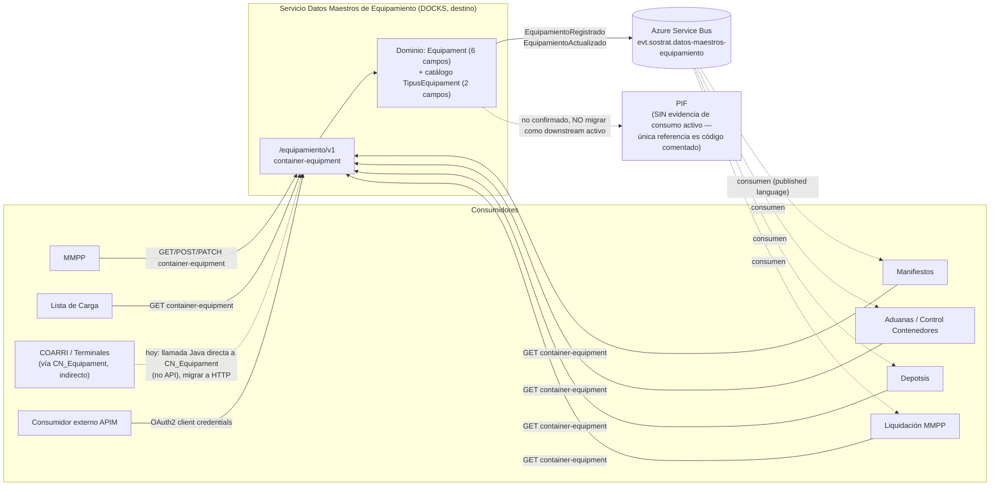

# [IA-GEN] Dossier — Datos Maestros de Equipamiento

> **Borrador generado por IA** (APB AI Framework — síntesis de apb-disc-spec-gen-v1.0/apb-pm-product-analysis-v1.0/apb-arch-c4-model-v1.0/apb-arch-decompose-v1.0) — pendiente validación humana. No distribuir sin revisión.

## 1. Cabecera

- **Nombre**: Datos Maestros de Equipamiento
- **Dominio DDD**: `dom-mercancias-v1` (transversal — ver `ui-screens-backlog.md:198`), `parent_domain` declarado en `proposals/bc-datos-maestros-equipamiento-v1.md:10`
- **Fase del roadmap**: 0 (Fundamentos de plataforma, prerequisito — `decomposition-roadmap.md:40-47`, `jira-backlog.md` EPIC-00)
- **Estado**: DISCOVERED — **propuesta nueva sin equivalente 1:1 en el monolito** (`proposals/bc-datos-maestros-equipamiento-v1.md:59`: *"no corresponde a un paquete Java existente 1:1"*), verificada campo a campo y consumidor a consumidor contra el checkout real de `SOSTRAT-Sostrat-MJ8`
- **Bounded context de origen**: `proposals/bc-datos-maestros-equipamiento-v1.md`
- **Épica**: `jira-backlog.md` EPIC-00 — Fundamentos de plataforma

## 2. Resumen ejecutivo

Datos Maestros de Equipamiento nace de un anti-patrón real, no de un módulo de negocio con Action/struts-config propios: la clase `Equipament.java` (tabla `EQUIPAMENT`, 6 campos) vive físicamente dentro del paquete de MMPP (`dataaccess/dto/mmpp/maestros/`) pero es importada directamente por **52 ficheros Java** repartidos en al menos 8 paquetes de servicio distintos (`mmpp`, `manifiestos`, `aduanas`, `depotsis`, `liquidadormm`, `listacarga`, `coarri`, `terminales`), confirmado por `grep` exhaustivo del import exacto `org.apb.sostrat.dataaccess.dto.mmpp.maestros.Equipament` sobre el checkout completo (`sostrat/` + `sostrat-CARGASINICIALES/`). Esto corrige ligeramente la cifra de "54 ficheros" citada en `proposals/bc-datos-maestros-equipamiento-v1.md:59` — la diferencia no cambia la conclusión (acoplamiento real y extendido a dato compartido sin dueño), y de hecho el número de **paquetes de servicio** afectados es mayor que los "6 dominios" enumerados originalmente en el propio bounded context.

**Dos hallazgos nuevos de esta verificación, no presentes en la documentación previa**:

1. **El campo `matriculaiso` NO es la matrícula ISO 6346 del contenedor.** Es un flag `"S"`/`"N"` (un único carácter) que indica si la matrícula real (`refequipament`) *cumple* el formato ISO 6346 — se calcula con el algoritmo de dígito de control real (`AuxiliarISO6346.calcularDigito6346`/`validarMatricula`, mod-11) aplicado sobre `refequipament`, nunca se asigna el contenedor en sí (confirmado: **todas** las 30+ asignaciones de `matriculaiso` en todo el checkout son literales `"S"` o `"N"`, sin ninguna excepción). El patrón `^[A-Z]{4}[0-9]{7}$` y el `maxLength: 11` del contrato actual (`specs/openapi-datos-maestros-equipamiento.yaml:153-157`) están aplicados al campo equivocado — deben aplicarse a `refequipament`, no a `matriculaiso`. Esto ya estaba parcialmente señalado como hipótesis no verificada en `testing-strategy-fase0-1.md:11` ("no se ha verificado en `Equipament.java`"); esta verificación la resuelve con evidencia concluyente y encuentra que la hipótesis original era incorrecta, no solo no verificada.
2. **`bc-pif-v1` no tiene evidencia real de consumo de `Equipament`** — la única referencia en todo el paquete `pif` es una línea comentada (código muerto) en `CN_Pif_Impl.java:284`. La propuesta original (`proposals/bc-datos-maestros-equipamiento-v1.md:44-48`) lista PIF como `downstream_context`; esta verificación no lo confirma con código activo (ver §4/§14).

El resto del maestro se confirma exactamente como fue documentado: 6 campos, deliberadamente delgado, sin peso/estado/situación aduanera (esos viven en cada bounded context consumidor).

## 3. Análisis funcional

### Responsabilidad de negocio
Mantener el dato maestro de identidad de un equipo de transporte de mercancías (fundamentalmente contenedores): su referencia de negocio, tipo, propietario y país de origen — como fuente única de verdad para los dominios que hoy lo consultan y actualizan cada uno por su cuenta contra la misma tabla Oracle.

### Actores
- Servicios consumidores internos (hoy módulos del monolito; mañana microservicios DOCKS): MMPP (dueño físico actual), Manifiestos, Aduanas, Depotsis, Liquidación MMPP, Lista de Carga, COARRI (EDI), Terminales.
- Operador/proceso EDI que da de alta o resuelve equipamiento automáticamente al procesar mensajes IFTDGN/HAZMAT/COARRI (`recuperarCrearEquipamiento`, ver más abajo).
- Consumidor externo vía APIM con scopes `equipamiento.read`/`equipamiento.write` (`specs/openapi-datos-maestros-equipamiento.yaml:137-139`).

### Casos de uso reales (grounded en `CN_Equipament`/`CN_Equipament_Impl.java`, servicio interno ya existente en `service/mmpp/gestion/`)
- **Consultar por identificador**: `obtenerRegistro(Long idequipament)` → `EquipamentDao.findByPrimaryKey`.
- **Consultar por matrícula de negocio**: `obtenerRegistroPorMatricula(String matricula)` → `EquipamentDao.findWhereRefequipamentEquals`, devuelve el primer resultado de la lista (no valida unicidad en este punto — ver §14).
- **Alta**: `crear(Equipament, boolean confirmado)` — genera el PK con una secuencia real de base de datos (`ServiceLocatorCoreDao.obtenerIdSecuencial("SEQ_IDEQUIPAMENT")`, no con lógica de aplicación), publica un evento local `CN_Equipament_Impl.crear_pre` vía `EventBus` (Swing EventBus interno, no Service Bus) antes de persistir.
- **Actualización**: `actualizar(Equipament, boolean confirmado)` — usa `EquipamentPk` (PK simple, un único campo `idequipament`, sin prefijo `port`).
- **Recuperar-o-crear** (caso de uso más usado en la práctica, invocado desde EDI/HAZMAT/IFTDGN): `recuperarCrearEquipamiento(matricula, esIso, idTipoEquipament, idOrigenDades)` — si existe y el tipo coincide, lo devuelve tal cual; si existe pero el tipo declarado es distinto, **actualiza el tipo silenciosamente** (comentario `MERCA-369` en el código); si no existe, lo crea con `propietari=null` y calcula `matriculaiso` con el algoritmo ISO 6346 real.
- **Validar si una matrícula es ISO-conforme**: `comprobarMatriculaISO(String matricula)` → delega en `AuxiliarISO6346.validarMatricula` (dígito de control mod-11 real, `sostrat/src/org/apb/sostrat/utility/edi/AuxiliarISO6346.java`) — es la única regla de negocio no trivial confirmada en código para este maestro.
- **Origen del dato**: el propio `CN_Equipament` declara 5 códigos de procedencia (`ORIGEN_DADES_MANUAL`, `_IFTDGN`, `_IFCSUM`, `_HAZMAT`, `_CARGA_INICIAL`, `_COPRAR`) — el campo que los almacena es `idoridade`.

### Reglas de negocio confirmadas en código
- `idequipament` es autogenerado por secuencia de base de datos (`SEQ_IDEQUIPAMENT`), nunca por el cliente — confirma la regla ya declarada en `specs/asyncapi-fase0-1.yaml:93` ("`idequipament` es inmutable una vez asignado") y añade que además es *server-generated*, coherente con que `ContainerEquipmentCreate` no lo incluya como campo de entrada (`specs/openapi-datos-maestros-equipamiento.yaml:176-184`).
- `EquipamentPk` es un PK simple de un solo campo (`idequipament`) — **a diferencia de otros maestros del monolito con PK compuesta `port+id...`** (p.ej. `Solicitud` de PPS), `EQUIPAMENT` no está particionado por puerto: es un maestro único y global.
- `matriculaiso` es un flag derivado, no un dato de entrada de negocio real — ver hallazgo #1 de §2.
- `recuperarCrearEquipamiento` actualiza el tipo de equipo existente sin pedir confirmación explícita si el tipo declarado por el mensaje entrante difiere del ya almacenado (`MERCA-369`) — comportamiento de *last-write-wins* silencioso a validar con negocio antes de migrarlo literalmente (ver §14).
- El método `validar()` de `CN_Equipament_Impl` está vacío (`//TODO`, línea 92-99) — **no hay validación de negocio real en el alta/actualización del maestro hoy**, más allá de lo que ya impone el propio flujo de `recuperarCrearEquipamiento`.

### Qué NO incluye
Confirmado por `events-catalog.md` §13 y por la propia definición del bounded context (`proposals/bc-datos-maestros-equipamiento-v1.md:70-72`): el maestro **no** incluye peso, tara, dimensiones ni estado del contenedor — esos atributos viven duplicados intencionadamente en cada bounded context consumidor (`MmppNotifEquipament.pesbrut/pesnet`, `ManifestEquip.idequipament+refequipament`, `VTcMAduanaContenidor`/`VTcTConAduanaContenidor` con su propio `estado`). Tampoco gestiona el traslado, tránsito ni ninguna operación de negocio sobre el contenedor — solo su identidad y atributos maestros.

## 4. Alcance de migración — qué se migra y qué NO por no estar en uso

- **Se migra la tabla `EQUIPAMENT`** (6 campos) y el catálogo de referencia `TIPUS_EQUIPAMENT` (2 campos: `idtipequipament` PK, `codequipament` — confirmado en `TipusEquipament.java`, **sin campo de descripción/nombre legible**, ver gap en §14).
- **El servicio interno `CN_Equipament`/`CN_Equipament_Impl` (`service/mmpp/gestion/`) es el mejor punto de partida para el diseño del nuevo servicio** — ya encapsula el acceso a la tabla vía `EquipamentExtendedDao` y expone exactamente las operaciones que necesita el nuevo contrato (`obtenerRegistro`, `crear`, `actualizar`, `recuperarCrearEquipamiento`, `comprobarMatriculaISO`). No es un bounded context aislado hoy — es una fachada interna dentro de MMPP consumida también desde fuera de MMPP vía llamada Java directa (no vía API), lo que en sí mismo demuestra el anti-patrón: incluso el único punto de acceso "de servicio" que existe no está expuesto como API real a los otros 7 paquetes consumidores.
- **No hay entradas en `dead-code-register.md` para `Equipament`/`EQUIPAMENT`** — el maestro en sí está activo y en uso constante.
- **Corrección de esta verificación (no estaba en `dead-code-register.md`)**: la única referencia a `Equipament` en el paquete `pif` es una línea comentada — `//List<Equipament> lObjEquipament = this.equipamentDao.findWhereRefequipamentEquals(dtov.getNumcontenidor());` (`service/pif/impl/CN_Pif_Impl.java:284`). **No hay ninguna otra referencia activa a `Equipament` en todo el paquete `pif`.** Por tanto, **`bc-pif-v1` no debe migrarse como consumidor activo de este maestro** hasta que negocio confirme si esa integración se necesita realmente — la propuesta original lo declara `downstream_context` sin evidencia de código viva que lo respalde (recomendado añadir esta línea a `dead-code-register.md`).
- **Corrección adicional**: `service/coarri/impl/CN_OperacionTerminal_Impl.java`, citado por nombre en `proposals/bc-datos-maestros-equipamiento-v1.md:95` como ejemplo de consumidor, **no importa el DTO `Equipament` directamente** — consume el equipamiento a través del servicio ya existente `CN_Equipament` (inyectado como `cnEquipament`) y del catálogo `TipusEquipament`/`CN_TipusEquipament`. Es un consumidor real, pero indirecto (vía servicio interno, no vía import de tabla) — un matiz relevante para diseñar la migración de COARRI/Terminales, que ya tiene un nivel de desacoplamiento mayor que Aduanas o Manifiestos.
- **Paquetes consumidores confirmados con import directo del DTO** (52 ficheros): `mmpp` (23, paquete de origen), `manifiestos` (8), `aduanas` (3), `listacarga` (2), `depotsis` (1), `liquidadormm` (1), `coarri` (1, solo el DTO EDI `Eqd01DTO.java`), `terminales` (1, `CN_ProtermCont_Impl.java`), más 6 ficheros de `mvc/control` (Actions de Manifiestos/MMPP) y 6 ficheros del módulo de migración batch `sostrat-CARGASINICIALES` (carga inicial de datos, no tráfico productivo continuo). `listacarga` y `coarri` **no están mapeados hoy a ningún `downstream_context` declarado** en `proposals/bc-datos-maestros-equipamiento-v1.md` — gap a cerrar antes de fijar el contrato de consumidores definitivo (ver §14).

## 5. Modelo de datos

Todos los campos siguientes están extraídos directamente de los DTOs reales en `sostrat/src/org/apb/sostrat/dataaccess/dto/mmpp/maestros/` del checkout `SOSTRAT-Sostrat-MJ8`.

### `Equipament` (tabla `EQUIPAMENT`, PK `idequipament`)

| Campo | Columna Oracle | Tipo Java | Nota |
|---|---|---|---|
| `idequipament` | `IDEQUIPAMENT` | `Long` | PK, autogenerado por secuencia `SEQ_IDEQUIPAMENT`, inmutable |
| `refequipament` | `REFEQUIPAMENT` | `String` | **La matrícula/referencia de negocio real del contenedor** (p.ej. `MSCU1234567`) — es sobre este campo, no sobre `matriculaiso`, donde aplicaría cualquier validación de formato ISO 6346 |
| `matriculaiso` | `MATRICULAISO` | `String` | **Flag `"S"`/`"N"`**, no la matrícula — indica si `refequipament` supera el dígito de control ISO 6346 (`AuxiliarISO6346.validarMatricula`). Confirmado sin excepciones en 30+ puntos de asignación de todo el checkout (ver §2) |
| `idtipequipament` | `IDTIPEQUIPAMENT` | `Integer` | FK a `TipusEquipament`/tabla `TIPUS_EQUIPAMENT` |
| `propietari` | `PROPIETARI` | `String`, nullable | Nombre de la naviera/propietario del equipo; `null` en alta automática por `recuperarCrearEquipamiento` |
| `idoridade` | `IDORIDADE` | `String`, nullable | Código de procedencia del dato — valores reales confirmados en `CN_Equipament`: `E01` (manual), `E02` (IFTDGN), `E03` (IFCSUM), `E04` (HAZMAT), `E05` (carga inicial), `C01` (COPRAR, ticket `MERC-1405`) |

`EquipamentPk` (`dataaccess/dto/mmpp/maestros/EquipamentPk.java`) — PK simple de un único campo `idequipament` (`Long`); **sin prefijo `port`**, a diferencia de otros maestros del monolito (p.ej. `SolicitudPk` de PPS) — `EQUIPAMENT` es un maestro único y global, no particionado por puerto.

### `TipusEquipament` (tabla `TIPUS_EQUIPAMENT`, PK `idtipequipament`)

| Campo | Columna Oracle | Tipo Java |
|---|---|---|
| `idtipequipament` | `IDTIPEQUIPAMENT` | `Integer` (PK) |
| `codequipament` | `CODEQUIPAMENT` | `String` |

**Confirmado: solo 2 campos, sin descripción/nombre legible del tipo** — relevante porque tanto `ui-screens-backlog.md:16` como `jira-backlog.md:25` proponen un `dxSelectBox` contra este catálogo, que necesitará resolver un literal de UI a partir de `codequipament` (o de una tabla de traducción de idioma no confirmada en este DTO) — ver gap en §14.

### Mapeo a Azure SQL
Migración directa tabla-a-tabla: `EQUIPAMENT`→`ContainerEquipment` (o equivalente), `TIPUS_EQUIPAMENT`→tabla de catálogo propia del servicio (candidata a `enum`/tabla de referencia, dado que solo tiene 2 columnas). No se ha diseñado el esquema Azure SQL definitivo en esta pasada — solo se confirma el origen y la cardinalidad real de columnas (6 + 2, no más).

## 6. Arquitectura técnica

Stack DOCKS (.NET, Azure SQL, EntraID, Service Bus, APIM), servicio dedicado tras `/equipamiento/v1` (`specs/openapi-datos-maestros-equipamiento.yaml:26`).

- **Patrón**: *published language* — el propio bounded context lo declara así para los 6 dominios consumidores (`proposals/bc-datos-maestros-equipamiento-v1.md:23-41`); la evidencia real de código confirma un acoplamiento aún más amplio (7 paquetes de servicio + capa `mvc/control`), lo que refuerza (no debilita) la necesidad de esta extracción como prerequisito de plataforma.
- **Paginación cursor-based, no offset** (`GET /container-equipment?cursor=...`, `specs/openapi-datos-maestros-equipamiento.yaml:50-53`) — decisión de diseño del contrato, sin equivalente literal en el DAO legacy (`EquipamentDao.findWhereRefequipamentEquals` no pagina).
- **Validación cruzada con `TipusEquipament`**: `jira-backlog.md:25` fija como historia de usuario explícita que `POST /container-equipment` valide `idtipequipament` contra el catálogo — no existe esa validación hoy en `CN_Equipament_Impl.validar()` (vacío, ver §3), así que es una regla **nueva**, no una migración literal de una regla existente.
- **Generación de identificador**: sustituir la secuencia Oracle `SEQ_IDEQUIPAMENT` por el mecanismo estándar de identidad/secuencia de Azure SQL — sin lógica de aplicación que replicar (la generación ya es 100% de base de datos en el origen).
- **CDC Oracle → Azure SQL** para la fase de convivencia, igual que el resto de servicios de Fase 0-1 (`decomposition-roadmap.md:45`).

## 7. Dominio DDD

- **Bounded context**: `bc-datos-maestros-equipamiento-v1`, `parent_domain: dom-mercancias-v1` (`proposals/bc-datos-maestros-equipamiento-v1.md:10`), transversal — no corresponde a un paquete Java existente 1:1 (`notes`, línea 59).
- **Sin solapamiento de tabla/dato con `bc-buques-v1`**: `bc-buques-v1` (`proposals/bc-buques-v1.md`) modela el agregado `Vaixell` sobre la tabla `VAIXELL` (66 columnas: ficha técnica de buques — eslora, calado, certificados, ISPS, Lloyd's). Es un maestro de referencia distinto en cardinalidad, ciclo de vida y dominio de negocio (buques vs. equipos de transporte de mercancías); no hay ninguna columna ni relación FK compartida entre `EQUIPAMENT` y `VAIXELL` en la evidencia revisada.
- **Sin solapamiento de tabla/dato con `bc-operadores-portuarios-v1`**: este bounded context (`proposals/bc-operadores-portuarios-v1.md`) modela el agregado `Usuari` sobre la tabla `USUARI` (60+ campos: identificación fiscal NIF/EORI/CNAE, direcciones, facturación electrónica de terceros/consignatarios). Es un maestro de "operador económico", no de "equipo físico de transporte" — sin relación de tabla ni de agregado con `EQUIPAMENT`. El campo `propietari` de `Equipament` es un `String` libre con el nombre de la naviera (no una FK a `Usuari`/`USUARI`), confirmado en el propio DTO — es decir, ni siquiera hay una relación de referencia formal entre ambos maestros hoy, aunque conceptualmente podría proponerse en el modelo destino (fuera del alcance grounded de esta verificación).
- **Ambos casos comparten un patrón, no una tabla**: los tres bounded contexts (`bc-datos-maestros-equipamiento-v1`, `bc-buques-v1`, `bc-operadores-portuarios-v1`) son ejemplos del mismo anti-patrón general — dato maestro consumido cross-domain sin servicio propio — pero cada uno sobre una tabla y un agregado distintos. No hay duplicación de datos ni de responsabilidad entre los tres.

## 8. Pantallas UI

Ver `ui-screens-backlog.md` §"Fase 0" / "App: Datos Maestros de Equipamiento":
1. **Listado de Equipamiento** (`dxDataGrid`) — columnas: `refequipament`, `matriculaiso`, `idtipequipament`, `propietari`. Filtro rápido por `refequipament`/`matriculaiso`.
2. **Ficha de Equipamiento** (`dxForm` en `dxPopup`) — campos: `refequipament`, `matriculaiso`, `idtipequipament` (`dxSelectBox` contra catálogo `TipusEquipament`), `propietari`, `idoridade`.

**Gap frente al backlog de UI, encontrado en esta verificación**: la columna `matriculaiso` propuesta en el listado (punto 1) muestra hoy, según el modelo de datos real, un flag `"S"/"N"`, no una matrícula — el literal de columna ("Matrícula ISO") induce a error de negocio si no se corrige antes de construir la pantalla (ver §14). El `dxSelectBox` de `idtipequipament` (punto 2) necesita resolver una etiqueta legible a partir de un catálogo de solo 2 columnas (`idtipequipament`, `codequipament`) — sin descripción textual confirmada en el DTO real.

## 9. APIs

| Método | Ruta | Descripción | Grounded en |
|---|---|---|---|
| GET | `/container-equipment` | Listar equipamiento (filtros `refequipament`/`matriculaiso`, paginación cursor) | `EquipamentDao.findWhereRefequipamentEquals` |
| POST | `/container-equipment` | Registrar un nuevo equipo | `CN_Equipament.crear`/`CN_Equipament_Impl.crear` |
| GET | `/container-equipment/{idequipament}` | Consultar por identificador | `CN_Equipament.obtenerRegistro` |
| PATCH | `/container-equipment/{idequipament}` | Actualizar atributos maestros | `CN_Equipament.actualizar`(no expuesto públicamente en la interfaz `CN_Equipament`, pero implementado en `CN_Equipament_Impl`) |

Contrato completo: `specs/openapi-datos-maestros-equipamiento.yaml`. **Corrección necesaria antes de aprobar el contrato**: el `pattern: "^[A-Z]{4}[0-9]{7}$"` y la descripción de `matriculaiso` (líneas 153-157) deben moverse a `refequipament`, y `matriculaiso` debe redefinirse como `boolean` o `enum: [S, N]` — ver hallazgo #1 de §2. Ningún otro campo del contrato presenta discrepancia frente al DTO real. La operación `PATCH` no está expuesta en la interfaz pública `CN_Equipament.java` (solo en la implementación) — sin impacto funcional, pero indica que el "contrato" interno de servicio del legacy nunca se diseñó pensando en un consumidor externo real.

## 10. Eventos

| Evento | Trigger | Payload (resumen) | Fuente |
|---|---|---|---|
| `EquipamientoRegistrado` | Alta de equipo (`crear`) | `idequipament`, `refequipament`, `matriculaiso`, `idtipequipament`, `propietari`, `idoridade` | `Equipament.java`, `CN_Equipament_Impl.crear` |
| `EquipamientoActualizado` | Modificación de atributos maestros (`actualizar`/`recuperarCrearEquipamiento`) | mismo payload que el anterior | `Equipament.java`, `CN_Equipament_Impl.actualizar` |

Canal: `evt.sostrat.datos-maestros-equipamiento` (AMQP, Azure Service Bus), con dead-letter exchange dedicado (`specs/asyncapi-fase0-1.yaml:24-34`). Contrato completo: `specs/asyncapi-fase0-1.yaml` §`EquipamientoData`; documentación de payload también en `events-catalog.md` §13. Reglas de negocio del evento ya documentadas correctamente en el AsyncAPI (`idequipament` inmutable, `matriculaiso` no validado a nivel de evento) — **el payload del evento en sí no tiene el mismo error que el OpenAPI**, porque no declara `pattern` ni restricción de formato sobre ningún campo (`asyncapi-fase0-1.yaml:189-198`); el error de semántica de `matriculaiso` solo afecta al contrato REST, no al de eventos. Manejo de errores documentado explícitamente: si un consumidor no puede resolver `idtipequipament` contra su copia local de `TipusEquipament`, reintento con backoff exponencial (3 intentos) y luego DLQ (`asyncapi-fase0-1.yaml:95-97`).

## 11. Diagrama topológico (C4 nivel 1)

## 12. Estrategia de convivencia con el modelo actual

1. **Extraer primero, migrar consumidores después**: este servicio es prerequisito explícito de Fase 0 (`decomposition-roadmap.md:40-47`) — no extrae funcionalidad de negocio, extrae un dato compartido, y debe estar en producción en modo lectura antes de tocar cualquiera de sus 7+ consumidores.
2. **Reusar `CN_Equipament`/`CN_Equipament_Impl` como especificación funcional del nuevo servicio**, no como código a portar literalmente — ya expone la forma correcta de la API (`obtenerRegistro`, `crear`, `actualizar`, `recuperarCrearEquipamiento`, `comprobarMatriculaISO`), pero con validación de negocio vacía (`validar()` es un `//TODO`) que debe diseñarse de cero, no migrarse.
3. **Dual-write durante la transición**: mientras los 7 paquetes de servicio sigan escribiendo contra `EQUIPAMENT` vía DAO directo, el nuevo servicio debe leer de la réplica CDC; el corte de escritura (cutover) solo puede producirse dominio a dominio, empezando por los más aislados (`listacarga`, `depotsis`, con 1-2 ficheros cada uno) antes que `mmpp` (23 ficheros, dueño físico actual) o `manifiestos` (8 ficheros).
4. **Corregir el contrato de `matriculaiso` antes de publicar el OpenAPI definitivo** — es un cambio de contrato, no de implementación, y es más barato corregirlo ahora (el servicio aún no está en producción) que después de que consumidores externos empiecen a integrar contra el campo equivocado.
5. **No dar por hecho el consumo de PIF**: excluir `bc-pif-v1` de la lista de `downstream_contexts` reales hasta que negocio confirme si la integración comentada en `CN_Pif_Impl.java:284` debe reactivarse como requisito nuevo (no como migración).
6. **Confirmar el dueño de negocio del maestro antes de cerrar el diseño** — sigue siendo un punto abierto heredado (`discovery-summary.md:119`, `decomposition-roadmap.md:119`): *"Dato maestro Equipamiento sin dueño de negocio confirmado — bloquea el diseño final del servicio de datos maestros hasta validación"*. Esta verificación no lo resuelve, solo confirma que sigue abierto.

## 13. Testing y seguridad

- **Estrategia de testing** (`testing-strategy-fase0-1.md:8-13`):
  - Unit: rechazo de `POST /container-equipment` sin `idtipequipament` válido contra `TipusEquipament`; idempotencia de `EquipamientoActualizado` (aplicar el mismo evento dos veces no debe generar históricos duplicados). **La validación de `matriculaiso` contra el patrón ISO 6346 propuesta en `testing-strategy-fase0-1.md:11` debe reescribirse: el patrón se prueba contra `refequipament`, y el resultado esperado de `matriculaiso` es `"S"`/`"N"`/booleano, no un string con formato de matrícula** — corrección directa derivada del hallazgo de §2.
  - Contract: validar que `EquipamientoActualizado` no incluye campos operativos (peso, estado aduanero) — test de contrato explícitamente diseñado para blindar el anti-patrón que este servicio existe para evitar (`testing-strategy-fase0-1.md:31`, `events-catalog.md` §13).
  - Integration: publish/consume real contra Service Bus de test; verificar DLQ ante mensaje malformado; **confirmar si existe relación real entre Depotsis y el maestro de Equipamiento** — `testing-strategy-fase0-1.md:39` señala que `DepotsisSolicitudVersio` no mostró un campo `idequipament` explícito en la extracción de código, pese a que `DepotsisSolicitudDTO.java` sí importa `Equipament` (confirmado en el grep de §4) — punto a reconciliar antes de dar la integración por cerrada o por innecesaria.
  - E2E: registrar equipo → consumirlo desde un segundo servicio simulado → actualizar atributo → verificar que el segundo servicio recibe la actualización sin duplicar el registro (`testing-strategy-fase0-1.md:45`).
- **Threat model** (`threat-model-fase0-1.md`): 9 amenazas STRIDE para los 4 servicios de Fase 0-1, con 2 directamente relevantes para este servicio:
  - **#3 Tampering (Alta)**: escritura directa a la BBDD saltándose la API — "repetir aquí el mismo error de SÒSTRAT sería la regresión de seguridad más obvia de todo el roadmap" (`threat-model-fase0-1.md:22`), literalmente el anti-patrón que motiva este bounded context.
  - **#5 Information Disclosure (Media)**: el campo `propietari` (nombre de la naviera) es dato comercialmente sensible expuesto a cualquier consumidor con scope `equipamiento.read` — evaluar un scope más granular antes de producción (`threat-model-fase0-1.md:24`).
  - Controles ya cubiertos: EntraID/OAuth2, sin secretos en código, Oracle compartido solo como estado transitorio con CDC.
- Ningún campo de credencial identificado en el modelo de datos de Equipamiento.

## 14. Riesgos y gaps de evidencia conocidos

- **`matriculaiso` mal modelado en el contrato REST actual** (hallazgo crítico de esta verificación, §2) — corregir antes de publicar `openapi-datos-maestros-equipamiento.yaml` como definitivo. Impacto: cualquier consumidor que integre contra el contrato actual esperando una matrícula ISO 6346 en ese campo fallará en producción.
- **`bc-pif-v1` como `downstream_context` no está soportado por evidencia de código activo** — única referencia es una línea comentada en `CN_Pif_Impl.java:284`. Recomendado corregir `proposals/bc-datos-maestros-equipamiento-v1.md` y añadir el hallazgo a `dead-code-register.md`.
- **Cifra de ficheros consumidores**: 52 confirmados por grep exacto del import, no 54 (diferencia menor, no cambia la conclusión de acoplamiento extendido).
- **`listacarga` y `coarri` (vía `Eqd01DTO.java`) no están mapeados a ningún `downstream_context` declarado** en la propuesta original del bounded context — pendiente de decidir si necesitan tratamiento propio o se agrupan bajo un consumidor existente (Aduanas/Manifiestos).
- **`CN_OperacionTerminal_Impl.java` no es un consumidor directo del DTO** — consume vía el servicio interno `CN_Equipament`, un nivel de indirección que la propuesta original no distinguía.
- **Dueño de negocio del maestro sin confirmar** — punto abierto heredado, no resuelto por esta verificación (`discovery-summary.md:119`).
- **`recuperarCrearEquipamiento` actualiza el tipo de equipo existente sin confirmación si difiere del ya almacenado (`MERCA-369`)** — comportamiento a validar con negocio antes de migrarlo literalmente: ¿es el comportamiento deseado en el nuevo servicio, o debería requerir una actualización explícita?
- **`CN_Equipament_Impl.validar()` está vacío** — no hay ninguna regla de validación de negocio real que migrar más allá de lo ya implementado en el flujo de `recuperarCrearEquipamiento`; cualquier regla de negocio adicional en el nuevo servicio (unicidad de `refequipament`, formato, etc.) es diseño nuevo, no migración.
- **`TipusEquipament` no tiene campo de descripción/nombre legible** — el `dxSelectBox` propuesto en `ui-screens-backlog.md` y la validación de catálogo propuesta en `jira-backlog.md:25` necesitan resolver esto (¿tabla de traducción separada no incluida en este DTO? ¿usar `codequipament` tal cual como etiqueta?) antes de construir la pantalla.
- **Relación Depotsis↔Equipamiento no reconciliada**: `DepotsisSolicitudDTO.java` importa `Equipament`, pero `testing-strategy-fase0-1.md:39` señala que no se encontró un campo `idequipament` explícito en `DepotsisSolicitudVersio` durante la extracción de superficie de API — confirmar el uso real antes de cerrar el contrato de integración con Depotsis.

## 15. Estimación de esfuerzo

Ver `jira-backlog.md` EPIC-00 (4 historias, 31 pts):
1. Consultar `GET /api/v1/container-equipment/{idequipament}` en lugar de leer `EQUIPAMENT` directamente (Manifiestos como piloto) — 8 pts.
2. Réplica de solo lectura Oracle → Azure SQL (CDC) para el esquema de Equipamiento — 13 pts.
3. Fachada APIM única para consumidores externos — 5 pts.
4. Validar `idtipequipament` contra el catálogo `TipusEquipament` en `POST /container-equipment` — 5 pts.

**Nota de esta verificación**: el alcance de la historia 1 (Manifiestos como piloto) es coherente con la evidencia — Manifiestos es, tras MMPP, el segundo mayor consumidor confirmado (8 ficheros). **No se ha estimado el esfuerzo de**: (a) corregir la semántica de `matriculaiso` en el contrato ya publicado (§2/§14) — cambio de contrato de bajo esfuerzo técnico pero con coste de coordinación si algún consumidor ya integró; (b) diseñar las reglas de validación de negocio que hoy no existen (`validar()` vacío); (c) resolver la etiqueta legible de `TipusEquipament` para UI. Estos tres puntos deberían añadirse como tareas técnicas explícitas a EPIC-00 antes de sprint planning.

## 16. Checklist de validación

**Funcional**:
- [ ] Confirmar el dueño de negocio real del maestro de Equipamiento (bloqueante heredado, `discovery-summary.md:119`).
- [ ] Confirmar con negocio si `bc-pif-v1` necesita integrarse realmente con este maestro, o si la referencia comentada en el código puede descartarse definitivamente.
- [ ] Validar el comportamiento de actualización silenciosa de tipo en `recuperarCrearEquipamiento` (`MERCA-369`) — ¿se mantiene en el nuevo servicio?
- [ ] Decidir la etiqueta/descripción legible del catálogo `TipusEquipament` para las pantallas de UI.
- [ ] Confirmar el uso real de `Equipament` desde Depotsis (no visible en el modelo de datos de `DepotsisSolicitudVersio` extraído hasta ahora).

**Desarrollo**:
- [ ] Corregir `specs/openapi-datos-maestros-equipamiento.yaml`: mover el patrón ISO 6346 (`^[A-Z]{4}[0-9]{7}$`) de `matriculaiso` a `refequipament`, y redefinir `matriculaiso` como `boolean`/`enum: [S, N]`.
- [ ] Diseñar las reglas de validación de negocio del nuevo servicio desde cero (`CN_Equipament_Impl.validar()` está vacío en el legacy — no hay nada que migrar ahí).
- [ ] Diseñar la migración de los 7 paquetes de servicio consumidores en el orden de menor a mayor acoplamiento (`listacarga`/`depotsis`/`liquidadormm` primero, `manifiestos`/`mmpp` al final).
- [ ] Confirmar con el equipo de COARRI/Terminales si la migración pasa por reemplazar la llamada Java directa a `CN_Equipament` por una llamada HTTP al nuevo servicio, o si conviene mantener un adaptador interno durante la transición.
- [ ] Añadir a `dead-code-register.md` el hallazgo de la referencia comentada en `CN_Pif_Impl.java:284`.

## 17. Historial de cambios

| Versión | Fecha | Autor | Cambio |
|---------|-------|-------|--------|
| 1.0.0 | 2026-07-13 | APB AI Framework | Dossier inicial, a petición explícita del usuario. Verificado campo a campo contra el checkout real de `SOSTRAT-Sostrat-MJ8` (`Equipament.java`, `EquipamentPk.java`, `TipusEquipament.java`, `CN_Equipament`/`CN_Equipament_Impl`, `AuxiliarISO6346.java`, y grep exhaustivo de 52 ficheros consumidores). Corrige `specs/openapi-datos-maestros-equipamiento.yaml`: el campo `matriculaiso` es un flag `S`/`N`, no la matrícula ISO 6346 (el patrón de formato pertenece a `refequipament`). Corrige `proposals/bc-datos-maestros-equipamiento-v1.md`: `bc-pif-v1` no tiene evidencia de consumo activo (solo código comentado); `listacarga` y `coarri` son consumidores reales no mapeados a ningún downstream declarado |
