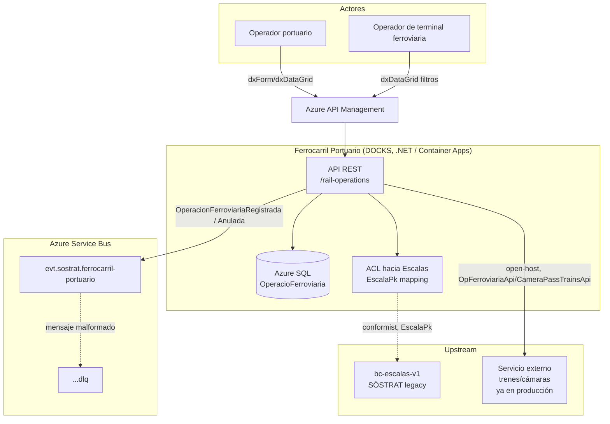

# [IA-GEN] Dossier — Ferrocarril Portuario

> **Borrador generado por IA** (APB AI Framework — síntesis de apb-disc-spec-gen-v1.0/apb-pm-product-analysis-v1.0/apb-arch-c4-model-v1.0/apb-arch-decompose-v1.0) — pendiente validación humana. No distribuir sin revisión.

## 1. Cabecera

- **Nombre**: Ferrocarril Portuario
- **Dominio DDD**: `dom-ferrocarril-v1` (dominio de negocio propio, ya `proposed` en `apb-domain-catalog` — confirmado independientemente por dos análisis distintos: bottom-up por código y top-down por negocio; ver §7)
- **Fase del roadmap**: 1 (quick win — bajo acoplamiento, bajo riesgo)
- **Estado**: `discovered`, candidato recomendado a primera extracción formal del roadmap
- **Bounded context de origen**: `proposals/bc-ferrocarril-portuario-v1.md`
- **Documentos base**: `specs/openapi-ferrocarril-portuario.yaml`, `specs/asyncapi-fase0-1.yaml`, `jira-backlog.md` EPIC-01, `ui-screens-backlog.md` §Fase 1, `testing-strategy-fase0-1.md`, `threat-model-fase0-1.md`, `decomposition-roadmap.md` §Fase 1, `discovery-summary.md`

## 2. Resumen ejecutivo

Ferrocarril Portuario gestiona el tráfico ferroviario dentro del recinto portuario: operaciones de entrada/salida/maniobra/intervención de trenes, su relación con la escala del buque, y el control físico de vías, incidencias e instalaciones de seguridad ferroviaria. Es el **candidato de menor riesgo de todo el roadmap de descomposición de SÒSTRAT**: su god class de control (`EscalasFerroviariasAction.java`, 3.530 líneas) **no contiene ninguna referencia a lógica de Liquidación/Facturación** (0 ocurrencias, verificado por grep — a diferencia de la god class de Escalas, que tiene 81 referencias cruzadas), y parte de su funcionalidad **ya está delegada a un servicio externo en producción** vía dos clientes Swagger reales (`OpFerroviariaApi.java`, `CameraPassTrainsApi.java`), evidencia de que la extracción ya está en marcha orgánicamente antes de este análisis.

La verificación contra código real confirma la mayoría de la evidencia citada en la propuesta original, con dos correcciones: (1) el número real de interfaces de servicio bajo `service/ferrocarril/` es **39, no 34** como afirmaba `bc-ferrocarril-portuario-v1.md` (recuento exacto por fichero, ver §4); y (2) el alcance real de rutas Struts del paquete `mvc/control/ferrocarril/` es de **41 acciones**, muy por encima de las 4 operaciones CRUD que cubre el contrato OpenAPI actual — el contrato existente es deliberadamente un subconjunto ("published language"), no el 100% del dominio (ver §4).

## 3. Análisis funcional

### Responsabilidad
Gestión del tráfico ferroviario portuario: registro y ciclo de vida de operaciones ferroviarias (entrada, salida, maniobra, intervención), gestión de vías y su ocupación, incidencias ferroviarias, instalaciones de seguridad, mercancía transportada por tren, y su vínculo con la escala del buque vía referencia cruzada.

### Actores/roles
- **Operador portuario** — registra y anula operaciones ferroviarias.
- **Operador de terminal ferroviaria** — consulta operaciones por escala para planificar maniobras.
- **Sistema de Escalas** — origen del identificador de escala (`EscalaPk`) que Ferrocarril consume como referencia, sin acoplarse a su modelo interno.
- **Servicio externo de trenes/cámaras** — ya en producción, consumido por SÒSTRAT vía `OpFerroviariaApi`/`CameraPassTrainsApi` (ver §4).

### Casos de uso (grounded en Actions Struts reales)
El paquete `mvc/control/ferrocarril/` (`sostrat/src/org/apb/sostrat/mvc/control/ferrocarril/`) contiene **41 action-mappings reales** confirmados en `sostrat/WebContent/WEB-INF/struts-config.xml`, entre ellos:

| Ruta Struts | Clase Action | Caso de uso |
|---|---|---|
| `/escalasFerroviarias` | `EscalasFerroviariasAction` | Pantalla principal de gestión de operación ferroviaria ligada a una escala (god class, 3.530 líneas) |
| `/escalasFerroviariasAudit` | `EscalasFerroviariasAuditAction` | Auditoría de cambios sobre operaciones ferroviarias |
| `/operacioFerroviaria` | `OperacioFerroviariaAction` | ABM de operación ferroviaria (`seqoperacio`) |
| `/ocupacionsVia` / `/ocupacionsViaEmergente` | `OcupacionsViaAction` / `OcupacionsViaEmergenteAction` | Gestión de ocupación de vías |
| `/incidenciaFerroviaria` / `/incidenciaFerroviariaElement` / `/incidenciaFerroviariaEmergente` | `IncidenciaFerroviaria*Action` | Gestión de incidencias ferroviarias por categoría/elemento |
| `/segmentoFerroviario` | `XarxaFerroviariaSegmentViaAction` | Gestión de segmentos de vía de la red ferroviaria |
| `/instalacionSeguridad` / `/instalacionSeguridadRef` | `XarxaFerroviariaInstalacio*Action` | Instalaciones de seguridad ferroviaria |
| `/mercaderiaFerr` / `/mercaderiaFerrEmergente` | `MercaderiaFerrAction` / `MercaderiaFerrEmergenteAction` | Mercancía transportada por tren |
| `/terminalsFerroviaries`, `/terminalsVies`, `/terminalsOperadores` | `Terminals*Action` | Maestros de terminales, vías y operadores ferroviarios |
| `/siguientePaso` | `SiguientePasoAction` | Cálculo del siguiente paso de maniobra |
| `/presentacionGrafica` | `PresentacionGraficaAction` | Presentación gráfica de la red ferroviaria |
| `/public/sferroviaris` | `ConsultaServeiFerroviarisAction` | Consulta pública de servicios ferroviarios |

Dentro de `EscalasFerroviariasAction.java`, los métodos de negocio reales confirmados por firma incluyen `generarPantallaEscalaFerroviaria`, `anularEscalaFerroviaria`, `generarPantallaOperadoresCarga`, `generarPantallaPasoTren`, `generarPantallaPasoTrenContenedor`, `actualizarOpCarga`, `actualizarDistancias`, `traladarEscalaCTC`, `seleccionPuntoCTC` (líneas 198–3518 de un fichero de 3.530 líneas).

### Reglas de negocio
- `idtipoperacio` solo transiciona entre **4 valores reales**, confirmados por 12+ usos de las constantes `Constantes.OPERACIONES_FERROVIARIAS_TIPO_OPERACION_ENTRADA/SALIDA/MANIOBRA/INTERVENCION` en `EscalasFerroviariasAction.java` (la clase `Constantes` que las declara vive fuera de este checkout parcial del repositorio — su import `org.apb.sostrat.constantes.Constantes` no resuelve a un fichero local — pero el **uso** de las 4 constantes en el código de control sí está confirmado línea a línea).
- Una operación ya en estado terminal (anulada/finalizada) no debe permitir una nueva cancelación silenciosa — validación de negocio reflejada en el diseño del `POST /rail-operations/{seqoperacio}/cancel` (409 si ya es terminal).
- `OperacioFerroviaria` referencia la escala del buque únicamente por los campos `portescalatren`/`anyescalatren`/`numescalatren` (columnas reales de `OP_FERROVIARIA`), no por una relación de clave foránea explícita a `ESCALA` — patrón de acoplamiento débil ya presente en el legacy.

### Qué NO incluye
No gestiona los datos generales de la escala del buque — solo referencia su identificador. No incluye lógica de facturación/liquidación (confirmado: 0 referencias a `Liquidacion`/`Facturacio` en `EscalasFerroviariasAction.java`, verificado por búsqueda exhaustiva — contraste explícito con Escalas, cuya god class sí tiene 81 referencias cruzadas). No incluye el maestro de buques (`Vaixell`, `bc-buques-v1`) — ver §7 para la confirmación de no solapamiento.

## 4. Alcance de migración — qué se migra y qué NO

**Se migra** (evidencia de código real):
- Tabla `OP_FERROVIARIA` (aggregate `OperacioFerroviaria`, PK `seqoperacio`) y sus ~58 columnas reales (ver §5).
- Las **41 rutas Struts** del paquete `mvc/control/ferrocarril/` confirmadas en `struts-config.xml` (líneas 362–398, 465, 1361–1366), no solo las 4 operaciones que cubre hoy el contrato OpenAPI publicado — **este es un hallazgo de esta verificación**: el OpenAPI actual (`specs/openapi-ferrocarril-portuario.yaml`) declara explícitamente ser un subconjunto ("el resto — auditoría interna, campos de validación de márgenes de tiempo — queda en el modelo de persistencia, no en la API pública"), pero el volumen real de superficie funcional a migrar (vías, incidencias, instalaciones de seguridad, terminales, mercancía) es sustancialmente mayor que `rail-operations` CRUD.
- La god class `EscalasFerroviariasAction.java` (3.530 líneas, confirmado por conteo real) — a retirar tras extracción, sin necesidad de separar lógica de facturación primero (a diferencia de Escalas), porque no la contiene.
- Las **39 interfaces de servicio** `CN_*` bajo `service/ferrocarril/` (recuento exacto por fichero — **corrige la cifra de 34 citada en `bc-ferrocarril-portuario-v1.md`**), con sus correspondientes 39 implementaciones en `service/ferrocarril/impl/`.

**Se re-cablea, no se retira**: los clientes Swagger `OpFerroviariaApi.java` y `CameraPassTrainsApi.java` (`sostrat/src/org/apb/sostrat/swagger/fer/client/api/`), que ya consumen un servicio externo de trenes/cámaras en producción (endpoints reales confirmados: `GET /api/v1/OpFerroviaria/ActualizarIniFinManiobras`, `GET /api/v1/OpFerroviaria/RecuperarContenedores`, `POST /api/v1/CameraPassTrains`). Estos clientes deben apuntar al nuevo servicio DOCKS en vez de invocarse desde el monolito.

**No se ha encontrado código muerto confirmado en este ámbito**: `dead-code-register.md` no contiene ninguna entrada para el paquete `ferrocarril` (búsqueda explícita, sin resultados) — a diferencia de Escalas, que sí tiene dos bloques comentados confirmados como obsoletos por el propio desarrollador. **No hay nada que excluir de la migración por estar confirmado como no-uso**; cualquier reducción de alcance frente a las 41 rutas debe decidirse por criterio funcional (negocio), no por evidencia de código muerto.

## 5. Modelo de datos

### Aggregate: `OperacioFerroviaria`
- **Fuente**: `sostrat/src/org/apb/sostrat/dataaccess/dto/ferrocarril/OperacioFerroviaria.java`
- **Tabla Oracle**: `OP_FERROVIARIA` (confirmado por comentarios Javadoc reales en el propio fichero: *"This attribute maps to the column X in the OP_FERROVIARIA table"*, presentes en 16 de los campos)
- **PK**: `seqoperacio` (`Long`) — clave simple de un solo campo, confirmado por `OperacioFerroviariaPk.java` (constructor de un único parámetro `seqoperacio`)
- **Campos reales** (extraídos del constructor completo de la clase, ~58 en total, de los cuales los siguientes son de negocio — el resto son de auditoría/técnicos):

| Campo | Tipo Java | Columna Oracle | Mapeo Azure SQL propuesto |
|---|---|---|---|
| `seqoperacio` | `Long` | `SEQOPERACIO` (PK) | `bigint` PK |
| `datoperacio` | `Date` | `DATOPERACIO` | `datetime2` |
| `durada` | `Integer` | (implícita) | `int` |
| `datsolicitud` | `Date` | (implícita) | `datetime2` |
| `lontren` | `Integer` | (implícita) | `int` |
| `taratren` | `Integer` | (implícita) | `int` |
| `idtipoperacio` | `String` | (implícita) | `varchar` + check constraint (ENTRADA/SALIDA/MANIOBRA/INTERVENCION) |
| `idopeferroviari` | `String` | (implícita) | `varchar` |
| `idopeferroviaris` | `String` | (implícita) | `varchar` |
| `idopelogistic` | `String` | (implícita) | `varchar` |
| `idopeterminal` | `String` | (implícita) | `varchar` |
| `observacions` | `String` | (implícita) | `nvarchar(max)` |
| `carrega` / `descarrega` | `String` | (implícita) | `char(1)` (flag S/N) |
| `facturable` | `String` | (implícita) | `char(1)` |
| `error` | `String` | (implícita) | `varchar` |
| `idopealta` / `idopemodificacio` | `String` | (implícita) | `varchar` (auditoría) |
| `datalta` / `datmodificacio` | `Date` | (implícita) | `datetime2` (auditoría) |
| `idprocalta` / `idprocmodificacio` | `String` | (implícita) | `varchar` (auditoría) |
| `guid` | `String` | (implícita) | `uniqueidentifier` |
| `idopeinfraestructura` | `String` | (implícita) | `varchar` |
| `portescalatren` | `String` | (implícita) | `varchar` — referencia a `EscalaPk.idsubport`, ver nota de mapeo abajo |
| `anyescalatren` | `Integer` | (implícita) | `int` — referencia a `EscalaPk.anyescala` |
| `numescalatren` | `Integer` | (implícita) | `int` — referencia a `EscalaPk.numescala` |
| `codintern` | `Integer` | (implícita) | `int` |
| `tipescalatren` | `String` | `TIPESCALATREN` | `varchar` |
| `datdispuesto` | `Date` | `DATDISPUESTO` | `datetime2` |
| `datasolsolicitud` | `Date` | `DATASOLSOLICITUD` | `datetime2` |
| `datinientrada` / `datrealentrada` | `Date` | `DATINIENTRADA` / `DATREALENTRADA` | `datetime2` |
| `datpredispuesto` | `Date` | `DATPREDISPUESTO` | `datetime2` |
| `piedetren` | `byte[]` | `PIEDETREN` | `varbinary(max)` |
| `observacionsferr` / `observacionsterdest` / `observacionsterorig` | `String` | `OBSERVACIONSFERR` / `OBERVACIONSTERDEST` | `nvarchar(max)` |
| `confirma` / `valida` | `String` | `CONFIRMA` / `VALIDA` | `char(1)` |
| `datsolicituddes` / `datpiedetren` | `Date` | (implícita) | `datetime2` |
| `idanchovia` | `String` | (implícita, default `Constantes.ANCHO_UNIDAD_IBERICO`) | `varchar` |
| `distanciatotal` / `distanciazs` | `Float` | `DISTANCIATOTAL` / `DISTANCIAZS` | `float` |
| `nompietren` | `String` | `NOMPIETREN` | `varchar` |
| `contenidorscarrega` / `contenidorsdescarrega` | `Long` | (implícita, FER-325) | `bigint` |
| `longitudtren` / `pestotaltren` | `Float` | (implícita, FER-433) | `float` |
| `mmpp` | `String` | (implícita, FER-433) | `varchar` |
| `idretraso` | `Integer` | (implícita, FER-443) | `int` |
| `datentport` / `datsalterm` / `datsalport` | `Date` | (implícita, FER-447) | `datetime2` |
| `listaOperacioFerroviariaVia` | `List<OperacioFerroviariaVia>` | relación (tabla separada) | tabla hija |
| `listaOperacioFerroviariaOrigenDesti` | `List<OperacioFerroviariaOrigenDesti>` | relación (tabla separada) | tabla hija |

**Nota**: solo 16 de los ~56 campos escalares tienen el comentario Javadoc explícito de mapeo a columna citando `OP_FERROVIARIA`; el resto se infiere por convención de nombre (mismo patrón del resto de DTOs del monolito, sin anotación JPA/Hibernate explícita en este framework de acceso a datos propietario). Marcado explícitamente como "(implícita)" donde no hay comentario textual de columna.

### Otras entidades del dominio (confirmadas en el paquete, no cubiertas por el OpenAPI actual)
El paquete `dataaccess/dto/ferrocarril/` contiene **85 clases DTO/PK reales** (recuento por fichero), entre ellas `Via`/`XarxaFerroviariaSegmentVia` (entidad "Vía" citada en la propuesta), `SiguientePasoManiobra`/`SiguientePasoSalida` (entidad "Maniobra"), `IncidenciaFerroviaria`, `XarxaFerroviariaInstalacio`, `MercaderiaFerr`, `TerminalesVias`, `EscalaTren`, `OpFerroviariaAudit`. Estas entidades sustentan las 41 rutas Struts de §4 pero no tienen todavía contrato OpenAPI formal — gap explícito, ver §14.

### Mapeo con `EscalaPk` — estado de la verificación
`EscalaPk.java` (`sostrat/src/org/apb/sostrat/dataaccess/dto/escalas/EscalaPk.java`) confirma que la PK real de `Escala` es `idsubport` (`String`) + `anyescala` (`Integer`) + `numescala` (`Integer`). `OperacioFerroviaria` referencia la escala vía `portescalatren` (`String`) + `anyescalatren` (`Integer`) + `numescalatren` (`Integer`) — **mismos tipos, nombres distintos, sin relación de clave foránea explícita en el código**, tal como ya señalaba la propuesta original.

**Evidencia adicional aportada por esta verificación** (no estaba en el análisis original): el cliente Swagger externo `OpFerroviariaApi.java`, que ya consume estos datos en producción desde SÒSTRAT, invoca su API real (`GET /api/v1/OpFerroviaria/ActualizarIniFinManiobras`) con parámetros literalmente llamados `anyescala`/`numescala` — es decir, **el servicio externo que ya está en marcha usa la nomenclatura de `EscalaPk`, no la de `OperacioFerroviaria`**. Esto refuerza la hipótesis semántica (mismo concepto de negocio) pero **sigue sin confirmar el mapeo 1:1 de `portescalatren` ↔ `idsubport` por nombre** — el servicio externo no expone `idsubport`/`portescalatren` en la firma de ese método concreto (solo pasa `anyescala`/`numescala`, sin el componente de subpuerto). **Sigue pendiente de confirmación explícita con el equipo funcional/ARGOS antes de fijar el contrato ACL definitivo.**

## 6. Arquitectura técnica

Stack DOCKS estándar: **.NET** sobre **Azure Container Apps**, **Azure SQL** propio del servicio, publicación vía **Azure API Management**, eventos vía **Azure Service Bus**. Patrón arquitectónico: microservicio transaccional con Anti-Corruption Layer (ACL) hacia Escalas (patrón *conformist*, ver §7) y Open Host Service consumido desde el servicio externo de trenes/cámaras ya en producción.

## 7. Dominio DDD

- **Bounded context**: `bc-ferrocarril-portuario-v1`.
- **Dominio padre real**: `dom-ferrocarril-v1`, confirmado en `apb-domain-catalog` como dominio de negocio de **primer nivel, independiente** — no anidado bajo Escalas/Operaciones Marítimas. `catalog-comparison.md` documenta que **dos análisis independientes llegaron a la misma conclusión por caminos distintos**: el análisis bottom-up (este, por evidencia de código — cliente Swagger externo ya en marcha) y el análisis top-down de negocio (por "decisión de frontera" de negocio) — convergencia que refuerza la confianza en el límite del bounded context.
- **Agregados**: `OperacioFerroviaria` (raíz de agregado).
- **Entidades**: `Via` (`XarxaFerroviariaSegmentVia` y relacionadas), `Maniobra` (`SiguientePasoManiobra`/`SiguientePasoSalida`).
- **Relaciones**:
  - **Upstream**: `bc-escalas-v1` (patrón *conformist* — Ferrocarril traduce el identificador de escala, no impone su modelo hacia arriba).
  - **Upstream (open-host-service)**: servicio externo de trenes/cámaras, ya en producción vía `OpFerroviariaApi`/`CameraPassTrainsApi`.
  - **Downstream**: ninguno confirmado en el análisis de código.
- **Confirmación de no solapamiento con `bc-buques-v1`**: `bc-buques-v1` (maestro de buques — `Vaixell`, ficha técnica, calado, ISPS, certificados Lloyds; tabla implícita, dominio padre `dom-operaciones-maritimas-v1`) es un maestro de referencia del **buque físico**, verificado sin ningún campo ni referencia cruzada a `OperacioFerroviaria`, `service/ferrocarril/` ni `EscalaPk` en su propuesta (`bc-buques-v1.md`, búsqueda de "ferrocarril" sin resultados). Ferrocarril no consume el maestro de buques directamente — solo referencia la escala (`EscalaPk`), que a su vez podría referenciar el buque. **No hay solapamiento de datos entre ambos bounded contexts.**

## 8. Pantallas UI

Fuente: `ui-screens-backlog.md` §Fase 1, App "Ferrocarril Portuario". Stack: **DevExtreme JavaScript puro**, WCAG 2.1 AA mínimo.

1. **Listado de Operaciones Ferroviarias** (`dxDataGrid`) — columnas: `seqoperacio`, `datoperacio`, `idtipoperacio`, `portescalatren/anyescalatren/numescalatren`, `facturable`. Filtro por escala y por tipo de operación.
2. **Alta de Operación Ferroviaria** (`dxForm`) — campos: `idtipoperacio` (`dxSelectBox`: Entrada/Salida/Maniobra/Intervención), `lontren`, `taratren`, `idopeferroviari`, `carrega`/`descarrega` (`dxCheckBox`), `observacions`.
3. **Acción "Anular operación"** — `dxButton` + `dxConfirm` sobre la fila del listado; deshabilitado si `idtipoperacio` ya está en estado terminal.

**Nota de alcance**: estas 3 pantallas cubren únicamente las 4 operaciones del OpenAPI actual (`rail-operations`), no las 41 rutas Struts identificadas en §4 (vías, incidencias, instalaciones de seguridad, terminales, mercancía). Si el alcance de migración se amplía más allá del CRUD de operaciones, este inventario de pantallas necesitará una revisión — gap explícito, ver §14.

## 9. APIs

Fuente: `specs/openapi-ferrocarril-portuario.yaml` (`APB Ferrocarril Portuario API`, v1.0.0), publicado vía APIM, auth EntraID OAuth2 client credentials (scopes `ferrocarril.read`/`ferrocarril.write`).

| Método | Ruta | Descripción |
|---|---|---|
| `GET` | `/rail-operations` | Listar operaciones ferroviarias (filtros: `idsubport`, `anyescala`, `numescala`, `idtipoperacio`; paginación cursor-based) |
| `POST` | `/rail-operations` | Registrar una operación ferroviaria |
| `GET` | `/rail-operations/{seqoperacio}` | Consultar una operación ferroviaria |
| `POST` | `/rail-operations/{seqoperacio}/cancel` | Anular una operación ferroviaria (409 si ya está en estado terminal) |

**Nota de alcance**: la propia especificación declara explícitamente cubrir solo "el subconjunto de negocio relevante para consumidores externos" del DTO real de ~58 campos — ver §4 para el hallazgo de que la superficie funcional real (41 rutas Struts) es mayor que este contrato.

## 10. Eventos

Fuente: `specs/asyncapi-fase0-1.yaml`, canal `evt.sostrat.ferrocarril-portuario` (Azure Service Bus, envelope CloudEvents 1.0, DLQ `evt.sostrat.ferrocarril-portuario.dlq`).

| Evento | Trigger | Consumidores |
|---|---|---|
| `OperacionFerroviariaRegistrada` | Alta de una operación ferroviaria (`idtipoperacio` ENTRADA/SALIDA/MANIOBRA/INTERVENCION) | No confirmados explícitamente en el análisis — pendiente de identificar consumidores reales del canal |
| `OperacionFerroviariaAnulada` | Anulación de una operación que no esté ya en estado terminal | Idem |

**Regla de error confirmada en la spec**: si `portescalatren`/`anyescalatren`/`numescalatren` no resuelve a una escala real en el consumidor, el mensaje va a DLQ — requiere confirmar el mapeo exacto hacia `EscalaPk` (ver §5) antes de production-ready.

## 11. Diagrama topológico (C4 nivel 1-2)

## 12. Estrategia de convivencia con el modelo actual

- **ACL con Escalas**: traducir `EscalaPk` legacy (`idsubport+anyescala+numescala`) al identificador de escala del nuevo modelo objetivo — mapeo semántico confirmado, mapeo 1:1 de nombre **no confirmado** (ver §5). Bloqueante de diseño antes de fijar el contrato ACL definitivo.
- **CDC**: réplica de lectura Oracle → Azure SQL para `OP_FERROVIARIA` durante la transición, manteniendo Oracle como fuente de verdad hasta el cutover — mismo patrón que el resto de servicios de Fase 0-1 (`decomposition-roadmap.md` §4).
- **Cutover**: retirar progresivamente las 41 rutas Struts `/ferrocarril*`/`/escalasFerroviarias*`/etc. del monolito tras validar paridad funcional — no solo las 4 operaciones cubiertas hoy por el OpenAPI.
- **Re-cableado del cliente externo**: migrar `OpFerroviariaApi`/`CameraPassTrainsApi` para que apunten al nuevo servicio DOCKS en vez de invocarse desde el monolito — tarea técnica ya identificada en `jira-backlog.md` EPIC-01.
- **Escalas/ARGOS**: si la Fase 5 (migración de Escalas hacia ARGOS) se ejecuta antes de completar esta extracción, el ACL de Ferrocarril debe apuntar a ARGOS/`APB.API.TES` como destino final del identificador de escala, no a un hipotético servicio "Escalas" nuevo (`decomposition-roadmap.md` §Fase 5, punto 3).

## 13. Testing y seguridad

Fuente: `testing-strategy-fase0-1.md` §Ferrocarril Portuario y `threat-model-fase0-1.md` (ambos cubren los 4 servicios de Fase 0-1 conjuntamente).

**Testing** (pirámide Unit 60% / Contract 20% / Integration 15% / E2E 5%):
- Unit: transición de `idtipoperacio` solo entre los 4 valores reales; `POST /rail-operations/{id}/cancel` sobre estado terminal debe devolver 409, no aplicar silenciosamente; validación de `lontren`/`taratren` como no negativos (**hipótesis no confirmada en código, marcada explícitamente como tal en la estrategia**).
- Contract: validar cada evento publicado contra `x-data-schema` de `asyncapi-fase0-1.yaml`; linter OpenAPI (Spectral) en CI.
- Integration: **caso específico de mayor riesgo de los 4 servicios de Fase 0-1** — verificar comportamiento cuando `portescalatren`/`anyescalatren`/`numescalatren` no resuelve a una escala real (mapeo no confirmado 1:1, ver §5).
- E2E: registrar operación de entrada → consultarla → anularla → verificar consistencia API/evento.

**Seguridad** (STRIDE, controles relevantes para Ferrocarril):
- Elevation of Privilege (#8): scope `*.write` genérico no distingue `POST /rail-operations/{id}/cancel` (operación destructiva) de un alta normal — evaluar scope propio más restrictivo para cancelación.
- Repudiation (#4): mantener los campos de auditoría reales (`idopealta`, `idopemodificacio`, `datalta`, `datmodificacio`) en el modelo de datos destino.
- Tampering (#3): principio de mínimo privilegio en Azure SQL — ningún otro servicio debe tener acceso de escritura directa a la base de Ferrocarril (mismo anti-patrón que el legacy a evitar).
- Denial of Service (#7): sin rate limiting definido explícitamente en el OpenAPI actual — pendiente antes de producción.

## 14. Riesgos y gaps de evidencia conocidos

- **Mapeo `portescalatren+anyescalatren+numescalatren` ↔ `EscalaPk` no confirmado 1:1 por nombre.** Esta verificación aporta evidencia adicional (el cliente externo ya en producción usa la nomenclatura `anyescala`/`numescala` de `EscalaPk`, no la de `OperacioFerroviaria`) que refuerza la hipótesis semántica, pero no cierra el mapeo de campo a campo — sigue siendo el mayor riesgo de integración de este bounded context, tal como ya señalaban `jira-backlog.md` EPIC-01 y `testing-strategy-fase0-1.md`.
- **Discrepancia de recuento corregida por esta verificación**: `bc-ferrocarril-portuario-v1.md` afirmaba 34 interfaces de servicio; el recuento real por fichero es **39**. No afecta a la viabilidad de la extracción, pero corrige la cifra citada.
- **Alcance funcional real mayor que el contrato publicado**: 41 rutas Struts confirmadas en `struts-config.xml` frente a las 4 operaciones cubiertas por `openapi-ferrocarril-portuario.yaml`. Antes de dar por cerrado el diseño de API, decidir con negocio si vías/incidencias/instalaciones de seguridad/terminales/mercancía entran en el alcance de esta primera extracción o se dejan para una segunda iteración del mismo servicio.
- **Sin evidencia de consumidores reales de los eventos `OperacionFerroviariaRegistrada`/`OperacionFerroviariaAnulada`** — el AsyncAPI define el canal pero no identifica quién los consume aguas abajo.
- **La clase `Constantes` que declara los 4 valores de `idtipoperacio` no está presente en este checkout parcial del repositorio** (su import no resuelve a un fichero local) — el uso de las constantes sí está confirmado exhaustivamente en el código de control, pero no se ha podido leer la declaración de los valores literales de cadena que representan.
- **No se ha auditado el impacto en `sostrat-BATCH`** de la retirada de este módulo (mismo gap general documentado en `coverage-audit.md` §4 para todo el roadmap).

## 15. Estimación de esfuerzo

Fuente: `jira-backlog.md` EPIC-01 — Extracción Ferrocarril Portuario. Fase 1 (quick win) | Valor de negocio: medio | Riesgo técnico: bajo | Dependencias: EPIC-00.

**Historias de usuario** (21 story points en total):
1. Registrar operación ferroviaria (`POST /rail-operations`) — 8 pts.
2. Anular operación ferroviaria (`POST /rail-operations/{id}/cancel`), con validación de transición de estado — 3 pts.
3. ACL de consumo del identificador de escala sin acoplar el modelo interno — 5 pts.
4. Consultar operaciones de una escala concreta (`GET /rail-operations?portescalatren=...`) — 5 pts.

**Tareas técnicas** (no puntuadas explícitamente en el backlog):
- Migrar el cliente `OpFerroviariaApi`/`CameraPassTrainsApi` para que apunte al nuevo servicio DOCKS.
- Confirmar el mapeo exacto de nombres de campo entre `portescalatren/anyescalatren/numescalatren` e `idsubport/anyescala/numescala`.
- Retirar progresivamente las rutas Struts `/ferrocarril*` del monolito tras validar paridad funcional.

**Criterios de éxito**: `/api/v1/rail-operations` en producción con los campos reales de `OperacioFerroviaria.java`; ACL con Escalas validado; god class `EscalasFerroviariasAction.java` retirada; time-to-deploy < 15 min.

**Nota de esta verificación**: los 21 pts cubren únicamente las 4 historias de usuario centradas en `rail-operations`. Si el alcance se amplía a las 41 rutas Struts identificadas en §4 (vías, incidencias, instalaciones de seguridad, terminales), la estimación debe revisarse — no está incluida en el recuento actual del backlog.

## 16. Checklist de validación

**Funcional**:
- [ ] Confirmar si el alcance de esta primera extracción se limita a `rail-operations` (21 pts, backlog actual) o debe ampliarse a vías/incidencias/instalaciones de seguridad/terminales/mercancía (41 rutas Struts reales).
- [ ] Confirmar con negocio el dominio de valores real de `idtipoperacio` más allá de los 4 usados en código (¿hay estados adicionales no ejercitados en las rutas analizadas?).
- [ ] Validar que `facturable` (campo real de `OperacioFerroviaria`) no implica lógica de facturación oculta pese a la ausencia de referencias a `Liquidacion`/`Facturacio` en el código de control.

**Desarrollo**:
- [ ] Confirmar el mapeo exacto de campos `portescalatren/anyescalatren/numescalatren` ↔ `idsubport/anyescala/numescala` con el equipo de Escalas/ARGOS antes de fijar el contrato ACL definitivo.
- [ ] Sesión técnica con el propietario del servicio externo de trenes/cámaras para confirmar el contrato real de `OpFerroviariaApi`/`CameraPassTrainsApi` más allá de los 3 métodos inspeccionados en esta verificación.
- [ ] Localizar o reconstruir la clase `Constantes` (valores literales de `idtipoperacio`) ausente en este checkout parcial.
- [ ] Revisar si las 41 rutas Struts justifican dividir la extracción en sub-iteraciones (core de operaciones vs. red/infraestructura ferroviaria) antes de comprometer el sprint planning.

## 17. Historial de cambios

| Versión | Fecha | Autor | Cambio |
|---------|-------|-------|--------|
| 1.0.0 | 2026-07-13 | APB AI Framework | Dossier inicial, síntesis de la documentación de sesión + verificación exhaustiva contra código real de `SOSTRAT-Sostrat-MJ8`. Correcciones aportadas: recuento de interfaces de servicio (39, no 34), alcance real de rutas Struts (41, no 4), confirmación de 0 referencias a Liquidación/Facturación en la god class de control, evidencia adicional (no concluyente) sobre el mapeo de campos hacia `EscalaPk` vía el cliente Swagger externo ya en producción. |
