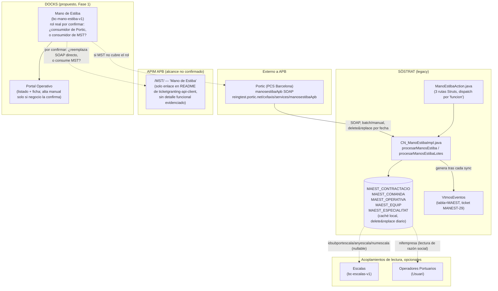

# [IA-GEN] Dossier — Mano de Estiba

> **Borrador generado por IA** (APB AI Framework — síntesis de apb-disc-spec-gen-v1.0/apb-pm-product-analysis-v1.0/apb-arch-c4-model-v1.0/apb-arch-decompose-v1.0) — pendiente validación humana. No distribuir sin revisión.
>
> **Estado de este documento**: esta verificación adicional contra el código real (`CN_ManoEstibaImpl.java`, `ManoEstibaAction.java`, `aplicacion.properties`) encuentra una **discrepancia de fondo con `bc-mano-estiba-v1.md`, `decomposition-roadmap.md` y `jira-backlog.md` EPIC-02**: el patrón real no es "un módulo con escritura propia que ya está siendo sustituido por un microservicio externo llamado MST", sino "una caché de lectura local que se sincroniza por batch desde un web service SOAP de un operador externo (**Portic**), sin pantalla de alta manual evidenciada". Ver §2 y §14.

## 1. Cabecera

- **Nombre**: Mano de Estiba (gestión de personal de estiba portuaria — estibadores)
- **Dominio DDD**: `dom-mano-estiba-v1` (dominio de negocio propio, nuevo — ver `proposals/dom-mano-estiba-v1.md`)
- **Fase del roadmap**: 1 (quick win, según `decomposition-roadmap.md` §3 Fase 1)
- **Estado**: PROVISIONAL — corrige el alcance funcional asumido por el resto de la serie de artefactos de esta app (ver nota superior); el bounded context y el dominio propio en sí (`bc-mano-estiba-v1`, `dom-mano-estiba-v1`) se mantienen válidos
- **Bounded context de origen**: `proposals/bc-mano-estiba-v1.md` / `proposals/dom-mano-estiba-v1.md`
- **Épica**: `jira-backlog.md` EPIC-02 — "Extracción Mano de Estiba" (requiere re-alcance, ver §15)

## 2. Resumen ejecutivo

SÒSTRAT gestiona hoy la contratación (`Contractació`), las comandas (`Comanda`), las operativas (`Operativa`), los equipos (`Equip`) y las especialidades (`Especialitat`) del personal de estiba portuaria, en cinco tablas relacionadas en cascada (`MAEST_CONTRACTACIO` → `MAEST_COMANDA` → `MAEST_OPERATIVA` → `MAEST_EQUIP` → `MAEST_ESPECIALITAT`).

**Hallazgo crítico de esta verificación**: leyendo `CN_ManoEstibaImpl.java` se confirma que SÒSTRAT **no es la fuente de verdad de esta contratación**. El método `obtenerRespuesta()` invoca un cliente SOAP (`net.portic.www.manosestiba.apb.ManosestibaApbProxy`) contra un servicio externo cuya URL está en `sostrat/WebContent/WEB-INF/classes/aplicacion.properties` línea 439: `urlManoEstiba=http://reingtest.portic.net/cxfaxis/services/manosestibaApb`. El dominio `portic.net` y el mensaje de error `"Contactar con Portic para que modifiquen el registro"` (`erroresMessages.properties` línea 5755) confirman que se trata de **Portic**, el operador del sistema comunitario portuario (PCS) de Barcelona — un tercero externo a APB, no un microservicio DOCKS en construcción.

El proceso batch (`procesarManosEstiba`/`procesarManosEstibaLotes`, disparable manualmente desde una pantalla con barra de progreso o reintentado automáticamente para días anteriores sin resolver) **borra todo el dato local de una fecha y lo reinserta desde la respuesta de Portic** (`eliminarTodoPorFecha` + `procesoInsertarMaestContratacio`) — un patrón "delete & replace" diario, no un alta transaccional por el usuario. **No se ha encontrado en `ManoEstibaAction.java` ningún método que dé de alta una contratación o comanda a partir de un formulario rellenado por un usuario de negocio** — los únicos métodos de escritura (`insertMaestContratacio`, `insertMaestComanda`, etc.) son invocados internamente por el propio proceso de sincronización.

Esto contradice el marco asumido por `jira-backlog.md` EPIC-02 (*"como gestor de estiba, quiero registrar una contratación de personal... para dejar de usar `ManoEstibaAction.java`"*) y por `openapi-mano-estiba.yaml` (`POST /stevedore-contracts` como alta manual): el legacy no tiene ese formulario, así que no hay nada equivalente que "dejar de usar" en ese sentido — lo que hay que decidir es cómo se sustituye la integración con Portic, no cómo se digitaliza un alta manual que nunca existió.

Además, la referencia a un "microservicio externo MST" en `ticketgranting-api-client/README.md` (citada como evidencia de extracción ya en marcha en `bc-mano-estiba-v1.md`, `discovery-summary.md` y `decomposition-roadmap.md`) resulta, al inspeccionar el fichero, ser **solo una entrada de enlace dentro de una lista HTML de módulos publicados en el API gateway de APB** (`.../MST/` junto a otros ~30 códigos como `ESF`, `ESM`, `USR`, `GRP`, `ADT`...), sin ningún detalle de su alcance funcional en ese repositorio. No hay evidencia en el código de que `MST` ya sustituya o envuelva la integración con Portic — puede ser un código de API reservado, un wrapper del mismo Portic, o algo no relacionado. Se corrige la afirmación de "madurez de extracción ya alcanzada" a "sin confirmar" (ver §14).

## 3. Análisis funcional

### Responsabilidad de negocio
Reflejar localmente (para consulta, no para alta) la contratación, comandas, operativas, equipos y especialidades del personal de estiba portuaria, sincronizadas desde el sistema externo de Portic, con reintento automático de días con contratación pendiente de asignar y alertas por email si la sincronización falla.

### Actores
- **Gestor de estiba / operador APB**: consulta el listado y ficha local, y puede relanzar manualmente la sincronización para un rango de fechas (`configurarEjecucionProceso`/`lanzarEjecucionProceso`).
- **Portic** (`net.portic.www.manosestiba.apb.ManosestibaApbProxy`, `urlManoEstiba` en `aplicacion.properties`): sistema externo, fuente real de la contratación de personal de estiba.
- **Administrador de sistema**: receptor de alertas por email en caso de error de parseo XML (`enviarMailParseException`) o de error devuelto por Portic (`enviarMailError`, lista de destinatarios en el parámetro `AVISO_MANO_DESTIBA`).
- **"MST"** (APIM, alcance no confirmado en este repositorio — ver §14).

### Casos de uso reales (grounded en `ManoEstibaAction.java` y `CN_ManoEstibaImpl.java`)
1. **Listado local** (`obtenerListadoLocal` → forward `lmanoestiba`) — consulta dinámica (`obtenerLista`/SQL parametrizado) sobre la vista `VTcMaestOperativa`, con variante "extendida" (`obtenerListaExtendida` sobre `VTcMaestEspecialitat`) activada por el parámetro de acción `MANOSESTIBA_ACCION_EXTENDIDA`.
2. **Ficha de detalle de una Operativa** (`generarPantallaLocal` → forward `mmanoestiba`) — resuelve en cascada Comanda → Contractació → tipos/estados traducidos (DAOs `*I`/`*Id` multi-idioma) y la razón social de la empresa a partir de `nifempresa` (`obtenerUsuari`).
3. **Configuración y lanzamiento manual de la sincronización por rango de fechas** (`configurarEjecucionProceso` → `lanzarEjecucionProceso`) — itera día a día, invoca `procesarManosEstiba` por cada fecha, y expone una **barra de progreso vía iframe con polling AJAX** (`pasoiframe` / `comprobarEstadoProceso` / `consultarBarraProgreso` / `consultarTabla`, JSON serializado con Gson) — patrón de UI distinto al estándar listado/ficha del resto de la serie.
4. **Revisión automática de días anteriores sin asignar** (`revisarManosEstibaDiasAnteriores`, ticket MANEST-33): recorre hasta `BATCH_NORMA_MANOS_ESTIBA_REVISAR_DIAS_ANTERIORES` días atrás (7 por defecto), excluye festivos y domingos (`esFechaCorrecta`, vía `CN_CalendariServeiDia`), y si `revisarManosEstibaSinAsignar` cuenta contrataciones con `idestatcontractacio <> 'AS'` para ese día, relanza `procesarManosEstiba` para esa fecha con notificación por email activada.
5. **Registro de un evento de sincronización** (`VtmosEventos`, ticket MANEST-29) tras cada ejecución batch — DTO genérico `tabla`/`accion`/`id1`-`id6`/`fechaHora`/`procesado`/`procesadoaop`, cuyo consumidor real no está identificado en este análisis (el campo `procesadoaop` sugiere un posible destino "AOP", no confirmado).
6. **Búsqueda de escala y de buque** (`buscarEscala`, `buscarBarcoNombre`, `buscarEscalaConBarco`, `buscarVTCEscalaConBarco`) — usadas internamente durante la sincronización para intentar casar cada operativa recibida de Portic con una escala real de SÒSTRAT (ver regla de negocio siguiente).

### Reglas de negocio grounded
- **Delete & replace diario**: al procesar una fecha, se borra todo el dato local de esa fecha (`eliminarTodoPorFecha`) antes de reinsertar lo recibido de Portic (`procesoInsertarMaestContratacio`) — no hay upsert incremental por registro.
- **Resolución de escala en cascada** (dentro de `procesarManosEstiba`): 1) por número de escala explícito en el año de la fecha procesada, o año-1 si no resuelve; 2) si Portic no envía número de escala, por número de escala extraído del propio nombre del buque recibido (ticket MANEST-32, regex sobre dígitos); 3) como último recurso, por coincidencia de nombre de buque + fecha (ticket MANEST-23), descartando yates (`vaitipus='23'`) si hay más de una escala candidata con el mismo nombre. Si ninguna vía resuelve, la operativa queda sin escala asociada (campos `idsubportescala`/`anyescala`/`numescala` a `null`).
- **Exclusión de festivos/domingos** en la revisión retroactiva de pendientes (`esFechaCorrecta`, vía el calendario de servicio de atraques `Constantes.CALENDARI_ATRAQUES`).
- **Estado terminal `'AS'`**: `idestatcontractacio <> 'AS'` se usa como criterio de "contratación aún pendiente" en `revisarManosEstibaSinAsignar` — el significado exacto de `'AS'` no está confirmado por nombre en el código analizado (hipótesis razonable: "Asignada").

### Qué NO incluye
- No gestiona el alta manual de una contratación o comanda por parte de un usuario de negocio de APB — la contratación real ocurre en Portic; SÒSTRAT solo la refleja y la re-sincroniza.
- No gestiona nóminas ni relación laboral del personal de estiba (sin evidencia de este alcance en el código analizado).
- No tiene lógica de facturación/liquidación acoplada (a diferencia de Escalas, ver `dossier-00-escalas-migracion-argos.md`).

## 4. Alcance de migración — qué se migra y qué NO se migra por no estar en uso

- **Dead-code-register.md**: **sin hallazgos** para `manoEstiba`/`MANEST` en `dead-code-register.md` (verificado por búsqueda explícita sobre el fichero) — no hay bloques de alta ni media confianza reportados en este ámbito.
- **Se migra** (si se confirma la necesidad de negocio): el listado y ficha de consulta local, el patrón de sincronización con reintento de pendientes, y la trazabilidad vía evento de sincronización.
- **No se migra tal cual**: la integración SOAP legacy en sí (Axis/CXF contra `reingtest.portic.net`) — en destino debe decidirse si se sustituye por REST/eventos con Portic directamente, o si el propio "MST" del catálogo APIM de APB ya cubre este rol y hace innecesaria una integración nueva con un tercero — **no confirmable con la evidencia disponible en este repositorio** (ver §14).
- **No se construye tal cual lo asume la evidencia previa**: un endpoint de alta manual de contratación/comanda (`POST /stevedore-contracts`, historia de usuario 1 de EPIC-02) — el legacy no tiene un formulario equivalente; antes de construirlo hay que confirmar con negocio si de verdad hace falta un alta manual en el sistema destino, o si el flujo correcto sigue siendo "Portic es el origen, APB solo consulta/reacciona".
- **Riesgo de reescritura innecesaria**: si "MST" ya cubre la integración con Portic, parte del esfuerzo de EPIC-02 (Fase 1) sería redundante — confirmar con el equipo propietario de MST antes de construir nada (tarea técnica ya prevista en `jira-backlog.md` EPIC-02, pero su urgencia sube de prioridad con este hallazgo).

## 5. Modelo de datos

Todas las entidades siguientes viven en el paquete Java `dataaccess.views.dto.manoEstiba` (la clase de PK vive en `dataaccess.dto.manoEstiba`) — ver nota de arquitectura al final de esta sección.

**`MaestContractacio`** (tabla `MAEST_CONTRACTACIO`, PK `idcontractacio`) — fuente: `dataaccess/views/dto/manoEstiba/MaestContractacio.java`:
`idcontractacio` (Long, PK), `datacontractacio` (Date), `idtipuscontractacio` (String, FK conceptual a `TipusContractacioMaest`), `idestatcontractacio` (String, FK conceptual a `EstatContractacioMaest`), `dataactualitzacio` (Date, nullable).

**`MaestComanda`** (tabla `MAEST_COMANDA`, PK `idcomanda`) — fuente: `MaestComanda.java`:
`idcomanda` (Long, PK), `idcontractacio` (Long, FK a `MaestContractacio`), `idcomandaportic` (Long, nullable — referencia externa a Portic), `nifempresa` (String, FK conceptual a `Usuari`), `idtipuscomanda` (String), `idestatcomanda` (String), `rojillosreenganche` (Long, nullable).

**`MaestOperativa`** (tabla `MAEST_OPERATIVA`, PK `idoperativa`) — fuente: `MaestOperativa.java`:
`idoperativa` (Long, PK), `idcomanda` (Long, FK a `MaestComanda`), `ordreoperativa` (String), `nomoperativa` (String), `dataoperativa` (Date), `idjornada` (Integer, FK conceptual a `TipusJornadaMaest`), `idsubportescala`/`anyescala`/`numescala` (String/Integer/Integer, nullable — enlace opcional a `Escala`/`EscalaPk`, ver §7), `tornsetmanal` (String), más campos de auditoría estándar: `idopealta`, `idopemodificacio`, `datalta`, `datmodificacio`, `idprocalta`, `idprocmodificacio`, `guid` (Long, control de concurrencia optimista vía `hashCodeConcurrency`).

**`MaestEquip`** (tabla `MAEST_EQUIP`, PK `idequip`) — fuente: `MaestEquip.java`:
`idequip` (Long, PK), `idoperativa` (Long, FK a `MaestOperativa`), `ordreequip` (String), `incidenciaequip` (String, nullable).

**`MaestEspecialitat`** (tabla `MAEST_ESPECIALITAT`, PK `idespecialitat`) — fuente: `MaestEspecialitat.java`:
`idespecialitat` (Long, PK), `idequip` (Long, FK a `MaestEquip`), `idcodiespecialitat` (String, FK conceptual a `TipusCodisEspecialitatMaest`), `places` (Long), `placesminimes` (Long), `placesasignades` (Long, nullable), `rojillos` (Long), `afegits` (Long), `idtipuscomanda` (String).

**`VtmosEventos`** (nombre de tabla no confirmado explícitamente en el DTO — ticket MANEST-29, `dataaccess/dto/manoEstiba/VtmosEventos.java`, PK compuesta `tabla+accion+id1+fechaHora` vía `VtmosEventosPk`): `tabla`, `accion`, `id1`...`id6` (String), `fechaHora` (Date), `procesado` (Integer), `procesadoaop` (Integer) — registro genérico de eventos de sincronización, consumidor no identificado.

**Catálogos/lookups referenciados** (no extraídos campo a campo en esta pasada, cada uno con variante multi-idioma sufijo `I`/`Id`): `TipusContractacioMaest(I)`, `EstatContractacioMaest(Id)`, `TipusComandaMaest(I)`, `EstatComandaMaest(I)`, `TipusJornadaMaest(I)`, `TipusCodisEspecialitatMaest(I)`.

**Nota de arquitectura — verificación del paquete `views.dto` vs `dto`** (tarea técnica de `jira-backlog.md` EPIC-02): se ha inspeccionado `MaestContractacioDaoImpl.java` (`dataaccess/views/jdbc/manoEstiba/`), la única implementación real del DAO. **No es una vista de solo lectura**: el método `insert()` ejecuta `INSERT INTO MAEST_CONTRACTACIO (...)`, `update()` ejecuta `UPDATE MAEST_CONTRACTACIO SET ...`, `delete()` ejecuta `DELETE FROM MAEST_CONTRACTACIO ...`, y `getTableName()` devuelve literalmente `"MAEST_CONTRACTACIO"` — CRUD completo contra una tabla base. **Se corrige la hipótesis planteada en `jira-backlog.md`**: el paquete `views.dto`/`views.dao` no indica una capa de vistas de solo lectura sobre otra tabla base; es una convención de organización/generación de código de este repositorio (probablemente ligada a la herramienta de codegen usada, no a semántica SQL). Las clases que sí son vistas reales de solo lectura en este ámbito llevan el prefijo `VTc` (`VTcMaestOperativa`, `VTcMaestEspecialitat`, consultadas vía `findByDynamicSelect` para los listados de pantalla) — un patrón de nomenclatura distinto y consistente con "Vista Tabla Cruzada" usado en otros bounded contexts de SÒSTRAT (p.ej. `aduanas`). La única distinción real entre `dataaccess.dto` y `dataaccess.views.dto` en este ámbito es que la clase de **PK** vive en el primero y la clase de **entidad completa** en el segundo — una separación de generación de código, no una separación arquitectónica de capas.

## 6. Arquitectura técnica

Stack DOCKS destino: .NET, Azure SQL, EntraID, Service Bus, APIM (según `decomposition-roadmap.md`). Patrón real a preservar/rediseñar (distinto al resto de la serie Fase 0-1): **este bounded context no es dueño de la escritura de su propio agregado principal**. La contratación de personal de estiba se origina en un sistema externo a APB (Portic), y SÒSTRAT actúa como consumidor batch + caché de lectura local, con reintento y alertado por email ante fallos de integración.

Implicaciones para el diseño DOCKS:
- El límite de confianza relevante no es "servicio APB nuevo ↔ resto de servicios APB", sino "servicio APB nuevo ↔ sistema de un tercero externo (Portic)" — un límite de confianza de naturaleza distinta a la de cualquier otro bounded context de esta serie (todos los demás integran con sistemas internos de APB o ya-DOCKS como ARGOS).
- La relación con "MST" (código APIM ya reservado bajo el label "Mano de Estiba") debe aclararse antes de diseñar nada: si "MST" ya es un wrapper de APB sobre la integración con Portic, el nuevo servicio de Mano de Estiba debería consumir "MST" en vez de reimplementar el cliente SOAP legacy contra Portic directamente.
- El patrón "delete & replace" diario del legacy no es necesariamente el patrón correcto en destino — evaluar si Portic puede ofrecer eventos/webhooks en vez de una consulta batch por rango de fechas, o si el patrón de reconciliación diaria debe mantenerse por ser el único contrato disponible con Portic.
- La credencial de acceso a Portic (`passManoEstiba`) está **cifrada** en `aplicacion.properties` (`StringUtilsEncryptDecrypt.decrypt`), a diferencia del hallazgo de credenciales LDAP en texto plano reportado por separado — de todas formas, en destino debe ir a Azure Key Vault, no a un fichero de propiedades, cifrado o no.
- El host configurado (`reingtest.portic.net`) tiene apariencia de entorno de pruebas ("reingtest") — no se ha confirmado en este repositorio cuál es el endpoint de producción real usado por Portic.

## 7. Dominio DDD

- **Bounded context**: `bc-mano-estiba-v1`, dominio propio `dom-mano-estiba-v1` — confirmado como capacidad de negocio distinta (gestión de personal operativo de estiba) de Transporte Terrestre, Accesos y del resto de dominios del catálogo.
- **Sin solapamiento de tabla/agregado con ningún otro BC de esta serie de dossiers** — confirmado: no comparte tablas con Escalas, Operadores Portuarios, Efficiency Network, Ferrocarril, Depotsis, ni con ningún otro bounded context auditado hasta ahora.
- **Corrección sobre "sin acoplamiento detectado" de `bc-mano-estiba-v1.md`/`decomposition-roadmap.md`**: existen dos acoplamientos de **lectura, opcionales y no estructurales** no reflejados en esa afirmación:
  1. `MaestOperativa.idsubportescala`/`anyescala`/`numescala` (nullable) — enlace de enriquecimiento hacia `Escala`/`EscalaPk` (mismo patrón que Ferrocarril, aunque aquí nunca es obligatorio: si no resuelve, la operativa queda sin escala).
  2. `MaestComanda.nifempresa` — usado para consultar `Usuari` (`obtenerUsuari`) y mostrar la razón social en la ficha; acoplamiento de lectura hacia el dominio de Operadores Portuarios, sin escritura cruzada.
  Ninguno de los dos implica una tabla compartida ni una dependencia de escritura — el nivel de acoplamiento cualitativo **"Bajo"** de `decomposition-roadmap.md` sigue siendo razonable, pero "ninguna detectada" debe leerse como "ninguna de escritura", no como ausencia total de referencias.
- **El acoplamiento real y no anticipado es externo al catálogo de dominios de APB**: con el sistema de Portic (fuera de todo bounded context de este catálogo) y, de forma no confirmada, con el código APIM "MST".

## 8. Pantallas UI

`ui-screens-backlog.md` §"Fase 1 / App: Mano de Estiba" propone 3 pantallas (Listado de Contrataciones, Ficha de Contratación con pestaña de Comandas maestro-detalle, Alta de Comanda en popup) siguiendo el patrón estándar Listado→Ficha→Acción del resto de la serie. **Esta verificación confirma que las dos primeras tienen respaldo real en el código** (`obtenerListadoLocal`/`generarPantallaLocal`), pero corrige dos puntos:

1. La "Alta de Comanda" (`dxForm` en `dxPopup`) no tiene equivalente evidenciado en `ManoEstibaAction.java` — no existe un método de alta manual invocado desde la UI (ver §3/§4). Debe confirmarse con negocio antes de construirla.
2. **Falta una pantalla real y evidenciada en `ui-screens-backlog.md`**: la de configuración/lanzamiento de la sincronización con Portic por rango de fechas, con barra de progreso (patrón iframe + polling AJAX, no un `dxDataGrid`/`dxForm` estándar) — `configurarEjecucionProceso`/`lanzarEjecucionProceso`/`pasoiframe` en el legacy. En destino, este patrón debería modelarse con un componente de progreso nativo de DevExtreme (`dxProgressBar` + polling a un endpoint de estado de job asíncrono) en vez de replicar el iframe legacy.

## 9. APIs

| Método | Ruta | Descripción | Estado tras esta verificación |
|---|---|---|---|
| GET | `/stevedore-contracts` | Listar contrataciones | Con respaldo real (listado local) |
| GET | `/stevedore-contracts/{idcontractacio}` | Consultar una contratación | Con respaldo real (ficha local) |
| POST | `/stevedore-contracts` | Registrar una contratación | **Sin respaldo de UI evidenciado** — confirmar necesidad de negocio antes de implementar (ver §4) |
| POST | `/stevedore-work-orders` | Asignar una comanda | **Sin respaldo de UI evidenciado** — mismo caso |
| GET | `/stevedore-work-orders/{idcomanda}` | Consultar una comanda | Con respaldo real (parte de la ficha) |

Contrato completo: `specs/openapi-mano-estiba.yaml` (grounded en `MaestContractacio.java`/`MaestComanda.java`). **No cubre** `MaestOperativa`, `MaestEquip`, `MaestEspecialitat` ni el endpoint de sincronización/reintento — pendiente de ampliar una vez resuelto el alcance real (§14). El propio spec ya señala la necesidad de "validar este contrato contra el servicio externo MST antes de implementar, para no duplicar funcionalidad" (`openapi-mano-estiba.yaml` línea 12-14) — esta verificación refuerza esa advertencia con evidencia adicional (Portic como origen real).

## 10. Eventos

| Evento | Trigger real | Consumidores | Nota |
|---|---|---|---|
| `ContratacionRegistrada` | Alta de `MaestContractacio` durante `procesoInsertarMaestContratacio` (parte del batch de sincronización, no de un alta manual) | No confirmados | `asyncapi-fase0-1.yaml` ya marca explícitamente: *"Consumidor externo 'MST' ya gestiona este evento de forma nativa — confirmar con el equipo propietario de MST si este evento debe publicarse desde SÒSTRAT o si MST ya es la fuente de verdad"* |
| `ComandaAsignada` | Alta de `MaestComanda` durante el mismo proceso batch | No confirmados | — |

Contrato completo: `specs/asyncapi-fase0-1.yaml` §"Mano de Estiba" (canal `evt.sostrat.mano-de-estiba`, DLQ `evt.sostrat.mano-de-estiba.dlq`). **Hallazgo adicional no reflejado en el AsyncAPI**: el legacy ya tiene su propio mecanismo de evento interno, `VtmosEventos` (tabla `tabla`/`accion`/`id1..6`/`fechaHora`/`procesado`/`procesadoaop`, ticket MANEST-29), generado tras cada ejecución batch con `accion="UPDATE"` y `tabla="MAEST"`. El campo `procesadoaop` sugiere un consumidor downstream no identificado (posible integración con "AOP" — Autoritat Portuaria u otro sistema, no confirmado). Este mecanismo debería evaluarse como posible origen real de los eventos `ContratacionRegistrada`/`ComandaAsignada`, o como un mecanismo paralelo a discontinuar en favor de CloudEvents — no confirmable sin más contexto.

## 11. Diagrama topológico (C4 nivel 1-2)

## 12. Estrategia de convivencia con el modelo actual

1. **Antes de tocar código**, resolver la ambigüedad "MST" (§14) con el equipo propietario de ese código APIM — es un bloqueante de diseño, no solo una tarea técnica menor como está reflejada hoy en `jira-backlog.md` EPIC-02.
2. **Confirmar con negocio si el alta manual de contrataciones/comandas es una necesidad real** o si el patrón correcto en destino sigue siendo "Portic es el origen, APB solo consulta y reacciona" — impacta directamente el alcance de EPIC-02 y del propio `openapi-mano-estiba.yaml`.
3. Mientras tanto, el patrón de convivencia más seguro es **mantener SÒSTRAT como caché de lectura tal cual** (sin tocar la integración con Portic) mientras se construye en paralelo el nuevo servicio de consulta DOCKS, y migrar el tráfico de lectura primero — la integración de escritura (sea con Portic o con MST) se resuelve en un segundo momento, una vez aclarado su propietario real.
4. Evaluar si el patrón "delete & replace diario" debe mantenerse o si el nuevo servicio puede pasar a un modelo de reconciliación más fino (por registro, no por fecha completa) — depende de qué contrato ofrezca Portic/MST, no es una decisión que se pueda tomar solo desde SÒSTRAT.
5. Los acoplamientos de lectura hacia Escalas y Operadores Portuarios (§7) deben resolverse vía API, no por consulta directa a la BBDD de esos servicios, siguiendo el mismo principio de mínimo privilegio ya aplicado al resto de la Fase 0-1 (`threat-model-fase0-1.md` amenaza #3).

## 13. Testing y seguridad

**Testing** (`testing-strategy-fase0-1.md` §"Mano de Estiba"): ya recoge dos puntos relevantes — validar que `POST /stevedore-work-orders` con `idcontractacio` inexistente devuelve 404, y **verificar con el equipo de "MST" si hay reglas de negocio duplicadas que deban eliminarse de este servicio en vez de re-testearse** — este documento refuerza esa recomendación con evidencia concreta de que Portic (no MST) es la integración real hoy. El flujo E2E propuesto (*"registrar contratación → asignar comanda → verificar consistencia con MST si ya está integrado"*) debe reformularse: el flujo real a testear es *"sincronizar desde Portic → verificar reflejo local → verificar evento de sincronización"*, no un alta manual.

**Seguridad** (`threat-model-fase0-1.md` amenaza #9, STRIDE Elevation of Privilege): ya identifica *"Mano de Estiba depende de un microservicio externo ('MST') no controlado por este roadmap — superficie de confianza no auditada"* como amenaza de severidad "Alta (sin evaluar)". Esta verificación **corrige y refuerza** ese punto: el sistema externo real y ya en producción es **Portic**, no (necesariamente) "MST" — el threat model debe actualizarse para nombrar explícitamente a Portic como el límite de confianza a auditar, y evaluar por separado si "MST" es un límite de confianza adicional o el mismo. La credencial de acceso a Portic está cifrada en `aplicacion.properties` (mejor que el hallazgo de LDAP en texto plano reportado por separado), pero sigue sin estar en un gestor de secretos — mismo control mitigador ya previsto para el resto de Fase 0-1 (Azure Key Vault desde el diseño inicial).

## 14. Riesgos y gaps de evidencia conocidos

- **Máxima prioridad**: ambigüedad sin resolver entre "MST" (código APIM de APB, sin alcance funcional confirmado en este repositorio) y Portic (sistema externo confirmado como origen real de los datos). Puede que sean el mismo sistema visto desde dos ángulos (MST como wrapper APB de la integración con Portic), o dos cosas distintas. **No se puede diseñar la arquitectura destino sin resolver esto primero.**
- No hay pantalla de alta manual de contratación/comanda evidenciada en el legacy, pese a que `jira-backlog.md` EPIC-02 y `openapi-mano-estiba.yaml` la asumen como historia de usuario principal.
- El endpoint de Portic configurado en `aplicacion.properties` (`reingtest.portic.net`) tiene apariencia de entorno de test — el endpoint de producción real no se ha confirmado en este repositorio.
- Dominios de valores de `idtipuscontractacio`, `idestatcontractacio` (incl. el significado exacto de `'AS'`), `idtipuscomanda`, `idestatcomanda` e `idjornada` no confirmados — dependen de tablas de catálogo (`TipusContractacioMaest`, etc.) no volcadas campo a campo en esta pasada.
- Consumidor real de `VtmosEventos`/`procesadoaop` no identificado.
- No se ha auditado si `MaestOperativa.idsubportescala/anyescala/numescala` y `MaestComanda.nifempresa` (acoplamientos de lectura hacia Escalas y Operadores Portuarios, §7) tienen algún consumidor adicional aguas abajo no visible desde este módulo.

## 15. Estimación de esfuerzo

`jira-backlog.md` EPIC-02 estima 16 pts (8+5+3) sobre 3 historias centradas en alta manual de contratación/comanda y consulta de estado — **esta estimación debe revisarse** a la luz de §2-§4: si el alta manual no es una necesidad real de negocio, ese esfuerzo se redirige hacia diseñar/construir la integración de sincronización con Portic (o con MST, según se resuelva §14) y el patrón de reintento/alertado, que hoy no está estimado en absoluto porque no se había identificado como el verdadero núcleo del trabajo. No se puede dar una cifra fiable de esfuerzo hasta resolver el bloqueante de MST/Portic.

## 16. Checklist de validación funcional / desarrollo

**Funcional**:
- [ ] Confirmar con negocio si de verdad hace falta una pantalla de alta manual de contratación/comanda, o si el flujo correcto en destino sigue siendo "Portic es el origen, APB solo consulta y reacciona".
- [ ] Confirmar el significado exacto y el dominio de valores de `idestatcontractacio` (incl. `'AS'`), `idtipuscontractacio`, `idtipuscomanda`, `idestatcomanda`, `idjornada`.
- [ ] Validar con el equipo de estiba si el reintento automático de 7 días anteriores (parámetro `BATCH_NORMA_MANOS_ESTIBA_REVISAR_DIAS_ANTERIORES`) sigue siendo la regla de negocio correcta en destino.

**Desarrollo**:
- [ ] **Bloqueante**: aclarar con el equipo propietario del código APIM "MST" su alcance funcional real y su relación (si la hay) con la integración SOAP a Portic — antes de diseñar cualquier API o evento nuevo.
- [ ] Confirmar el endpoint de producción real de Portic (el de `aplicacion.properties` analizado, `reingtest.portic.net`, parece de test) y el modelo de autenticación/credenciales a usar en destino (Key Vault, no properties file).
- [ ] Decidir si el patrón "delete & replace diario" se mantiene o se sustituye por reconciliación fina, en función del contrato real disponible con Portic/MST.
- [ ] Ampliar `openapi-mano-estiba.yaml`/`asyncapi-fase0-1.yaml` para cubrir `MaestOperativa`, `MaestEquip`, `MaestEspecialitat` y el flujo de sincronización/reintento, una vez resuelto el bloqueante anterior.
- [ ] Confirmar el consumidor real de `VtmosEventos`/`procesadoaop` antes de decidir si se traduce a un evento CloudEvents nuevo o se descarta.

## 17. Historial de cambios

| Versión | Fecha | Autor | Cambio |
|---------|-------|-------|--------|
| 1.0.0 | 2026-07-13 | APB AI Framework | Dossier inicial, a petición explícita del usuario. Verificación adicional contra `CN_ManoEstibaImpl.java`, `ManoEstibaAction.java` y `aplicacion.properties` del repo `SOSTRAT-Sostrat-MJ8` encuentra que el sistema externo real es Portic (SOAP, `manosestibaApb`), no el "MST" asumido por `bc-mano-estiba-v1.md`/`decomposition-roadmap.md`/`jira-backlog.md` EPIC-02; corrige también la hipótesis de "vista de solo lectura" del paquete `views.dto` (es CRUD completo) y señala que no hay pantalla de alta manual evidenciada en el legacy. |
