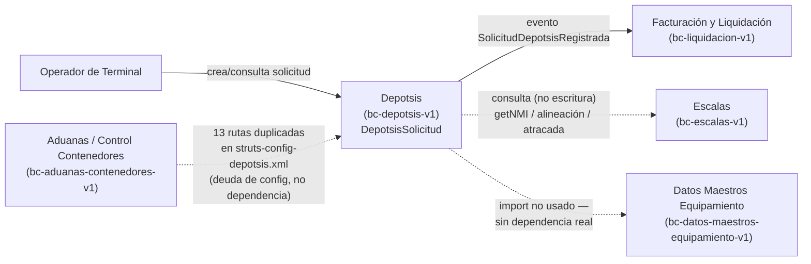

# [IA-GEN] Dossier — Depotsis

> **Borrador generado por IA** (APB AI Framework — síntesis de apb-disc-spec-gen-v1.0/apb-pm-product-analysis-v1.0/apb-arch-c4-model-v1.0/apb-arch-decompose-v1.0) — pendiente validación humana. No distribuir sin revisión.

## 1. Cabecera

- **Nombre**: Depotsis
- **Dominio DDD**: `dom-mercancias-v1` (`domain-catalog/domains/mercancias/domain.md`, dominio registrado y no tentativo)
- **Fase del roadmap**: 1 — quick win (`decomposition-roadmap.md` §"Fase 1 — Quick wins")
- **Estado**: DISCOVERED, con correcciones de esta verificación adicional respecto a `proposals/bc-depotsis-v1.md` (ver §7 y §12)
- **Bounded context**: `proposals/bc-depotsis-v1.md`
- **Épica**: `jira-backlog.md` EPIC-03 — Extracción Depotsis

## 2. Resumen ejecutivo

Depotsis gestiona las solicitudes y operaciones de depósito en muelle libre de la Terminal T6: un operador de terminal registra una solicitud de depósito (con producto arancelario, cantidad y ventana de operaciones), la solicitud evoluciona por versiones numeradas hasta su cierre y liquidación, y cada solicitud agrupa una o varias operaciones de desconsolidación de mercancía. Es, en términos de acoplamiento de módulos, el contexto más pequeño y mejor delimitado del clúster de Mercancías y Aduanas (`discovery-summary.md` §"DEPOTSIS").

**Corrección clave de esta verificación**: la propuesta original (`bc-depotsis-v1.md`) describe Depotsis como dependiente del dato maestro de Equipamiento (`upstream_contexts: bc-datos-maestros-equipamiento-v1`, patrón ACL) y como aislado salvo por ese acoplamiento. La lectura directa del código muestra dos matices importantes:
1. **No hay dependencia real de Equipamiento**: en todo el paquete `service/depotsis` y `dataaccess/dto/depotsis` solo existe **una** referencia a la clase `Equipament` — un `import` no utilizado en `DepotsisSolicitudDTO.java` (§12). `DepotsisSolicitudVersio.java`, que es donde vive el detalle real de la solicitud, no tiene ningún campo `idequipament`.
2. **Sí hay una dependencia real y no documentada con Escalas**: `CN_Depotsis.java` importa 9 excepciones del paquete `dataaccess.exceptions.escalas` (`EscalaDaoException`, `AtracadaDaoException`, `OcupacioMollDaoException`, etc.), expone `getNMI(numescala, anyescala, idsubport)` y `obtenerDescripcionAlineacion(Integer idalineacio)` devolviendo `VLupAlineacioVigent` (vista de `dataaccess.views.dto.escalas`), y `DepotsisSolicitudVersio.idalineacio` importa `TerminalPassatgersAlineacio` del paquete `escalas`. Esta dependencia no está en el bounded context propuesto ni en el modelo de datos publicado en `openapi-depotsis.yaml`.

Además, `struts-config-depotsis.xml` tiene 17 rutas registradas, pero **13 de ellas son literalmente las 13 rutas propias de `struts-config-aduanas.xml`, duplicadas byte a byte (mismo `path` y `type`)** — solo 4 rutas son realmente de Depotsis. Esto es deuda de configuración, no una dependencia funcional real entre ambos contextos (§4).

## 3. Análisis funcional

### Actores
- Operador de terminal (crea y da seguimiento a solicitudes de depósito).
- Servicio de Liquidación (consumidor del evento `SolicitudDepotsisRegistrada`).

### Casos de uso reales (grounded en `CN_Depotsis.java`)
- Registrar una nueva solicitud de depósito (`crear(...)`).
- Modificar una solicitud existente (`modificar(...)`).
- Consultar la versión vigente y el histórico de versiones de una solicitud (`obtener(...)`, `obtenerVersiones(...)`).
- Crear una nueva versión de una solicitud, incluyendo variantes "anterior" (`creaNuevaVersio(...)` con cuatro sobrecargas, `creaNuevaVersioAnterior(...)`).
- Rechazar una solicitud con comentario de rechazo (`rechazoSolicitud(...)`, campo `comentarisrebuig` en `T6_SOLICITUT_OP_VERSIO`).
- Registrar y comparar operaciones de desconsolidación asociadas a una solicitud/versión (`obtenerListaOperacion(...)`, `comparaListasOperaciones(...)`, `rellenarListaOperaciones(...)`).
- Validar el cierre de una solicitud y cerrarla (`validacionCierre(...)`, `cierre(...)`).
- Liquidar / desliquidar una solicitud (`liquidar(...)`, `desliquidar(...)`) — `CN_Depotsis extends CN_ActualizaServicioOriginal` (paquete `service.facturas`), confirmando el acoplamiento real con Facturación/Liquidación.
- Eliminar una solicitud (`eliminar(...)`).
- Validar contra el manifiesto asociado (`validaManifiesto(...)`).
- Mantener catálogos de apoyo: tipos de ocupación, unidades, medio de operación, sentido de operación, códigos arancelarios favoritos (`obtenerT6TipusOcupacio`, `obtenerT6TipusUnitats`, `obtenerT6TipusMediOp`, `obtenerT6TipusSentitOp`, `obtenerListaST6CodaranzprodFav`).
- Mantener "maestros de graneles" y su factor de conversión (`createT6FactorConvm2`, `updateT6FactorConvm2`, `deleteT6FactorConvm2`, acción propia `DepotsisMaestrosAction`).

### Reglas de negocio grounded
- La solicitud (`T6_SOLICITUT_OP`) es una raíz delgada que solo guarda `idsolicitud` (PK), `veractual` (puntero a la versión vigente) e `idservei`; todo el detalle vive versionado en `T6_SOLICITUT_OP_VERSIO` (`DepotsisSolicitud.java`, `DepotsisSolicitudVersio.java`).
- Crear una nueva versión no debe alterar versiones anteriores — confirmado por el patrón PK compuesta `idsolicitut+versio` y el campo `datafinversion` (fecha de fin de vigencia de la versión) en `DepotsisSolicitudVersio.java`.
- El estado (`estat`) es un valor de un catálogo real en BBDD (`T6Estat.java`, tabla `T6_ESTAT`, PK `idestat` de tipo `String`) — **no es una enumeración fija en código Java**; los valores concretos no están hardcoded como constantes y no se han extraído en esta pasada (mismo gap ya señalado en `testing-strategy-fase0-1.md`, ahora con la precisión adicional de que es un catálogo, no un enum).
- Una solicitud puede tener un motivo de rechazo (`comentarisrebuig`) sin perder la traza de por qué fue rechazada.
- Cada solicitud/versión puede tener una o varias operaciones de desconsolidación asociadas, vía la tabla puente `T6_SOLICITUT_DESCONSOLIDACIO` (`DepotsisSolicitudDesconsolidacion.java`), que enlaza `idsolicitut+versiosolicitut` con `idoperacio` (que a su vez apunta a `T6_OPERACIO`/`DepotsisOperacion.java`).
- Existe un submódulo de "graneles" con factores de conversión y factores de penalización (`T6FactorConvm2`, `T6FactorConvm2Hist`, `T6FactorsPenalitzacio`) y de preliquidación (`T6Preliquidacio`, `T6PreliquidacioLinia`, `T6PreliqDiaOperativa`) — indica que Depotsis calcula una preliquidación propia antes/además de que Liquidación procese el evento, no solo "entrega datos crudos".

### Qué NO incluye
- No gestiona el manifiesto original de la mercancía (eso es `bc-manifiestos-v1`).
- No gestiona el control aduanero (eso es PIF/Aduanas — `bc-pif-v1`, `bc-aduanas-contenedores-v1`).
- No es dueño del dato maestro de contenedor/equipo (`Equipament`) — y, a diferencia de lo que sugiere `bc-datos-maestros-equipamiento-v1.md`, tampoco lo consume de forma activa (ver §12).
- No gestiona el dato maestro de Escalas/Atracadas — solo lee/consulta (`getNMI`, `obtenerDescripcionAlineacion`) desde `bc-escalas-v1`.

## 4. Alcance de migración — qué se migra y qué NO

**Se migra**:
- Las **4 rutas propias** de `struts-config-depotsis.xml`: `/listaSolicitudDepotsis` (`DepotsisSolicitudAction`), `/listaDepotsisMaestrosGraneles` (`DepotsisMaestrosAction`), `/solicitudOperacionDepotsis` (`DepotsisSolicitudOperacionAction`), `/listaOperacionDepotsis` (`DepotsisOperacionAction`).
- El modelo de datos completo de `T6_SOLICITUT_OP` / `T6_SOLICITUT_OP_VERSIO` / `T6_OPERACIO` / `T6_SOLICITUT_DESCONSOLIDACIO` (§5).
- Los catálogos propios (`T6_ESTAT`, `T6_TIPUS_OCUPACIO`, `T6_TIPUS_MEDI_OP`, `T6_TIPUS_SENTIT_OP`, `T6_TIPUS_UNITATS`, `T6_CODARANZPROD_FAV`) y el submódulo de graneles/preliquidación (`T6_FACTOR_CONVM2`, `T6_FACTORS_PENALITZACIO`, `T6_PRELIQUIDACIO`, `T6_PRELIQUIDACIO_LINIA`, `T6_PRELIQ_DIA_OPERATIVA`) — su alcance funcional exacto no se ha detallado campo a campo en esta pasada (ver §14).

**NO se migra / nota específica sobre la duplicación de config con Aduanas**:
- **Las 13 rutas restantes de `struts-config-depotsis.xml` son deuda de configuración a limpiar, no funcionalidad de Depotsis.** Verificación exacta: `struts-config-aduanas.xml` tiene 13 `<action>` únicas en total (`org.apb.sostrat.mvc.control.aduanas.*`), y las 13 aparecen **también**, con idéntico `path` e idéntico `type`, dentro de `struts-config-depotsis.xml`: `/aduanasTrasllat`, `/listaTrasllatAudit`, `/aduanasTransit`, `/aduanasLlistasCarrega`, `/aduanasEquipsLlistasCarrega`, `/aduanasConsultaContenedor`, `/datosAduanas`, `/datosAduanas_popup`, `/aduanasEntradaTerminal`, `/creuamentDadesTerminal`, `/missatgesEDI`, `/missatgesEDI_popup`, `/proternifs`. Es decir, **el 100% de las rutas propias de Aduanas está duplicado dentro del fichero de Depotsis**. No hay ninguna acción con prefijo `depotsis` que dependa de Aduanas, ni viceversa en el otro sentido: es redundancia de registro Struts (probablemente un `import`/copia histórica del fichero de configuración), no una dependencia funcional real entre los dos bounded contexts. Recomendación: al retirar `struts-config-depotsis.xml` (criterio de éxito de EPIC-03), no migrar esas 13 rutas como parte de Depotsis — ya están cubiertas por la extracción de Aduanas/Control de Contenedores (Fase 3) y no deben duplicarse en el servicio nuevo.
- No se ha encontrado código muerto adicional en `dead-code-register.md` específico de `depotsis` (sin entradas para este ámbito en el registro).
- No se migra el dato maestro de Equipamiento (pertenece a `bc-datos-maestros-equipamiento-v1`) ni el de Escalas/Atracadas (pertenece a `bc-escalas-v1`) — Depotsis solo los consulta.

## 5. Modelo de datos

### `DepotsisSolicitud` (tabla `T6_SOLICITUT_OP`) — raíz delgada
Fuente: `sostrat/src/org/apb/sostrat/dataaccess/dto/depotsis/DepotsisSolicitud.java`

| Campo Java | Columna | Tipo | Notas |
|---|---|---|---|
| `idsolicitud` | `IDSOLICITUD` | `Long` | PK real (única usada por `createPk()`). |
| `veractual` | `VERACTUAL` | `Integer` | Puntero a la versión vigente en `T6_SOLICITUT_OP_VERSIO`. **No expuesto en `openapi-depotsis.yaml`.** |
| `idservei` | `IDSERVEI` | `Long` | **No expuesto en `openapi-depotsis.yaml`.** |

### `DepotsisSolicitudVersio` (tabla `T6_SOLICITUT_OP_VERSIO`) — detalle versionado
Fuente: `sostrat/src/org/apb/sostrat/dataaccess/dto/depotsis/DepotsisSolicitudVersio.java`. PK compuesta: `idsolicitut` + `versio` (`DepotsisSolicitudVersioPk.java`).

| Campo Java | Columna | Tipo | ¿En `openapi-depotsis.yaml`? |
|---|---|---|---|
| `idsolicitut` | `IDSOLICITUT` | `Long` | Sí (como `idsolicitud`) |
| `versio` | `VERSIO` | `Integer` | Sí |
| `idocupacio` | `IDOCUPACIO` | `Long` | Sí |
| `numescala` | `NUMESCALA` | `Integer` | Sí |
| `anyescala` | `ANYESCALA` | `Integer` | Sí |
| `idsubport` | `IDSUBPORT` | `String` | Sí |
| `idestibador` | `IDESTIBADOR` | `String` | Sí |
| `idalineacio` | `IDALINEACIO` | `Integer` | **No** — referencia a `TerminalPassatgersAlineacio` (paquete `escalas`), gap identificado en esta verificación |
| `codaranzprod` | `CODARANZPROD` | `String` | Sí |
| `estat` | `ESTAT` | `String` | Sí — FK a catálogo `T6_ESTAT` |
| `idunitat` | `IDUNITAT` | `Long` | **No** |
| `quantitat` | `QUANTITAT` | `BigDecimal` | Sí |
| `factorconvm2` | `FACTORCONVM2` | `BigDecimal` | **No** |
| `datainioperacions` | `DATAINIOPERACIONS` | `Date` | Sí |
| `datafioperacions` | `DATAFIOPERACIONS` | `Date` | Sí |
| `datalta` | `DATALTA` | `Date` | **No** — campo de auditoría |
| `idopealta` | `IDOPEALTA` | `String` | **No** — campo de auditoría |
| `idprocalta` | `IDPROCALTA` | `String` | **No** — campo de auditoría |
| `comentaris` | `COMENTARIS` | `String` | Sí |
| `datmodificacio` | `DATMODIFICACIO` | `Date` | **No** — campo de auditoría |
| `idprocmodificacio` | `IDPROCMODIFICACIO` | `String` | **No** — campo de auditoría |
| `idopemodificacio` | `IDOPEMODIFICACIO` | `String` | **No** — campo de auditoría |
| `escalaasoc` | `ESCALAASOC` | `String` | **No** |
| `comentarisrebuig` | `COMENTARISREBUIG` | `String` | **No** — motivo de rechazo |
| `datafinversion` | `DATAFINVERSION` | `Date` | **No** — fecha fin de vigencia de la versión |

**No existe ningún campo `idequipament`** en `DepotsisSolicitudVersio` — confirma negativamente la duda abierta en `jira-backlog.md` EPIC-03 ("Confirmar si `DepotsisSolicitudVersio` referencia contenedores — no se encontró ese campo en la extracción realizada"). Ver §12 para el análisis completo del (no-)acoplamiento con Equipamiento.

### `DepotsisOperacion` (tabla `T6_OPERACIO`)
Fuente: `DepotsisOperacion.java`. PK: `idoperacio` (`Long`).
Campos: `tipusoperacio`, `idsentitoperacio`, `idmedioperacio`, `dataoperacio`, `quantitat`, más bloque de auditoría completo (`datalta`/`idopealta`/`idprocalta`, `datbaixa`/`idprocbaixa`/`idopebaixa`, `datmodificacio`/`idopemodificacio`/`idprocmodificacio`). Ninguno de estos campos de auditoría está en `openapi-depotsis.yaml`, que no modela `DepotsisOperacion` como recurso propio.

### `DepotsisSolicitudDesconsolidacion` (tabla `T6_SOLICITUT_DESCONSOLIDACIO`) — tabla puente
Fuente: `DepotsisSolicitudDesconsolidacion.java`. PK: `idesconsolidacio` (`Long`). Enlaza `idsolicitut` + `versiosolicitut` con `idoperacio`, más auditoría estándar. **No modelada en `openapi-depotsis.yaml`.**

### Catálogos y submódulo de graneles/preliquidación (no extraídos campo a campo en esta pasada)
`T6Estat` (tabla `T6_ESTAT`, PK `idestat`), `T6TipusOcupacio`, `T6TipusMediOp`, `T6TipusSentitOp`, `T6TipusUnitats`, `T6CodaranzprodFav` (catálogos de referencia); `T6FactorConvm2`/`T6FactorConvm2Hist`, `T6FactorsPenalitzacio`, `T6Preliquidacio`/`T6PreliquidacioLinia`, `T6PreliqDiaOperativa` (submódulo de graneles y preliquidación, expuesto vía `DepotsisMaestrosAction`/`createT6FactorConvm2`/`updateT6FactorConvm2` en `CN_Depotsis.java`) — se ha confirmado su existencia y ubicación (`sostrat/src/org/apb/sostrat/dataaccess/dto/depotsis/`) pero no su estructura de campos completa; pendiente para una siguiente pasada (ver §14).

### Mapeo a Azure SQL
Migración directa tabla-a-tabla con renombrado a convención destino: `T6_SOLICITUT_OP` → `DepotsisSolicitud` (raíz, tabla estrecha), `T6_SOLICITUT_OP_VERSIO` → `DepotsisSolicitudVersion` (tabla ancha, todo el detalle), `T6_OPERACIO` → `DepotsisOperacion`, `T6_SOLICITUT_DESCONSOLIDACIO` → tabla de relación N:M explícita en el modelo destino (no un mero JOIN). No se ha diseñado el esquema Azure SQL definitivo — pendiente de decisión de Arquitectura sobre si el patrón de versionado (`veractual` + tabla de versiones) se preserva igual o se sustituye por un patrón de auditoría/event-sourcing más propio de DOCKS.

## 6. Arquitectura técnica

Stack DOCKS: microservicio .NET en Azure Container Apps, Azure SQL propio, publicación vía APIM (`https://apim.portdebarcelona.cat/depotsis/v1`, ver `specs/openapi-depotsis.yaml`), autenticación EntraID OAuth2 client credentials (scopes `depotsis.read`/`depotsis.write`), eventos vía Azure Service Bus (`evt.sostrat.depotsis`, con dead-letter queue `evt.sostrat.depotsis.dlq`).

Patrón de acceso a datos legacy: separación DTO (`dataaccess.dto.depotsis`, solo claves/campos base) vs. DTOV/vista (`dataaccess.views.dto.depotsis`: `VTcDepotsisSolicitud`, `VTcDepotsisOperacion`, `VTcDepotsisMP`, `VTcTipusSentit`) para listados — mismo patrón "vista de solo lectura sobre tabla base" ya señalado para Mano de Estiba en `jira-backlog.md` EPIC-02.

## 7. Dominio DDD

- **Bounded context**: `bc-depotsis-v1` (`proposals/bc-depotsis-v1.md`).
- **`parent_domain`**: `dom-mercancias-v1` — dominio **registrado** en `domain-catalog/domains/mercancias/domain.md` (no tentativo, a diferencia de otros bloqueantes de este mismo lote como Operadores Portuarios/Efficiency Network).
- **Aggregates**: `DepotsisSolicitud` (raíz, incluye por composición `DepotsisSolicitudVersio` y transitivamente `DepotsisOperacion`/`DepotsisSolicitudDesconsolidacion`).
- **Sin solapamiento de agregados con contextos hermanos del mismo dominio padre**, confirmado comparando `aggregates:` de los tres BCs de `dom-mercancias-v1` relacionados con contenedores/mercancía:
  - `bc-datos-maestros-equipamiento-v1` → aggregate `Equipament`.
  - `bc-depotsis-v1` → aggregate `DepotsisSolicitud`.
  - `bc-aduanas-contenedores-v1` → aggregate `TrasllatContenidor`.
  Ningún nombre de aggregate se repite; no hay overlap.
- **Corrección de relaciones respecto a `bc-depotsis-v1.md`**: el fichero de propuesta declara `upstream_contexts: [bc-datos-maestros-equipamiento-v1]` con patrón ACL. Esta verificación no encuentra evidencia de código que sostenga esa relación (§12) y sí encuentra una relación real no declarada con `bc-escalas-v1` (consulta de alineación/atracada) y una relación real con `bc-liquidacion-v1`/Facturación más profunda de lo descrito (`CN_Depotsis extends CN_ActualizaServicioOriginal`, métodos `liquidar`/`desliquidar`, submódulo de preliquidación §5).

## 8. Pantallas UI

Ver `ui-screens-backlog.md` §"App: Depotsis" (Fase 1):
1. **Listado de Solicitudes de Depósito** (`dxDataGrid`) — columnas: `idsolicitud`, `versio`, `estat`, `numescala/anyescala`.
2. **Ficha de Solicitud** (`dxForm`) — campos: `idocupacio`, `idestibador`, `codaranzprod`, `quantitat`, `datainioperacions`/`datafioperacions`, `comentaris`.

No hay pantalla propuesta todavía para el submódulo de graneles/preliquidación ni para la gestión de operaciones de desconsolidación como pantalla independiente — gap de cobertura UI a validar con negocio (ver §16).

## 9. APIs

| Método | Ruta | Descripción | Fuente |
|---|---|---|---|
| GET | `/free-yard-requests` | Listar solicitudes (filtros `estat`, `anyescala`, `numescala`, paginación por cursor) | `specs/openapi-depotsis.yaml` |
| POST | `/free-yard-requests` | Registrar una solicitud de depósito (crea versión inicial `versio=1`) | `specs/openapi-depotsis.yaml` |
| GET | `/free-yard-requests/{idsolicitud}` | Consultar la versión vigente de una solicitud | `specs/openapi-depotsis.yaml` |

Referencia completa: `discovery/ddd-sostrat-mj8/specs/openapi-depotsis.yaml` (OpenAPI 3.0.3, seguridad EntraID `clientCredentials`, `ProblemDetails` RFC 7807). **Gap**: no expone `DepotsisOperacion` ni `DepotsisSolicitudDesconsolidacion` como recursos, ni los campos de §5 marcados como ausentes (`veractual`, `idservei`, `idalineacio`, `idunitat`, `factorconvm2`, `escalaasoc`, `comentarisrebuig`, `datafinversion`, ni los campos de auditoría) — a revisar antes de congelar el contrato v1.

## 10. Eventos

| Evento | Trigger | Consumidores | Fuente |
|---|---|---|---|
| `SolicitudDepotsisRegistrada` | Registro de nueva solicitud (`crear(...)`) | Facturación y Liquidación (`dom-facturacion-v1`), consumidor principal — calcula la liquidación sin acceso directo a la BBDD de Depotsis | `specs/asyncapi-fase0-1.yaml`, canal `evt.sostrat.depotsis` |

Payload (`SolicitudDepotsisData`, `specs/asyncapi-fase0-1.yaml`): `idsolicitud`, `versio`, `idocupacio`, `numescala`, `anyescala`, `idsubport`, `idestibador`, `codaranzprod`, `estat`, `quantitat`, `datainioperacions`, `datafioperacions` — mismo subconjunto de 12 campos que el API REST, con las mismas ausencias señaladas en §5/§9. Envelope CloudEvents 1.0, DLQ `evt.sostrat.depotsis.dlq`. No hay evento de anulación/rechazo de solicitud pese a que `rechazoSolicitud(...)` es un caso de uso real en `CN_Depotsis.java` — gap a evaluar (¿el consumidor de Liquidación necesita enterarse de un rechazo posterior a la liquidación?).

## 11. Diagrama topológico (C4 nivel 1)

## 12. Estrategia de convivencia con el modelo actual

`jira-backlog.md` EPIC-03 declara `Dependencias: EPIC-00` (el servicio de datos maestros de Equipamiento) como prerequisito de la extracción de Depotsis, siguiendo la hipótesis original de `bc-depotsis-v1.md`/`bc-datos-maestros-equipamiento-v1.md` de que Depotsis es uno de los seis consumidores directos de la tabla `EQUIPAMENT`.

**Esta verificación no confirma esa dependencia.** Búsqueda exhaustiva de "equipament"/"Equipament" en `dataaccess/dto/depotsis`, `dataaccess/views/dto/depotsis` y `service/depotsis` (recursivo) da un único resultado: `service/depotsis/dto/DepotsisSolicitudDTO.java` línea 18, `import org.apb.sostrat.dataaccess.dto.mmpp.maestros.Equipament;` — import que **no se usa en ningún campo, método ni tipo de retorno de la clase**. Es código muerto (import vestigial), no una dependencia funcional.

**Implicación práctica**: la dependencia declarada de Depotsis (Fase 1) respecto al servicio de datos maestros de Equipamiento (Fase 0, EPIC-00) puede no ser un bloqueante real para el desarrollo del dominio de negocio de Depotsis — solo sería necesaria si, al confirmar con negocio, se decide que el nuevo servicio SÍ debe llevar una referencia a `idequipament` que el legacy no llegó a implementar. Recomendación: mantener EPIC-00 como prerequisito de **plataforma** (ACL/fundamentos transversales aplicable a todo el roadmap, según `decomposition-roadmap.md` Fase 0) pero no bloquear el arranque de EPIC-03 esperando específicamente a Equipamiento por esta supuesta dependencia de Depotsis.

**Dependencia real que sí requiere estrategia de convivencia**: Depotsis consulta datos de Escalas/Atracadas en tiempo real (`getNMI`, `obtenerDescripcionAlineacion`, campos `idalineacio`/`escalaasoc`/`numescala`/`anyescala`/`idsubport`). Como Escalas es Fase 5 del roadmap (migración a ARGOS, no extracción a microservicio nuevo — `migration-readiness-fase5.md`), Depotsis deberá seguir leyendo esos datos del monolito (o de su réplica CDC de Fase 0) durante la convivencia, vía ACL, hasta que se resuelva el mapeo de `EscalaPk` señalado como punto de mayor riesgo de integración en `testing-strategy-fase0-1.md` §3.

**Dependencia con Liquidación**: confirmada y más profunda de lo documentado — `CN_Depotsis extends CN_ActualizaServicioOriginal` (interfaz de `service.facturas`) y expone `liquidar`/`desliquidar` directamente, además de publicar el evento `SolicitudDepotsisRegistrada`. La estrategia de "evento sin acceso directo a BBDD" (declarada en `asyncapi-fase0-1.yaml`) debe extenderse para cubrir también el ciclo `liquidar`/`desliquidar`, no solo el alta.

## 13. Testing y seguridad

**Testing** (`testing-strategy-fase0-1.md` §"Depotsis"):
- Creación de nueva versión no debe alterar versiones anteriores (patrón versionado confirmado en `DepotsisSolicitudVersio.java`, y reforzado en esta verificación por el campo `datafinversion`).
- Máquina de estados de `estat` — bloqueante para escribir el test hasta que negocio confirme los valores reales del catálogo `T6_ESTAT` (confirmado en esta verificación que es un catálogo en BBDD, no un enum en código).
- Integración con Datos Maestros de Equipamiento: la propia estrategia de testing ya advertía que no se había encontrado el campo `idequipament` y pedía confirmar antes de dar la integración por innecesaria — **esta verificación confirma que no hay integración de código real, solo un import muerto** (§12); dar por innecesario ese test de integración salvo que negocio confirme un requisito de producto no implementado en el legacy.
- **Nuevo caso a añadir** (no estaba en la estrategia original): test de integración con Escalas para `getNMI`/alineación/atracada, dado el acoplamiento real detectado en `CN_Depotsis.java`.

**Seguridad** (`threat-model-fase0-1.md`):
- Amenaza #8 (Elevation of Privilege): scope `depotsis.write` sin distinguir operaciones destructivas (`rechazoSolicitud`, `eliminar`, `desliquidar`) de altas normales — recomendación pendiente de evaluar un scope más restrictivo para esas acciones.
- Amenaza #4 (Repudiation): campos de auditoría (`idopealta`/`idopemodificacio`/`datalta`/`datmodificacio`) confirmados en `DepotsisSolicitudVersio`, `DepotsisOperacion` y `DepotsisSolicitudDesconsolidacion` — deben preservarse en el modelo de datos destino.
- No hay throttling/rate limiting definido en `openapi-depotsis.yaml` (amenaza #7, transversal a las 4 apps de Fase 0-1).

## 14. Riesgos y gaps de evidencia

- **Contradicción entre propuestas de esta misma serie**: `bc-depotsis-v1.md` y `bc-datos-maestros-equipamiento-v1.md` afirman una dependencia de Depotsis sobre Equipamiento que el código no sostiene (§12). Requiere que Arquitectura APB decida si es (a) un requisito de negocio nuevo no implementado en el legacy, o (b) una hipótesis a descartar del bounded context.
- **Dependencia con Escalas no documentada en la propuesta original** (`idalineacio`, `getNMI`, `escalaasoc`) — impacto en el orden de dependencias del roadmap: Depotsis (Fase 1) consulta datos de un contexto que se resuelve en Fase 5.
- **Catálogo de valores de `estat` no extraído** — bloqueante para tests de máquina de estados y para el modelo de datos definitivo del campo `estat` en el servicio nuevo.
- **Submódulo de graneles/preliquidación no extraído campo a campo** (`T6FactorConvm2`, `T6FactorsPenalitzacio`, `T6Preliquidacio`, `T6PreliquidacioLinia`, `T6PreliqDiaOperativa`) — su alcance funcional real (¿cálculo de liquidación propio de Depotsis, o solo apoyo a la UI de graneles?) no está confirmado; puede cambiar el tamaño de la extracción de EPIC-03 significativamente si su lógica de negocio debe migrarse íntegra.
- **`DepotsisOperacion` y `DepotsisSolicitudDesconsolidacion` no están modelados en `openapi-depotsis.yaml`** pese a ser parte real del flujo de negocio (una solicitud contiene operaciones de desconsolidación) — el contrato API actual solo cubre la solicitud, no el árbol completo.
- **12 de los 24 campos reales de `DepotsisSolicitudVersio` no están en el contrato API/evento actual** (§5, §9) — algunos son auditoría (bajo riesgo de omitir del contrato público) pero otros son de negocio (`idalineacio`, `idunitat`, `factorconvm2`, `escalaasoc`, `comentarisrebuig`, `datafinversion`) y deberían revisarse antes de congelar v1.
- No se ha encontrado ningún evento de rechazo/anulación de solicitud pese a que `rechazoSolicitud(...)` es un método real — gap de diseño de eventos.

## 15. Estimación de esfuerzo

Ver `jira-backlog.md` EPIC-03 (3 historias de usuario, 16 pts: 8+3+5). **Esta estimación no incluye** el submódulo de graneles/preliquidación (no estaba en el alcance original de EPIC-03 tal como está redactada la épica, que solo cubre `/free-yard-requests` y el evento de alta) ni la exposición API de `DepotsisOperacion`/`DepotsisSolicitudDesconsolidacion`. Si negocio confirma que ambos deben migrarse como parte de Depotsis (no descontinuarse), la estimación de EPIC-03 debe revisarse al alza — recomendación: no cerrar el sizing de EPIC-03 sin antes completar el gap de §14 sobre el submódulo de graneles.

## 16. Checklist de validación

**Funcional**:
- [ ] Confirmar con negocio si el submódulo de graneles/preliquidación (`T6FactorConvm2`, `T6FactorsPenalitzacio`, `T6Preliquidacio*`) debe migrarse como parte de Depotsis, discontinuarse, o mover su responsabilidad a Facturación y Liquidación.
- [ ] Confirmar los valores reales del catálogo `estat` (tabla `T6_ESTAT`) y la máquina de estados que gobierna sus transiciones.
- [ ] Confirmar si `idalineacio`/`escalaasoc` (referencias a Escalas) son datos que el operador de terminal introduce manualmente o que se resuelven automáticamente contra la escala/atracada — afecta al diseño de la ACL hacia Escalas.
- [ ] Validar si la ausencia de un evento de rechazo de solicitud es intencional o un gap a cerrar antes de producción.

**Desarrollo**:
- [ ] Descartar formalmente (o confirmar como requisito nuevo) la dependencia declarada con el servicio de datos maestros de Equipamiento — el código actual no la sostiene (§12).
- [ ] No migrar las 13 rutas de Aduanas duplicadas en `struts-config-depotsis.xml` como parte de este servicio — están cubiertas por la extracción de Aduanas/Control de Contenedores (Fase 3).
- [ ] Diseñar la ACL hacia Escalas para `getNMI`/alineación/atracada antes de dar por cerrada la Fase 1, dado que Escalas se resuelve en Fase 5.
- [ ] Ampliar `openapi-depotsis.yaml` y `asyncapi-fase0-1.yaml` con los 12 campos de `DepotsisSolicitudVersio` actualmente no cubiertos (§5, §9), o justificar explícitamente su exclusión.
- [ ] Modelar `DepotsisOperacion` y `DepotsisSolicitudDesconsolidacion` como sub-recursos del contrato API si el negocio los necesita expuestos (hoy no lo están).
- [ ] Extraer campo a campo el submódulo de graneles/preliquidación antes de dar el modelo de datos por definitivo.

## 17. Historial de cambios

| Versión | Fecha | Autor | Cambio |
|---------|-------|-------|--------|
| 1.0.0 | 2026-07-13 | APB AI Framework | Dossier inicial, a petición explícita del usuario, con verificación adicional contra `SOSTRAT-Sostrat-MJ8` que corrige la hipótesis de dependencia con Equipamiento, confirma cuantitativamente la duplicación de rutas Aduanas/Depotsis (13 de 17), y añade una dependencia real con Escalas no documentada en `bc-depotsis-v1.md` |
