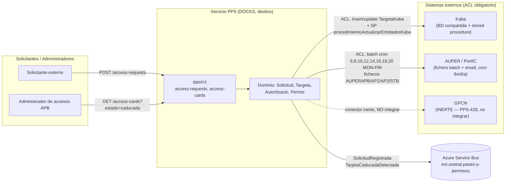

# [IA-GEN] Dossier — PPS (Pases y Permisos)

> **Borrador generado por IA** (APB AI Framework — síntesis de apb-disc-spec-gen-v1.0/apb-pm-product-analysis-v1.0/apb-arch-c4-model-v1.0/apb-arch-decompose-v1.0) — pendiente validación humana. No distribuir sin revisión.

## 1. Cabecera

- **Nombre**: PPS (Pases y Permisos)
- **Dominio DDD**: `dom-acceso-seguridad-fisica-v1` (dominio ya existente en `apb-domain-catalog`, no propuesto por esta auditoría — ver `catalog-comparison.md:17`)
- **Fase del roadmap**: 2
- **Estado**: DISCOVERED — bounded context propuesto, con evidencia de código verificada campo a campo contra el checkout real de `SOSTRAT-Sostrat-MJ8`
- **Bounded context de origen**: `proposals/bc-pps-v1.md`
- **Épica**: `jira-backlog.md` EPIC-04 — Extracción PPS

## 2. Resumen ejecutivo

PPS gestiona el ciclo de vida completo de las solicitudes de acceso físico al recinto portuario: alta de solicitud, emisión y auditoría de tarjetas, autorizaciones puntuales de visitante y permisos especiales (incluidos permisos de dron). Es un dominio **supporting de tamaño medio, sin acoplamiento a Escalas** (`decomposition-roadmap.md` lo cataloga como "extracción relativamente limpia"), lo que lo convierte en un candidato de bajo riesgo para Fase 2. La evidencia de código confirma con exactitud los tamaños citados en la propuesta original: `CN_Solicituds_Impl.java` tiene **2.200 líneas** y `mvc/control/pps/TarjetasPasesAction.java` tiene **2.647 líneas** (recuento exacto vía `wc -l` sobre el checkout real), y las **29 rutas Struts** de `struts-config-pps.xml` están confirmadas una a una.

**Hallazgo nuevo de esta verificación, no presente en la documentación previa de discovery**: de los tres conectores externos mencionados en la propuesta y en `jira-backlog.md` (Kaba, PortIC, GPCN), **el conector GPCN está desactivado en producción**. La interfaz `CN_GPCNConnector.java` no declara ningún método activo — su único método (`gestionAltasGPCN`) está comentado en bloque, con la nota del propio desarrollador `// PPS-428 Eliminamos conexiones al GPCN` (línea 5-7 de la interfaz, y el cuerpo entero de `CN_GPCNConnector_Impl.java` líneas 57-251 comentado). El campo `Solicitud.gpcn` (booleano) sigue existiendo y se sigue rellenando desde la UI, pero no dispara ninguna llamada real al sistema GPCN. Esto corrige la tarea técnica de `jira-backlog.md` EPIC-04 ("Migrar `CN_KabaConnector`, `CN_PorticConnector`, `CN_GPCNConnector` al nuevo servicio") — GPCN no tiene lógica que migrar, solo el campo de dato.

## 3. Análisis funcional

### Responsabilidad de negocio
Gestión de solicitudes de pase/tarjeta de acceso al recinto portuario, sus autorizaciones puntuales de visitante, permisos especiales (obra, dron) y la auditoría completa de cada tarjeta emitida, caducada o dada de baja.

### Actores
- Solicitante externo (empresa que solicita tarjetas de acceso para su personal).
- Administrador de accesos APB (gestiona autorizaciones, permisos y el ciclo de vida de tarjetas).
- Sistema físico Kaba (control de accesos biométrico/tarjeta, integrado por escritura directa en tablas replicadas).
- Sistema AUPER/PortIC (destinatario de ficheros de codificación de tarjeta, generados por batch).

### Casos de uso reales (grounded en las Actions y rutas Struts confirmadas)
- **Alta y gestión de solicitudes** (`/listaSolicituds` → `SolicitudsAction.java`, `/listaSolicitudsAudit` → `SolicitudsAuditAction.java`, `/listaSolicitudIncidencia` → `SolicitudIncidenciaAction.java`, ticket `PPS-484`).
- **Gestión de tarjetas y pases** (`/listaTarjetaspases` y `/listaTarjetaspases_popup` → `TarjetasPasesAction.java`, `/listaTarjetasEstados` → misma Action, `/listaTarjetas` → `TarjetasAction.java` con forward dedicado `administracionPPS` a `MenuGeneracionFicheros.jsp`, `/listaTarjetasAudit` → `TarjetasAuditAction.java`).
- **Autorizaciones puntuales de visitante** (`/listaAutorizacion` y `/public/listaAutorizacion` → `AutoritzacioAction.java`, con formulario público de auto-registro; `/listaAutorizacionHist` → `AutoritzacioHistAction.java`; `/listaAutorizacionAudit` → `AutoritzacioAuditAction.java`; `/cercaAutorizacions` → `CercaAutoritzacionsAction.java`).
- **Permisos especiales** (`/listaPermisosEspecials` y `/listaPermisosEspecialsPopup` → `PermisAction.java`; `/listaPermisosEspecialsDron` → `PermisDronAction.java`; `/listaPermisosEspecialsAudit` → `PermisAuditAction.java`).
- **Gestión de acreditaciones** (`/gestionAcreditacion` → `GestionAcreditacionAction.java`; `/gestionSAcreditacion` → `GestionSAcreditacionAction.java`).
- **Gestión documental adjunta a cada proceso** (`/listaDocumentacio`, `/public/listaDocumentacio`, `/listaDocumentacioPermisos`, `/listaDocumentacioPermisosDron`, `/listaDocumentaciopases`, `/listaDocumentacioSolicituds`, `/listaDocumentacioTargetes` — 7 rutas, ticket `PPS-435`).
- **Informes de tarjetas** (`/informeTargetas` → `InformeTargetasAction.java`).
- **Descarga de ficheros PPS** (`/verFicheroPPS` y `/public/verFicheroPPS` → `FileDownload.java`).

### Reglas de negocio confirmadas en código
- `port+idsolicitud` es la PK de `Solicitud` y es inmutable una vez asignada (`specs/asyncapi-fase2.yaml:49`, `x-business-rules`).
- Una solicitud lleva su propio precio (`Solicitud.preu`, `BigDecimal`) y contador de tarjetas entregadas vs. solicitadas (`ntargetesentregades`/`ntargetesduplicades`/`ntargetesduptotal` vs. `ntargetes`), con un máximo (`maxnumtargetes`, ticket `PPS-452`).
- Toda tarjeta impresa pasa por Kaba: `CN_KabaConnector_Impl.imprimirTarjeta()` inserta o actualiza el registro en la tabla replicada `TargetaKaba` y ejecuta el procedimiento almacenado `procedimientoActualizarEntidadesKaba()` antes de "promocionar" el dato a las tablas definitivas de Kaba (`Hperson`, `Apersonprofile`) — es decir, la integración es de **base de datos compartida + stored procedure**, no una llamada de red a un servicio.
- El envío de tarjetas a PortIC/AUPER es un job batch Quartz (`enviarTarjetasPPS`, bean `tareaPPSTargetesPortic` en `applicationContext-planificador.xml:329-332`) que corre **8 veces al día, de lunes a viernes** (`cron: 0 0 6,8,10,12,14,16,18,20 ? * MON-FRI`), y genera 3 ficheros de texto de ancho fijo (`AUPERAPB`, `AUPERAP2`, `AUPERAP3`/`AUPERSTB`) que se envían por email, no por API.

### Qué NO incluye
No gestiona el transporte terrestre de mercancías (eso es Transporte Terrestre — `bc-transporte-terrestre-v1`), aunque ambos comparten el eje de "acceso/movimiento físico" (`bc-pps-v1.md` §"Lo que NO incluye"). Tampoco gestiona biometría, autenticación de usuario (AUT) ni la integración con Vinfopol — esos sistemas están fuera del alcance de SÒSTRAT (ver §7).

## 4. Alcance de migración — qué se migra y qué NO por no estar en uso

- **Se migran las 29 rutas Struts confirmadas** de `struts-config-pps.xml` (conteo exacto: 29 elementos `<action path=...>`, coincide con `coverage-audit.md:44` "pps (satélite) | 29 | bc-pps-v1").
- **No se ha encontrado código muerto de PPS en `dead-code-register.md`** — no hay entradas para el módulo `pps` en ese registro.
- **Corrección de esta verificación (no en `dead-code-register.md` porque no encaja en su patrón de bloques comentados dentro de un método activo, sino en una interfaz entera sin métodos activos)**: el conector **GPCN está inerte en producción**. `CN_GPCNConnector.java` no tiene ningún método sin comentar; toda la lógica de `CN_GPCNConnector_Impl.java` (altas/bajas/modificaciones desde el fichero `SOLICITUD_GPCN`, envío de email de aviso) está comentada con la nota explícita `PPS-428 Eliminamos conexiones al GPCN`. **No debe migrarse como integración activa** — si negocio confirma que se necesita reactivar, es un rediseño, no una migración literal. El campo `Solicitud.gpcn`/`gpcnSol` (booleano en el formulario) sí sigue en uso activo y sí debe migrarse como dato.
- Kaba y PortIC **sí están activos y deben migrarse como integraciones reales** (ver §6).

## 5. Modelo de datos

Todos los campos siguientes están extraídos directamente de los DTOs reales en `sostrat/src/org/apb/sostrat/dataaccess/dto/pps/` del checkout `SOSTRAT-Sostrat-MJ8`.

### `Solicitud` (tabla `SOLICITUD`, PK `port+idsolicitud`)
`Solicitud.java` extiende `SolicitudBase.java` y añade auditoría de concurrencia:

| Campo (`SolicitudBase`) | Tipo Java | Nota |
|---|---|---|
| `port` | String | PK parte 1 |
| `idsolicitud` | String | PK parte 2 |
| `idempresa` | String | |
| `datsol` | Date | |
| `ntargetes` | Long | |
| `doccomplerta` | Boolean | |
| `observacions` | String | |
| `iddepaval` | String | |
| `gpcn` | Boolean | dato vivo; conector GPCN inerte (§4) |
| `tipoavalador` | String | dominio de valores no confirmado como enum |
| `denomdept` | String | |
| `idempresasol` | String | |
| `numeracion_targeta` | String | |
| `maxnumtargetes` | Long | ticket PPS-452 |
| `datbaixa` | Date | ticket PPS-435 |
| `emailnotificacio` | String | ticket PPS-435 |
| `ntargetesentregades` | Integer | ticket PPS-435 |
| `ntargetesduplicades` | Integer | ticket PPS-435 |
| `ntargetesduptotal` | Integer | ticket PPS-435 |
| `preu` | BigDecimal | ticket PPS-435 |
| `idtipustargetapps` | String | ticket PPS-435 |
| `refpagoweb` | String | ticket PPS-435 |
| `idempresafact` | String | ticket PPS-473 |
| `entregata` | Integer | ticket PPS-476 |
| `dataentrega` | Date | ticket PPS-476 |
| `numtargetessau` | Integer | ticket PPS-477 |
| `paseuhf` | String | ticket PPS-513 |

Campos añadidos por `Solicitud.java` (auditoría de concurrencia + anulación): `datalta`, `datmodificacio`, `idopealta`, `idopemodificacio`, `idprocalta`, `idprocmodificacio`, `guid`, `motiuanulacio`.

### `SolicitudAudit` (tabla `SOLICITUD_AUDIT`, PK `seqaudit`)
Extiende también `SolicitudBase` y añade: `seqaudit` (Long, PK), `dataaudit` (Date), `tipoperacio` (String), `proces` (String), `operador` (String), `idestat` (String), `numeracionTargeta` (String) — todos con Javadoc de mapeo de columna explícito en el propio fichero fuente.

### `Targeta` (tabla `TARGETA`, PK `port+idtargeta+versio` según `TargetaPk`)
`port`, `idtargeta`, `versio`, `idsubtipus`, `idtipus`, `idusuari`, `idsolicitud`, `matricula`, `idzona`, `coditargeta`, `dataalta`, `databaixa`, `datacaduca`, `dataficte`, `xipproximitat`, `idempaval`, `cessiodades`, `idareaexe`, `idareafunc`, `idseccio`, `iddept`, `nomkaba`, `notificacio1/2/3`, `carrecusu`, `recollida`, `imprimir`, `observaciones`, `iddepaval`, `tipoavalador`, `denomdept`, `codempapb`, `datakaba`, `codibarres`, `legic`, `mifare`, `usukaba`, `pdtduplicat` (ticket PPS-435).

### `Autoritzacio` (tabla `AUTORITZACIO`, PK `port+idautoritzacio`)
`port`, `idautoritzacio`, `historica`, `idempvisitant`, `nomempvisitant`, `idempdesti`, `idzona`, `numagent`, `datreg`, `datini`, `datfi`, `observacions`, `motiu`, `nom`, `cognom1`, `cognom2`, `idtipdocument`, `documentacio`, `datanaixement`, `email`, `idvaixell`, `porta`, `idtipvehicle`, `matricula`, `nifmpvisitant`, `nifempdesti`, `tlfmovil`, `entradas`, `tipovehiculo`, `idiomadoc`, `idempresaoperador`.

### `Permis` (tabla `PERMIS`, PK `port+idpermis`)
`port`, `idpermis`, `codi`, `nom`, `cognom1`, `cognom2`, `idtipdocument`, `mobil`, `email`, `idempresa`, `nif`, `tipvia`, `nomvia`, `numvia`, `escala`, `pis`, `porta`, `codpostal`, `pais`, `provincia`, `localitat`, `telefonemp`, `emailemp`, `dataini`, `datafi`, `datasolicitud`, `activitat`, `localitzacio`, `zona`, `remunerat`, `importe`, `iva`, `importetotal`, `fianza`, `recuperarfianza`, `observacions`, `estat`, `idiomacom` — incluye campos económicos (fianza, IVA) no reflejados en ningún contrato de API actual (ver §14).

**Nota de cobertura del modelo de datos**: `openapi-pps.yaml` solo modela `AccessRequest` (=`Solicitud`) y `AccessCardAudit` (=`SolicitudAudit`). `Targeta`, `Autoritzacio` y `Permis` — tres de los cinco agregados/entidades reales del dominio — **no tienen contrato de API todavía**, pese a que las Actions correspondientes (`AutoritzacioAction`, `PermisAction`, `TarjetasAction`) son las de mayor volumen de rutas. Esto es un gap real, no una omisión deliberada (ver §14).

### Mapeo a Azure SQL
Migración directa tabla-a-tabla: `SOLICITUD`→`Solicitudes` (o equivalente), `SOLICITUD_AUDIT`→histórico de auditoría (candidato a Event Store / tabla append-only dado que ya es un log de auditoría), `TARGETA`, `AUTORITZACIO`, `PERMIS` como agregados propios. No se ha diseñado el esquema Azure SQL definitivo en esta pasada — solo se confirma el origen.

## 6. Arquitectura técnica

Stack DOCKS (.NET, Azure SQL, EntraID, Service Bus, APIM), servicio dedicado tras `/pps/v1` (`specs/openapi-pps.yaml:17`).

**Los tres conectores deben tratarse siempre como integraciones vía Anti-Corruption Layer (ACL), nunca como llamadas directas a un sistema físico real desde el nuevo servicio ni desde CI** (`testing-strategy-fase2-4.md:12`: *"Integration: conectores externos Kaba/PortIC — usar test doubles, no el sistema físico real en CI"*). Con la evidencia de código verificada, cada conector requiere un patrón ACL distinto:

- **Kaba** — hoy es una integración de **base de datos compartida + stored procedure** (`CN_KabaConnector_Impl.java`: inserta/actualiza en tablas replicadas `TargetaKaba`, luego ejecuta `targetaKabaDao.procedimientoActualizarEntidadesKaba()` y finalmente escribe en `Hperson`/`Apersonprofile`). En destino, esto **no puede ser un simple wrapper HTTP** — necesita decidirse si Kaba expone una API real hoy o si el nuevo servicio sigue escribiendo en su esquema de BD replicado durante la transición.
- **PortIC/AUPER** — hoy es un **job batch programado** (Quartz, `enviarTarjetasPPS`, cron `0 0 6,8,10,12,14,16,18,20 ? * MON-FRI`, bean `tareaPPSTargetesPortic`) que consulta tarjetas vigentes, cruza con datos Kaba (`legic`/`mifare`), genera 3 ficheros de ancho fijo y los envía por email — no hay llamada de red directa a "PortIC" en este flujo, es generación de fichero + email. El nombre de la clase (`CN_PorticConnector`) no coincide con el mecanismo real de integración (fichero/email, no API PortIC) — a confirmar con el equipo qué sistema físico consume realmente estos ficheros.
- **GPCN** — inerte, ver §4. No requiere ACL de integración activa, solo migración del campo de dato `gpcn`.

## 7. Dominio DDD

- **Bounded context**: `bc-pps-v1`, `parent_domain: dom-acceso-seguridad-fisica-v1` (`proposals/bc-pps-v1.md`).
- **Este dominio ya existe en `apb-domain-catalog`** — no es un dominio nuevo propuesto por la auditoría de cobertura de esta serie de dossiers. `catalog-comparison.md:17` confirma el encaje: *"Buen encaje; el dominio existente es más amplio (incluye AUT, biometría KABA, Vinfopol — sistemas fuera del alcance de SOSTRAT-Sostrat-MJ8)."* Es decir, el `dom-acceso-seguridad-fisica-v1` real de APB cubre más superficie (autenticación, biometría, integración con Policía Vinfopol) que lo que SÒSTRAT implementa — SÒSTRAT solo aporta la parte de solicitudes/tarjetas/permisos.
- **Sin solapamiento con ningún BC nuevo de la auditoría de cobertura**: `coverage-audit.md:44` clasifica el módulo `pps` (29 rutas) íntegro y en exclusiva bajo `bc-pps-v1`, sin repartirse con `bc-servicios-auxiliares-cruceros-v1`, `bc-inspeccion-scpp-v1`, `bc-tramites-cliente-v1` ni ningún otro de los 7 BC nuevos identificados en esa auditoría. `decomposition-roadmap.md:23` confirma además: *"PPS | — | ninguna detectada (sin acoplamiento a Escala) | Bajo"* — es el único de los 5 dominios de Fase 2 sin ninguna dependencia cruzada detectada.
- **Relación con Kaba/PortIC**: `bc-pps-v1.md` declara un `integration_pattern: open-host` con `sistema-externo-kaba-portic` como `upstream` — confirmado y refinado por el código real en §6 (dos mecanismos de integración distintos, no uno homogéneo).

## 8. Pantallas UI

Ver `ui-screens-backlog.md` §"App: PPS (Pases y Permisos)" (Fase 2):
1. **Listado de Solicitudes de Acceso** (`dxDataGrid`) — columnas: `idsolicitud`, `idempresa`, `ntargetes`, `datsol`, `preu`.
2. **Listado de Tarjetas Caducadas** (`dxDataGrid`, vista filtrada dedicada) — columnas: `numeracionTargeta`, `idestat`, `dataaudit`, con botón de acceso rápido desde el dashboard del servicio.
3. **Alta de Solicitud** (`dxForm`) — campos: `idempresa`, `ntargetes`, `iddepaval` (`dxSelectBox`), `tipoavalador`, `emailnotificacio`.

**Gap frente al backlog de UI**: no hay pantalla propuesta para `Autoritzacio` (autorización de visitante), `Permis` (permiso especial/dron) ni la gestión de `Targeta` fuera de "tarjetas caducadas" — pese a ser las Actions con más rutas del módulo (`AutoritzacioAction`, `PermisAction`, `TarjetasAction`, `TarjetasPasesAction`). Consistente con el gap ya señalado en §5 sobre el modelo de datos.

## 9. APIs

| Método | Ruta | Descripción | Grounded en |
|---|---|---|---|
| GET | `/access-requests` | Listar solicitudes (paginado por `idempresa`) | `Solicitud.java`/`SolicitudBase.java` |
| POST | `/access-requests` | Crear solicitud | `SolicitudBase.java` |
| GET | `/access-requests/{port}/{idsolicitud}` | Obtener solicitud por PK compuesta | `SolicitudPk` |
| GET | `/access-cards` | Auditoría de tarjetas (filtro `estado`, p.ej. `caducada`) | `SolicitudAudit.java`, tabla `SOLICITUD_AUDIT` |

Contrato completo: `specs/openapi-pps.yaml`. **No cubre `Targeta`, `Autoritzacio` ni `Permis` como recursos propios** (ver §5/§8) — pendiente de una segunda iteración del contrato antes de dar por cerrada la superficie de API del servicio.

## 10. Eventos

| Evento | Trigger | Payload (resumen) | Fuente |
|---|---|---|---|
| `SolicitudRegistrada` | Alta de solicitud (`port+idsolicitud` inmutable) | `port`, `idsolicitud`, `idempresa`, `datsol`, `ntargetes`, `preu` | `Solicitud.java`/`SolicitudBase.java` |
| `TarjetaCaducadaDetectada` | Detección de tarjeta caducada (proceso batch) | `seqaudit`, `dataaudit`, `idestat`, `numeracionTargeta` | `SolicitudAudit.java`, tabla `SOLICITUD_AUDIT` |

Canal: `evt.sostrat.pases-y-permisos` (AMQP, Azure Service Bus), con dead-letter exchange dedicado (`specs/asyncapi-fase2.yaml:17-21`). Contrato completo: `specs/asyncapi-fase2.yaml` §`SolicitudPpsData`/`TarjetaAuditData`; documentación de payload también en `events-catalog.md` §17. Manejo de errores documentado explícitamente: fallo del consumidor de notificaciones de `TarjetaCaducadaDetectada` usa reintento estándar, "no es crítico para la integridad de datos, solo para el aviso al titular" (`asyncapi-fase2.yaml:54-56`).

## 11. Diagrama topológico (C4 nivel 1)

## 12. Estrategia de convivencia con el modelo actual

1. **Strangler fig sobre las 29 rutas Struts**: extraer módulo por sub-funcionalidad (solicitudes → tarjetas → autorizaciones → permisos), dado que no hay acoplamiento a Escalas que obligue a una extracción monolítica.
2. **Kaba primero, en modo dual-write**: mientras el nuevo servicio no sea la fuente de verdad, seguir escribiendo en las tablas replicadas de Kaba desde SÒSTRAT y validar en paralelo desde el nuevo servicio antes del cutover — el mecanismo actual (BD compartida + SP) no admite un corte limpio sin coordinar con el propietario del sistema Kaba.
3. **PortIC/AUPER puede migrarse antes que Kaba**: al ser un job batch autocontenido (consulta + fichero + email), es más fácil de replicar 1:1 en el nuevo servicio sin periodo de coexistencia complejo — candidato a "quick win" dentro de la Fase 2.
4. **GPCN se excluye de la migración** salvo decisión explícita de negocio de reactivarlo — no hay lógica viva que trasladar (§4).
5. **Cerrar el gap de API antes de comprometer fecha de cutover completo**: `Targeta`, `Autoritzacio` y `Permis` necesitan su propio contrato antes de considerar la migración de esas Actions "lista para desarrollo" (ver §14).

## 13. Testing y seguridad

- **Estrategia de testing** (`testing-strategy-fase2-4.md:9-12`): pirámide Unit 60% / Contract 20% / Integration 15% / E2E 5%.
  - Unit: `POST /access-requests` sin `idempresa` debe rechazarse; `ntargetesentregades` no debe superar `ntargetes` solicitadas.
  - Contract: schema de `SolicitudRegistrada`/`TarjetaCaducadaDetectada` contra `specs/asyncapi-fase2.yaml`.
  - Integration: conectores Kaba/PortIC con **test doubles obligatorios, nunca el sistema físico real en CI** — confirmado además por la naturaleza real de la integración (BD compartida con stored procedure para Kaba, no solo una API a mockear).
- **Threat model** (`threat-model-fase2-4.md`): no hay una amenaza específica de PPS listada en la tabla de amenazas nuevas/de mayor severidad de Fase 2-4 — el threat model base heredado de `threat-model-fase0-1.md` (trust boundaries APIM↔Internet, servicio↔Azure SQL, servicio↔Service Bus, servicio↔legacy) aplica sin extensión adicional documentada. **Gap a cubrir antes de producción**: la integración Kaba vía BD compartida + stored procedure no está modelada explícitamente en el threat model — es una superficie de ataque distinta (acceso a esquema de BD de un tercero) que merece su propio análisis STRIDE, no cubierto en la pasada actual.
- Ningún campo de credencial identificado en el modelo de datos de PPS.

## 14. Riesgos y gaps de evidencia conocidos

- **Contrato de API incompleto**: `openapi-pps.yaml` solo cubre `Solicitud`/`SolicitudAudit`; `Targeta`, `Autoritzacio` y `Permis` no tienen recursos API definidos pese a tener Actions dedicadas y de alto volumen.
- **Backlog de UI incompleto en el mismo sentido**: solo hay 3 pantallas definidas (`ui-screens-backlog.md`), todas sobre `Solicitud`; falta cubrir `Autoritzacio`, `Permis` y la gestión completa de `Targeta`.
- **Nombre de conector engañoso**: `CN_PorticConnector` no llama a ningún servicio "PortIC" en el código real — genera ficheros AUPER y los envía por email. A confirmar con negocio/infra qué sistema físico consume esos ficheros y si "PortIC" es el nombre correcto del destino real.
- **`tipoavalador` e `idestat` sin dominio de valores confirmado**: extraídos como `String` libre en el DTO, no como enum — `jira-backlog.md:103` señala esto explícitamente como tarea pendiente antes de fijar el contrato de API definitivo.
- **Threat model de la integración Kaba (BD compartida + stored procedure) no cubierto** — ver §13.
- **GPCN inerte confirmado en este dossier, no en `dead-code-register.md`** — recomendar añadirlo a ese registro para mantener una única fuente de verdad de código muerto/inerte en todo el proyecto.

## 15. Estimación de esfuerzo

Ver `jira-backlog.md` EPIC-04 (4 historias, 24 pts):
1. Iniciar solicitud de pase (`POST /access-requests`) — 8 pts.
2. Ver tarjetas caducadas (`GET /access-cards?estado=caducada`) — 5 pts.
3. Integrar el conector Kaba detrás de la nueva API — 8 pts.
4. Consultar precio de la solicitud (`preu`) — 3 pts.

**Nota de esta verificación**: la tarea técnica "migrar `CN_KabaConnector`, `CN_PorticConnector`, `CN_GPCNConnector`" (jira-backlog.md:102) debe reducirse a Kaba y PortIC — GPCN no tiene lógica viva que migrar (§4), lo que reduce el alcance real de esa tarea sin cambiar los puntos de historia ya estimados. No se ha estimado el esfuerzo de cerrar los gaps de API/UI de `Targeta`/`Autoritzacio`/`Permis` (§14) — pendiente de una iteración adicional de discovery antes de poder darle story points.

## 16. Checklist de validación

**Funcional**:
- [ ] Confirmar con negocio si el conector GPCN debe reactivarse o queda definitivamente excluido del alcance de migración.
- [ ] Confirmar el dominio de valores real de `tipoavalador` e `idestat`.
- [ ] Validar si `Autoritzacio` (visitante puntual) y `Permis` (permiso especial/dron) necesitan pantallas y API propias en el MVP de Fase 2 o pueden diferirse.
- [ ] Confirmar qué sistema físico real consume los ficheros AUPER generados por `CN_PorticConnector`.

**Desarrollo**:
- [ ] Confirmar con el equipo propietario de Kaba si existe una API real disponible o si la integración debe seguir siendo de base de datos compartida durante la transición.
- [ ] Diseñar el contrato de API para `Targeta`, `Autoritzacio` y `Permis` antes de cerrar el alcance de EPIC-04.
- [ ] Ejecutar threat model STRIDE dedicado sobre la integración Kaba (BD compartida + stored procedure).
- [ ] Añadir el hallazgo de GPCN inerte a `dead-code-register.md`.

## 17. Historial de cambios

| Versión | Fecha | Autor | Cambio |
|---------|-------|-------|--------|
| 1.0.0 | 2026-07-13 | APB AI Framework | Dossier inicial, a petición explícita del usuario. Verificado campo a campo contra el checkout real de `SOSTRAT-Sostrat-MJ8` (DTOs, Actions, `struts-config-pps.xml`, conectores Kaba/PortIC/GPCN, `applicationContext-planificador.xml`). Corrige `jira-backlog.md` EPIC-04: el conector GPCN está inerte en producción (PPS-428), no debe migrarse como integración activa |
