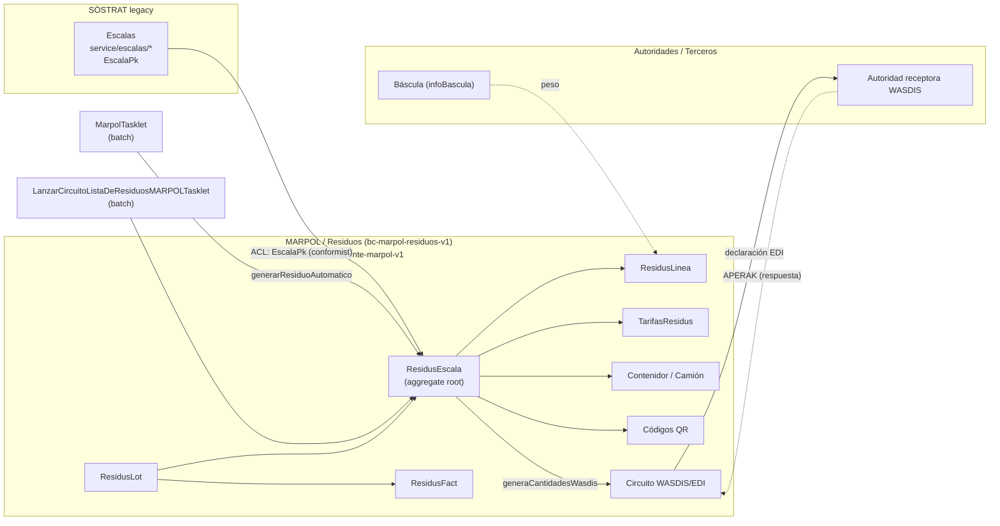

# [IA-GEN] Dossier — MARPOL / Residuos

> **Borrador generado por IA** (APB AI Framework — síntesis de apb-disc-spec-gen-v1.0/apb-pm-product-analysis-v1.0/apb-arch-c4-model-v1.0/apb-arch-decompose-v1.0) — pendiente validación humana. No distribuir sin revisión.

## 1. Cabecera

- **Nombre**: MARPOL / Residuos
- **Dominio DDD**: `dom-medio-ambiente-marpol-v1` (confirmado — ver §7)
- **Fase del roadmap**: 2 (`decomposition-roadmap.md` §Fase 2; `jira-backlog.md` EPIC-05)
- **Estado**: `discovered`, propuesta inicial 2026-07-11 (`proposals/bc-marpol-residuos-v1.md`), esta pasada de verificación adicional contra el código real es del 2026-07-13 y **corrige un bloqueante clave** (ver §13)
- **Bounded context**: `proposals/bc-marpol-residuos-v1.md`
- **Épica**: `jira-backlog.md` EPIC-05

## 2. Resumen ejecutivo

MARPOL/Residuos gestiona la recogida de residuos de buques en cumplimiento de la normativa internacional MARPOL: registro de la recogida asociada a una escala, pesaje por tipo/subtipo de residuo, gestión de contenedores y camiones de transporte, códigos QR de trazabilidad, y el circuito EDI de declaración a autoridades (WASDIS). Es el bounded context más grande y maduro del antiguo clúster "Servicios Auxiliares al Buque" — **114 clases de servicio** (`service/marpol/`) y **182 clases de acceso a datos** (`dataaccess/dto/marpol/`), confirmadas por conteo exacto sobre el checkout, frente a las 4 clases DTO citadas en la propuesta inicial. Corresponde también a la hipótesis de negocio "MEDI" (Medio Ambiente) del inventario Jira, que no tiene paquete de código propio separado — el análisis de código y el catálogo de dominios de APB convergen de forma independiente en la misma conclusión (`catalog-comparison.md` línea 15).

**Hallazgo clave de esta verificación**: la propia clase `ResidusEscala.java` **sí tiene los 7 valores de `idestat` nombrados como constantes literales en el código fuente** (`ID_ESTAT_RECIBIDO=1`, `ID_ESTAT_ANULADO=2`, `ID_ESTAT_NO_PAGADO=3`, `ID_ESTAT_CONFIRMADO=4`, `ID_ESTAT_ENVIADO=5`, `ID_ESTAT_PAGADO=6`, `ID_ESTAT_RECLAMADO=7`), y las 7 se usan activamente en el código (no son declaraciones muertas). Esto **corrige** la advertencia repetida en `jira-backlog.md`, `testing-strategy-fase2-4.md`, `threat-model-fase2-4.md` y `events-catalog.md §14`, que afirmaban que solo el valor 1 tenía nombre de constante confirmado. El bloqueante de negocio sobre los nombres de estado queda resuelto por evidencia de código — ver §13 y §14 para el detalle de qué sigue pendiente (la semántica de negocio de las transiciones, no los nombres).

## 3. Análisis funcional

### Responsabilidad de negocio
Registrar y gestionar el ciclo de vida de una recogida de residuos de buque (desde la solicitud hasta el pago), calcular su importe según tarifa, generar y enviar la declaración WASDIS a las autoridades, y dar soporte operativo a báscula, contenedores y camiones de transporte del residuo.

### Actores
- Operador de recogida de residuos (empresa gestora, p. ej. `empresa` en `ResidusEscala`).
- Operador de báscula (integración con `CN_InfoBasculaWS`, paquete `infoBascula`).
- Autoridad portuaria / marítima, receptora de la declaración EDI WASDIS.
- Escalas (`bc-escalas-v1`), como origen de la información de buque/escala vía `EscalaPk`.

### Casos de uso reales (grounded en `CN_ResidusEscala.java`, interfaz de 60+ operaciones)
- Alta de una recogida de residuos asociada a escala (`crear`, `crearDesdeFile`, `crearPDA`) — la propia interfaz define un enum de operación `Operacion {ALTA, MODIFICACION, CONFIRMAR, ANULAR}` (`CN_ResidusEscala.java:61`), que es el primer indicio de máquina de estados de negocio explícita.
- Modificación de una recogida ya creada (`modificar`, `modificarPDA`, con variantes para actualizar cantidades/servei de pesatge).
- Confirmación (`confirmar`, `confirmarTCON`) y anulación (`anular`, `anularTCON`, `anularPDA`) de una recogida.
- Pesaje de residuo por línea, con tipo/subtipo/unidad y cantidad (`ResidusLinea`).
- Búsqueda por código QR (`findByQr`, `getByQrAndRefServei`) — trazabilidad física del residuo/contenedor.
- Cálculo de importe de un lote de confirmación (`calcularImporte`), con tarifas propias en tabla `TARIFAS_RESIDUS` (`TarifasResidus.java`: `idtarifa`, `idtipus`, `fechaini/fechafi`, `rangoInferior/rangoSuperior`, `valor`, `valorServicioMar`) — **este es un tarifario propio de MARPOL, distinto de la tarifa L7 que se calcula en el lado de Escalas/Facturación** (ver §12).
- Validación de capacidad máxima declarada (`validarCapMaxMarpolAlineadaEnLineasDeRecogida`, `obtenerCapMaxMarpolParaTipoResiduo`) y de plazos de servicio (`plazoServicioAgotado`, `plazoSegundoServicio24h`, `plazoServicioAgotadoSinFondeos`).
- Generación automática de residuo (`generarResiduoAutomatico`, invocada por el batch `MarpolTasklet.java`).
- Generación de cantidades y envío del circuito WASDIS/EDI (`generaCantidadesWasdis`, `obtenerCantidadNotificadaWasdis`), con manejo de mensajes EDI (`CN_EDI_Helper_MARPOL_WASDIS`, `CN_EDI_Helper_Procesar_WASDIS`, `CN_EDI_Helper_WASDIS_APERAK` — incluye procesamiento de la respuesta APERAK del circuito EDI).
- Generación de PDF del expediente de recogida (`createPDFMarpol`).
- Gestión de contenedores y camiones asociados al transporte del residuo (paquetes `contenidor` — con histórico de taras `CN_ContenidorHistTara` — y `camio` — con histórico de taras `CN_CamioHistTara` y estado de depósito de gasoil `CN_EstatDipositGasoil`).
- Códigos QR de trazabilidad (`CN_CodisQR`).

### Reglas de negocio grounded (identificadores de ticket citados literalmente en el código)
- **MARPOL-77 / MARPOL-229**: cálculo de cantidad entregada declarada y de si aplica la "nova llei 2019" (`esAplicableNovaLlei2019`).
- **MARPOL-81**: gestión de límite de residuos (`LIMITACIO_RESIDUS`) y capacidad máxima alineada en líneas de recogida; introduce el campo `capmaxmarpol`/`quantlliuradadeclarada`.
- **MARPOL-139**: ampliación del modelo con `volumdecla`, `docexcluido`, `motivo`, `inivalidador`/`fivalidador`, `origendades` — trazabilidad de exclusión de documento y origen del dato.
- **MARPOL-140**: `inicivigencia` en `ResidusLinea`.
- **MARPOL-144**: regla de negocio explícita — *"Comprovar que es valida que en un mateix servei no vingui amb diferent mitjà de recollida (camió i gavarra) ja que el mitjà de recollida ha de ser comú a tot el servei"* (`ResidusEscala.combinar`, línea 1374).
- **MARPOL-145**: campo `datacordser` (fecha de acuerdo de servicio).
- **MARPOL-211**: campo `qr` (código QR) añadido al modelo de `ResidusEscala`.
- **MARPOL-281**: `getEmpresaMarpol281`, regla de negocio sobre empresa asociada no completamente documentada en este pase — citar el ticket y confirmar alcance con negocio antes de implementar.
- **WASDIS-65**: en `Dgs01DTO.java`, gestión de versiones del formato EDI WASDIS (4.1, 4.2, 4.3) con listas de tipos/subtipos que obligan a introducir sustancia — regla de formato regulatorio, no de negocio APB.

### Qué NO incluye
- No gestiona otros servicios auxiliares al buque (Aguada, Marinas, Pesca) pese a compartir el antiguo clúster de negocio — se mantienen como bounded context separado (`bc-servicios-auxiliares-cruceros-v1`/agrupación Aguada+Marinas+Pesca) por diferencia de tamaño y madurez (`bc-marpol-residuos-v1.md`, nota).
- No gestiona la escala en sí (buque, atraque) — eso es `bc-escalas-v1`; MARPOL solo consume `EscalaPk` como referencia.
- No gestiona la facturación/liquidación final del residuo — calcula su propio importe interno (`calcularImporte`, tabla `TARIFAS_RESIDUS`), pero la liquidación L7 de la escala (que integra el tipo de entrega de residuos como variable) vive en `CN_Escala_Impl.java`/`bc-liquidacion-v1` (ver §12, hallazgo de código nuevo de esta pasada).
- No incluye "MARDEP" (Marinas Deportivas): confirmado que ese concepto vive en `service/factestandar/marinas/`, un módulo distinto (`discovery-summary.md` línea 57) — **queda explícitamente fuera de este bounded context**, pese a la cercanía de nombre con "medio ambiente"/aguas.

## 4. Alcance de migración — qué se migra y qué NO por no estar en uso

**Se migra**: las 46 rutas Struts del paquete `marpol` (recontadas en esta pasada con `grep -c 'type="org.apb.sostrat.mvc.control.marpol'` sobre `struts-config.xml`, coincide exacto con `coverage-audit.md` línea 39), los subpaquetes de servicio `wasdis`, `pesatges`, `contenidor`, `camio`, `codisqr`, `infoBascula`, `informesResidus`, `imgcomponent` (114 clases confirmadas), y el circuito batch (`MarpolTasklet.java`, `LanzarCircuitoListaDeResiduosMARPOLTasklet.java`).

**No se migra por evidencia de código muerto** (`dead-code-register.md` #6, confianza ALTA):
- `sostrat/src/org/apb/sostrat/service/marpol/wasdis/edi/dto/Dgs01DTO.java`, método `isValidCodTipo` (líneas ~52 en adelante) — comentado con la declaración textual *"Este metodo ya no se usa, puesto que se busca en BD si está vigente el tipo, pero se mantiene por si se modificara en el futuro"*. Verificado en esta pasada: el método completo permanece comentado en el fichero (bloque con switch por `dgs01ciden` para versiones EDI 4.1/4.2/4.3). **Veredicto: no migrar, pero confirmar con negocio si el comentario "por si se modificara" sigue vigente** antes de descartarlo definitivamente — es la única salvedad del propio registro de código muerto.

**No se migra por estar fuera de este bounded context** (aunque el código esté activo): la lógica de liquidación entrelazada en `CN_Escala_Impl.java` (método `recuperarReduccionesEscala`, ver §12) — pertenece a Escalas/Facturación, no a MARPOL, aunque consuma conceptos de residuos (`ResidusPlaRecullida`, `TIPO_RESIDUOS_*`).

**Gap de evidencia explícito**: `TarifasResidus`/`ResidusLotEstat`/`ResidusRecollida`/`SubclasseMarpolNoWasdis`/`LimitacionM3Pasaje`/`LimitacionM3PorGt` y otras ~15 clases DTO del paquete (de las 182 totales) no se han inspeccionado campo a campo en esta pasada — se prioriza el flujo principal (`ResidusEscala`/`ResidusLot`/`ResidusFact`/`ResidusLinea`/`ResidusEstat`). No se afirma que estén cubiertas ni que sean código muerto; quedan como pendiente de una pasada de detalle antes de fijar el modelo de datos definitivo (ver §14).

## 5. Modelo de datos

Todas las clases están grounded en `sostrat/src/org/apb/sostrat/dataaccess/dto/marpol/*.java` (verificado directamente contra el checkout real, no solo contra el OpenAPI de discovery, que solo cubría un subconjunto de campos).

### `ResidusEscala` (tabla `RESIDUS_ESCALA`, PK `idresidu`)
Raíz de agregado. Campos reales completos (34, frente a los 11 recogidos en `specs/openapi-marpol-residuos.yaml`):

| Campo | Tipo Java | Nota |
|---|---|---|
| `idresidu` | `Long` | PK |
| `idestat` | `Integer` | Estado — ver enum completo abajo |
| `idsubport` | `String` | |
| `anyescala` / `numescala` | `Integer` | Referencia a `EscalaPk` (upstream de Escalas) |
| `idmitja` | `String` | Medio de recogida (p. ej. camión/gabarra — ver MARPOL-144) |
| `empresa` | `String` | Empresa gestora de residuos |
| `refservei` | `Long` | Referencia de servicio |
| `datasol` | `Date` | Fecha de solicitud |
| `iniservei` / `fiservei` | `Date` | Ventana de servicio |
| `refalbara` | `Long` | Referencia a albarán |
| `qr` | `String` | Código QR (MARPOL-211) |
| `observacions` | `String` | |
| `idopealta` / `idopemodificacio` | `String` | Auditoría de operador |
| `datalta` / `datmodificacio` | `Date` | Auditoría de fecha |
| `idprocalta` / `idprocmodificacio` | `String` | Auditoría de proceso |
| `limitacion` | `String` | Valores `N`/`S`/`R` (`VALUE_EMPTY_RESTRICCIO`/`VALUE_LIMITACIO_RESIDUS`/`VALUE_SENSE_RESTRICCIO`, MARPOL-81) |
| `quantlliuradadeclarada` | `BigDecimal` | Cantidad entregada declarada (MARPOL-81) |
| `senserestriccio` | `String` | |
| `datacordser` | `Date` | Fecha acuerdo de servicio (MARPOL-145) |
| `volumdecla` | `Integer` | Volumen declarado, default 0 (MARPOL-139) |
| `docexcluido` | `Integer` | Documento excluido, default 1 (MARPOL-139) |
| `motivo` | `String` | Motivo de exclusión (MARPOL-139) |
| `inivalidador` / `fivalidador` | `Date` | Vigencia del validador (MARPOL-139) |
| `origendades` | `String` | Origen del dato (MARPOL-139) |
| `concrecion` | `Integer` | |
| `guid` | `Long` | |
| `idtipus` | `String` | Tipo de residuo (no persistido en la propia tabla según el mapeo del comentario, verificar en capa DAO) |
| `url` | `String` | |

**Enum `idestat` — las 7 constantes son literales confirmadas en `ResidusEscala.java` líneas 18-24** (corrección respecto a discovery, que solo daba el valor 1 por confirmado):

| Constante Java | Valor | Uso confirmado en código |
|---|---|---|
| `ID_ESTAT_RECIBIDO` | 1 | Sí (1 fichero) |
| `ID_ESTAT_ANULADO` | 2 | Sí (2 ficheros) |
| `ID_ESTAT_NO_PAGADO` | 3 | Sí (1 fichero) |
| `ID_ESTAT_CONFIRMADO` | 4 | Sí (2 ficheros) |
| `ID_ESTAT_ENVIADO` | 5 | Sí (1 fichero) |
| `ID_ESTAT_PAGADO` | 6 | Sí (1 fichero) |
| `ID_ESTAT_RECLAMADO` | 7 | Sí (1 fichero) |

Existe además una tabla catálogo `RESIDUS_ESTAT` (clase `ResidusEstat.java`), pero su DTO **solo contiene la columna `idestat`** (sin descripción textual embebida) — la traducción/etiqueta del estado, si existe, vive probablemente en `ResidusEstatIdioma.java` (no inspeccionada campo a campo en esta pasada).

### `ResidusLot` (tabla `RESIDUS_LOT`, PK `idlot`)
`idlot`, `datalot`, `idempresa`, `idestat` (Integer, catálogo propio `RESIDUS_LOT_ESTAT`/`ResidusLotEstat.java` — **sin constantes nombradas en el DTO**, a diferencia de `ResidusEscala`), `idtipus`, `importlot`, `dataenv`, `observacions`, `datafins`, `idopealta`/`idopemodificacio`, `datalta`/`datmodificacio`, `idprocalta`/`idprocmodificacio`, `guid`. Relación 1:1 con `ResidusFact` (campo `residusFact`) y N:M con `ResidusEscala` vía tabla puente `ResidusEscalaResidusLot`.

### `ResidusFact` (tabla `RESIDUS_FACT`, PK `idfact`)
`idfact`, `idlot` (FK), `datalot`, `numfact`, `datfact`, `impfact`, `observacions`, `importsimulat`, `impanterior`, campos de auditoría estándar (`idopealta`/`idopemodificacio`/`datalta`/`datmodificacio`/`idprocalta`/`idprocmodificacio`/`guid`).

### `ResidusLinea` (tabla `RESIDUS_LINEA`, PK compuesta `idlinea`+`idresidu`)
Campos reales completos (27, frente a los 9 del OpenAPI de discovery): `idlinea`, `idresidu` (FK), `idsubtipus`, `idtipus`, `idunitat`, `quantitat`, `quantitatpagada`, `ncamions`, `ncont`, `repercutit`, `importe` (mapea a columna `IMPORT`), `obsvapb`, `obsvext`, campos de auditoría estándar, `idsubclasse` (con constante `ID_SUBCLASSE_99`), `factor` (Float), `visadoeqmarpol` (default 0), `capmaxdeclarada`/`capmaxmarpol`/`quantitatlimitada` (MARPOL-81), `inicivigencia` (MARPOL-140), `idinforme`, `quantitatentregada`/`quantitatvalidada`/`quantitatnotificada`, `pagadamanual`.

### `TarifasResidus` (tabla `TARIFAS_RESIDUS`)
`idtarifa`, `idtipus`, `fechaini`/`fechafi`, `rangoInferior`/`rangoSuperior`, `valor`, `valorServicioMar` — tarifario propio por rango y tipo de residuo, **distinto y adicional** a la tarifa L7 que se calcula del lado de Escalas (ver §12).

### Mapeo a Azure SQL (propuesta, no confirmada con Arquitectura APB)
Tablas origen Oracle (`RESIDUS_ESCALA`, `RESIDUS_LOT`, `RESIDUS_FACT`, `RESIDUS_LINEA`, `RESIDUS_ESTAT`, `TARIFAS_RESIDUS`) mapean 1:1 a tablas Azure SQL homónimas dentro del esquema del nuevo servicio, manteniendo nombres de columna en minúsculas/snake_case destino salvo decisión en contra de Arquitectura APB. Los campos de auditoría (`idopealta`, `idopemodificacio`, `datalta`, `datmodificacio`, `idprocalta`, `idprocmodificacio`) se recomiendan homogeneizar con el patrón de auditoría estándar DOCKS en vez de replicarlos campo a campo — decisión de diseño, no tomada aquí.

## 6. Arquitectura técnica

Stack DOCKS: microservicio .NET en Azure Container Apps, Azure SQL propio, EntraID (OAuth2 client credentials, scopes `marpol.read`/`marpol.write` ya definidos en `specs/openapi-marpol-residuos.yaml`), Azure Service Bus para eventos, expuesto vía APIM (`https://apim.portdebarcelona.cat/marpol-residuos/v1`). Consume el bounded context de Escalas vía anti-corruption layer (patrón *conformist*, `bc-marpol-residuos-v1.md` línea 30) traduciendo `EscalaPk` (idsubport+anyescala+numescala) al identificador de escala del sistema destino.

## 7. Dominio DDD

- **Bounded context**: `bc-marpol-residuos-v1`, `parent_domain: dom-medio-ambiente-marpol-v1`.
- **Confirmación "MEDI = MARPOL"**: doble fuente independiente — el catálogo de dominios de APB ya proponía `dom-medio-ambiente-marpol-v1` (`catalog-comparison.md` línea 15) y el análisis de código bottom-up (`discovery-summary.md` línea 56) identificó que la hipótesis Jira "MEDI" no tiene paquete propio y apunta al mismo código de `service/marpol/`. Coincidencia fuerte, sin discrepancia.
- **MARDEP fuera de este BC**: confirmado — "Marinas" (incluyendo el concepto MARDEP/marinas deportivas) vive en `service/factestandar/marinas/`, módulo distinto de `service/marpol/` (`discovery-summary.md` línea 57). No hay solapamiento de paquete de código entre ambos.
- **Sin solapamiento con los BCs nuevos de la auditoría de cobertura** (Fase 6: Buques, Operadores Portuarios, Servicios Auxiliares de Cruceros, Inspección SCPP/PIF, Trámites de Cliente — `decomposition-roadmap.md` §Fase 6): ninguno de esos 5 bounded contexts referencia paquete `marpol` ni las tablas `RESIDUS_*`/`TARIFAS_RESIDUS`. Único punto de contacto real detectado con un dominio no-MARPOL es la relación con Escalas/Liquidación descrita en §12, ya conocida desde `decomposition-roadmap.md` línea 84.
- **Relaciones**: downstream (conformist) de `bc-escalas-v1` vía `EscalaPk`. Sin bounded contexts downstream de MARPOL detectados (`downstream_contexts: []` en la propuesta original, confirmado — ningún otro paquete de código importa clases de `dataaccess.dto.marpol` fuera de `service/marpol` y el interfaz puntual `CN_EnvioMarpolEscala` en `service/escalas`).

## 8. Pantallas UI

Ver `ui-screens-backlog.md` §"App: MARPOL/Residuos" (Fase 2):
1. **Listado de Recogidas de Residuos** (`dxDataGrid`) — columnas: `idresidu`, `idestat` (badge de color, 7 estados — **ya no bloqueado**, ver §5), `idsubport/anyescala/numescala`, `empresa`.
2. **Ficha de Recogida** (`dxForm` + `dxTabPanel`) — pestaña "Datos" + pestaña "Líneas de Residuo" (`dxDataGrid` maestro-detalle): `idtipus`, `idsubtipus`, `quantitat`, `ncamions`, `ncont`, `importe`.
3. **Pantalla de Pesaje** (`dxForm` específico, lanzada desde una línea) — captura de `quantitat`, con integración potencial a báscula real vía el patrón ya existente de `CN_InfoBasculaWS`.
4. **Widget de estado** (stepper, construido con `dxDataGrid`/CSS, no componente DevExtreme estándar) — posición dentro de los 7 estados reales, bloqueando transiciones inválidas.

No cubiertas explícitamente en el backlog de pantallas (gap a considerar en desarrollo, ver §14): gestión de contenedores/camiones (paquetes `contenidor`/`camio`), búsqueda por código QR, visor del circuito EDI WASDIS/APERAK, generación del PDF del expediente.

## 9. APIs

| Método | Ruta | Descripción |
|---|---|---|
| GET | `/ship-waste-collections` | Listar recogidas (filtros `idestat`, `idsubport`, `anyescala`, `numescala`, paginado por cursor) |
| POST | `/ship-waste-collections` | Registrar recogida |
| GET | `/ship-waste-collections/{idresidu}` | Obtener recogida |
| POST | `/ship-waste-collections/{idresidu}/weighings` | Registrar pesaje (línea de residuo) |

**Referencia**: `specs/openapi-marpol-residuos.yaml` (OpenAPI 3.0.3, seguridad EntraID OAuth2 client credentials). **Gap detectado en esta verificación**: el contrato cubre solo `ResidusEscala`/`ResidusLinea` con un subconjunto de campos (11 de 34 en `ShipWasteCollection`, 9 de 27 en `Weighing`) — no expone `ResidusLot`/`ResidusFact` (agregación en lotes y facturación de lote), ni las operaciones de contenedor/camión/QR/PDF de `CN_ResidusEscala.java`. El contrato actual cubre el flujo transaccional básico, no la superficie completa de 60+ operaciones de la interfaz de servicio real — ampliar antes de dar el contrato por definitivo (ver §14).

## 10. Eventos

| Evento | Trigger | Fuente |
|---|---|---|
| `ListaResiduosMarpolGenerada` | Circuito batch de residuos (`MarpolTasklet.java` → `generarResiduoAutomatico`), no un `POST` directo de usuario final | `dataaccess/dto/marpol/ResidusLot.java` (tabla `RESIDUS_LOT`) |
| `ResiduoPesado` | Registro de pesaje de una línea de residuo | `dataaccess/dto/marpol/ResidusLinea.java` (tabla `RESIDUS_LINEA`) |

**Referencia**: `specs/asyncapi-fase2.yaml` (canal `evt.sostrat.marpol-residuos`, envelope CloudEvents 1.0, DLQ dedicada `evt.sostrat.marpol-residuos.dlq`). Regla de negocio del evento `ResiduoPesado` (`x-business-rules` del AsyncAPI): la nota sobre "solo el valor 1 confirmado" en el propio fichero de especificación **queda corregida por esta verificación** (§5) — las 7 constantes están confirmadas en código, pendiente actualizar el AsyncAPI/OpenAPI de discovery para reflejarlo (ver §14, acción de seguimiento).

No hay evento de cambio de estado (`idestat`) de la recogida como entidad de primer nivel en el AsyncAPI actual — solo `ListaResiduosMarpolGenerada`/`ResiduoPesado`. Dado que ahora los 7 estados están confirmados con nombre, es razonable evaluar un evento explícito `RecogidaResiduosEstadoCambiado` en el diseño final — no implementado aquí, es una recomendación de diseño.

## 11. Diagrama topológico (C4 nivel 1)

## 12. Estrategia de convivencia con el modelo actual

1. **Dependencia dura de Escalas (ACL, patrón conformist)**: MARPOL no tiene identidad propia sin `EscalaPk` (`idsubport`+`anyescala`+`numescala`). La extracción requiere un ACL que traduzca ese identificador al modelo destino de Escalas — que, según `dossier-00-escalas-migracion-argos.md`, tiene como destino real `APB.API.TES` (ARGOS), no un servicio "Escalas" nuevo. **Implicación directa para MARPOL**: el ACL debe apuntar finalmente a ARGOS/TES, no a un hipotético microservicio SÒSTRAT intermedio — mismo criterio ya aplicado a Cruceros/Ferrocarril/Aguada (`decomposition-roadmap.md` §Fase 5, punto 3).
2. **Cruce nuevo con Facturación/Liquidación (tarifa L7), confirmado en esta pasada**: el método `recuperarReduccionesEscala(Escala, EscalaAspecte)` de `CN_Escala_Impl.java` (líneas 10193-10475) calcula bonificaciones/reducciones sobre la **tarifa L7** (constante real `Constantes.TARIFA_L7`, referenciada en `CN_Escala_Impl.java:10279` y `:10802`; la clase `Constantes.java` de ese paquete no está incluida en este checkout, mismo patrón de ausencia parcial ya documentado en `dead-code-register.md` ítems de confianza MEDIA) en función del **tipo de entrega de residuos** (`ResidusPlaRecullida`, `TIPO_RESIDUOS_AMBOS`/`SOLIDOS`/`LIQUIDOS`/`NULO`/`SOLIDOSLIQUIDOS`). Es decir: **la facturación de la escala consume el plan de recogida de residuos como variable de bonificación**, un acoplamiento no documentado en la propuesta original de MARPOL ni en `decomposition-roadmap.md` §1 (que solo listaba "MARPOL depende de Escalas" en una dirección). Los dos bloques de código muerto confirmados (`dead-code-register.md` #2 y #3, ESCA-1328 y ESCA-1654) están dentro de este mismo método — ambos bloques desactivaban comparaciones del plan de recogida (`ResidusPlaRecullida`) para simplificar el cálculo a "siempre continuar el tratamiento" (`lBolContinuarTratamiento = true`). **No deben migrarse ni replicarse** en el servicio destino, sea MARPOL o Facturación — están confirmados obsoletos por el propio desarrollador legado.
3. **`ResidusPlaRecullida` no es lo mismo que `RESIDUS_ESCALA`**: es una clase distinta (`dataaccess.dto.escalas.ResidusPlaRecullida`, no `dataaccess.dto.marpol.*`) que vive en el paquete de Escalas, no en el de MARPOL. Representa el "plan de recogida" (contrato/expectativa) mientras que `ResidusEscala`/`ResidusLot`/`ResidusLinea` representan la recogida real ejecutada. **Decisión de diseño pendiente**: ¿el plan de recogida pertenece al bounded context de MARPOL (es su fuente de verdad de planificación) o queda en Escalas como hoy? No resuelto en esta pasada — recomendación: tratarlo como parte de MARPOL, dado que su propósito es exclusivamente de residuos, pero requiere confirmación con Arquitectura APB antes de mover el código.
4. **Tarifa propia (`TARIFAS_RESIDUS`) coexiste con L7**: MARPOL calcula su propio importe interno de recogida (`calcularImporte`, sobre `TarifasResidus`) independientemente del cálculo L7 de bonificación en Escalas. Ambos cálculos deben mantenerse sincronizados conceptualmente durante la migración — no es la misma tarifa, pero comparten el mismo hecho de negocio (tipo de residuo entregado).
5. **Circuito EDI WASDIS**: mantiene su propio adaptador (`wasdis/edi/*`), incluyendo procesamiento de la respuesta `APERAK`. Se recomienda mantenerlo como adaptador de infraestructura dentro del propio servicio MARPOL (no como servicio EDI transversal), salvo que la resolución del punto abierto en `catalog-comparison.md` línea 64 (*"¿EDI es un dominio propio o un patrón repartido?"*) — ya resuelto a favor de "infraestructura transversal" (`dom-integraciones-edi-v1`) — implique extraer también el adaptador WASDIS a ese dominio transversal. Si se confirma esa extracción, MARPOL pasaría a consumir el gateway EDI genérico en vez de mantener su propio adaptador — decisión de diseño no tomada aquí.

## 13. Testing y seguridad

**Testing** (`testing-strategy-fase2-4.md` §MARPOL/Residuos):
- Unit: transición de `idestat` (1-7) — **la nota original decía "bloqueante hasta confirmar con negocio los nombres reales de los estados 2-7"; esta verificación confirma los 7 nombres por evidencia de código directa (§5), por lo que el bloqueante de nomenclatura queda resuelto**. **Sigue pendiente y sí sigue siendo bloqueante**: confirmar con negocio la **semántica de las transiciones válidas** (p. ej., ¿puede pasarse de "No pagado" a "Reclamado" directamente, o solo a través de "Enviado"/"Pagado"?) — los nombres no implican por sí solos el grafo de transiciones permitido.
- Contract: validar que `ResiduoPesado` nunca incluye campos fuera de `ResidusLineaData`.
- E2E: flujo completo recogida → pesaje → cierre de lote → factura asociada — **cruza con Facturación y Liquidaciones (Fase 4)**, y con el hallazgo nuevo de §12 (tarifa L7) — coordinar el orden real de implementación con esa dependencia antes de fijar el plan de pruebas E2E definitivo.

**Seguridad** (`threat-model-fase2-4.md` amenaza #16, STRIDE Tampering): *"Los estados con nombres no confirmados (`ResidusEscala.idestat` 2-7 (...)) podrían implementarse con semántica incorrecta si no se valida con negocio antes de codificar la máquina de estados"*, severidad Media. **Actualización de esta pasada**: el riesgo de "nombre incorrecto" queda mitigado (nombres confirmados por código), pero el riesgo de fondo — máquina de estados mal definida permitiendo transiciones inválidas de negocio (p. ej. "Pagado"→"Recibido") — **se mantiene íntegro**, porque depende de la semántica de negocio de las transiciones, no del nombre del estado. No cerrar este ítem del checklist de seguridad solo por esta corrección.

Configuración de seguridad legacy confirmada: `applicationContext-spring-security-residuos.xml` define roles dedicados `ROLE_MLISTRES` (listados de residuos/WASDIS) y `ROLE_MISSATGESEDI` (mensajería EDI WASDIS, incluye `verMensajeOrigen`/`verMensajeResponde`/`generarMensajeEstructurado`) — mapear a scopes/roles EntraID equivalentes en destino, distintos del genérico `marpol.read`/`marpol.write` ya definido en el OpenAPI si se quiere preservar la segregación de permisos entre "ver listados" y "gestionar mensajería EDI".

## 14. Riesgos y gaps de evidencia conocidos

- **Semántica de transiciones de `idestat` no confirmada con negocio** (persiste tras esta verificación — ver §13): los nombres están confirmados, el grafo de transiciones válidas no.
- **`ResidusPlaRecullida` sin bounded context asignado**: vive hoy en el paquete de Escalas pero es conceptualmente de MARPOL — decisión de diseño pendiente (§12, punto 3).
- **Contrato OpenAPI incompleto frente a la interfaz de servicio real**: cubre ~30% de los campos de `ResidusEscala`/`ResidusLinea` y ninguna operación de `ResidusLot`/`ResidusFact`/contenedor/camión/QR/PDF (§9).
- **~15 clases DTO del paquete no inspeccionadas campo a campo** en esta pasada (`ResidusLotEstat`, `ResidusRecollida`, `SubclasseMarpolNoWasdis`, `LimitacionM3Pasaje`, `LimitacionM3PorGt`, etc.) — no se afirma que falten del alcance, solo que no se ha verificado el detalle de campos.
- **MARPOL-281 (`getEmpresaMarpol281`) sin alcance de negocio documentado** — citado por ticket, no explicado.
- **`Dgs01DTO.isValidCodTipo` comentado "por si se modifica en el futuro"** — único hallazgo de código muerto de este ámbito con matiz de reversibilidad; confirmar con negocio antes de excluirlo en firme (§4).
- **AsyncAPI/OpenAPI de discovery desactualizados respecto al hallazgo de §5** (constantes de estado confirmadas) — actualizarlos es una acción de seguimiento de bajo esfuerzo, no ejecutada en este documento por no ser su alcance.
- **Pantallas de contenedor/camión/QR/EDI no cubiertas en `ui-screens-backlog.md`** (§8) — gap de alcance de diseño de UI, no de evidencia de código (el código existe, la pantalla no está en el backlog).

## 15. Estimación de esfuerzo

Ver `jira-backlog.md` EPIC-05 (Fase 2, valor de negocio medio-alto, riesgo técnico medio, dependencias EPIC-00 + ACL con Escalas validada en EPIC-01):
- 4 historias de usuario estimadas: registrar recogida (8 pts), registrar pesaje (5 pts), generación/envío automático de declaración WASDIS (8 pts), máquina de estados de 7 transiciones con criterio de aceptación de rechazo 409/RFC 7807 (8 pts) — **29 pts** de historias ya estimadas.
- Tareas técnicas: migración de subpaquetes `pesatges`/`contenidor`/`camio`/`codisqr`, reconexión del tasklet batch, confirmación de nombres de estado — **este último punto queda resuelto por esta verificación**, reduciendo el riesgo/esfuerzo de esa tarea técnica específica a solo la confirmación de semántica de transición (§13), no de nomenclatura.
- **No incluido en la estimación original de EPIC-05** y a considerar como esfuerzo adicional tras esta verificación: ampliar el contrato OpenAPI para cubrir `ResidusLot`/`ResidusFact`/contenedor/camión/QR/PDF (§9), y decidir el encaje de `ResidusPlaRecullida` (§12) antes de cerrar el modelo de datos definitivo.

## 16. Checklist de validación

**Funcional**:
- [ ] Confirmar con negocio la semántica de las transiciones válidas entre los 7 estados de `idestat` (no solo los nombres, ya confirmados).
- [ ] Confirmar el alcance de la regla MARPOL-281 (`getEmpresaMarpol281`).
- [ ] Confirmar si `Dgs01DTO.isValidCodTipo` (comentado) debe excluirse definitivamente o si el escenario "por si se modifica en el futuro" sigue siendo relevante.
- [ ] Confirmar si `ResidusPlaRecullida` (plan de recogida) debe pasar a ser propiedad de MARPOL o permanecer en Escalas.

**Desarrollo**:
- [ ] Diseñar el ACL hacia el destino real de Escalas (ARGOS/`APB.API.TES`, no un servicio SÒSTRAT intermedio — ver `dossier-00-escalas-migracion-argos.md`).
- [ ] Ampliar `specs/openapi-marpol-residuos.yaml` para cubrir `ResidusLot`/`ResidusFact` y las operaciones de contenedor/camión/QR/PDF antes de fijarlo como contrato definitivo.
- [ ] Actualizar `specs/openapi-marpol-residuos.yaml`/`specs/asyncapi-fase2.yaml` para reflejar los 7 nombres de estado confirmados (§5), eliminando la advertencia de "solo el valor 1 confirmado".
- [ ] Coordinar con el equipo de Facturación y Liquidaciones (Fase 4) el tratamiento del cálculo de tarifa L7/bonificación por tipo de residuo (`recuperarReduccionesEscala`) antes de separar físicamente MARPOL de Escalas — riesgo de romper ese cálculo si se migra sin coordinación.
- [ ] Inspeccionar campo a campo las ~15 clases DTO no cubiertas en esta pasada antes de fijar el modelo de datos definitivo.
- [ ] Mapear `ROLE_MLISTRES`/`ROLE_MISSATGESEDI` legacy a scopes EntraID de destino.

## 17. Historial de cambios

| Versión | Fecha | Autor | Cambio |
|---------|-------|-------|--------|
| 1.0.0 | 2026-07-13 | APB AI Framework | Dossier inicial, a petición explícita del usuario. Verificación adicional contra el checkout real de `SOSTRAT-Sostrat-MJ8` que corrige el bloqueante de nombres de estado `idestat` (las 7 constantes están confirmadas en código, no solo la 1), confirma el vínculo `CN_EnvioMarpolEscala`/`recuperarReduccionesEscala` con la tarifa L7 de Facturación, y amplía el modelo de datos de 4 a 6 clases DTO con campos completos |
