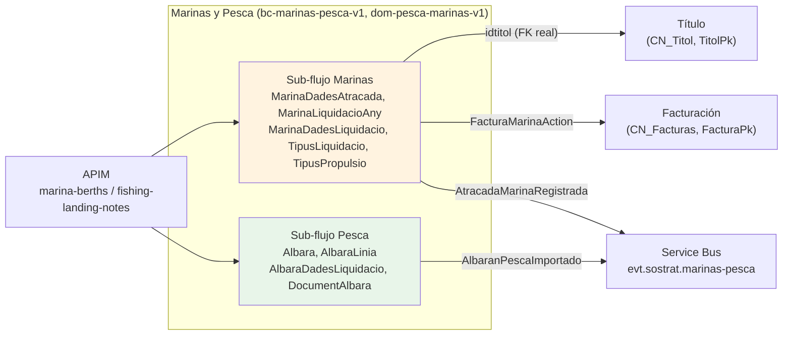

# [IA-GEN] Dossier — Marinas y Pesca

> **Borrador generado por IA** (APB AI Framework — síntesis de apb-disc-spec-gen-v1.0/apb-pm-product-analysis-v1.0/apb-arch-c4-model-v1.0/apb-arch-decompose-v1.0) — pendiente validación humana. No distribuir sin revisión.

## 1. Cabecera

- **Nombre**: Marinas y Pesca
- **Dominio DDD**: `dom-pesca-marinas-v1` (clasificación `generic`, ya existente en `apb-domain-catalog`)
- **Fase del roadmap**: 2 (`decomposition-roadmap.md` §Fase 2 — junto a PPS, MARPOL/Residuos, Aguada y Transporte Terrestre)
- **Estado**: **DISCOVERED** — bounded context propio con evidencia de código completa para sus dos sub-flujos; una pregunta de modelado (separar Marinas de Pesca en dos dominios) queda explícitamente abierta por el propio catálogo
- **Bounded context**: `proposals/bc-marinas-pesca-v1.md` (v1.1.0, reparentado el 2026-07-11 desde el bounded context agrupado original `bc-servicios-auxiliares-buque-v1`)
- **Épica**: `jira-backlog.md` EPIC-06 (ver §15 sobre una discrepancia de alcance detectada en esta épica)

## 2. Resumen ejecutivo

Marinas y Pesca agrupa dos sub-flujos de negocio no comerciales sobre el buque, hoy separados en el código SÒSTRAT y reparentados el 2026-07-11 al mismo dominio real del catálogo (`dom-pesca-marinas-v1`, `generic`): la gestión de atraques en marinas deportivas con su liquidación anual (`service/factestandar/marinas/`, tabla `MARINA_DADES_ATRACADA`) y el registro de albaranes de descarga de actividad pesquera (`service/gpesca/`, tabla `ALBARA`). La verificación de código de este dossier confirma la evidencia base del catálogo (`MarinaDadesAtracada.java`, `Albara.java`/`AlbaraBase.java`, sin acoplamiento a Escalas en ninguno de los dos sub-flujos) y añade dos hallazgos no recogidos hasta ahora: (1) el sub-flujo de Marinas sí tiene acoplamiento real a Título y a Facturación a través de `FacturaMarinaAction.java` y del campo `idtitol`, algo que Pesca no tiene, lo que aporta evidencia nueva — pero no resuelve — a la pregunta abierta de si Marinas y Pesca deben separarse; (2) existe un sub-modelo de liquidación anual de Marinas (`MarinaDadesLiquidacio`, `TipusLiquidacio`, `TipusPropulsio`, `LiqT5T0*`) y un sub-modelo de líneas/documentos de Pesca (`AlbaraLinia`, `AlbaraDadesLiquidacio`, `DocumentAlbara`, `FitxerPesca`) sustancialmente más ricos que los dos agregados descritos en la propuesta original y en los contratos OpenAPI/AsyncAPI actuales.

## 3. Análisis funcional

Se tratan Pesca y Marinas como dos sub-flujos dentro de la misma app, cada uno con sus propios actores y casos de uso — no comparten agregado ni PK, y solo confluyen en el nivel de dominio/servicio.

### Sub-flujo: Marinas (atraques deportivos y liquidación anual)

**Responsabilidad**: registrar el atraque de una embarcación en una marina deportiva y gestionar su liquidación de tasas anual.

**Actores**:
- Gestor de marina deportiva (alta y consulta de atraques).
- Propietario/armador de la embarcación (sujeto de la liquidación).
- Gestor de facturación (a través de `FacturaMarinaAction.java`, ver hallazgo de acoplamiento en §7).

**Casos de uso reales, grounded en las 9 entradas de `struts-config.xml` (líneas 1076-1089) mapeadas a 5 clases Action distintas**:
- Alta/consulta de atraque (`/marina`, `/marina_popup` → `MarinaAction.java`).
- Alta/consulta del tipo de liquidación anual de una marina (`/marinaResumTipusLiqAny`, `/marinaResumTipusLiqAny_popup` → `MarinaTipusLiquidacioAnyAction.java`).
- Gestión del atraque dentro de la ficha (`/marinaAtraque_popup`, `/marinaPestAtraque` → `MarinaAtraqueAction.java`, mismo Action mapeado dos veces con paths distintos).
- Resumen de atraques (`/marinaAtraqueResum_popup`, `/marinaPestResumenAtraque` → `MarinaAtraqueResumAction.java`, misma duplicidad de mapeo).
- Consulta/gestión de facturas de marina (`/facturasMarina_popup`, `/marinaPestFactura` → `FacturaMarinaAction.java`, misma duplicidad de mapeo).
- Importación desde Excel de atraques (`ImportarExcel.java`, `service/factestandar/marinas/CN_LiqT5T0.java` para el cálculo de la liquidación T5-T0).

### Sub-flujo: Pesca (albaranes de descarga)

**Responsabilidad**: registrar el albarán de descarga de una operación de pesca, con sus líneas de detalle (cajas, peso, importe) y documentos adjuntos.

**Actores**:
- Gestor de actividad pesquera / punto de venta (alta del albarán).
- Armador (`idarmador`, titular de la embarcación pesquera).

**Casos de uso reales, grounded en las 6 rutas de `struts-config-gpesca.xml`**:
- Alta/consulta de albarán (`/albarans` → `AlbaraAction.java`).
- Consulta de auditoría del albarán (`/albaransAudit` → `AlbaraAuditAction.java`).
- Gestión de líneas de detalle del albarán — cajas, peso, importe (`/albaransLinia`, `/albaransLinia_popup` → `AlbaraLiniaAction.java`).
- Consulta de auditoría de datos de liquidación del albarán (`/albaradadesliquidacioAudit` → `AlbaraDadesActionAudit.java`).
- Descarga de fichero adjunto (`/verFicheroPesca` → `FileDownload.java`).
- Importación masiva de albaranes desde fichero (`service/gpesca/CN_ImportarAlbarans.java`, DTO `FitxerPesca.java`).

### Qué NO incluye

No incluye Aguada (`bc-aguada-v1`, bajo `dom-suministros-buques-v1`) — bounded context separado tras el reparenting del 2026-07-11, aunque `jira-backlog.md` EPIC-06 sigue agrupando los tres en la redacción de la épica (ver discrepancia documentada en §15).

## 4. Alcance de migración — qué se migra y qué NO por no estar en uso

- **Se migran** los 6 casos de uso de Pesca (`struts-config-gpesca.xml`, 6 rutas exactas) y los 5 casos de uso de Marinas (9 entradas de `struts-config.xml` que colapsan en 5 Action classes reales por duplicidad de mapeo `_popup`/`Pest*`).
- **No se ha encontrado código muerto en este ámbito** — `dead-code-register.md` no contiene ninguna entrada para `gpesca`, `marinas`, `MARINA_DADES_ATRACADA` ni `ALBARA` (búsqueda sin resultados).
- **Duplicidad de mapeo a limpiar, no a migrar dos veces**: `MarinaAtraqueAction`, `MarinaAtraqueResumAction` y `FacturaMarinaAction` están cada uno mapeados por dos paths Struts distintos (`*_popup` vs `marinaPest*`) — es la misma pantalla servida en modo popup y en modo pestaña embebida; en destino debe migrarse como un único endpoint/pantalla, no duplicarse.
- **No se migra el sub-modelo de liquidación de Marinas (`MarinaDadesLiquidacio`, `TipusLiquidacio`, `TipusPropulsio`, `LiqT5T0*`) en esta pasada de contrato** — existe en código, tiene rutas Struts reales, pero no está cubierto por `specs/openapi-marinas-pesca.yaml` ni por `bc-marinas-pesca-v1.md` (que solo lista `MarinaLiquidacioAny` como entidad, sin sus tablas satélite). Ver gap en §14.
- **No se migra el sub-modelo de líneas/documentos de Pesca (`AlbaraLinia`, `AlbaraDadesLiquidacio`, `DocumentAlbara`, `FitxerPesca`) en esta pasada de contrato** — mismo motivo, no cubiertos por el OpenAPI actual. Ver gap en §14.

## 5. Modelo de datos

### Marinas

**`MarinaDadesAtracada`** (tabla `MARINA_DADES_ATRACADA`, PK `seqdades`) — fuente: `dataaccess/dto/marinas/MarinaDadesAtracada.java`. **27 campos reales**, frente a los 11 que expone hoy `specs/openapi-marinas-pesca.yaml`:

| Campo | Tipo Java | Nota |
|---|---|---|
| `seqdades` | `Long` | PK |
| `idusuari` | `String` | |
| `idsubport` | `String` | |
| `idtitol` | `Integer` | **FK real a Título** (no expuesta en el OpenAPI actual como relación, ver §7) |
| `nomvaixell` | `String` | expuesto en OpenAPI |
| `matricula` | `String` | expuesto en OpenAPI |
| `nompropietari` | `String` | expuesto en OpenAPI |
| `idpais` | `Integer` | **no expuesto en OpenAPI** |
| `exemptet0` | `String` | **no expuesto en OpenAPI** |
| `eslora` | `BigDecimal` | expuesto en OpenAPI |
| `maniga` | `BigDecimal` | expuesto en OpenAPI |
| `idtipuspropulsio` | `String` | FK a `TIPUS_PROPULSIO`, **no expuesto en OpenAPI** |
| `baseenport` | `String` | **no expuesto en OpenAPI** |
| `dataentrada` | `Date` | expuesto en OpenAPI |
| `datasortida` | `Date` | expuesto en OpenAPI |
| `ubicacio` | `String` | **no expuesto en OpenAPI** |
| `idopealta`/`idopemodificacio`/`idprocalta`/`idprocmodificacio`/`datalta`/`datmodificacio` | auditoría estándar | **no expuestos en OpenAPI** |
| `guid` | `Long` | **no expuesto en OpenAPI** |
| `numdiesfora` | `Integer` | **no expuesto en OpenAPI** |
| `dataentaiguas`/`datasortaiguas` | `Date` | **no expuesto en OpenAPI** |
| `exemptet5` | `String` | añadido por ticket `MARDEP-50`, **no expuesto en OpenAPI** |

**`MarinaLiquidacioAny`** (tabla `MARINA_LIQUIDACIO_ANY`) — fuente: `dataaccess/dto/marinas/MarinaLiquidacioAny.java`. PK real confirmada por `createPk()`: **`idusuari + idsubport + anyo`** (no `idusuari+idsubport+idtitol` como podría deducirse de los campos declarados — `idtitol` e `idtipusliq` existen como atributos pero no forman parte de la PK). Campos: `idusuari`, `idsubport`, `idtitol`, `anyo`, `idtipusliq` (FK a `TIPUS_LIQUIDACIO`).

**Entidades satélite no documentadas hasta ahora en `bc-marinas-pesca-v1.md`** (halladas en esta verificación):
- `MarinaDadesLiquidacio` (tabla `MARINA_DADES_LIQUIDACIO`): `idusuari`, `idsubport`, `idtitol`, `aiguaenconcessio`, `idperiodicitat`, `datinici`, `liquidatfins`, `recalculardesde`, `idservei`, + auditoría.
- `TipusLiquidacio` (tabla `TIPUS_LIQUIDACIO`, PK `idtipusliq`) + `TipusLiquidacioIdioma` (traducciones).
- `TipusPropulsio` (tabla `TIPUS_PROPULSIO`) + `TipusPropulsioIdioma` (traducciones) — catálogo referenciado por `MarinaDadesAtracada.idtipuspropulsio`.
- `LiqT5T0MarinaDTO`/`LiqT5T0LineaDTO`/`LiqT5T0ImportesDTO`/`LiqT0ExentoDTO`/`LiqT5T0ResumenAtraquesDTO` (`service/factestandar/marinas/CN_LiqT5T0.java`): cálculo de la liquidación tarifaria T5-T0, no modelado en ningún artefacto de esta serie hasta ahora.
- `MarinaAtracadesDesdeFitxerDTO`: soporte de la importación por Excel (`mvc/control/factestandar/marinas/ImportarExcel.java`).

### Pesca

**`Albara`/`AlbaraBase`** (tabla `ALBARA`, PK `idport+idalbara`) — fuente: `dataaccess/dto/gpesca/AlbaraBase.java` (confirmada la PK exacta en `AlbaraPk.java`: `idalbara`, `idport`). **14 campos reales**, frente a los 9 que expone hoy `specs/openapi-marinas-pesca.yaml`:

| Campo | Tipo Java | Nota |
|---|---|---|
| `idalbara` | `String` | PK parte 1, expuesto en OpenAPI |
| `idport` | `String` | PK parte 2, expuesto en OpenAPI |
| `data` | `Date` | expuesto en OpenAPI |
| `importtotal` | `BigDecimal` | expuesto en OpenAPI |
| `idarmador` | `Long` | expuesto en OpenAPI |
| `idvaixell` | `Long` | expuesto en OpenAPI |
| `entrada` | `Long` | **no expuesto en OpenAPI** |
| `puntodeventa` | `String` | **no expuesto en OpenAPI** |
| `observacions` | `String` | **no expuesto en OpenAPI** |
| `dataliquidacio` | `Date` | expuesto en OpenAPI |
| `origen` | `Long` | **no expuesto en OpenAPI** |
| `numalbara` | `String` | expuesto en OpenAPI |
| `esborrador` | `String` | expuesto en OpenAPI |
| `idservei` | `Long` | **no expuesto en OpenAPI** |

**Entidades satélite no documentadas hasta ahora en `bc-marinas-pesca-v1.md`**:
- `AlbaraLinia`/`AlbaraLiniaBase` (tabla presumible `ALBARA_LINIA`, no confirmada por nombre literal en esta pasada): `idport`, `idalbara`, `idlinia`, `numcaixes`, `pes`, `import_`, `observacions` + auditoría — son las líneas de detalle reales del albarán (cajas, peso, importe), ausentes del contrato OpenAPI actual, que solo modela la cabecera.
- `AlbaraDadesLiquidacio` (datos de liquidación del albarán, con su propia auditoría — `AlbaraDadesActionAudit.java` la expone vía Struts).
- `DocumentAlbara` (documentos adjuntos al albarán).
- `FitxerPesca` (registro de fichero de importación masiva, soporte de `CN_ImportarAlbarans.java`).

### Mapeo a Azure SQL

Sin decisión de mapeo físico confirmada en la evidencia disponible (`tech_stack: [.NET, Azure SQL]` en `bc-marinas-pesca-v1.md`, sin DDL de destino). Recomendación provisional, no confirmada: una base de datos por servicio con dos esquemas o prefijos de tabla (`marinas.*`, `pesca.*`) reflejando los dos sub-flujos, dado que no comparten PK ni FK directa entre sí.

## 6. Arquitectura técnica

Stack DOCKS (.NET, Azure SQL, EntraID vía OAuth2 client-credentials — confirmado en `securitySchemes.entraId` de `specs/openapi-marinas-pesca.yaml` —, Service Bus, APIM).

**Nota sobre aislamiento de fallos entre los dos sub-recursos dentro del mismo servicio**: `testing-strategy-fase2-4.md` §"Marinas y Pesca" señala explícitamente que `marina-berths` y `fishing-landing-notes` conviven en el mismo servicio/proceso y exige verificar en integración "que un fallo en uno no bloquea el otro" — es decir, aunque son dos sub-flujos de negocio independientes (sin FK cruzada, sin acoplamiento de código detectado entre `marinas/` y `gpesca/`), la decisión de desplegarlos como un único servicio técnico introduce un riesgo de disponibilidad compartida que no existiría si se separaran. Esta nota de testing es, en la práctica, la misma señal de arquitectura que alimenta la pregunta abierta de separación de dominios (§7, §14): el testing ya asume que conviven en un proceso, pero no da por resuelto si deben seguir así.

## 7. Dominio DDD

- **Bounded context**: `bc-marinas-pesca-v1` (`proposals/bc-marinas-pesca-v1.md`), `parent_domain: dom-pesca-marinas-v1`.
- **Clasificación**: `generic` (agrupa Marinas y Pesca como actividad no comercial-carga, distinta de Suministros a Buques).
- **Sin solapamiento con otros bounded contexts de esta serie**: `catalog-comparison.md` (línea 28) confirma que el catálogo real separa explícitamente `dom-pesca-marinas-v1` (Pesca + Marinas) de `dom-suministros-buques-v1` (Aguada + Shore Power/OPS + Bunkering + Moll de l'Energia) — son dos dominios de negocio distintos por tipo de servicio ("suministro al buque" vs. "actividad no comercial"), no una única agrupación por tamaño de código como asumía la propuesta original (`bc-servicios-auxiliares-buque-v1`, ya retirada).
- **Sin acoplamiento a Escalas confirmado por código** en ninguno de los dos sub-flujos: búsqueda de imports de `dataaccess.dto.escalas.*` en `service/gpesca/`, `service/factestandar/marinas/`, `dataaccess/dto/gpesca/` y `dataaccess/dto/marinas/` no encuentra ninguna referencia a la excepción matizada abajo.
- **Matiz encontrado en esta verificación** (no invalida la conclusión anterior, la precisa): `mvc/control/factestandar/marinas/ImportarExcel.java` importa `org.apb.sostrat.dataaccess.dto.escalas.ArmadorLloyds` — pero `ArmadorLloyds` (tabla `ARMADOR_LLOYDS`) es un catálogo de referencia de armadores del registro Lloyd's, físicamente ubicado en el paquete `dataaccess.dto.escalas` por convención histórica del proyecto, **no** una referencia al agregado de Escala/Atracada (`EscalaPk`). No hay ningún uso de `EscalaPk` ni de `Escala`/`Atracada` en ninguno de los dos sub-flujos — la ausencia de acoplamiento de negocio a Escalas se mantiene confirmada.
- **Hallazgo nuevo de esta verificación — acoplamiento real a Título y Facturación, solo en el sub-flujo de Marinas**: `mvc/control/factestandar/marinas/FacturaMarinaAction.java` importa `org.apb.sostrat.dataaccess.dto.FacturaPk`, `TitolPk`, `TitolDades`, `org.apb.sostrat.service.CN_Titol` y `org.apb.sostrat.service.facturas.CN_Facturas`/`FacturasDelegate`; `MarinaTipusLiquidacioAnyAction.java` también importa `CN_Titol`/`TitolPk`/`TitolDades`. El campo `idtitol` está presente tanto en `MarinaDadesAtracada` como en `MarinaLiquidacioAny`/`MarinaDadesLiquidacio`. **El sub-flujo de Pesca no presenta ningún import equivalente** (`CN_Albarans.java` y `AlbaraAction.java` verificados sin resultado). Esto no estaba reflejado en `bc-marinas-pesca-v1.md` (que afirma "sin acoplamiento detectado a otros dominios de negocio de SÒSTRAT") ni en `repo-domain-coverage.md` (que solo evaluó el eje de acoplamiento hacia Escalas, no hacia Título/Facturación).
- **Pregunta abierta del propio catálogo (no resuelta en este documento)**: la nota de `bc-marinas-pesca-v1.md` indica textualmente que el dominio está "a validar si deben separarse" Marinas y Pesca en dos dominios distintos. Este dossier no toma esa decisión. Aporta como evidencia adicional relevante para esa futura decisión — sin resolverla — la asimetría encontrada: Marinas tiene acoplamiento real a Título/Facturación (vía liquidación anual) y Pesca no tiene ningún acoplamiento externo detectado más allá de su propio sub-modelo.

## 8. Pantallas UI

Ver `ui-screens-backlog.md` §"App: Marinas y Pesca — mapea a `dom-pesca-marinas-v1`":
1. Panel con 2 pestañas (`dxTabPanel`): Marinas / Pesca.
2. Listado de Atraques en Marina (`dxDataGrid`) — columnas: `seqdades`, `nomvaixell`, `matricula`, `dataentrada/datasortida`.
3. Ficha de Atraque en Marina (`dxForm`) — campos: `nomvaixell`, `matricula`, `nompropietari`, `eslora`, `maniga`.
4. Listado de Albaranes de Pesca (`dxDataGrid`) — columnas: `idalbara`, `idport`, `importtotal`, `numalbara`, `dataliquidacio`.
5. Ficha de Albarán de Pesca (`dxForm`) — campos: `idarmador`, `idvaixell`, `importtotal`, `numalbara`.

**Gap frente al modelo de datos real (§5)**: el backlog de pantallas no incluye todavía ninguna pantalla para la liquidación anual de Marinas (`MarinaLiquidacioAny`/`MarinaDadesLiquidacio`/`TipusLiquidacio`) ni para las líneas de detalle/documentos del albarán de Pesca (`AlbaraLinia`, `DocumentAlbara`) — ambos sub-modelos existen en código con pantallas Struts reales (`marinaResumTipusLiqAny`, `albaransLinia`, `verFicheroPesca`) pero no están todavía traducidas al backlog de pantallas DOCKS.

*(Nota heredada del propio backlog: Aguada y Marinas+Pesca se agrupaban antes en una única app "Servicios Auxiliares al Buque" — separadas 2026-07-11 tras reparentar contra el catálogo real.)*

## 9. APIs

Fuente: `specs/openapi-marinas-pesca.yaml` (`x-source-evidence`: `MarinaDadesAtracada.java`, `Albara.java`/`AlbaraBase.java`). Dos sub-recursos:

| Método | Ruta | Sub-recurso | Descripción |
|---|---|---|---|
| GET | `/marina-berths` | `marina-berths` | Listar atraques (filtro `matricula`, paginación por cursor) |
| POST | `/marina-berths` | `marina-berths` | Registrar atraque |
| GET | `/marina-berths/{seqdades}` | `marina-berths` | Consultar atraque |
| GET | `/fishing-landing-notes` | `fishing-landing-notes` | Listar albaranes (filtro `idport`, paginación por cursor) |
| POST | `/fishing-landing-notes` | `fishing-landing-notes` | Registrar albarán |

Seguridad: OAuth2 `clientCredentials` vía EntraID, scopes `marinas-pesca.read`/`marinas-pesca.write`. Errores en formato `application/problem+json` (`ProblemDetails`).

**Gap confirmado**: ninguno de los dos endpoints POST expone los campos de liquidación (`idtitol`, `idtipuspropulsio`, campos de auditoría) ni las líneas/documentos satélite descritos en §5 — el contrato actual cubre solo la cabecera de cada agregado principal.

## 10. Eventos

Fuente: `specs/asyncapi-fase2.yaml`, canal `evt.sostrat.marinas-pesca` (DLQ: `evt.sostrat.marinas-pesca.dlq`), envelope CloudEvents 1.0.

| Evento | Fuente de datos | Descripción |
|---|---|---|
| `AtracadaMarinaRegistrada` | `dataaccess/dto/marinas/MarinaDadesAtracada.java` (tabla `MARINA_DADES_ATRACADA`) | Se ha registrado un atraque en marina deportiva. Payload (`MarinaBerthData`): `seqdades`, `nomvaixell`, `matricula`, `dataentrada` — subconjunto de 4 campos sobre los 27 reales. |
| `AlbaranPescaImportado` | `dataaccess/dto/gpesca/Albara.java`+`AlbaraBase.java` (tabla `ALBARA`) | Se ha importado un albarán de pesca. Payload (`AlbaraData`): `idalbara`, `idport`, `importtotal`, `idarmador` — subconjunto de 4 campos sobre los 14 reales. |

Ninguno de los dos eventos tiene `x-blocking-gap` ni `x-error-handling` marcado en el AsyncAPI (a diferencia de Aguada, en el mismo fichero) — no hay bloqueante de evidencia de código para estos dos eventos, solo el gap de cobertura de campos ya señalado en §5/§9.

## 11. Diagrama topológico (C4 nivel 1)

*(El color distingue visualmente que Marinas tiene aristas salientes reales hacia otros dominios, mientras Pesca no presenta ninguna en esta verificación — evidencia relevante para la pregunta abierta de separación, ver §7.)*

## 12. Estrategia de convivencia con el modelo actual

1. Extraer primero **Pesca** (`fishing-landing-notes`) por ser el sub-flujo sin acoplamiento externo detectado — puede desplegarse con ACL mínimo.
2. Extraer **Marinas** (`marina-berths`) con un ACL explícito hacia Título y Facturación (patrón anti-corrupción, no escritura directa) — el acoplamiento real encontrado en `FacturaMarinaAction.java`/`MarinaTipusLiquidacioAnyAction.java` (§7) debe resolverse con eventos de dominio o llamada a servicio, replicando el patrón ya recomendado para el caso mucho mayor de Escalas/Liquidación (`dossier-00`), no el anti-patrón de escritura cruzada.
3. Mientras conviven ambos sub-flujos en un único servicio técnico (decisión de `decomposition-roadmap.md` Fase 2, por coste operativo), mantener el aislamiento de fallos exigido por `testing-strategy-fase2-4.md` (§6 de este dossier) como requisito no funcional explícito, no solo como nota de test.
4. No migrar el sub-modelo de liquidación de Marinas ni el de líneas/documentos de Pesca (§5) hasta ampliar el contrato OpenAPI — evitar construir sobre un contrato que se sabe incompleto.
5. Confirmar con Arquitectura APB si la pregunta abierta de separación de dominios (§7) debe resolverse **antes** de la extracción o puede resolverse en una fase posterior sin re-trabajo — dado el acoplamiento asimétrico encontrado, separar ahora podría evitar migrar dos veces el sub-flujo de Marinas.

## 13. Testing y seguridad

**Testing** (`testing-strategy-fase2-4.md` §"Marinas y Pesca"):
- Unit: `eslora`/`maniga` como valores positivos — **no confirmado como regla de negocio real, hipótesis razonable a validar con negocio**, tal como señala el propio documento.
- Integration: verificar aislamiento de fallos entre `marina-berths` y `fishing-landing-notes` en el mismo servicio (ver §6).
- **No cubierto por la estrategia actual**: ningún caso de test para el sub-modelo de liquidación de Marinas ni para las líneas/documentos de Pesca (§5), por no estar en el contrato.

**Seguridad** (`threat-model-fase2-4.md`): el documento **no incluye ninguna amenaza específica para Marinas y Pesca** en su tabla STRIDE de Fase 2-4 (a diferencia de Aguada, que sí tiene una consideración dedicada por su gap de evidencia). Dado el hallazgo nuevo de este dossier (§7 — acoplamiento real de Marinas a Título/Facturación), se señala aquí una amenaza no evaluada hasta ahora, análoga en naturaleza (aunque de alcance mucho menor) a la amenaza #10 ya documentada para Concesiones↔Facturación en `threat-model-fase2-4.md`: **Tampering** — riesgo de que la extracción de Marinas replique escritura directa sobre datos de Título/Factura en vez de usar un ACL, si `FacturaMarinaAction.java`/`MarinaTipusLiquidacioAnyAction.java` se migran sin rediseñar ese acoplamiento. No evaluada todavía por el equipo de seguridad — señalada aquí como hallazgo a incorporar, no como amenaza ya mitigada.

## 14. Riesgos y gaps de evidencia

- **Cobertura de campos incompleta en OpenAPI/AsyncAPI**: `MarinaDadesAtracada` tiene 27 campos reales, el contrato expone 11; `Albara` tiene 14 campos reales, el contrato expone 9 (detalle completo en §5).
- **Sub-modelos enteros sin contrato**: liquidación anual de Marinas (`MarinaLiquidacioAny`, `MarinaDadesLiquidacio`, `TipusLiquidacio`, `TipusPropulsio`, cálculo `LiqT5T0*`) y líneas/documentos de Pesca (`AlbaraLinia`, `AlbaraDadesLiquidacio`, `DocumentAlbara`, `FitxerPesca`) existen en código con pantallas Struts reales pero no están en `specs/openapi-marinas-pesca.yaml` ni en `bc-marinas-pesca-v1.md`.
- **Acoplamiento real a Título/Facturación no documentado hasta ahora, asimétrico entre sub-flujos** (§7): Marinas sí, Pesca no. Aporta evidencia a la pregunta abierta de separación de dominios sin resolverla.
- **Pregunta abierta del propio catálogo, sin resolver**: si Marinas y Pesca deben separarse en dos bounded contexts/dominios distintos (`bc-marinas-pesca-v1.md`, campo `notes`). Este dossier no la resuelve, solo documenta su estado y aporta evidencia nueva relevante (§7).
- **Discrepancia de alcance en `jira-backlog.md` EPIC-06**: la épica sigue titulada "Extracción Servicios Auxiliares al Buque (agrupado)" y su objetivo declarado es "extraer Aguada, Marinas y Pesca como un único microservicio" — redacción anterior al reparenting del 2026-07-11 que separó Marinas+Pesca (`dom-pesca-marinas-v1`) de Aguada (`dom-suministros-buques-v1`) como dominios de negocio distintos (`catalog-comparison.md` línea 28). El propio `specs/openapi-marinas-pesca.yaml` ya refleja la separación (no incluye `water-supply-requests`). La épica no se ha actualizado para reflejar esta separación — pendiente de re-alcance con el equipo de producto.
- **Historia 3 de EPIC-06 (Aguada, `water-supply-requests`) está bloqueada** por la ausencia confirmada del DTO fuente real (`SaSolicitud`, ver `jira-backlog.md`/`events-catalog.md` §15) — las historias 1 y 2 (Marinas, Pesca) no dependen de ese bloqueante y podrían avanzar de forma independiente si se separa la épica.
- **Duplicidad de mapeo Struts sin resolver** (§4): tres Action classes de Marinas mapeadas por dos paths distintos cada una.
- **No hay `threat-model` específico para Marinas y Pesca** — solo la consideración general de Fase 2-4 (§13).
- **PK de `MarinaLiquidacioAny` no evidente a simple vista**: los campos declarados (`idusuari`, `idsubport`, `idtitol`, `anyo`, `idtipusliq`) no coinciden 1:1 con la PK real confirmada por `createPk()` (`idusuari+idsubport+anyo`) — riesgo de modelar mal la clave en destino si se infiere de los getters/setters sin leer `createPk()`.
- **Nombre de tabla no confirmado por evidencia literal**: `ALBARA_LINIA` (para `AlbaraLinia`) es una inferencia razonable del nombre de la clase, no una cadena de tabla confirmada en el fichero fuente leído.

## 15. Estimación de esfuerzo

Ver `jira-backlog.md` EPIC-06. Story points confirmados para el alcance real de este dossier (excluyendo Aguada):
- Historia 1 — registrar atraque de marina (`POST /marina-berths`): 5 pts.
- Historia 2 — importar albarán de pesca (`POST /fishing-landing-notes`): 5 pts.
- **Total confirmado en backlog para Marinas+Pesca: 10 pts.**

**Riesgo de subestimación**: estos 10 pts cubren solo los dos endpoints de cabecera ya contratados en OpenAPI. No incluyen el sub-modelo de liquidación anual de Marinas ni el de líneas/documentos de Pesca (§5, §14), que no tienen historias de usuario propias todavía — su esfuerzo no está estimado en absoluto en el backlog actual.

## 16. Checklist de validación

**Funcional**:
- [ ] Confirmar con negocio si la regla `eslora`/`maniga` positivos es real (hipótesis de test, no confirmada).
- [ ] Decidir si la liquidación anual de Marinas (`MarinaLiquidacioAny`/`TipusLiquidacio`/`LiqT5T0`) entra en el alcance de esta primera extracción o se pospone explícitamente a una fase 2.
- [ ] Decidir si las líneas/documentos de Pesca (`AlbaraLinia`/`DocumentAlbara`) entran en el alcance de esta primera extracción.
- [ ] Confirmar si Marinas y Pesca deben separarse en dos dominios/servicios distintos — usar como insumo la asimetría de acoplamiento encontrada en §7 (Marinas→Título/Facturación, Pesca sin acoplamiento externo).

**Desarrollo**:
- [ ] Re-alcanzar `jira-backlog.md` EPIC-06: separar la historia bloqueada de Aguada (3) de las historias no bloqueadas de Marinas y Pesca (1, 2).
- [ ] Ampliar `specs/openapi-marinas-pesca.yaml` y `specs/asyncapi-fase2.yaml` con los campos reales completos de `MarinaDadesAtracada`/`Albara` (§5) antes de fijar el contrato como definitivo.
- [ ] Diseñar el ACL de Marinas hacia Título/Facturación (no escritura directa) antes de migrar `FacturaMarinaAction.java`/`MarinaTipusLiquidacioAnyAction.java`.
- [ ] Confirmar el nombre real de tabla de `AlbaraLinia` (inferido, no confirmado literalmente).
- [ ] Resolver la duplicidad de mapeo Struts (`*_popup` vs `marinaPest*`) como una única pantalla en destino.

## 17. Historial de cambios

| Versión | Fecha | Autor | Cambio |
|---------|-------|-------|--------|
| 1.0.0 | 2026-07-13 | APB AI Framework | Dossier inicial. Verifica `bc-marinas-pesca-v1.md`/`specs/openapi-marinas-pesca.yaml`/`specs/asyncapi-fase2.yaml` contra el código real de `SOSTRAT-Sostrat-MJ8` (`dataaccess/dto/marinas/`, `dataaccess/dto/gpesca/`, `struts-config.xml`, `struts-config-gpesca.xml`). Confirma ausencia de acoplamiento a Escalas en ambos sub-flujos. Añade hallazgo nuevo: acoplamiento real de Marinas (no de Pesca) a Título y Facturación vía `FacturaMarinaAction.java`. Documenta discrepancia de alcance entre `jira-backlog.md` EPIC-06 (agrupa Aguada+Marinas+Pesca) y el reparenting de dominio ya aplicado en `bc-marinas-pesca-v1.md`/`specs/openapi-marinas-pesca.yaml` (separa Marinas+Pesca de Aguada). No resuelve la pregunta abierta del catálogo sobre separar Marinas de Pesca — solo la documenta y aporta evidencia adicional. |
