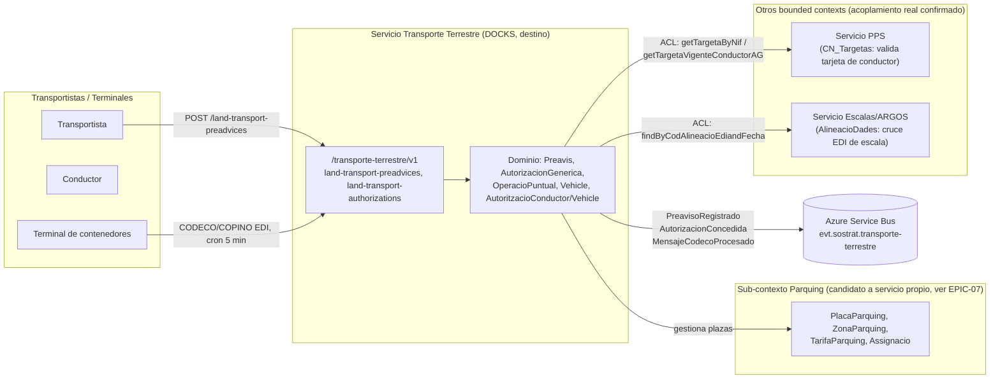

# [IA-GEN] Dossier — Transporte Terrestre

> **Borrador generado por IA** (APB AI Framework — síntesis de apb-disc-spec-gen-v1.0/apb-pm-product-analysis-v1.0/apb-arch-c4-model-v1.0/apb-arch-decompose-v1.0) — pendiente validación humana. No distribuir sin revisión.

## 1. Cabecera

- **Nombre**: Transporte Terrestre
- **Dominio DDD**: `dom-transporte-terrestre-v1` (dominio ya existente en `apb-domain-catalog`, no propuesto por esta auditoría — ver `catalog-comparison.md:18`)
- **Fase del roadmap**: 2
- **Estado**: DISCOVERED — bounded context propuesto, con evidencia de código verificada campo a campo contra el checkout real de `SOSTRAT-Sostrat-MJ8`
- **Bounded context de origen**: `proposals/bc-transporte-terrestre-v1.md`
- **Épica**: `jira-backlog.md` EPIC-07 — Descomposición interna y extracción de Transporte Terrestre

## 2. Resumen ejecutivo

Transporte Terrestre gestiona el acceso de camiones y transportistas al recinto portuario: preavisos de operación, autorizaciones genéricas y específicas de transporte, la documentación y conductores/vehículos asociados a cada autorización, el circuito EDI CODECO de contenedores, y un sub-contexto propio de gestión de plazas de aparcamiento (`parquing/`). Es un dominio **de tamaño medio-grande, cuyo `parent_domain` ya existe en el catálogo real de APB con un alcance más amplio que el implementado en SÒSTRAT** — `catalog-comparison.md:18` confirma que `dom-transporte-terrestre-v1` incluye también Truck Center (TRU) y Puertas Virtuales (PVI), sistemas externos a este checkout.

**Tres correcciones nuevas de esta verificación, no presentes en la documentación previa de discovery**:

1. **El recuento de rutas Struts real es 56, no 89.** `coverage-audit.md:38` cita "transporteterrestre (+ satélite 39) | 89", sumando sin deduplicar las 50 rutas de `struts-config.xml` cuyo `type` apunta al paquete `transporteterrestre` y las 39 de `struts-config-transporteterrestre.xml`. La verificación campo a campo (recuento de `<action path=...>` únicos, `sort -u` + `comm` sobre ambos ficheros) muestra que **33 de esas rutas están definidas de forma literal e idéntica en ambos ficheros** (mismo `path`, mismo `type`, mismos atributos — ver §4). El total real de rutas únicas es 50 + 39 − 33 = **56**. Adicionalmente, el propio encargo de esta verificación citaba "63 actions Struts, según el inventario" — esa cifra pertenece en realidad al módulo Manifiestos (`coverage-audit.md:36`, "manifiestos | 63 | bc-manifiestos-v1"), no a Transporte Terrestre; queda corregido aquí.
2. **`PreavisAction.java` no es la god class más grande del módulo.** Tiene exactamente **1.347 líneas** (recuento `wc -l`, coincide con `bc-transporte-terrestre-v1.md:83`), pero `OperacioPuntualAction.java` tiene **4.072 líneas** (23 métodos de acción) y `AutorizacionGenericaAction.java` tiene **3.795 líneas** (35 métodos de acción) — ambas más del doble de tamaño. El refactor previsto en `jira-backlog.md` EPIC-07 ("Refactorizar `PreavisAction.java`") **infravalora el problema real**: las dos clases más grandes ni siquiera están mencionadas.
3. **Sí hay acoplamiento hacia otros dominios de negocio**, contradiciendo `decomposition-roadmap.md:26` ("ninguna detectada hacia otros dominios de negocio (sí hacia EDI/CBOX)") y la nota de `bc-transporte-terrestre-v1.md:45` ("Sin acoplamiento detectado hacia otros dominios de negocio"). Evidencia real de código en `OperacioPuntualAction.java` y `DocumentacionAction.java` (import directo de `org.apb.sostrat.service.pps.CN_Targetas`/`CN_DocumentAutoritzacio` y `org.apb.sostrat.dataaccess.dto.pps.Targeta`) y en `CN_CODECO_Impl.java` (import de `org.apb.sostrat.dataaccess.dto.escalas.AlineacioDades`) — ver §7.

## 3. Análisis funcional

### Responsabilidad de negocio
Gestión del transporte terrestre de mercancías dentro y hacia el recinto portuario: preavisos de operación de camión/contenedor, autorizaciones (genéricas y específicas) de transportistas, conductores y vehículos, documentación asociada, el circuito EDI CODECO/COPINO de intercambio de datos de contenedores con terminales, y la asignación de plazas de aparcamiento a vehículos autorizados.

### Actores
- Transportista (empresa de transporte por carretera que solicita preavisos y autorizaciones).
- Conductor (persona física vinculada a una autorización de vehículo/conductor).
- Autoridad portuaria / gestor de Transporte Terrestre APB (valida preavisos, concede/deniega autorizaciones, gestiona incidencias).
- Terminal de contenedores (emisor/receptor del circuito EDI CODECO).
- Gestor de parquing (asigna plazas y liquida el uso de aparcamiento).

### Casos de uso reales (grounded en las Actions y rutas Struts confirmadas)
- **Preavisos de operación** (`/Preavis` → `PreavisAction.java`, 1.347 líneas, 8 métodos de acción sobre 24 métodos totales; `/listaPreavisos` y `/listaPreavisosAudit` en `struts-config.xml`; `/listaPreavisosOP`, `/listaPreavisosAE`, `/listaPreavisosConjunta`, `/listaPreavisosAuditOP`, `/listaPreavisosAuditAE` en el satélite `struts-config-transporteterrestre.xml`, únicas a ese fichero — ver §4).
- **Operaciones puntuales / RPI** (`/listaOperacioPuntual`, `/listaOperacioPuntualAudit`, `/listaRPI` → `RPIAction.java`, `/listaRPIAudit` → `RPIActionAudit.java`, `/listaRPISCPP` → `RPISCPPAction.java`, todas sobre `OperacioPuntualAction.java`, **4.072 líneas, 23 métodos de acción** — la mayor god class real del módulo, no citada en `bc-transporte-terrestre-v1.md` ni en `jira-backlog.md` EPIC-07).
- **Autorizaciones genéricas y específicas** (`/listaAutorizacionGenerica` y `/listaAutorizacionGenericaAudit` → `AutorizacionGenericaAction.java`, **3.795 líneas, 35 métodos de acción** — segunda god class real del módulo; `/listaAutorizacionEspecifica` y `/listaAutorizacionEspecificaAudit` → `AutorizacionEspecificaAction.java`/`AutorizacionEspecificaActionAudit`). **Matiz de modelo de dominio**: `AutorizacionEspecificaAction.java` no opera sobre el DTO `AutorizacionGenerica` sino sobre `OperacioPuntualDTOV` (import confirmado en el fichero fuente) — es decir, en el código real "Autorización Específica" es una vista/flujo especializado de `OperacioPuntual` (RPI), no una instancia del mismo agregado que "Autorización Genérica". Esto matiza el modelo de dominio simplificado de `bc-transporte-terrestre-v1.md` (que lista un único aggregate `AutorizacionGenerica` para ambas).
- **Conductores y vehículos autorizados** (`/listaTconConductores`/`/listaTconConductoresAudit` → `TconConductoresAction.java`, 1.127 líneas, sobre `AutoritzacioConductor.java`/tabla `AUTORITZACIO_CONDUCTOR_TT`; `/listaTconVehicles`/`/listaTconVehiclesAudit` → `TconVehiclesAction.java`, 921 líneas, sobre `AutoritzacioVehicle.java`/tabla `AUTORITZACIO_VEHICLE_TT`; `/listaVehicles`/`/listaVehiclesAudit` → `VehicleAction.java`, 1.211 líneas, sobre `Vehicle.java`/tabla `VEHICLES_TT`; `/transportistaAction` → `TransportistaAction.java`, 1.272 líneas). **Matiz**: `AutoritzacioConductor`/`AutoritzacioVehicle` son registros de vínculo conductor/vehículo↔autorización, no maestros independientes — el maestro de vehículo propiamente dicho es `Vehicle`/`VEHICLES_TT`.
- **Documentación de autorizaciones/operaciones puntuales** (`/documentacionAction` → `DocumentacionAction.java`; `/documentacioOperacioPuntual` → `DocumentacioOperacioPuntualAction.java`; `/verFichero` → `FileDownload.java`; `/firmaDigital` → `FirmaDigitalAction.java`, 682 líneas).
- **Incidencias** (`/incidenciaAction` → `IncidenciaAction.java`; `/incidenciaOperacioPuntualAction` → `IncidenciaOperacioPuntualAction.java`).
- **Circuito EDI CODECO/COPINO de contenedores** (`CN_CODECO_Impl.java`, 1.164 líneas, ejecutado por `LanzarCircuitoCodecoTasklet.java`, job Quartz `sostrat-batch-CodecoEDI.xml` con cron `0 0/5 * * * ?` — **cada 5 minutos**, confirmado activo en `sostrat-BATCH/src/spring-batch.xml:155`; el cron anterior `59 59 23 * * ?` (diario) está comentado en el propio fichero de job).
- **Parquing** (sub-contexto propio, ver §7): `/placesParquing`, `/placesParquingLibres`, `/placesParquing_popup` → `PlacaParquingAction.java` (tabla `PLACA_DE_PARQUING`); `/zonesParquing` → `ZonaParquingAction.java` (tabla `ZONA_DE_PARQUING`); `/tarifesParquing` → `TarifaParquingAction.java` (tabla `TARIFES_PARQUING`); `/mantAssignacions`, `/assignacions_popup`, `/tMantAltaAssignacionspopup`, `/liqProcesServei_popup` → `MantAssignacioAction.java` (tabla `ASSIGNACIO_DE_PLACA`); `/assignacionsPendents` → `AssignacioPendentsAction.java`; `/mantAssignacionsAudit` → `MantAssignacioAuditAction.java`; `/liqtAssignacio` → `LiqtAssignacioAction.java`; `/placesLiquidables` → `MantAssignacioAction.java` (tabla de estados de facturación `ASSIG_TIPUS_ESTAT_FACT`, DTO `AssigEstatFact.java`).
- **Búsquedas transversales** (`/buscar` y `/public/buscar` → `BuscarBBDDAction.java`).

### Qué NO incluye
No gestiona el control de accesos personales al recinto (eso es PPS, `bc-pps-v1`), aunque comparte con PPS el eje de "acceso físico" — y, a diferencia de lo documentado hasta ahora, **sí existe una dependencia de código real** entre ambos (ver §7). Tampoco gestiona el maestro de mercancía/manifiesto en sí (eso es Manifiestos/MMPP) ni el maestro de terceros/transportista como entidad fiscal completa (eso corresponde a Operadores Portuarios/`Usuari`, consumido aquí solo por NIF/referencia). Truck Center (TRU) y Puertas Virtuales (PVI) — sistemas que sí forman parte del `dom-transporte-terrestre-v1` real de APB — **no tienen código en este checkout de SÒSTRAT** (`catalog-comparison.md:18`); no se puede confirmar ni descartar con evidencia de este repositorio si SÒSTRAT los alimenta.

## 4. Alcance de migración — qué se migra y qué NO por no estar en uso

- **Se migran las 56 rutas Struts únicas confirmadas** (50 en `struts-config.xml` + 39 en el satélite `struts-config-transporteterrestre.xml`, con 33 definiciones duplicadas byte a byte entre ambos ficheros → 56 rutas únicas reales). Esto **corrige la cifra de `coverage-audit.md:38` (89)**, que no deduplicó entre ficheros.
- **Hallazgo nuevo, no recogido en `dead-code-register.md`**: el fichero satélite `struts-config-transporteterrestre.xml` (cargado en `web.xml:144`, mismo módulo Struts por defecto que `struts-config.xml`, sin prefijo de módulo — confirmado en `web.xml:141-150`) contiene **33 de sus 39 rutas como copia literal exacta** (mismo `path`, `type`, `parameter`, `name`, `validate`, `scope`, incluso el mismo comentario `<!-- TRANSTE-1337 -->` en los casos `/conjoperpuntaudit` y `/conjpreavisosaudit`) de rutas ya definidas en `struts-config.xml`. Ejemplos verificados línea a línea: `/Preavis` (`struts-config.xml:1242` = satélite línea 35), `/mantAssignacions` (`struts-config.xml:1266` = satélite línea 60), `/zonesParquing` (`struts-config.xml:1275` = satélite línea 62). **No es código muerto en el sentido de `dead-code-register.md`** (ambas definiciones están activas y cargadas), pero es una duplicación de configuración con riesgo de comportamiento no determinista según la versión de Struts (algunas versiones lanzan excepción de arranque por `path` no único dentro del mismo módulo, otras simplemente sobrescriben la primera definición) — no verificable desde el código estático sin arrancar la aplicación real. Ver §14, recomendado añadir a `dead-code-register.md` como hallazgo de "config duplicada" tras confirmar el comportamiento real en un entorno vivo.
- **Solo 6 rutas son exclusivas del satélite** (`/PreavisoAudit`, `/listaPreavisosAE`, `/listaPreavisosAuditAE`, `/listaPreavisosAuditOP`, `/listaPreavisosConjunta`, `/listaPreavisosOP`) y **17 son exclusivas de `struts-config.xml`** (incluye la mayoría de rutas de `parquing/`, `Vehicle`, `Transportista`, `Documentacio`, `Incidencia`).
- **No se han encontrado entradas de código muerto de Transporte Terrestre en `dead-code-register.md`** — no hay comentarios `NO SE USA`/`obsoleto` ni rutas comentadas dentro de `struts-config-transporteterrestre.xml` ni en las secciones de `struts-config.xml`/`transporteterrestre*` (búsqueda `grep -rniE "no se usa|obsolet|deprecated|no usar"` sobre los tres paquetes `dataaccess/dto`, `mvc/control` y `service` de `transporteterrestre`, sin resultados).
- **Hallazgo adicional, no confirmado como código muerto ni como integración activa — pendiente de negocio**: existe un subconjunto de DTOs con prefijo `Ptrans*` (`PtransPreaviso.java`→tabla `PREAVISO_TT` singular, distinta de `PREAVIS_TT`; `PtransVehiculo.java`→tabla `VEHICULO`; `PtransPersonas.java`→tabla `PERSONAS`; `PtransParamGlobales.java`→tabla `PARAM_GLOBALS_TT`), consumidos por `CN_PtransPreaviso_Impl.java` y `CN_Quartz_Preavisos_Impl.java` (bean Quartz, confirma que hay un job programado sobre este flujo, pero no se ha localizado su expresión cron en esta pasada). Los nombres de tabla no coinciden con el modelo `PREAVIS_TT`/`AUTORITZACIO_GEN_TT` documentado en el resto de este dossier — es consistente con un flujo de sincronización hacia un sistema externo (posible candidato: Truck Center/TRU o Puertas Virtuales/PVI, mencionados como parte del `dom-transporte-terrestre-v1` real en `catalog-comparison.md:18`), **pero esta hipótesis no está confirmada con evidencia directa de destino** — no se ha encontrado ningún literal "TRU" o "PVI" en `CN_Quartz_Preavisos_Impl.java`. No excluir ni migrar como si fuera el mismo modelo que `Preavis`/`PreavisBase` sin antes confirmar con negocio qué sistema consume `PREAVISO_TT`/`VEHICULO`/`PERSONAS`.

## 5. Modelo de datos

Todos los campos siguientes están extraídos directamente de los DTOs reales en `sostrat/src/org/apb/sostrat/dataaccess/dto/transporteterrestre/` (y su subpaquete `parquing/`) del checkout `SOSTRAT-Sostrat-MJ8`.

### `Preavis` (tabla `PREAVIS_TT`, PK `portpreavis+seqpreavis` — confirmado en `PreavisPk.java`)
`Preavis.java` extiende `PreavisBase.java`. Campos de `PreavisBase` (36 en total, con Javadoc de mapeo de columna explícito en el propio fichero fuente):

| Campo | Tipo Java | Nota |
|---|---|---|
| `portautoritzacio` / `seqautoritzacio` | String / Long | FK a `AutorizacionGenerica` (no forma parte de la PK de `Preavis`) |
| `portoperacio` / `seqoperacio` | String / Long | FK a `OperacioPuntual` |
| `portpreavis` / `seqpreavis` | String / Long | **PK** |
| `idconsignatari`, `nifconsignatari`, `nomconsignatari` | String | |
| `tipuspreavis` | String | dominio de valores no confirmado como enum |
| `trasllat` | String | |
| `admetislliuris` | String | |
| `datoperacio` | Date | |
| `observacions` | String | |
| `idterminal`, `nifterminal`, `nomterminal` | String | terminal de contenedores asociada |
| `nbooking` | String | |
| `matcontenidor`, `refcontenidor`, `precontenidor` | String | |
| `idtamcontenidor`, `desctamcontenidor` | String | |
| `incidencies` | String | |
| `datvalidacio`, `datlimit` | Date | |
| `refptrans`, `numptrans`, `codiptrans` | String / Long | referencia al flujo `Ptrans*` (§4) |
| `estat` | String | dominio de valores no confirmado como enum |
| `esgeneric` | String | distingue preaviso genérico/específico |
| `pincode` | String | |
| `datenvia` | Date | |
| `tipdocucond`, `paisconductor` | String | |
| `numreserva`, `numreferencia` | String | |
| `enviopermitido`, `nifultimoaut`, `numhuecoslibres`, `motivorechazo`, `indpreavisesp` | String/Integer | ticket `TRANSTE-1273` |
| `datfranjafi`, `seqpreavisdm`, `seqpreavislt` | Date / Long | ticket `TRANSTE-1273` |
| `datopeoriginal` | Date | ticket `TRANSTE-1335` |

### `AutorizacionGenerica` (tabla `AUTORITZACIO_GEN_TT`, PK `portautoritzacio+seqautoritzacio`)
`AutorizacionGenericaBase.java`, 23 campos: `portautoritzacio`/`seqautoritzacio` (PK), `telematica`, `emptransport`, `nifemppeticionari`, `emppeticionari`, `datiniautoritzacio`, `datfiautoritzacio`, `refautmdp`, `datiniautmdp`, `datfiautmdp`, `datcaducitat`, `estat`, `datsolicitud`, `datanulacio`, `datautdenegacio`, `datnotificacio`, `recogida`, `tiptartransport`, `datrevtartransport`, `provisional`, `preregeres`, `tipopepun` (ticket `TRANSTE-1337`).

### `OperacioPuntual` (tabla `OPERACIO_PUNTUAL_TT`, PK confirmada en `OperacioPuntualPk.java`)
`OperacioPuntualBase.java`: `portoperacio`/`seqoperacio` (PK), `portautoritzacio`/`seqautoritzacio` (FK a autorización), `idempresa`, `nifempresa`, `nomempresa`, `telempresa`, `idpeticionari`, `dnipeticionari`, `nompeticionari`, `datsolicitud`, `estat`, `datnotificada`, `datiniautesp`, `datfiautesp`, `sensepreavisos`, `idconductor`, `dniconductor`, `nomconductor`, `cognom1conductor`, `cognom2conductor`, `mobil`, `email`, `autonom` (y más campos no listados en esta pasada — fichero completo no volcado íntegro).

### `Vehicle` (tabla `VEHICLES_TT`, PK `matricula` según `VehicleBase.java`) y entidades de vínculo
- `AutoritzacioVehicle` (tabla `AUTORITZACIO_VEHICLE_TT`) — vínculo vehículo↔autorización, no maestro.
- `AutoritzacioConductor` (tabla `AUTORITZACIO_CONDUCTOR_TT`) — vínculo conductor↔autorización.
- `AutoritzacioDoc` (tabla `AUTORITZACIO_DOC_TT`) — documentación adjunta a una autorización.

### Sub-contexto `parquing/` (tablas confirmadas por Javadoc de columna en cada DTO)
| Entidad | Tabla | Campos clave |
|---|---|---|
| `PlacaParquing` | `PLACA_DE_PARQUING` | PK `seqplaca` |
| `ZonaParquing` | `ZONA_DE_PARQUING` | `idzona`, `desczona`, `datalta` |
| `TarifaParquing` | `TARIFES_PARQUING` | `tipplaca`, `datainicivigencia`, `importmensual` |
| `Assignacio` | `ASSIGNACIO_DE_PLACA` | `portassignacio`/`seqassignacio` (PK), `seqplaca`, `datainicivigencia`, `datafivigencia`, `matricula`, `client`, `idservei`, `idestfacturacio`, `dniconductor` |
| `AssigEstatFact` | `ASSIG_TIPUS_ESTAT_FACT` | `idestfacturacio`, `activo` — catálogo de estados de facturación de una asignación |

### Circuito CODECO/COPINO (EDI)
`CodecoTT.java`, `MissatgeEdiCodecoTT.java` y ~25 clases de segmento EDIFACT (`CodecoEBgm01`, `CodecoEEqd01`, `CodecoETdt01`, etc., paquete `codeco/`) más un paquete paralelo `copino/` con la misma estructura de segmentos — no se ha volcado el detalle campo a campo de estas clases en esta pasada (volumen alto, > 40 ficheros); su procesamiento vive en `CN_CODECO_Impl.java` (1.164 líneas), que además depende de `dataaccess.dto.escalas.AlineacioDades` (ver §7).

### Mapeo a Azure SQL
Migración directa tabla-a-tabla: `PREAVIS_TT`, `AUTORITZACIO_GEN_TT`, `OPERACIO_PUNTUAL_TT`, `VEHICLES_TT`, `AUTORITZACIO_VEHICLE_TT`, `AUTORITZACIO_CONDUCTOR_TT`, `AUTORITZACIO_DOC_TT` como agregados/entidades del servicio de Transporte Terrestre; `PLACA_DE_PARQUING`, `ZONA_DE_PARQUING`, `TARIFES_PARQUING`, `ASSIGNACIO_DE_PLACA`, `ASSIG_TIPUS_ESTAT_FACT` como agregados propios del sub-contexto Parquing (candidato a servicio separado, ver §7 y §12). No se ha diseñado el esquema Azure SQL definitivo en esta pasada — solo se confirma el origen. El flujo `Ptrans*`/`PREAVISO_TT` (§4) queda excluido del mapeo hasta confirmar su propósito real.

## 6. Arquitectura técnica

Stack DOCKS (.NET, Azure SQL, EntraID, Service Bus, APIM), servicio dedicado tras `/transporte-terrestre/v1` (`specs/openapi-transporte-terrestre.yaml:19`), que **no incluye el sub-contexto Parquing** (explícito en la descripción del propio contrato: *"No incluye el sub-contexto Parquing, pendiente de descomposición interna (ver jira-backlog.md EPIC-07)"*, `specs/openapi-transporte-terrestre.yaml:10-11`).

El circuito CODECO debe tratarse como integración EDI vía ACL, con el job Quartz (`sostrat-batch-CodecoEDI.xml`, cron cada 5 minutos, confirmado activo) migrado a un trigger programado del nuevo servicio o a una función Azure independiente — la cadencia de 5 minutos (frente a los ~8 veces/día de PortIC en PPS) sugiere un patrón de near-real-time que debe preservarse en el diseño de destino, no degradarse a batch diario.

La dependencia real hacia PPS (`CN_Targetas.getTargetaByNif`/`getTargetaVigenteConductorAG`, ver §7) implica que el servicio de Transporte Terrestre necesitará un cliente (HTTP o evento) hacia el servicio PPS ya extraído en Fase 2 (`bc-pps-v1`, mismo fase de roadmap) para validar la vigencia de la tarjeta de acceso de un conductor antes de autorizar una operación puntual — a diseñar como llamada síncrona de validación (equivalente a `GET /pps/v1/access-cards?nif=...` o similar, no existe hoy ese endpoint en `specs/openapi-pps.yaml`, es un gap de contrato nuevo).

## 7. Dominio DDD

- **Bounded context**: `bc-transporte-terrestre-v1`, `parent_domain: dom-transporte-terrestre-v1` (`proposals/bc-transporte-terrestre-v1.md`).
- **Este dominio ya existe en `apb-domain-catalog`** — no es un dominio nuevo propuesto por la auditoría de cobertura de esta serie de dossiers. `catalog-comparison.md:18` confirma el encaje: *"Buen encaje; el dominio existente es más amplio (incluye Truck Center/TRU y Puertas Virtuales/PVI, sistemas externos a SÒSTRAT)."* — es decir, igual que ocurre con PPS/`dom-acceso-seguridad-fisica-v1` (`dossier-05-pps.md` §7), el dominio real de APB cubre más superficie que lo que SÒSTRAT implementa.
- **Verificación de solapamiento con otros BC ya documentados — corrige documentación previa**:
  - `decomposition-roadmap.md:26` y `bc-transporte-terrestre-v1.md:45` afirman *"sin acoplamiento detectado hacia otros dominios de negocio (sí hacia EDI/CBOX)"*. **Esta verificación encuentra dos acoplamientos reales de código no documentados**:
    1. **Hacia PPS** (`bc-pps-v1`): `OperacioPuntualAction.java` importa `org.apb.sostrat.dataaccess.dto.pps.Targeta`, `org.apb.sostrat.dataaccess.dto.pps.VTcTargeta` y `org.apb.sostrat.service.pps.CN_Targetas`, y llama a `CN_Targetas.getTargetaByNif(nifCond, idioma)` (línea 780) y `CN_Targetas.getTargetaVigenteConductorAG(...)` (líneas 967 y 2199) para verificar que un conductor tiene una tarjeta de acceso PPS vigente antes de procesar una operación puntual. `DocumentacionAction.java` importa `org.apb.sostrat.service.pps.CN_DocumentAutoritzacio` y lo usa en línea 115 (`getBean("CN_DocumentAutoritzacio")`).
    2. **Hacia Escalas** (`bc-escalas-v1`): `CN_CODECO_Impl.java` (circuito EDI CODECO) importa `org.apb.sostrat.dataaccess.dto.escalas.AlineacioDades`/`AlineacioDadesPk` y `org.apb.sostrat.dataaccess.dao.escalas.AlineacioDadesExtendedDao`, usado en línea 716 para localizar el registro de alineación de datos EDI de una escala por código y fecha (`findByCodAlineacioEdiandFecha`) — el circuito CODECO de contenedores necesita cruzar contra el dato de escala/atraque real.
  - **Sin solapamiento en cuanto a rutas Struts**: `coverage-audit.md:38` clasifica el módulo `transporteterrestre` (con la corrección de §4, 56 rutas reales) íntegro y en exclusiva bajo `bc-transporte-terrestre-v1`, sin repartirse con ningún otro de los BC nuevos o existentes de esta auditoría.
  - **Dependencia esperada y no problemática hacia Operadores Portuarios**: varias Actions (`PreavisAction.java`, `RPISCPPAction.java`) importan `org.apb.sostrat.dataaccess.dto.Usuari` (maestro de terceros, `bc-operadores-portuarios-v1`/EPIC-17) — mismo patrón de consumo de maestro compartido que el resto del sistema, no es un hallazgo nuevo.
  - **Catálogo de referencia distinto del maestro de Equipamiento**: `PreavisAction.java` usa `TipusDEquipIso`/tabla `TIPUS_D_EQUIP_ISO` (catálogo de tipos/tamaños de contenedor ISO) — **tabla distinta** de `TIPUS_EQUIPAMENT` (el maestro de Equipamiento de EPIC-00, `bc-datos-maestros-equipamiento-v1`). No se ha confirmado si ambos catálogos deberían unificarse en destino; se listan como entidades de referencia separadas hasta confirmar con negocio.
- **Sub-bounded-context interno confirmado: `parquing/`**. Tiene paquete Java propio en las tres capas (`dataaccess.dto.transporteterrestre.parquing`, `dataaccess.views.dao/dto.transporteterrestre.parquing`, `mvc.control.transporteterrestre.parquing`, `service.transporteterrestre.parquing`), 5 tablas propias (§5), 7 Actions propias y 13 rutas Struts únicas — confirma la recomendación de `bc-transporte-terrestre-v1.md:45` y `decomposition-roadmap.md:61` de descomponerlo internamente antes de la extracción completa (`jira-backlog.md` EPIC-07, tarea técnica "Diseñar el sub-recurso `parquing` como posible servicio independiente en una fase posterior").

## 8. Pantallas UI

Ver `ui-screens-backlog.md` §"App: Transporte Terrestre" (Fase 2):
1. **Listado de Preavisos** (`dxDataGrid`) — columnas: `portpreavis/seqpreavis`, `tipuspreavis`, `estat`, `datlimit`, con columna condicional mostrando `motivorechazo` si el preaviso fue rechazado.
2. **Alta de Preaviso** (`dxForm`) — campos: `idconsignatari`, `tipuspreavis`, `trasllat` (`dxCheckBox`), `matcontenidor`, `refcontenidor`.
3. **Listado de Autorizaciones** (`dxDataGrid`) — columnas: `emptransport`, `nifemppeticionari`, `datfiautoritzacio`, `estat`.
4. **Pantalla de Parquing** (`dxScheduler` o `dxDataGrid` de asignación de plazas) — pendiente decidir si es sub-pantalla de esta app o app propia tras la descomposición interna prevista en EPIC-07.

**Gap frente al backlog de UI**: no hay pantalla propuesta para `OperacioPuntual`/RPI, `AutoritzacioConductor`/`AutoritzacioVehicle` ni el circuito CODECO — pese a que `OperacioPuntualAction.java` (4.072 líneas) es, con diferencia, la Action de mayor volumen de todo el módulo (§3). Consistente con el patrón de gap ya señalado en `dossier-05-pps.md` §8 para su propio módulo.

## 9. APIs

| Método | Ruta | Descripción | Grounded en |
|---|---|---|---|
| GET | `/land-transport-preadvices` | Listar preavisos (filtro `estat`, paginado por cursor) | `Preavis.java`/`PreavisBase.java` |
| POST | `/land-transport-preadvices` | Crear preaviso | `PreavisBase.java` |
| GET | `/land-transport-preadvices/{portpreavis}/{seqpreavis}` | Obtener preaviso por PK compuesta | `PreavisPk.java` |
| POST | `/land-transport-preadvices/{portpreavis}/{seqpreavis}/authorize` | Autorizar preaviso, transiciona `estat`; devuelve 409 si ya fue rechazado/autorizado | `PreavisBase.estat` |
| POST | `/land-transport-authorizations` | Crear autorización genérica | `AutorizacionGenericaBase.java` |

Contrato completo: `specs/openapi-transporte-terrestre.yaml`. **No cubre `OperacioPuntual`/RPI, `AutorizacionEspecifica`, `AutoritzacioConductor`/`AutoritzacioVehicle`, `Vehicle` ni `parquing`** como recursos propios — pese a que `OperacioPuntualAction.java` y `AutorizacionGenericaAction.java` son, con diferencia, las Actions de mayor volumen del módulo (§3). Es el mismo patrón de gap de contrato ya señalado para PPS (`dossier-05-pps.md` §9) — pendiente de una segunda iteración del contrato antes de dar por cerrada la superficie de API del servicio.

## 10. Eventos

| Evento | Trigger | Payload (resumen) | Fuente |
|---|---|---|---|
| `PreavisoRegistrado` | Alta de preaviso (`portpreavis+seqpreavis` PK) | `portpreavis`, `seqpreavis`, `idconsignatari`, `tipuspreavis`, `trasllat`, `datoperacio`, `matcontenidor`, `refcontenidor`, `estat`, `datlimit`, `motivorechazo` | `Preavis.java`/`PreavisBase.java` |
| `AutorizacionConcedida` | Alta/concesión de autorización genérica | `portautoritzacio`, `seqautoritzacio`, `emptransport`, `nifemppeticionari`, `datiniautoritzacio`, `datfiautoritzacio`, `estat`, `datcaducitat` | `AutorizacionGenerica.java` |
| `MensajeCodecoProcesado` | Procesamiento de mensaje EDI CODECO (job Quartz, cron cada 5 min, confirmado activo) | Pendiente de diseño — no hay una entidad DTO propia identificada como payload en esta extracción, es un evento a nivel de mensaje EDI | `LanzarCircuitoCodecoTasklet.java` |

Canal: pendiente de asignar en `specs/asyncapi-fase2.yaml` — el fichero cubre PPS (§16-17 del events-catalog) pero no incluye todavía una sección dedicada de Transporte Terrestre con contrato AsyncAPI formal. **Gap de evidencia**: a diferencia de PPS (`asyncapi-fase2.yaml` §`SolicitudPpsData`/`TarjetaAuditData`), no existe hoy un fichero AsyncAPI con el schema completo de `PreavisoRegistrado`/`AutorizacionConcedida`/`MensajeCodecoProcesado` — solo el resumen de `events-catalog.md` §16 usado en este dossier.

## 11. Diagrama topológico (C4 nivel 1)

## 12. Estrategia de convivencia con el modelo actual

1. **Strangler fig sobre las 56 rutas Struts reales** (corrección de la cifra 89, §4): extraer módulo por sub-funcionalidad (preavisos → autorizaciones → conductores/vehículos → parquing), dado que la evidencia de acoplamiento hacia PPS y Escalas es puntual (dos llamadas de servicio concretas), no estructural.
2. **Descomponer Parquing primero, como recomienda `jira-backlog.md` EPIC-07**: al tener paquete Java, tablas y Actions propias en las cuatro capas, es el candidato más limpio para extraerse como sub-servicio o módulo independiente dentro del mismo dominio antes de tocar el núcleo de Preavisos/Autorizaciones.
3. **Refactorizar `OperacioPuntualAction.java` (4.072 líneas) y `AutorizacionGenericaAction.java` (3.795 líneas) antes de extraer**, no solo `PreavisAction.java` como indica hoy `jira-backlog.md` EPIC-07 — son las dos clases de mayor riesgo real del módulo (§2, §3).
4. **La validación de tarjeta PPS (`CN_Targetas`) debe convertirse en llamada ACL síncrona al servicio PPS ya extraído** — mientras PPS no exponga un endpoint de consulta por NIF/vigencia de tarjeta (gap de contrato, §6), esta dependencia bloquea el corte limpio de Transporte Terrestre si PPS aún no está en producción.
5. **El circuito CODECO (cron 5 min) debe migrarse manteniendo su cadencia real**, y su cruce con `AlineacioDades` de Escalas debe resolverse como ACL hacia el sistema que finalmente sea dueño de la maestría de escala (SÒSTRAT hoy, ARGOS/TES tras EPIC-14) — no asumir que este acoplamiento desaparece antes de que la migración de Escalas (Fase 5) esté resuelta.
6. **Confirmar el propósito real del flujo `Ptrans*`/`PREAVISO_TT` (§4) antes de excluirlo o migrarlo** — no se incluye en el alcance de la Fase 2 hasta esa confirmación.

## 13. Testing y seguridad

- **Estrategia de testing** (`testing-strategy-fase2-4.md`, mismo patrón aplicado a PPS en `dossier-05-pps.md` §13): pirámide Unit 60% / Contract 20% / Integration 15% / E2E 5%.
  - Unit: `POST /land-transport-preadvices/{id}/authorize` debe rechazar (409) un preaviso ya autorizado o rechazado (confirmado en el propio contrato `specs/openapi-transporte-terrestre.yaml:59`); una operación puntual no debe autorizarse sin tarjeta PPS vigente del conductor (regla de negocio confirmada en código, §7, no reflejada aún en ningún contrato).
  - Contract: schema de `PreavisoRegistrado`/`AutorizacionConcedida` contra un AsyncAPI dedicado, hoy inexistente (gap, §10).
  - Integration: **la dependencia real hacia PPS (`CN_Targetas`) y hacia Escalas (`AlineacioDades`) debe testearse con test doubles, nunca contra el sistema real en CI** — mismo principio ya aplicado a los conectores de PPS (`testing-strategy-fase2-4.md:12`), extendido aquí a dos dependencias internas de dominio no documentadas hasta esta verificación.
- **Threat model**: no se ha localizado una entrada específica de Transporte Terrestre en `threat-model-fase2-4.md` en esta pasada — no confirmado si existe o no; **gap de evidencia**, no se afirma su ausencia sin haber releído el documento completo.
- **Duplicación de rutas Struts (§4) como superficie de riesgo operativo, no de seguridad**: 33 rutas definidas dos veces en el mismo módulo Struts son un riesgo de comportamiento no determinista en tiempo de arranque/despliegue del legacy, no una vulnerabilidad — se lista aquí porque afecta directamente a la fiabilidad del inventario de rutas a migrar (§4).
- Ningún campo de credencial identificado en el modelo de datos de Transporte Terrestre.

## 14. Riesgos y gaps de evidencia conocidos

- **Recuento de rutas corregido**: 56 rutas únicas reales, no 89 (`coverage-audit.md:38`) ni 63 (cifra que en realidad corresponde a Manifiestos, `coverage-audit.md:36`) — ver §4.
- **God classes reales mayores que la citada en la documentación previa**: `OperacioPuntualAction.java` (4.072 líneas) y `AutorizacionGenericaAction.java` (3.795 líneas) no están mencionadas en `bc-transporte-terrestre-v1.md` ni en `jira-backlog.md` EPIC-07, que solo cita `PreavisAction.java` (1.347 líneas, la tercera en tamaño) — ver §2, §3.
- **Duplicación de configuración Struts no confirmada como código muerto ni como bug en producción**: 33 rutas definidas de forma idéntica en `struts-config.xml` y en `struts-config-transporteterrestre.xml`, cargadas en el mismo módulo Struts por defecto (`web.xml:141-150`). No se ha podido confirmar desde el análisis estático si esto causa un error de arranque, una sobrescritura silenciosa, o si Struts simplemente ignora la segunda definición — requiere una prueba en un entorno con la aplicación viva o confirmación del equipo SÒSTRAT. Recomendado añadir a `dead-code-register.md` tras esa confirmación.
- **Acoplamiento real hacia PPS y Escalas no documentado previamente**: corrige `decomposition-roadmap.md:26` y `bc-transporte-terrestre-v1.md:45` — ver §7. Bloquea el criterio de éxito de EPIC-07 tal como está escrito hoy ("sin dependencias"), sin ser un bloqueo grave (son dos llamadas de servicio puntuales, no una integración de base de datos compartida).
- **Modelo de dominio de "Autorización Específica" distinto de lo asumido**: `AutorizacionEspecificaAction.java` opera sobre `OperacioPuntualDTOV`, no sobre `AutorizacionGenerica` — el aggregate único propuesto en `bc-transporte-terrestre-v1.md` para ambos tipos de autorización no se sostiene tal cual en el código (§3).
- **Flujo `Ptrans*`/`PREAVISO_TT` sin propósito confirmado**: tablas y DTOs con nomenclatura y esquema distintos del modelo principal (`Preavis`/`PREAVIS_TT`), consumidos por un job Quartz (`CN_Quartz_Preavisos_Impl.java`) cuya cadencia no se ha localizado en esta pasada — posible integración con Truck Center/TRU o Puertas Virtuales/PVI (mencionados en `catalog-comparison.md:18` como parte del dominio real), pero sin evidencia textual directa que lo confirme — ver §4.
- **Circuito CODECO/COPINO no detallado campo a campo**: >40 clases de segmento EDIFACT en los paquetes `codeco/` y `copino/` no se han volcado en esta pasada por volumen; el payload del evento `MensajeCodecoProcesado` sigue pendiente de diseño dedicado con el equipo EDI, tal como ya señalaba `events-catalog.md:580`.
- **`OperacioPuntualBase.java` no volcado íntegro**: el fichero tiene más campos de los listados en §5 (no se ha confirmado el total exacto de atributos en esta pasada).
- **Sin contrato AsyncAPI dedicado**: a diferencia de PPS, no existe hoy una sección de Transporte Terrestre en ningún fichero `specs/asyncapi-*.yaml` — ver §10.
- **Threat model no releído íntegramente para confirmar ausencia de amenazas específicas** — ver §13.

## 15. Estimación de esfuerzo

Ver `jira-backlog.md` EPIC-07 — Descomposición interna y extracción de Transporte Terrestre (Fase 2, 4 historias):
1. Registrar preaviso (`POST /land-transport-preadvices`) — 8 pts.
2. Conceder/denegar autorización genérica/específica — 8 pts.
3. Consultar motivo de rechazo de preaviso (`motivorechazo`) — 3 pts.
4. Asignar plaza de parquing a vehículo autorizado — 5 pts.

**Tareas técnicas ya previstas**: refactorizar `PreavisAction.java` (1.347 líneas) sacando lógica de negocio a la capa de servicio antes de la extracción; diseñar el sub-recurso `parquing` como posible servicio independiente en fase posterior.

**Nota de esta verificación — el alcance técnico de EPIC-07 debe ampliarse, no solo confirmarse**: la tarea de refactor debe incluir explícitamente `OperacioPuntualAction.java` (4.072 líneas) y `AutorizacionGenericaAction.java` (3.795 líneas), ambas más grandes que `PreavisAction.java` y no mencionadas hoy en la épica (§2, §14). El criterio de éxito "sin acoplamiento" debe reformularse para reconocer las dos dependencias reales confirmadas (PPS, Escalas) y planificar su resolución vía ACL (§12) en vez de asumir que no existen. No se ha reestimado el esfuerzo en story points de estas correcciones — pendiente de una iteración de refinamiento con el equipo antes de sprint planning.

## 16. Checklist de validación

**Funcional**:
- [ ] Confirmar con negocio el propósito real del flujo `Ptrans*`/`PREAVISO_TT`/`VEHICULO`/`PERSONAS` y si corresponde a Truck Center (TRU) o Puertas Virtuales (PVI).
- [ ] Confirmar el dominio de valores real de `tipuspreavis`, `estat` (en `Preavis` y en `AutorizacionGenerica`) y `esgeneric`.
- [ ] Validar si `AutorizacionEspecifica` debe modelarse en destino como variante de `OperacioPuntual` (como sugiere el código real) o como su propio agregado (como sugiere el nombre de negocio).
- [ ] Decidir si Parquing se extrae como servicio independiente o como sub-recurso del servicio de Transporte Terrestre (EPIC-07).

**Desarrollo**:
- [ ] Confirmar en un entorno con la aplicación viva el comportamiento real de Struts ante las 33 rutas duplicadas entre `struts-config.xml` y `struts-config-transporteterrestre.xml` (error de arranque, sobrescritura, o ambas activas) antes de dar por buena la lista de 56 rutas a migrar.
- [ ] Ampliar el alcance de refactor de EPIC-07 para incluir `OperacioPuntualAction.java` (4.072 líneas) y `AutorizacionGenericaAction.java` (3.795 líneas), no solo `PreavisAction.java`.
- [ ] Diseñar el endpoint ACL de consulta de vigencia de tarjeta PPS por NIF de conductor (hoy inexistente en `specs/openapi-pps.yaml`), requerido por la dependencia real confirmada en `OperacioPuntualAction.java`.
- [ ] Diseñar el contrato AsyncAPI de `PreavisoRegistrado`/`AutorizacionConcedida`/`MensajeCodecoProcesado`, hoy inexistente.
- [ ] Volcar campo a campo el resto de `OperacioPuntualBase.java` y las clases de segmento EDIFACT de `codeco/`/`copino/` antes de fijar el contrato de API/eventos definitivo.
- [ ] Añadir el hallazgo de configuración Struts duplicada a `dead-code-register.md` tras confirmar su comportamiento real (ver primer punto de esta lista).

## 17. Historial de cambios

| Versión | Fecha | Autor | Cambio |
|---------|-------|-------|--------|
| 1.0.0 | 2026-07-13 | APB AI Framework | Dossier inicial, a petición explícita del usuario. Verificado campo a campo contra el checkout real de `SOSTRAT-Sostrat-MJ8` (DTOs, Actions, `struts-config.xml` + `struts-config-transporteterrestre.xml`, sub-contexto `parquing/`, circuito CODECO). Corrige tres afirmaciones previas: (1) el recuento de rutas Struts real es 56, no 89 (`coverage-audit.md`) ni 63 (cifra que pertenece a Manifiestos); (2) `PreavisAction.java` no es la god class más grande del módulo — `OperacioPuntualAction.java` (4.072 líneas) y `AutorizacionGenericaAction.java` (3.795 líneas) son mayores y no estaban citadas; (3) sí existe acoplamiento real de código hacia PPS (`CN_Targetas`) y Escalas (`AlineacioDades`), contradiciendo `decomposition-roadmap.md` y `bc-transporte-terrestre-v1.md` |
