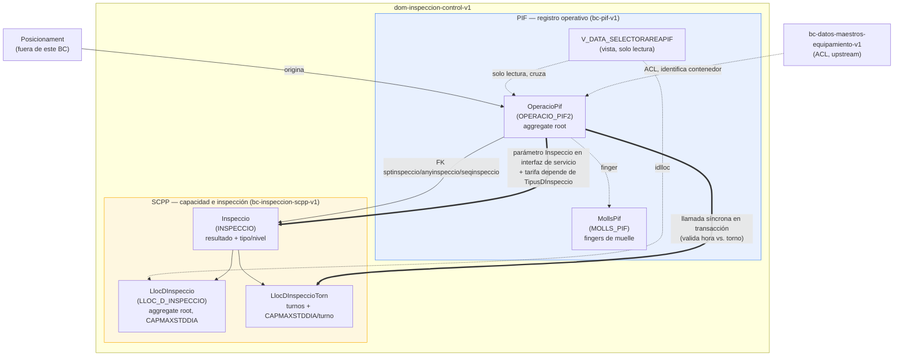

# [IA-GEN] Dossier — PIF (Punto de Inspección Fronteriza)

> **Borrador generado por IA** (APB AI Framework — síntesis de apb-disc-spec-gen-v1.0/apb-pm-product-analysis-v1.0/apb-arch-c4-model-v1.0/apb-arch-decompose-v1.0) — pendiente validación humana. No distribuir sin revisión.

## 1. Cabecera

- **Nombre**: PIF (Punto de Inspección Fronteriza)
- **Dominio DDD**: `dom-inspeccion-control-v1`
- **Fase del roadmap**: 3 (`decomposition-roadmap.md` §"Fase 3 — Núcleo de Mercancías y Aduanas")
- **Estado**: DISCOVERED — bounded context confirmado con código real, pero con una decisión de diseño abierta (fusión o separación con `bc-inspeccion-scpp-v1`, ver §7 y §14)
- **Bounded context**: `proposals/bc-pif-v1.md`
- **BC hermano (mismo dominio, distinta épica)**: `proposals/bc-inspeccion-scpp-v1.md` (descubierto en la auditoría de cobertura 2026-07-13)
- **Épica**: `jira-backlog.md` EPIC-09 ("Extracción MMPP y PIF") + EPIC-19 ("Extracción Capacidad e Inspección Fronteriza (SCPP)")

## 2. Resumen ejecutivo

PIF es el control fronterizo/aduanero de mercancías en muelle: registra cada **operación concreta de inspección** de un contenedor/camión (asignación a un finger de muelle, tiempos de espera y manipulación, importe facturable) desde que se posiciona hasta que se finaliza o anula. Está grounded en `dataaccess/dto/OperacioPif.java` (tabla `OPERACIO_PIF2`), `dataaccess/dto/MollsPif.java` (tabla `MOLLS_PIF`, fingers de muelle) y la vista de solo lectura `V_DATA_SELECTORAREAPIF`.

**Hallazgo central de esta verificación**: el registro operativo de PIF (`OperacioPif`) y la gestión de capacidad del recurso físico de inspección (`bc-inspeccion-scpp-v1`, entidad `LlocDInspeccio`/`Inspeccio`) **son conceptualmente dos agregados distintos** (ejecución vs. capacidad/planificación), tal como ya proponía `bc-inspeccion-scpp-v1.md`. Pero la verificación de código a nivel de capa de servicio (`CN_OperacioPif_Impl.java`, `CN_AreaPif_Impl.java`, `CN_Pif_Impl.java`) muestra que ese acoplamiento **no es una simple referencia por clave foránea**: la lógica de negocio de PIF invoca de forma **síncrona y transaccional** DAOs y tipos de SCPP (`LlocDInspeccioTornDao`, `Inspeccio`, `TipusDInspeccio`) para calcular tarifas, validar horarios de turno y decidir transiciones de estado. Ver §7 para el detalle y la recomendación.

## 3. Análisis funcional

### Responsabilidad de negocio
Gestión operativa del control fronterizo/aduanero: asignación de un camión/contenedor a un área/finger PIF, seguimiento de tiempos (espera, manipulación, inspección), cálculo del importe facturable de la operación y su ciclo de vida hasta finalización o anulación.

### Actores
- Inspector fronterizo / operador de área PIF.
- Transportista (camión, identificado por `matriculacamio`).
- Sistema de Posicionament (origen de la operación PIF — cada `OperacioPif` referencia un `Posicionament` vía `sptposicionament/anyposicionament/seqposicionament`).
- Sistema de Inspección/SCPP (`Inspeccio`, `LlocDInspeccioTorn` — ver §7).

### Casos de uso reales (grounded en código)
- Registrar una operación PIF a partir de un posicionamiento (`CN_Pif.crearOperacionPifporPosicionament(OperacioPif, Posicionament)`, `CN_Pif.crearOperacionPif(OperacioPif, VDataOperacioPifPrevistas)`).
- Consultar operaciones previstas para el día siguiente/actual (`insertOperacionesPrevistesDiaSeguent`, `insertOperacionesPrevistesdiaactual`, ambos en `CN_Pif`).
- Ciclo de vida de la operación en área PIF (`CN_AreaPif`): `llegada`, `finger` (asignación de finger de muelle), `inidescarga`/`findescarga`, `inicarga`/`fincarga`, `precintar`, `parking`/`parkingatras`/`parkingfinal`, `atras`, `finalizar`, `anular`.
- Reasociar la operación a otra inspección (`CN_Pif.modificarReasociarInspeccion(OperacioPifPk, InspeccioPk)`).
- Recalcular conceptos facturables automáticos (`CN_AreaPif.recalcularConcepteSimulacioAuto`/`recalcularConceptosAutomaticos`).
- Gestión de fingers de muelle (`CN_MollsPIF`): alta/baja/modificación de `MollsPif` (tabla `MOLLS_PIF`), bloqueo de fingers (`listafingersBloqueados`).
- Consulta de área PIF en tiempo real, solo lectura (`CN_AreaPif.obtenerAreaDTOV`, sobre la vista `V_DATA_SELECTORAREAPIF`).

### Reglas de negocio grounded
- **Máquina de estados de `idestatoperaciopif`** (tabla `OPERACIO_PIF2`, 6 códigos: `CR`/`AP`/`PF`/`FI`/`AN`/`AF`). La secuencia real de transiciones, confirmada leyendo `CN_AreaPif_Impl.java` (no solo los códigos, también el orden de las llamadas `setIdestatoperaciopif`):
  - `CR` (creada) → `AP` (asignada a parking, línea 351/496) → `AF` (asignada a finger, línea 368) → `PF` (parking final, línea 678) → `FI` (finalizada, línea 690).
  - `AN` (anulada) es alcanzable como rama de cancelación desde varios puntos del ciclo (línea 266), no forma parte de la secuencia lineal.
  - Esta secuencia **corrige/completa** la nota de `openapi-pif.yaml` y `asyncapi-fase3.yaml`, que listan los 6 códigos pero marcan explícitamente "nombres completos no documentados... confirmar con negocio" — los nombres siguen sin confirmar, pero el **orden de transición** ya está grounded en código, no solo los valores del enum.
  - Consulta adicional grounded (línea 719/737/755 de `CN_AreaPif_Impl.java`): hay lógica de negocio que filtra explícitamente por `IDESTATOPERACIOPIF IN ('CR')`, `IN ('AP','PF')` y `NOT IN ('CR','AP','PF','FI','AN')` para decidir qué operaciones son candidatas a distintas acciones — confirma que el estado gobierna reglas de visibilidad/edición, no es solo informativo.
- El estado `AN` tiene una regla especial de facturación: un concepto con `idconcepte == 5` no se factura si la operación está en estado `AN` (línea 1006 `CN_AreaPif_Impl.java`).
- El cálculo de tarifa (`addTarifaA`/`addTarifaB`/`addTarifaC`/`addTarifaC1`/`addTarifaC2`/`addTarifaD`, todos en `CN_AreaPif_Impl.java`) depende del tipo/nivel de la `Inspeccio` asociada (parámetro `Inspeccio inspeccio` en cada método) — la facturación de PIF no es autónoma, depende de datos de SCPP.

### Qué NO incluye
No gestiona mercancías peligrosas (eso es MMPP, `bc-mmpp-v1`) ni el manifiesto en sí (eso es Manifiestos, `bc-manifiestos-v1`), aunque coordina con ambos vía el número TARIC/expediente de inspección. Tampoco gestiona la **capacidad/calendario/turnos** del lugar de inspección ni el **resultado formal de la inspección aduanera** (`ResultatDInspeccio`) — eso vive en `bc-inspeccion-scpp-v1` (ver §7).

## 4. Alcance de migración — qué se migra y qué NO por no estar en uso

- **Se migra**: el registro operativo completo de `OperacioPif` (tabla `OPERACIO_PIF2`), la gestión de fingers de muelle (`MollsPif`, tabla `MOLLS_PIF`) y la consulta de área en tiempo real (vista `V_DATA_SELECTORAREAPIF`).
- **`dead-code-register.md` no contiene ningún hallazgo de código muerto de alta/media confianza específico de `service/pif/`** — no hay rutas ni jobs marcados como huérfanos en ese ámbito.
- **Gap de cobertura, no de código muerto**: el paquete raíz `org.apb.sostrat.mvc.control` que incluye las acciones `Inspeccio*`/`LlocDInspeccio*` (base de `bc-inspeccion-scpp-v1`) está clasificado en `dead-code-register.md` línea 83 como "código **nunca analizado**", explícitamente **no** como código muerto — "varios de ellos probablemente sí necesitan migrarse". Esto significa que el alcance completo de SCPP no está cerrado con la misma confianza que PIF; ver §14.
- **Excel/exportación** (`CN_GeneracionAutomaticaExcelPIF`, `CN_SAPL`/subpaquete `sapl`): presentes en el código (67-86 KB de implementación) pero fuera del alcance grounded de esta pasada — no se ha verificado si están activos en `struts-config.xml`; **no incluir en el alcance de migración sin confirmar uso real primero**.

## 5. Modelo de datos

### `OperacioPif` (tabla `OPERACIO_PIF2`, PK compuesta `anyoperaciopif` + `seqoperaciopif`)
Grounded en `sostrat/src/org/apb/sostrat/dataaccess/dto/OperacioPif.java` (campo → mapeo Azure SQL sugerido):

| Campo | Tipo Java | Columna Oracle | Mapeo Azure SQL sugerido |
|---|---|---|---|
| anyoperaciopif | Integer | ANYOPERACIOPIF (PK1) | int, PK |
| seqoperaciopif | Integer | SEQOPERACIOPIF (PK2) | int, PK |
| seqposicionament / anyposicionament / sptposicionament | Long / Integer / String | SEQPOSICIONAMENT / ANYPOSICIONAMENT / SPTPOSICIONAMENT | FK compuesta a `Posicionament` |
| sptinspeccio / anyinspeccio / seqinspeccio | String / Integer / Integer | SPTINSPECCIO / ANYINSPECCIO / SEQINSPECCIO | FK compuesta a `Inspeccio` (tabla `INSPECCIO`, entidad de `bc-inspeccion-scpp-v1`) |
| idestatoperaciopif | String | IDESTATOPERACIOPIF | varchar(2), enum `CR/AP/PF/FI/AN/AF` |
| matriculacamio | String | MATRICULACAMIO | nvarchar |
| finger | Integer | FINGER | int, FK a `MollsPif.idfinger` |
| dataassignaciomoll | Date | DATAASSIGNACIOMOLL | datetime2 |
| tempstotal / tempsoperativa / tempsinspector / tempsoperativasenseinspector / tempsesperaparking / tempsmanipulaciomercaderia | BigDecimal | TEMPS* | decimal |
| puntualitatarribada / motiuretardoperativa | String | — | nvarchar |
| contenidorextra | String | CONTENIDOREXTRA | nvarchar |
| idsimulaciofactura / importtotal | Long / BigDecimal | IDSIMULACIOFACTURA / IMPORTTOTAL | decimal(18,2) |
| canvitipusinspeccio | String | CANVITIPUSINSPECCIO | nvarchar |
| numabonament | Long | NUMABONAMENT | bigint |
| mostra / contractacioextra / intencionalitatmanifesta | String | — | nvarchar (flags S/N) |
| numpersonalmanipulaciooperati | Long | NUMPERSONALMANIPULACIOOPERATI | int |
| horesfacturables (ticket PIF-1229) | Double | HORESFACTURABLES | decimal |
| idresfactura | String | IDRESFACTURA | nvarchar |
| datarroper | Date | DATARROPER | datetime2 |
| nomoper | String | NOMOPER | nvarchar |
| autotransvassament / operativaespecial / idtipusoperativaesp | String | — | nvarchar |
| dataarribadaagent | Date | DATAARRIBADAAGENT | datetime2 |
| validaciofactura | String | VALIDACIOFACTURA | nvarchar (flag) |
| dataparking | Date | DATAPARKING | datetime2 |
| kilosmalmesos (ticket PIF-1647) | BigDecimal | KILOSMALMESOS | decimal |
| datalta / datmodificacio / idopealta / idopemodificacio / idprocalta / idprocmodificacio | Date/String | auditoría estándar (`MiniAuditoriaConcurrencia`) | estándar |

**Nota de contrato**: `openapi-pif.yaml` solo expone 9 de estos ~40 campos reales en `BorderInspectionOperation` (los operativos de mayor valor: estado, matrícula, finger, tiempos, importe). Es una simplificación deliberada del contrato público, no un error — pero debe confirmarse con negocio si algún campo omitido (p. ej. `puntualitatarribada`, `intencionalitatmanifesta`, `kilosmalmesos`) es necesario para consumidores futuros antes de cerrar el contrato v1.

### `MollsPif` (tabla `MOLLS_PIF`, PK `idfinger`)
`idfinger` (Integer, PK), `bloquejat` (Integer, flag de bloqueo), `guid` (Long — comentario Javadoc heredado erróneamente de `MANIFEST_SERVEI`, revisar antes de migrar), más auditoría estándar (`datalta/datmodificacio/idopealta/idopemodificacio/idprocalta/idprocmodificacio`).

### `V_DATA_SELECTORAREAPIF` (vista, solo lectura)
`code`, `anyoperaciopif`, `seqoperaciopif`, `codestado`, `numcontenidor`, `horaasignada`, `finger`, `matriculacamio`, `estado`, `codidioma`, `today`, `idlloc` (referencia al lugar de inspección SCPP), `dataarribadaagent`, `validaciofactura`, `datentzonispeccio`. Confirma a nivel de vista que el área PIF ya cruza datos de `OPERACIO_PIF2` con el lugar de inspección (`idlloc`) de SCPP.

### Corrección de campo — `LlocDInspeccio` (entidad de `bc-inspeccion-scpp-v1`, verificada por completitud dado el cruce con PIF)
`bc-inspeccion-scpp-v1.md`, `openapi-inspeccion-scpp.yaml` y `ui-screens-backlog.md` (§"App: Capacidad e Inspección Fronteriza") usan el nombre de campo **`idllocinspeccio`** como PK. La lectura del DTO real (`sostrat/src/org/apb/sostrat/dataaccess/dto/LlocDInspeccio.java`) muestra que la PK real es **`idlloc`** (columna `IDLLOC`), no `idllocinspeccio` — el mismo nombre corto que usa `OperacioPif`/`Inspeccio`/`V_DATA_SELECTORAREAPIF` para referenciarlo. Campos reales completos de `LlocDInspeccio` (tabla `LLOC_D_INSPECCIO`): `idlloc` (PK), `gescapacitat`, `capmaxstddia` (capacidad diaria — confirmado), `datactnoupif`, `datbaixa`, `tipass`, `fingers`, `inutilitzat` (ticket PIF-1234), más auditoría estándar. **Corregir el nombre del campo en los 3 documentos citados antes de fijar el contrato definitivo de `openapi-inspeccion-scpp.yaml`.**

Adicionalmente, `LlocDInspeccioTorn` (tabla `LLOC_D_INSPECCIO_TORN`) tiene su **propio** campo `CAPMAXSTDDIA` a nivel de turno (PK `idlloc`+`seqtorn`, más `horainici`/`horafi`/`tiptorn`) — es decir, hay capacidad máxima declarada tanto a nivel de lugar (diaria) como a nivel de turno, dato no recogido en `bc-inspeccion-scpp-v1.md`.

## 6. Arquitectura técnica

Stack DOCKS (.NET, Azure SQL, EntraID vía APIM, Azure Service Bus para eventos). Patrón de integración con `bc-datos-maestros-equipamiento-v1` vía ACL (upstream, para identificar contenedores). El acceso a la vista `V_DATA_SELECTORAREAPIF` se modela como endpoint de solo lectura (`GET /pif-areas`), nunca escribible — confirmado como regla de test de contrato en `testing-strategy-fase2-4.md` línea 38. La relación con `bc-inspeccion-scpp-v1` (§7) es la decisión de arquitectura más relevante pendiente de este servicio: determina si PIF se despliega como microservicio único con dos agregados, o como dos microservicios con integración síncrona.

## 7. Dominio DDD — verificación de solapamiento con `bc-inspeccion-scpp-v1`

**`dom-inspeccion-control-v1`** es el dominio padre común de `bc-pif-v1` (este dossier) y `bc-inspeccion-scpp-v1`.

### Lo que dice la evidencia previa (`bc-inspeccion-scpp-v1.md`)
El propio bounded context de SCPP ya distingue: `OperacioPif`/`OPERACIO_PIF2` es "el registro operativo de cada operación PIF concreta sobre una mercancía", mientras que `LlocDInspeccio`/`Inspeccio` es "la capa de planificación/capacidad del recurso físico de inspección, no la ejecución". Su nota recomienda "evaluar con Arquitectura APB si debe fusionarse... dado que comparten dominio y ticket de origen (PIF-1429)".

### Lo que añade esta verificación (evidencia de código a nivel de servicio, no solo de FK)
Se ha inspeccionado `CN_Pif.java`, `CN_AreaPif.java`, `CN_OperacioPif.java` y sus implementaciones (`CN_Pif_Impl.java` 1.350 líneas, `CN_AreaPif_Impl.java` ~86 KB, `CN_OperacioPif_Impl.java`). Tres hallazgos concretos, no presentes en la propuesta original:

1. **Acoplamiento por tipo, no solo por clave foránea**: `CN_Pif.obtenerPorInspeccio(Inspeccio inspeccio)` y `CN_OperacioPif.updateOperacioPif(Inspeccio pObjInspeccio, Inspeccio pObjInspeccioOld)` reciben el tipo `Inspeccio` (agregado de SCPP) como parámetro directo de su propia interfaz de servicio. Esto es más fuerte que una relación de datos vía `sptinspeccio/anyinspeccio/seqinspeccio` — el contrato de la capa de aplicación de PIF ya conoce el tipo de SCPP.
2. **Validación cruzada de horarios de turno dentro del flujo transaccional de PIF**: `CN_OperacioPif_Impl.updateOperacioPif(...)` (líneas 152-158) consulta directamente `LlocDInspeccioTornDao.findByPrimaryKey(posicionament.getIdlloc(), posicionament.getSeqtorn())` y compara la hora de entrada a zona de inspección (`pObjInspeccio.getDatentzoninspeccio()`) contra `torn.getHorafi()`/`torn.getHorainici()` — es decir, la actualización de una operación PIF valida, en la misma transacción, contra el calendario de turnos de SCPP. No es un evento asíncrono ni una consulta de solo lectura post-hoc: es una dependencia síncrona dentro de la lógica de negocio de escritura de PIF.
3. **La facturación de PIF depende del tipo/nivel de inspección de SCPP**: los seis métodos de cálculo de tarifa (`addTarifaA` a `addTarifaD`, `CN_AreaPif_Impl.java`) reciben `Inspeccio inspeccio` como parámetro y usan `TipusDInspeccio` (catálogo de SCPP) para decidir el importe — `getTipoInspeccioFinal(Inspeccio inspeccio)` consulta `tipusDInspeccioDao`. El importe facturable de una operación PIF no puede calcularse sin datos de SCPP.

### Valoración fundamentada
La distinción conceptual de `bc-inspeccion-scpp-v1.md` (ejecución vs. capacidad/planificación) es correcta y **se mantiene como distinción de agregado**: `OperacioPif` (raíz: la operación concreta) y `LlocDInspeccio`/`Inspeccio` (raíz: el recurso y su resultado de inspección) modelan cosas distintas y no deberían colapsarse en una única entidad. Pero el nivel de acoplamiento encontrado —parámetros de tipo cruzado en las interfaces de servicio, validación síncrona de turnos dentro de una transacción de escritura, y cálculo de tarifa dependiente de catálogos del otro contexto— **supera el umbral habitual de una relación upstream/downstream limpia** (que se resolvería bien con ACL o evento de dominio asíncrono). Con la evidencia disponible, la recomendación es:

- **Mantener dos agregados** (`OperacioPif` y `LlocDInspeccio`/`Inspeccio`) — no fusionar el modelo de datos en una tabla única.
- **Desplegar ambos como parte de un único servicio/bounded context físico** (no dos microservicios separados con llamada síncrona entre ellos vía red), precisamente porque la validación de turno ocurre dentro de una misma transacción de negocio hoy. Separar en dos servicios de red obligaría a convertir esa validación síncrona en una llamada remota (o a duplicar el calendario de turnos), lo que añade latencia y un nuevo modo de fallo a una operación que hoy es atómica.
- Esto coincide con la recomendación ya apuntada en EPIC-19 ("evaluar fusión... si se confirma, no es fase nueva sino ampliación de EPIC-09"), pero la razón para preferirla no es solo "comparten dominio y ticket" — es que el código real ya los trata como una única unidad transaccional en al menos un flujo de negocio central (actualización de operación PIF con validación de turno).
- **Alternativa a considerar** si Arquitectura APB prefiere mantenerlos como servicios separados por razones de tamaño/equipo: publicar `CapacidadPifActualizada` (ya definido en `asyncapi-fase6.yaml`) con antelación suficiente y aceptar que la validación de horario de turno se relaje a "último calendario conocido" en vez de tiempo real — es un cambio de comportamiento respecto al legacy, debe validarse con negocio explícitamente, no asumirse.

Esta es una recomendación de arquitectura, no una decisión — **requiere validación de Arquitectura APB** (ver checklist §16).

## 8. Pantallas UI

Ver `ui-screens-backlog.md` §"App: PIF" (Fase 3):
1. **Listado de Operaciones PIF** (`dxDataGrid`) — columnas: `anyoperaciopif/seqoperaciopif`, `idestatoperaciopif` (badge, 6 estados), `matriculacamio`, `finger`.
2. **Ficha de Operación PIF** (`dxForm`) — campos: `dataassignaciomoll`, `tempstotal`, `tempsoperativa`, `importtotal`.
3. **Consulta de Área PIF** (`dxDataGrid`, solo lectura sobre `V_DATA_SELECTORAREAPIF`) — columnas: `numcontenidor`, `horaasignada`, `finger`, `estado`.

Pantallas relacionadas del BC hermano (§"App: Capacidad e Inspección Fronteriza (SCPP)", Fase 6, ver §7 para la relación):
4. Listado de Lugares de Inspección (`dxDataGrid`) — columnas: `idlloc` (corregido, ver §5), `capmaxstddia`, `descripcio`.
5. Calendario de Turnos (`dxScheduler`) — grounded en `LlocDInspeccioTorn`.

## 9. APIs

| Método | Ruta | Descripción | Fuente |
|---|---|---|---|
| GET | `/border-inspection-operations` | Listar operaciones PIF (filtro por `idestatoperaciopif`, cursor) | `specs/openapi-pif.yaml` |
| POST | `/border-inspection-operations` | Registrar operación PIF | `specs/openapi-pif.yaml` |
| GET | `/border-inspection-operations/{anyoperaciopif}/{seqoperaciopif}` | Consultar operación por PK compuesta | `specs/openapi-pif.yaml` |
| GET | `/pif-areas` | Consultar área PIF (solo lectura, vista `V_DATA_SELECTORAREAPIF`) | `specs/openapi-pif.yaml` |
| GET | `/border-inspection-sites` | Listar lugares de inspección (BC hermano SCPP) | `specs/openapi-inspeccion-scpp.yaml` |
| GET | `/border-inspection-sites/{idllocinspeccio}` | Capacidad de un lugar — **nombre de parámetro a corregir a `idlloc`, ver §5** | `specs/openapi-inspeccion-scpp.yaml` |
| GET | `/border-inspection-sites/{idllocinspeccio}/shifts` | Turnos del lugar | `specs/openapi-inspeccion-scpp.yaml` |
| POST | `/inspections` | Registrar resultado de inspección | `specs/openapi-inspeccion-scpp.yaml` |

Referencia completa: `specs/openapi-pif.yaml` (v1.0.0, seguridad `entraId` OAuth2 client-credentials, scopes `pif.read`/`pif.write`) y `specs/openapi-inspeccion-scpp.yaml` (misma seguridad, scopes `border-inspection-sites.read`/`.write`, marcada explícitamente "se mantiene separada hasta esa decisión" de fusión).

## 10. Eventos

| Evento | Trigger | Payload clave | Fuente |
|---|---|---|---|
| `OperacionPifRegistrada` | Se registra una operación de inspección fronteriza | `anyoperaciopif`, `seqoperaciopif`, `idestatoperaciopif` (enum CR/AP/PF/FI/AN/AF), `matriculacamio` | `specs/asyncapi-fase3.yaml` (canal `evt.sostrat.pif`, DLQ `evt.sostrat.pif.dlq`) |
| `InspeccionRegistrada` | Resultado de inspección registrado (BC hermano SCPP) | `idinspeccio`, `idllocinspeccio`, `resultat` | `specs/asyncapi-fase6.yaml` (canal `evt.sostrat.inspeccion-scpp`) |
| `CapacidadPifActualizada` | Cambio de capacidad de un lugar de inspección (BC hermano SCPP) | `idllocinspeccio`, `capmaxstddia` | `specs/asyncapi-fase6.yaml` |

**Nota de negocio-regla** (`asyncapi-fase3.yaml`): "`idestatoperaciopif` transiciona entre CR/AP/PF/FI/AN/AF — nombres completos no confirmados". La secuencia de transición sí está grounded ahora (ver §3); los nombres completos de los estados siguen pendientes de confirmar con negocio.

## 11. Diagrama topológico (C4 nivel 2, Mermaid)

La frontera real (línea gruesa `==>`) no es una simple dependencia de datos: es invocación síncrona de servicio dentro de la misma unidad transaccional, razón central de la recomendación de §7.

## 12. Estrategia de convivencia con el modelo actual

- **Strangler fig con ACL** hacia `bc-datos-maestros-equipamiento-v1` (ya definido en `bc-pif-v1.md`).
- Dado el hallazgo de §7, la estrategia de convivencia de PIF **no puede diseñarse de forma aislada de SCPP**: si se decide desplegarlos como un único servicio (recomendación de este dossier), el corte (cutover) debe ser conjunto — cortar solo PIF dejaría la validación de turnos sin su fuente de datos síncrona, y cortar solo SCPP dejaría el cálculo de tarifa de PIF sin `TipusDInspeccio`.
- Doble escritura Oracle↔Azure SQL durante la transición, siguiendo el patrón CDC general del roadmap (`decomposition-roadmap.md` §4), aplicado a ambos conjuntos de tablas (`OPERACIO_PIF2`, `MOLLS_PIF`, `LLOC_D_INSPECCIO`, `LLOC_D_INSPECCIO_TORN`, `INSPECCIO`) si se confirma el despliegue conjunto.
- La vista `V_DATA_SELECTORAREAPIF` se mantiene como endpoint de solo lectura durante toda la transición — no convertir en escribible (regla de test de contrato ya definida en `testing-strategy-fase2-4.md`).

## 13. Testing y seguridad

**Testing** (grounded en `testing-strategy-fase2-4.md` §"PIF", pirámide Unit 60%/Contract 20%/Integration 15%/E2E 5%):
- Unit: transición de `idestatoperaciopif` (CR/AP/PF/FI/AN/AF) — usar la secuencia confirmada en §3 (CR→AP→AF→PF→FI, con AN como rama), no solo los 6 valores sueltos.
- Contract: test que falle si se intenta exponer `V_DATA_SELECTORAREAPIF` como escribible.
- Contract compartido: todos los consumidores de `/api/v1/container-equipment` (incluido PIF) no deben fallar si el maestro de Equipamiento devuelve solo sus 6 campos reales.
- **Gap**: no existe un `testing-strategy` específico para `bc-inspeccion-scpp-v1` (Fase 6, fuera del alcance de `testing-strategy-fase2-4.md`, que cubre Fase 2-4). Debe redactarse antes de sprint planning, cubriendo explícitamente el escenario síncrono de §7 (validación de turno dentro de la transacción de PIF).

**Seguridad** (grounded en `threat-model-fase2-4.md`):
- Amenaza #16 (Tampering): "los estados con nombres no confirmados (`OperacioPif.idestatoperaciopif`) podrían implementarse con semántica incorrecta si no se valida con negocio antes de codificar la máquina de estados" — severidad media. Mitigación: no codificar transiciones hasta confirmar nombres reales; riesgo indirecto de permitir transiciones de negocio inválidas.
- **Gap**: no existe `threat-model` específico para `bc-inspeccion-scpp-v1` (mismo motivo que el gap de testing). El acoplamiento síncrono de §7 introduce una superficie de amenaza no evaluada todavía (p. ej., disponibilidad: si SCPP no responde, ¿la transacción de PIF debe bloquearse o degradar?) — debe incorporarse al threat model conjunto si se confirma el despliegue unificado.
- Ambos servicios usan EntraID/OAuth2 client-credentials vía APIM (`entraId`, scopes `pif.read/write` y `border-inspection-sites.read/write`) — consistente con el resto del roadmap.

## 14. Riesgos y gaps de evidencia

| Riesgo/gap | Severidad | Detalle |
|---|---|---|
| **Decisión pendiente: PIF vs. SCPP como servicio único o separado** | Alta | Ver §7. Bloquea el diseño final de despliegue, el modelo de datos definitivo y el testing/threat-model. Requiere decisión de Arquitectura APB antes de sprint planning de EPIC-09/EPIC-19. |
| Nombre de campo incorrecto en 3 documentos (`idllocinspeccio` vs. `idlloc` real) | Media | Ver §5. Corregir en `bc-inspeccion-scpp-v1.md`, `openapi-inspeccion-scpp.yaml` y `ui-screens-backlog.md` antes de fijar el contrato definitivo. |
| Nombres completos de los 6 estados de `idestatoperaciopif` sin confirmar | Media | Solo se conocen los códigos y ahora la secuencia (§3); los nombres de negocio siguen pendientes. |
| Cobertura de `bc-inspeccion-scpp-v1` es "código nunca analizado", no "código muerto verificado" | Media | `dead-code-register.md` línea 83 — el alcance de SCPP no tiene la misma confianza de cierre que PIF. |
| Sin `testing-strategy`/`threat-model` propio para SCPP (Fase 6) | Media | Ver §13. |
| Alcance de `CN_GeneracionAutomaticaExcelPIF`/`CN_SAPL` no confirmado como activo | Baja | Ver §4 — no incluir en el alcance de migración sin verificar uso real en `struts-config.xml`. |
| Javadoc de `MollsPif.guid` referencia la tabla `MANIFEST_SERVEI`, no `MOLLS_PIF` | Baja | Probable copia-pega del generador FireStorm/DAO — confirmar con negocio/DBA si el campo `guid` es real en `MOLLS_PIF` antes de migrarlo. |

## 15. Estimación de esfuerzo

Ver `jira-backlog.md` EPIC-09 (5 historias, PIF cubre las historias 4-5: ~10 pts) + EPIC-19 (2 historias, ~10 pts, "evaluar mover a Fase 3 si se confirma la fusión"). Si se confirma la recomendación de §7 (servicio único), el esfuerzo de EPIC-19 se replantea como ampliación de alcance de EPIC-09 en vez de épica independiente — la estimación combinada requiere refinamiento conjunto con el equipo, no una simple suma de los puntos actuales (la validación síncrona de turnos añade trabajo de diseño no reflejado en las historias actuales).

## 16. Checklist de validación

**Funcional**:
- [ ] **¿Se confirma fusión con SCPP o servicios separados?** — decisión explícita de Arquitectura APB, ver §7 (recomendación de este dossier: un único servicio con dos agregados).
- [ ] Confirmar nombres completos de negocio de los 6 estados de `idestatoperaciopif` (CR/AP/PF/FI/AN/AF).
- [ ] Confirmar si `CN_GeneracionAutomaticaExcelPIF`/`CN_SAPL` están activos en producción.
- [ ] Confirmar con negocio si el campo `guid` de `MollsPif` es real o un artefacto de generación de código.

**Desarrollo**:
- [ ] Corregir el nombre de campo `idllocinspeccio`→`idlloc` en `bc-inspeccion-scpp-v1.md`, `openapi-inspeccion-scpp.yaml` y `ui-screens-backlog.md`.
- [ ] Diseñar la estrategia de validación de turno (§7, §13) según la decisión de fusión: transacción única (si servicio conjunto) o degradación aceptada a "último calendario conocido" (si servicios separados) — debe validarse con negocio, no asumirse.
- [ ] Redactar `testing-strategy`/`threat-model` propios para `bc-inspeccion-scpp-v1` (o ampliar los de PIF si se confirma la fusión).
- [ ] Confirmar si el resto de campos no expuestos en `openapi-pif.yaml` (de los ~40 reales de `OperacioPif`) son necesarios para el contrato v1.

## 17. Historial de cambios

| Versión | Fecha | Autor | Cambio |
|---------|-------|-------|--------|
| 1.0.0 | 2026-07-13 | APB AI Framework (síntesis apb-disc-spec-gen-v1.0/apb-pm-product-analysis-v1.0/apb-arch-c4-model-v1.0/apb-arch-decompose-v1.0) | Dossier inicial. Verificación en profundidad del solapamiento PIF/SCPP contra código real (`OperacioPif.java`, `LlocDInspeccio.java`, `CN_Pif.java`, `CN_AreaPif.java`, `CN_OperacioPif.java` y sus implementaciones) — confirma que son agregados distintos pero con acoplamiento síncrono a nivel de servicio, más fuerte que una relación FK simple; recomienda servicio único con dos agregados, pendiente de validación de Arquitectura APB. Corrige el nombre de campo PK de `LlocDInspeccio` (`idlloc`, no `idllocinspeccio`) en 3 documentos previos. Confirma secuencia real de transición de `idestatoperaciopif` (CR→AP→AF→PF→FI, con AN como rama de cancelación). |
