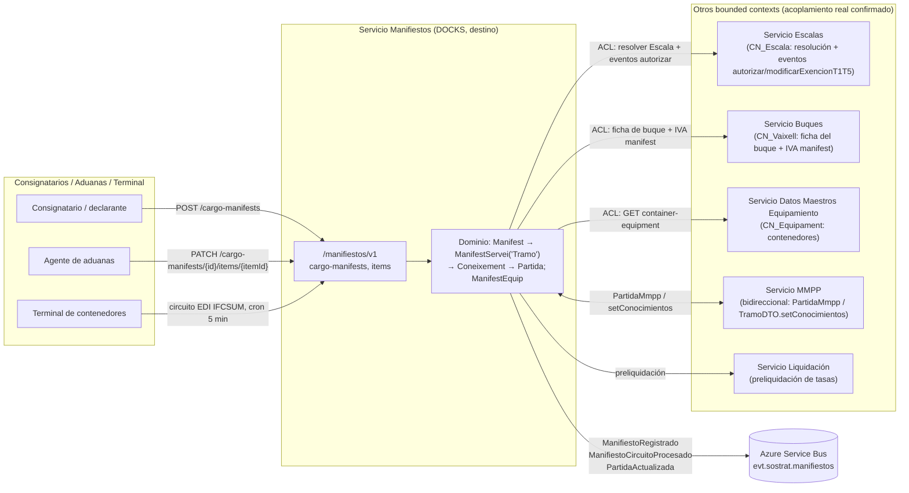

# [IA-GEN] Dossier — Manifiestos

> **Borrador generado por IA** (APB AI Framework — síntesis de apb-disc-spec-gen-v1.0/apb-pm-product-analysis-v1.0/apb-arch-c4-model-v1.0/apb-arch-decompose-v1.0) — pendiente validación humana. No distribuir sin revisión.

## 1. Cabecera

- **Nombre**: Manifiestos
- **Dominio DDD**: `dom-mercancias-v1` (dominio real ya existente en `apb-domain-catalog` — confirmado por su mención explícita en `catalog-comparison.md:37` y `:45`), `parent_domain` declarado en `proposals/bc-manifiestos-v1.md:8`
- **Fase del roadmap**: 3 — Núcleo de Mercancías y Aduanas (`decomposition-roadmap.md:63-68`), con refactor interno previo obligatorio (EPIC-08) antes de extraer
- **Estado**: DISCOVERED — bounded context propuesto, con evidencia de código verificada campo a campo contra el checkout real de `SOSTRAT-Sostrat-MJ8`
- **Bounded context de origen**: `proposals/bc-manifiestos-v1.md`
- **Épicas**: `jira-backlog.md` EPIC-08 (Refactor interno de Manifiestos, pre-extracción) y EPIC-10 (Extracción Manifiestos)

## 2. Resumen ejecutivo

Manifiestos gestiona el ciclo de vida completo del manifiesto de mercancías de una escala: cabecera del manifiesto, sus tramos (servicios de descarga/embarque por consignatario), los conocimientos de embarque (B/L), las partidas de mercancía y los contenedores/equipos declarados, además del circuito EDI (IFCSUM/CUSCAR/CUSREP) que lo mantiene sincronizado con Aduanas. Es, junto con Escalas, uno de los núcleos más grandes y más acoplados de todo SÒSTRAT — `decomposition-roadmap.md:19` ya lo calificaba de acoplamiento "Medio-alto", y esta verificación **eleva esa valoración** al confirmar una dependencia estructural no documentada hacia Escalas (§7).

**Confirmación de la cifra corregida en `dossier-09-transporte-terrestre.md`**: el recuento de **63 rutas Struts** citado en `coverage-audit.md:36` ("manifiestos | 63 | bc-manifiestos-v1") es **exacto** — verificado por parseo de los 63 elementos `<action>` de `struts-config.xml` cuyo `type` apunta al paquete `org.apb.sostrat.mvc.control.manifiestos`, todos con `path` único (sin duplicados, sin fichero satélite `struts-config-manifiestos.xml`, a diferencia de PPS/Transporte Terrestre/Aduanas/Depotsis). Esto confirma con evidencia directa la corrección que ya apuntaba `dossier-09-transporte-terrestre.md §2`: la cifra "63" pertenece a Manifiestos, no a Transporte Terrestre.

**Tres hallazgos nuevos de esta verificación, no presentes en la documentación previa de discovery**:

1. **`CN_Tramo_Impl.java` (4.159 líneas), no `CN_Manifest_Impl.java` (3.929 líneas), es la god class más grande del módulo**, y no está citada en `bc-manifiestos-v1.md` ni en `jira-backlog.md` EPIC-08 (que solo menciona `CN_Manifest_Impl` y `CN_Partida_Impl`, 3.338 líneas, ambas confirmadas exactas por `wc -l`). Además, `CN_Coneixement_Impl.java` (2.893 líneas) es sustancialmente mayor que cualquier otra clase de servicio del módulo salvo las tres anteriores. **Corrección adicional**: la propia afirmación de `bc-manifiestos-v1.md:53` ("Contiene las mayores god classes de todo el sistema") **es incorrecta** — el módulo Escalas tiene clases muy superiores (`CN_Escala_Impl.java`, 10.829 líneas; `CN_Berman_Impl.java`, 10.734 líneas; `CN_LiquidacionEscala_Impl.java`, 10.266 líneas — recuento exacto por `wc -l` sobre todo `sostrat/src`), más del doble de tamaño que la mayor clase de Manifiestos.
2. **Acoplamiento real no documentado hacia Escalas (`bc-escalas-v1`) y hacia Buques (`bc-buques-v1`)**, que corrige tanto `bc-manifiestos-v1.md` (solo cita Equipamiento/MMPP/Liquidación) como `decomposition-roadmap.md:19` (solo cita MMPP como dependencia interna y Equipament como downstream): `CN_Manifest_Impl.java` inyecta el servicio `CN_Escala` como campo, se suscribe a tres eventos internos de dominio de Escala (`@EventTopicSubscriber(topic="CN_Escala.autorizar")`, `"CN_Escala.autorizarModificarCompleto"`, `"CN_Escala.modificarExencionT1T5"`), e importa 29 clases de `dataaccess.dto.escalas` + 24 de `service.escalas` + 8 de `dataaccess.dao.escalas` — el mayor volumen de import cruzado de todo el módulo, por delante incluso de MMPP. Los propios campos `anyescala`/`numescala`/`idsubport` de `Manifest.java` son la clave natural de una Escala. Adicionalmente, `CN_Manifest_Impl.java` importa `org.apb.sostrat.dataaccess.dto.Vaixell` y los servicios `CN_Vaixell`/`CN_VaixellServeiRegularDuana`, y el módulo tiene su propia tabla `VAIXELL_IVA_MANIFEST` (exención de IVA por buque+manifiesto, servicio dedicado `CN_VaixellIvaManifest`) — ver §7.
3. **La entidad de negocio "Tramo" no tiene tabla propia** — `TramoAction`/`CN_Tramo`/`TramoDTO` operan sobre `ManifestServei`/`ManifestServeiVersio` (tablas `MANIFEST_SERVEI`/`MANIFEST_SERVEI_VERSIO`). `bc-manifiestos-v1.md:17` lista `Tramo` como una `entity` independiente sin esta aclaración, lo que puede inducir a error al diseñar el modelo de datos destino — ver §5.

## 3. Análisis funcional

### Responsabilidad de negocio
Gestión del manifiesto de mercancías de una escala: su cabecera, los tramos/servicios de descarga o embarque asociados a cada consignatario, los conocimientos de embarque (B/L), las partidas de mercancía dentro de cada conocimiento y los contenedores/equipos declarados — incluyendo el circuito EDI IFCSUM/CUSCAR/CUSREP que sincroniza estos datos con Aduanas y la preliquidación de tasas de mercancía asociada.

### Actores
- Consignatario / declarante (empresa que presenta el manifiesto y sus tramos, vía EDI o manual).
- Agente de aduanas (gestiona partidas, situación aduanera, régimen simplificado).
- Operador APB de Mercancías (concilia errores de tramo/terminal/nivel de equipo, gestiona incidencias y observaciones del manifiesto).
- Terminal de contenedores (fuente de datos EDI de conciliación, mensajes CUSCAR/CUSREP/IFCSUM).
- Sistema EDI/aduanero (procesa el circuito batch IFCSUM cada 5 minutos).

### Casos de uso reales (grounded en las 63 Actions y rutas Struts confirmadas — `org.apb.sostrat.mvc.control.manifiestos.*`, `struts-config.xml`, sin fichero satélite)
- **Gestión de manifiesto (cabecera)**: `ManifestAction.java` (838 líneas, 6 rutas), `ManifestObservacionAction.java` (observaciones), `ManifestIncidenciaAction.java` (incidencias), `ManifestEDIAction.java` (estado del circuito EDI), `ManifestAuxiliarAction.java` (419 líneas, auxiliar de consulta).
- **Gestión de tramos** (servicio de descarga/embarque por consignatario): `TramoAction.java` (**2.339 líneas**, 5 rutas — la Action de mayor volumen del módulo), `ErrorTramoCierreAction.java` (2 rutas), `CorreccionCardiftramoAction.java` (corrección del indicador `cardiftramo`).
- **Gestión de conocimientos de embarque (B/L)**: `ConeixementAction.java` (930 líneas, 4 rutas), `ConeixementSesionAction.java`, `ConeixementMixtoAction.java`.
- **Gestión de partidas**: `PartidaAction.java` (1.138 líneas, 5 rutas), `PartidaSesionAction.java`, `PartidaMixtoAction.java`, `PartidaDocumentacioAction.java`, `PartidaAnimalAction.java` (421 líneas, 2 rutas — partidas de ganado vivo), `PartidaDesconsolidacioAction.java`/`PartidaDesconsolidacioSesionAction.java` (desconsolidación de carga LCL).
- **Gestión de contenedores/equipos del manifiesto**: `ManifestEquipamentAction.java` (**1.187 líneas**, 4 rutas), `ManifestEquipamentSesionAction.java`, `ManifestEquipamentMixtoAction.java`.
- **Conciliación de errores EDI/terminal**: `ErroresTramoAction.java` (3 rutas), `ErroresTerminalesAction.java` (3 rutas), `ErroresNivelEquipoAction.java` (3 rutas), `ConciliacionForzadaAction.java` (forzado manual de conciliación).
- **Documentación adjunta**: `DocsAdjuntosManifiestosAction.java`.
- **Estiba/desestiba**: `ActDesEstibaAction.java`.
- **Preliquidación de tasas de mercancía** (subpaquete `manifiestos/liquidadormm`, 9 rutas): `PreliquidacionAction.java` (247 líneas, 6 rutas), `ArmSMBonifAction.java` (268 líneas, bonificaciones de armador), `ExcepcionesSujetoPasivoAction.java` (172 líneas), `PreliquidacionLineaAction.java` (173 líneas).

### Reglas de negocio confirmadas en código
- `Manifest` (tabla `MANIFEST`, PK `idmanifest`) es una raíz de agregado deliberadamente delgada — **8 campos** (`idmanifest`, `veractual`, `codedi`, `idtipdeclaracio`, `idsubport`, `anyescala`, `numescala`, `guid`), confirmados uno a uno en `Manifest.java`. **Corrección menor**: `events-catalog.md §8` cita "7 campos" — omite `guid` (campo de auditoría/concurrencia), presente en el DTO real.
- El modelo es jerárquico y versionado en cascada: `Manifest` (1) → `ManifestServei`/"Tramo" (N, por consignatario) → `Coneixement` (N, B/L) → `Partida` (N) → `PartidaVersio` (versión vigente, nunca sobrescribe — confirmado también para `ManifestEquip`/`ManifestEquipVersio`, mismo patrón versionado que `PartidaVersio`).
- `Coneixement.idservei` referencia a `ManifestServei`, **no a `Manifest` directamente** — el B/L cuelga del tramo, no de la cabecera del manifiesto.
- `PartidaVersio` es la entidad más rica del modelo (48 campos confirmados, incluyendo `numonu`/`classemmpp` para mercancía peligrosa, `tipsitaduanera`/`decens`/`prosimplificat` para situación aduanera, `codaranzelari` como FK a `Mercaderia`).
- El circuito EDI IFCSUM se ejecuta en batch cada 5 minutos (ver §6/§12), confirmado activo en producción.

### Qué NO incluye
No gestiona la autorización regulatoria de mercancías peligrosas en sí (eso es MMPP, `bc-mmpp-v1` — Manifiestos solo referencia la clasificación vía `numonu`/`classemmpp` en `PartidaVersio` y el catálogo `MmppMercPerillosaApb`), ni el traslado físico de contenedores dentro del recinto ni la conciliación con terminales fuera del propio circuito EDI de manifiesto (eso es Aduanas/Control de Contenedores, `bc-aduanas-contenedores-v1` — **sin evidencia de import directo de código** entre ambos módulos, ver §7), ni el dato maestro del contenedor en sí (eso es `bc-datos-maestros-equipamiento-v1`, solo consumido aquí por referencia), ni el cálculo final de la liquidación (solo la preliquidación de líneas, el cálculo vive en `bc-liquidacion-v1`). Tampoco gestiona el traslado de contenedores en depósito (Depotsis) — **sin ninguna referencia de código encontrada** entre `manifiestos` y `depotsis` en todo el checkout (0 resultados de `grep -rl "depotsis"` sobre el paquete completo).

## 4. Alcance de migración — qué se migra y qué NO por no estar en uso

- **Se migran las 63 rutas Struts confirmadas** (conteo exacto por parseo de `<action>` con `type` en `org.apb.sostrat.mvc.control.manifiestos.*` sobre `struts-config.xml`, sin duplicados de `path`, sin fichero satélite) — coincide exactamente con `coverage-audit.md:36`.
- **No hay entradas de código muerto de Manifiestos en `dead-code-register.md`** previas a esta verificación. **Dos hallazgos nuevos de esta pasada**:
  1. **Confianza ALTA — método privado sin llamador activo**: `CN_EDI_Helper_Procesar_Manifiestos_Impl.decisionMensajeEnviarCUSREP()` (`service/manifiestos/edi/manifiestos/impl/CN_EDI_Helper_Procesar_Manifiestos_Impl.java:996-1030`, marcado `@Deprecated`) — su único punto de invocación está comentado (`//MERC-72 if(decisionMensajeEnviarCUSREP(lIfcsumDTO)) return enviarCUSREP(lIfcsumDTO);`, línea 425). Es un método `private`, por lo que no puede tener otros llamadores fuera de la clase — objetivamente desconectado, mismo nivel de confianza que las entradas ya registradas en `dead-code-register.md`. **No migrar.**
  2. **Confianza ALTA — código tras `return` inalcanzable**: en `ProcesarMensaje_Impl.java` (líneas 366-368), tras un `return pTramoMess;` explícito, quedan tres líneas comentadas (`pTramoBD.setConocimientos(...)`, `pTramoBD.setManifestDTO(...)`, `return pTramoBD;`) — código muerto trivial, sin impacto funcional.
  - **Matiz importante — NO confundir con código muerto**: `TramoDTO.setConocimientos()` (línea 77-80) también está marcado `@Deprecated`, pero **sí tiene un llamador activo real y fuera del propio módulo**: `CN_MMPP_Hazmat_Impl.java:387` (paquete MMPP) lo invoca sin comentar. Es API interna obsoleta pero todavía en uso productivo cruzado con MMPP — no debe excluirse de la migración pese a la anotación `@Deprecated`.
- **No se ha encontrado ninguna ruta Struts comentada** de `manifiestos` en `struts-config.xml` (búsqueda de `<!--` en el entorno de las rutas del módulo, sin resultados) — a diferencia de otros módulos ya auditados (PPS-terminales, TT), Manifiestos no presenta señales de configuración huérfana o duplicada.
- **Corrige la afirmación de `bc-manifiestos-v1.md:53`** ("Contiene las mayores god classes de todo el sistema") — ver §2, hallazgo 1. No cambia la necesidad del refactor de EPIC-08, pero sí su alcance real: debe ampliarse explícitamente a `CN_Tramo_Impl.java` (4.159 líneas) y `CN_Coneixement_Impl.java` (2.893 líneas), no solo a `CN_Manifest_Impl`/`CN_Partida_Impl` (ver §15).

## 5. Modelo de datos

Todos los campos siguientes están extraídos directamente de los DTOs reales en `sostrat/src/org/apb/sostrat/dataaccess/dto/manifiestos/gestion/` del checkout `SOSTRAT-Sostrat-MJ8`.

### `Manifest` (tabla `MANIFEST`, PK `idmanifest`)
| Campo | Columna Oracle | Nota |
|---|---|---|
| `idmanifest` | `IDMANIFEST` | PK, `Long` |
| `veractual` | `VERACTUAL` | versión vigente del manifiesto |
| `codedi` | `CODEDI` | código EDI, clave de correlación con circuitos externos (ver §9) |
| `idtipdeclaracio` | `IDTIPDECLARACIO` | tipo de declaración (p.ej. `IMPORT`) |
| `idsubport` | `IDSUBPORT` | junto con `anyescala`/`numescala`, forma la clave natural de la Escala asociada (ver §7) |
| `anyescala` | `ANYESCALA` | |
| `numescala` | `NUMESCALA` | |
| `guid` | `GUID` | auditoría/concurrencia — **no contabilizado en `events-catalog.md §8` ("7 campos"), corrección de esta verificación** |

### `ManifestServei` / "Tramo" (tabla `MANIFEST_SERVEI`, PK `idservei`; versión en `MANIFEST_SERVEI_VERSIO`)
**Aclaración de nomenclatura (hallazgo #3 de §2)**: el nombre de negocio "Tramo" (`TramoAction`, `CN_Tramo`, `TramoDTO`) no tiene tabla propia — el DTO de servicio real (`TramoDTO.java`) extiende `ManifestServei` (`import org.apb.sostrat.dataaccess.dto.manifiestos.gestion.ManifestServei`).

`ManifestServei` (8 campos): `idservei` (PK), `idmanifest` (FK a `Manifest`), `numservei`, `veractual`, `consignatari`, `negativa`, `cardiftramo`, `guid`.

`ManifestServeiVersio` (33 campos, confirmados por Javadoc de columna): `idservei`, `versio`, `estat`, `datinivigencia`, `datfivigencia`, `coninicial`, `partinicial`, `regsimplificat`, `concessionari`, `estibador`, `alineacio` (cruce EDI), `subpassiu`, `penrevisio`, `idsancio` (FK a `Sancio`), `dadesterminalsok`, `nummissatge`, `totalcn20`/`totalcn40`/`totalcnaltres`/`totalequipnocon` (recuentos de contenedores por tamaño), `totalkg`, `totalunitats`, `armmercaderia`, `datanulacio`, auditoría (`datalta`/`datmodificacio`/`idopealta`/`idopemodificacio`/`idprocalta`/`idprocmodificacio`), `idserveitram`, `cambiorelevante`, `cambiosversionanterior`, `ubicacio`.

### `Coneixement` (tabla `CONEIXEMENT`, PK `idconeixement`) — conocimiento de embarque (Bill of Lading)
`idconeixement` (PK), `veractual`, `numconeixement`, `idtipconeixement`, `idservei` (**FK a `ManifestServei`, no a `Manifest` directamente**), `guid`. 6 campos — raíz delgada, versionada por `ConeixementVersio`.

### `Partida` (tabla `PARTIDA`, PK `idpartida`) y `PartidaVersio` (tabla `PARTIDA_VERSIO`)
`Partida` (5 campos): `idpartida` (PK), `veractual`, `coneixement` (FK), `numpartida`, `guid`.

`PartidaVersio` (48 campos, confirmados por Javadoc de columna): `idpartida`, `versio`, `estat`, `datinivigencia`, `datfivigencia`, `embalums`, `tipembalum`, `descripcio`, `pes`, `volum`, `modetransport`, `codaranzelari` (FK a `Mercaderia`, tabla `MERCADERIA`), `codconcert`, `insespecial`, `marautomobil`, `transit`, `tipmarcatge`, `marcatge`, `serregular`, `prosimplificat`, `tipsitaduanera`, `decens`, `mercaderiaapb`, `numonu` (mercancía peligrosa), `classemmpp` (clase MMPP), `paginaimdg`/`versioimdg` (referencia al código IMDG), `idexempcio`, `exeiva`, `pertrets`, `roro`, `comentaris`, `penrevisio`, `alineacio`, `estibador`, `concessionari`, `nummissatge`, `datanulacio`, `marcaanimal`, auditoría, `idpartidatransit`, `epr`, `cambiosversionanterior`, `ubicacio`.

### `ManifestEquip` / `ManifestEquipVersio` (tablas `MANIFEST_EQUIP` / `MANIFEST_EQUIP_VERSIO`) — contenedor/equipo declarado en el manifiesto
`ManifestEquip` (6 campos): `iddecequipament` (PK), `veractual`, `idservei` (FK a `ManifestServei`), `idequipament` (**FK al maestro `Equipament`/`EQUIPAMENT`**, `bc-datos-maestros-equipamiento-v1`), `refequipament` (duplicado local de la matrícula), `guid`.

`ManifestEquipVersio` (25 campos): `estat`, vigencia, `tipequipament`, `tipequipiso`, `datdespatx`, `embalums`, `repeticions`, `plebuit`, `tara`, `roro`, `modtraterminal`, `codconcert`, `comentaris`, `nummissatge`, `datanulacio`, auditoría, `epr`, `opmaritimaok`/`opterrestreok`/`renfeok` (flags de conciliación EDI multimodal), `cambiosversionanterior`.

### `PartidaMmpp` (ya documentado en `bc-manifiestos-v1.md`)
Confirmado: `CN_PartidaMmpp_Impl.java` (53 líneas) vive en `service/manifiestos/gestion/impl/`, modela un concepto de MMPP (clasificación de mercancía peligrosa por partida) dentro del paquete de Manifiestos.

### Mapeo a Azure SQL
Migración directa tabla-a-tabla: `MANIFEST`, `MANIFEST_SERVEI`/`MANIFEST_SERVEI_VERSIO` ("Tramo"), `CONEIXEMENT`, `PARTIDA`/`PARTIDA_VERSIO`, `MANIFEST_EQUIP`/`MANIFEST_EQUIP_VERSIO` como agregados/entidades del servicio de Manifiestos, manteniendo el patrón versionado (tabla base delgada + tabla `*_VERSIO` de detalle histórico) tal cual, dado que es un patrón de diseño deliberado del legacy, no un accidente a corregir. No se ha diseñado el esquema Azure SQL definitivo en esta pasada.

## 6. Arquitectura técnica

Stack DOCKS (.NET, Azure SQL, EntraID, Service Bus, APIM), servicio dedicado tras `/manifiestos/v1` (`specs/openapi-manifiestos.yaml:19`). El propio contrato ya declara la precondición: *"Requiere refactor interno previo de `CN_Manifest_Impl`/`CN_Partida_Impl` antes de extraer (ver jira-backlog.md EPIC-08) — este spec asume ese refactor completado"* (`openapi-manifiestos.yaml:9-11`) — **esta verificación amplía esa precondición a `CN_Tramo_Impl.java` y `CN_Coneixement_Impl.java`** (ver §2/§4/§15).

- **Patrón versionado explícito**: cada aggregate raíz (`Manifest`, `ManifestServei`, `Coneixement`, `Partida`, `ManifestEquip`) es deliberadamente delgado y su detalle vive en una tabla `*_VERSIO` que nunca sobrescribe, solo añade — confirmado también por `testing-strategy-fase2-4.md:42` ("verificar que `PartidaActualizada` siempre crea versión nueva (`versio+1`), nunca sobrescribe"). El diseño destino debe preservar este patrón (event-sourcing-like a nivel de entidad), no aplanarlo.
- **Dependencia real hacia Escalas** (§2, hallazgo 2): el nuevo servicio de Manifiestos necesitará un cliente (HTTP o evento) hacia el futuro servicio de Escalas (Fase 5 del roadmap, `decomposition-roadmap.md:130`) para resolver la Escala asociada (`anyescala`/`numescala`/`idsubport`) y para reaccionar a eventos de autorización de Escala — hoy resuelto por inyección de servicio Java directa (`cnEscala`) y suscripción a eventos internos Swing EventBus (`@EventTopicSubscriber`), no por una API real. Es la dependencia externa más profunda del módulo — Escalas está en Fase 5 mientras Manifiestos está en Fase 3, lo que implica que **el corte limpio de Manifiestos no puede completarse hasta que Escalas tenga, como mínimo, una API de consulta estable**, aunque el propio servicio de Escalas siga viviendo en el monolito durante la transición (ver §12).
- **Dependencia hacia Buques** (`bc-buques-v1`, también no extraído hasta fase posterior): `CN_Manifest_Impl` consume `Vaixell`/`CN_Vaixell` y mantiene la tabla propia `VAIXELL_IVA_MANIFEST` — mismo patrón de ACL pendiente que Escalas.
- **Dependencia hacia Equipamiento** (`bc-datos-maestros-equipamiento-v1`, Fase 0, ya diseñado): confirmado en `dossier-01-datos-maestros-equipamiento.md §4` como el segundo mayor consumidor tras MMPP (8 ficheros de import directo del DTO `Equipament`); adicionalmente, `CN_Manifest_Impl.java` y `CN_Partida_Impl.java` consumen el servicio interno `CN_Equipament`/`CN_TipusEquipament` (patrón de acceso mixto: DTO directo en algunas Actions, servicio interno en las clases de mayor tamaño).
- **Circuito EDI IFCSUM**: batch Quartz activo en producción (`sostrat-batch-ManifiestosEDI.xml`, importado en `sostrat-BATCH/src/spring-batch.xml:52`), cron `0 0/5 * * * ?` — **cada 5 minutos**, misma cadencia que el circuito CODECO de Transporte Terrestre (`dossier-09-transporte-terrestre.md §6`). Debe migrarse preservando esta cadencia near-real-time, no degradarse a batch diario.

## 7. Dominio DDD

- **Bounded context**: `bc-manifiestos-v1`, `parent_domain: dom-mercancias-v1` (`proposals/bc-manifiestos-v1.md:8`).
- **Verificación de solapamiento con otros BC ya documentados — corrige documentación previa**:
  - `decomposition-roadmap.md:19` y `bc-manifiestos-v1.md:86` solo citan como dependencias **MMPP** (interna, `PartidaMmpp`) y **Equipament** (downstream/upstream). **Esta verificación encuentra dos acoplamientos reales de código adicionales, no documentados**:
    1. **Hacia Escalas** (`bc-escalas-v1`): el mayor volumen de import cruzado del módulo (29 clases `dataaccess.dto.escalas` + 24 `service.escalas` + 8 `dataaccess.dao.escalas`, solo en los 4 ficheros de servicio más grandes), inyección del servicio `CN_Escala` y suscripción real a 3 eventos de dominio de Escala vía `@EventTopicSubscriber` en `CN_Manifest_Impl.java` (líneas 456, 465, 3637). Ver §2/§6.
    2. **Hacia Buques** (`bc-buques-v1`): `CN_Manifest_Impl.java` importa `org.apb.sostrat.dataaccess.dto.Vaixell` y los servicios `CN_Vaixell`/`CN_VaixellServeiRegularDuana`; tabla local `VaixellIvaManifest`/`VAIXELL_IVA_MANIFEST` con servicio dedicado `CN_VaixellIvaManifest`.
  - **MMPP confirmado y ampliado**: además de `PartidaMmpp.java` (ya documentado), `CN_Partida_Impl.java` importa `MmppMercPerillosaApb`/`MmppMercPerillosaApbPk` (catálogo propio de APB de mercancías peligrosas, distinto de los campos `classemmpp`/`numonu` de `PartidaVersio`) y el servicio `CN_TipusInstruccMarcatge`. **Acoplamiento inverso también confirmado**: `CN_MMPP_Hazmat_Impl.java` (paquete MMPP) invoca directamente `TramoDTO.setConocimientos()` (paquete Manifiestos) — dependencia bidireccional real a nivel de código, no solo conceptual, confirmando el `integration_pattern: conformist/bidirectional` ya declarado en `bc-manifiestos-v1.md:34-36`.
  - **Sin evidencia de acoplamiento de código hacia Aduanas/Control de Contenedores** (`bc-aduanas-contenedores-v1`): 0 resultados de `grep` de `dto.aduanas`/`service.aduanas` en todo el paquete `manifiestos`. La situación aduanera (`PartidaVersio.tipsitaduanera`) es un campo propio, no una FK — contradice implícitamente cualquier hipótesis de acoplamiento estructural con Aduanas a nivel de tabla.
  - **Sin evidencia de acoplamiento hacia Depotsis** (`bc-depotsis-v1`): 0 referencias a "depotsis" en todo el paquete `manifiestos`.
  - **Liquidación confirmada** (`bc-liquidacion-v1`, downstream): subpaquete propio `manifiestos/liquidadormm` (9 Actions/rutas) e imports directos de `Liquidacio`/`LiquidacioPk` desde `TramoDTO.java` — coincide con `bc-manifiestos-v1.md:38-39`.
  - **Sin solapamiento en rutas Struts**: `coverage-audit.md:36` clasifica el módulo `manifiestos` (63 rutas) íntegro y en exclusiva bajo `bc-manifiestos-v1`, sin repartirse con ningún otro BC.
- **Operaciones SOAP verificadas** (ver §9 para detalle): `manifiestogrimaldisecure` (2 operaciones) vive, a nivel de paquete de log interno, dentro del namespace `service.manifiestos.wssicad`, pero su implementación real delega en una tabla y servicio propios (`CN_Sicad`/`SicadDao`), no en las tablas `MANIFEST_*`; `specs/asyncapi-fase3.yaml:71-73` ya trata este consumidor como parte del circuito de eventos de **Aduanas/Contenedores** (`TrasladoContenedorActualizado`), no de Manifiestos — confirma, con matices, la clasificación de `coverage-audit.md:112` (`bc-aduanas-contenedores-v1`). `contenedoressecure` (3 operaciones) **sí es Aduanas/Contenedores sin ambigüedad** (`ContenedoresSecureImpl.java` importa exclusivamente `dto.aduanas.TrasladoTypeDto`).
- **Confirmado que WASDIS, PAXLST, COARRI y CODECO NO pertenecen a Manifiestos**: 0 referencias a estos términos en todo el paquete `service/manifiestos`. WASDIS es circuito de residuos de MARPOL (`bc-marpol-residuos-v1`), PAXLST es lista de pasajeros de Cruceros (`bc-cruceros-v1`), COARRI es un módulo EDI propio (infraestructura transversal, `coverage-audit.md:59`) y CODECO pertenece a Transporte Terrestre (`CN_CODECO_Impl.java`, `dossier-09-transporte-terrestre.md §3`).

## 8. Pantallas UI

Ver `ui-screens-backlog.md` §"App: Manifiestos" (Fase 3):
1. **Listado de Manifiestos** (`dxDataGrid`) — columnas: `idmanifest`, `codedi`, `idtipdeclaracio`, `idsubport/anyescala/numescala`.
2. **Ficha de Manifiesto** (`dxForm` + `dxDataGrid` maestro-detalle de Partidas) — columnas de partida: `idpartida`, `versio`, `estat`, `embalums`, `pes`, `volum`, `codaranzelari`, `numonu`, `classemmpp`.
3. **Indicador visual de mercancía peligrosa** — badge condicional cuando `numonu`/`classemmpp` no están vacíos, con enlace cruzado a la ficha MMPP correspondiente.

**Gap frente al backlog de UI, encontrado en esta verificación**: el backlog no propone pantalla propia para `ManifestServei`/"Tramo" (la Action de mayor volumen real del módulo, `TramoAction.java`, 2.339 líneas, 5 rutas), ni para `Coneixement` (conocimiento de embarque) ni para `ManifestEquip` (contenedores/equipos declarados) — solo la ficha de Partida aparece en el maestro-detalle propuesto. Mismo patrón de gap ya señalado en `dossier-05-pps.md §8` y `dossier-09-transporte-terrestre.md §8` para sus respectivos módulos: las pantallas propuestas cubren la entidad "cabecera" y la de mayor volumen de negocio evidente, pero no las entidades intermedias de la jerarquía real (`Manifest` → `ManifestServei` → `Coneixement` → `Partida`).

## 9. APIs

| Método | Ruta | Descripción | Grounded en |
|---|---|---|---|
| GET | `/cargo-manifests` | Listar manifiestos (filtros `idsubport`/`anyescala`/`numescala`, paginación cursor) | `Manifest.java` |
| POST | `/cargo-manifests` | Registrar manifiesto | `Manifest.java` (campos `codedi`, `idtipdeclaracio`, `idsubport`, `anyescala`, `numescala`) |
| GET | `/cargo-manifests/{idmanifest}` | Obtener manifiesto por PK | `ManifestPk.java` |
| PATCH | `/cargo-manifests/{idmanifest}/items/{idpartida}` | Actualizar partida (crea nueva versión, no sobreescribe) | `PartidaVersio.java` |

Contrato completo: `specs/openapi-manifiestos.yaml`. **Gap confirmado por esta verificación**: el contrato actual solo modela `CargoManifest`/`CargoManifestItem` (=`Manifest`/`PartidaVersio`) — **no cubre `ManifestServei`/"Tramo" (la Action de mayor volumen real), `Coneixement` ni `ManifestEquip`** como recursos propios, pese a que `TramoAction.java` (2.339 líneas) es la Action de mayor tamaño de todo el módulo. Mismo patrón de gap de contrato ya señalado para PPS y Transporte Terrestre.

**Operaciones SOAP EDI relevantes como contexto de integración legacy** (§7):
| Servicio | Operaciones | Rol respecto a Manifiestos |
|---|---|---|
| `manifiestogrimaldisecure` | `consultaCambiosEquiposPorCodEdi`, `consultaCambiosEquiposPorRango` | Consulta de cambios de estado de contenedores para la naviera Grimaldi, correlacionada por `codEdi` (mismo campo que `Manifest.codedi`), pero persistida en tabla propia (`SicadDao`/`SicadDto`), no en `MANIFEST_*`. Tratado como consumidor del circuito de Aduanas/Contenedores en `specs/asyncapi-fase3.yaml:71-73`, no de Manifiestos — ver gap en §14. |
| `contenedoressecure` | 3 operaciones (`ActualizarTrasladoInspeccion`, etc.) | **No pertenece a Manifiestos** — confirmado, solo Aduanas/Contenedores (`TrasladoTypeDto`). |
| Circuito batch IFCSUM (no SOAP) | `sostrat-batch-ManifiestosEDI.xml`, cron cada 5 min | Circuito EDI propio y activo de Manifiestos — genera/procesa mensajes IFCSUM/CUSCAR/CUSREP hacia Aduanas. |

## 10. Eventos

| Evento | Trigger | Payload (resumen) | Fuente |
|---|---|---|---|
| `ManifiestoRegistrado` | Alta de manifiesto | `idmanifest`, `veractual`, `codedi`, `idtipdeclaracio`, `idsubport`, `anyescala`, `numescala` | `Manifest.java` |
| `ManifiestoCircuitoProcesado` | Procesamiento del circuito EDI IFCSUM (batch, cron cada 5 min, confirmado activo) | mismo payload que `ManifiestoRegistrado` | `Manifest.java`, `sostrat-batch-ManifiestosEDI.xml` |
| `PartidaActualizada` | Actualización de partida (`versio+1`, nunca sobrescribe) | `idpartida`, `versio`, `estat`, `codaranzelari`, `numonu` | `PartidaVersio.java` |

Canal: `evt.sostrat.manifiestos` (AMQP, Azure Service Bus), con dead-letter exchange dedicado (`specs/asyncapi-fase3.yaml:26-30`). Contrato completo: `specs/asyncapi-fase3.yaml` §`ManifiestoData`/`PartidaData`; documentación de payload también en `events-catalog.md §8`. Regla de negocio del evento ya documentada correctamente en el AsyncAPI: *"Crea una nueva versión (versio+1), nunca sobrescribe la anterior — patrón versionado confirmado en PartidaVersio.java"* (`asyncapi-fase3.yaml:66`).

**Gap confirmado**: no existe hoy un evento dedicado para `ManifestServei`/"Tramo" ni para `ManifestEquip` (contenedor) en `asyncapi-fase3.yaml` — el AsyncAPI cubre cabecera de manifiesto y partida, no el nivel intermedio de tramo/conocimiento/equipo, mismo gap ya señalado en §8/§9 para UI/API.

## 11. Diagrama topológico (C4 nivel 1)

## 12. Estrategia de convivencia con el modelo actual

1. **Refactor interno obligatorio antes de extraer (EPIC-08), con alcance ampliado**: no basta con romper `CN_Manifest_Impl.java` (3.929 líneas) y `CN_Partida_Impl.java` (3.338 líneas) — `CN_Tramo_Impl.java` (4.159 líneas, la mayor del módulo) y `CN_Coneixement_Impl.java` (2.893 líneas) deben incluirse explícitamente en el alcance del refactor, tal como se corrigió el alcance equivalente de EPIC-07 para Transporte Terrestre (`dossier-09-transporte-terrestre.md §12`).
2. **Strangler fig sobre las 63 rutas Struts, por sub-agregado de la jerarquía versionada**: extraer en el orden `Manifest` → `ManifestServei`/"Tramo" → `Coneixement` → `Partida` → `ManifestEquip`, preservando el patrón de versión "crea, nunca sobrescribe" en cada paso.
3. **Escalas y Buques deben tratarse como ACL desde el primer día**, no como llamada Java directa — son dependencias hacia bounded contexts que, según el roadmap actual, se extraen en fases posteriores (Escalas en Fase 5, Buques sin fase asignada explícita en `decomposition-roadmap.md`). Mientras esos servicios sigan en el monolito, el nuevo servicio de Manifiestos debe consultarlos vía un adaptador que hoy no existe (gap de contrato, ver §14) — el patrón de suscripción a eventos internos Swing EventBus (`@EventTopicSubscriber`) no tiene equivalente directo en Azure Service Bus y requiere diseño explícito, no una migración literal.
4. **El circuito EDI IFCSUM (cron 5 min) debe migrarse manteniendo su cadencia real**, igual que el circuito CODECO de Transporte Terrestre — no degradar a batch diario.
5. **Confirmar con negocio si `manifiestogrimaldisecure` pertenece al alcance de Manifiestos o de Aduanas/Contenedores antes de fijar el backlog definitivo** — la evidencia de código es mixta (namespace de paquete interno vs. persistencia y arquitectura de eventos reales), ver §14.
6. **Cerrar el gap de API/UI/eventos de `ManifestServei`/"Tramo", `Coneixement` y `ManifestEquip` antes de comprometer fecha de cutover completo** — hoy el contrato solo cubre cabecera y partida, pero la Action de mayor volumen real del módulo (`TramoAction.java`) no tiene recurso API propio.

## 13. Testing y seguridad

- **Estrategia de testing** (`testing-strategy-fase2-4.md:40-42`): pirámide Unit 60% / Contract 20% / Integration 15% / E2E 5%, con una nota explícita de prioridad: *"Unit: prioridad alta — dado que este servicio depende del refactor previo de `CN_Manifest_Impl`/`CN_Partida_Impl` (EPIC-08), los tests de caracterización de ese refactor SON la base de este plan de testing, no un añadido"* — **esta verificación confirma que esa base de tests de caracterización debe cubrir también `CN_Tramo_Impl` y `CN_Coneixement_Impl`** (§2/§4/§12), no solo las dos clases citadas.
  - Integration: `testing-strategy-fase2-4.md:42` ya exige verificar que `PartidaActualizada` siempre crea versión nueva (`versio+1`), nunca sobrescribe — confirmado como patrón real también en `ManifestServei`/`Coneixement`/`ManifestEquip`, no solo en `Partida`.
  - Contract: `testing-strategy-fase2-4.md:63` ya exige un test de contrato compartido entre MMPP/Manifiestos/PIF/Aduanas contra `/api/v1/container-equipment` (Equipamiento) — aplica directamente a este servicio.
  - **Nuevo, no cubierto hoy**: test de integración para la dependencia real hacia `CN_Escala` (eventos `autorizar`/`autorizarModificarCompleto`/`modificarExencionT1T5`) — sin mención en `testing-strategy-fase2-4.md`, gap de esta verificación.
- **Threat model**: **no se ha localizado ninguna entrada específica de Manifiestos en `threat-model-fase2-4.md`** — a diferencia de PIF/MARPOL (que sí tienen entradas propias en el mismo documento), Manifiestos no aparece. Gap de evidencia explícito, no se afirma su ausencia de riesgo, solo la ausencia de análisis documentado.
- Ningún campo de credencial identificado en el modelo de datos de Manifiestos.

## 14. Riesgos y gaps de evidencia conocidos

- **Alcance de refactor de EPIC-08 infravalorado**: no cita `CN_Tramo_Impl.java` (4.159 líneas, la mayor real del módulo) ni `CN_Coneixement_Impl.java` (2.893 líneas) — ver §2/§4/§12/§15.
- **Afirmación incorrecta en `bc-manifiestos-v1.md:53`**: "las mayores god classes de todo el sistema" no se sostiene frente a Escalas (`CN_Escala_Impl.java`, 10.829 líneas, más del doble).
- **Acoplamiento real hacia Escalas y Buques no documentado previamente** en `bc-manifiestos-v1.md` ni en `decomposition-roadmap.md:19` — corrige ambos. Es la dependencia externa más profunda del módulo (mayor volumen de import cruzado, suscripción real a eventos de dominio) y bloquea el criterio de éxito de EPIC-10 tal como está escrito hoy si no se planifica explícitamente vía ACL.
- **Clasificación ambigua de `manifiestogrimaldisecure`**: el paquete de log interno (`service.manifiestos.wssicad`) vive dentro del namespace de Manifiestos y su clave de correlación es `codedi` (campo real de `Manifest`), pero la implementación SOAP real y su persistencia (`CN_Sicad`/`SicadDao`/`SicadDto`, módulo `sostratWSCXF`) son independientes de las tablas `MANIFEST_*`, y `specs/asyncapi-fase3.yaml:71-73` ya lo trata como parte del circuito de eventos de Aduanas/Contenedores. Recomendado confirmar con negocio/arquitectura si este consumidor debe tratarse como parte del alcance de migración de Manifiestos o de Aduanas/Contenedores antes de fijar el backlog definitivo.
- **Contrato de API/eventos/UI incompleto**: `openapi-manifiestos.yaml` y `asyncapi-fase3.yaml` solo cubren `Manifest`/`PartidaVersio`; `ManifestServei`/"Tramo" (la Action de mayor volumen real), `Coneixement` y `ManifestEquip` no tienen recurso ni evento propio pese a tener Actions dedicadas — mismo patrón de gap ya señalado para PPS y Transporte Terrestre.
- **`events-catalog.md §8` cuenta 7 campos en `Manifest`, el DTO real tiene 8** (omite `guid`) — corrección menor de esta verificación.
- **Threat model de Manifiestos no localizado** en `threat-model-fase2-4.md` — gap de evidencia, no de ausencia confirmada (§13).
- **`TramoDTO.setConocimientos()` marcado `@Deprecated` pero con llamador activo real desde MMPP** (`CN_MMPP_Hazmat_Impl.java:387`) — no debe excluirse de la migración pese a la anotación; riesgo de exclusión accidental si se usa `@Deprecated` como único criterio de poda.
- **`ManifestEquipVersio`/`PartidaVersio` no volcadas con el detalle campo a campo de sus DTOs auxiliares de EDI** (`codeco`/`copino`-equivalentes de manifiestos, ~10 subpaquetes EDI: `cuscar`, `cusrep`, `cusres`, `cusrp2`, `ifcsum`, `wssicad`, `mnfmodifpassatgers`) — no volcados campo a campo en esta pasada por volumen, mismo patrón de limitación ya señalado para el circuito CODECO de Transporte Terrestre.

## 15. Estimación de esfuerzo

Ver `jira-backlog.md` EPIC-08 (Refactor interno de Manifiestos, pre-extracción, Fase 3, 34 pts) y EPIC-10 (Extracción Manifiestos, Fase 3, dependiente de EPIC-08 y EPIC-00, 31 pts):

**EPIC-08**:
1. Tests de caracterización sobre `CN_Manifest_Impl` — 13 pts.
2. Separar lógica EDI de lógica de negocio de manifiestos — 13 pts.
3. Aislar la gestión de `PartidaVersio` de `CN_Partida_Impl` — 8 pts.

**EPIC-10**:
1. Registrar manifiesto (`POST /cargo-manifests`) — 13 pts.
2. Actualizar partida (`PATCH /cargo-manifests/{id}/items/{itemId}`) — 8 pts.
3. Consultar ONU/clase MMPP de una partida — 5 pts.
4. Recibir `ManifiestoCircuitoProcesado` desde Liquidación — 5 pts.

**Nota de esta verificación — el alcance técnico de EPIC-08 debe ampliarse, no solo confirmarse**: el criterio de éxito "ninguna clase de servicio de Manifiestos supera las 500 líneas" (`jira-backlog.md:165`) es correcto en su formulación, pero las historias de usuario 1-3 solo citan `CN_Manifest_Impl`/`CN_Partida_Impl` — deben ampliarse explícitamente a `CN_Tramo_Impl.java` (4.159 líneas, mayor que `CN_Manifest_Impl`) y `CN_Coneixement_Impl.java` (2.893 líneas), no cubiertas hoy por ninguna historia de la épica. No se ha reestimado el esfuerzo en story points de esta ampliación — pendiente de una iteración de refinamiento con el equipo antes de sprint planning. Tampoco se ha estimado el esfuerzo de diseñar el ACL hacia Escalas/Buques (§12/§14), ni el de cerrar el gap de API/UI/eventos de `ManifestServei`/`Coneixement`/`ManifestEquip` (§8/§9/§10).

## 16. Checklist de validación

**Funcional**:
- [ ] Confirmar con negocio si `manifiestogrimaldisecure` (SOAP, naviera Grimaldi) pertenece al alcance de migración de Manifiestos o de Aduanas/Contenedores.
- [ ] Validar si `ManifestServei`/"Tramo", `Coneixement` y `ManifestEquip` necesitan pantallas y API propias en el MVP de Fase 3 o pueden diferirse.
- [ ] Confirmar con negocio el comportamiento esperado de la suscripción a eventos de Escala (`autorizar`, `autorizarModificarCompleto`, `modificarExencionT1T5`) en el diseño destino.

**Desarrollo**:
- [ ] Ampliar el alcance de refactor de EPIC-08 para incluir explícitamente `CN_Tramo_Impl.java` (4.159 líneas) y `CN_Coneixement_Impl.java` (2.893 líneas).
- [ ] Diseñar el ACL hacia el servicio de Escalas (hoy inexistente como API, solo como servicio Java interno + eventos Swing EventBus) y hacia el servicio de Buques.
- [ ] Diseñar el contrato de API/eventos/UI de `ManifestServei`/"Tramo", `Coneixement` y `ManifestEquip`, hoy inexistente.
- [ ] Añadir a `dead-code-register.md` el hallazgo de `CN_EDI_Helper_Procesar_Manifiestos_Impl.decisionMensajeEnviarCUSREP()` (método privado sin llamador activo, confianza ALTA).
- [ ] Corregir `bc-manifiestos-v1.md`: la afirmación "mayores god classes de todo el sistema" es incorrecta (Escalas las supera); añadir las dependencias reales hacia Escalas y Buques.
- [ ] Corregir `decomposition-roadmap.md:19`: añadir Escalas y Buques a la columna de dependencias de Manifiestos.
- [ ] Confirmar si existe threat model dedicado de Manifiestos o si debe generarse antes de producción.

## 17. Historial de cambios

| Versión | Fecha | Autor | Cambio |
|---------|-------|-------|--------|
| 1.0.0 | 2026-07-13 | APB AI Framework | Dossier inicial, a petición explícita del usuario. Verificado campo a campo contra el checkout real de `SOSTRAT-Sostrat-MJ8` (DTOs de `dataaccess/dto/manifiestos/gestion/`, Actions de `mvc/control/manifiestos`, `struts-config.xml`, `CN_Manifest_Impl`/`CN_Partida_Impl`/`CN_Tramo_Impl`/`CN_Coneixement_Impl`, `sostrat-batch-ManifiestosEDI.xml`, SOAP `manifiestogrimaldisecure`/`contenedoressecure`). Confirma la cifra de 63 rutas Struts de `coverage-audit.md` (y la corrección ya apuntada en `dossier-09-transporte-terrestre.md`). Corrige `bc-manifiestos-v1.md`: (1) `CN_Tramo_Impl.java` (4.159 líneas), no `CN_Manifest_Impl`, es la god class más grande del módulo, y la afirmación "mayores god classes de todo el sistema" es incorrecta frente a Escalas; (2) existe acoplamiento real de código hacia Escalas (`CN_Escala`, eventos de dominio) y Buques (`CN_Vaixell`, `VaixellIvaManifest`), no documentado; (3) la entidad de negocio "Tramo" no tiene tabla propia, es el nombre de negocio de `ManifestServei`/`ManifestServeiVersio` |
