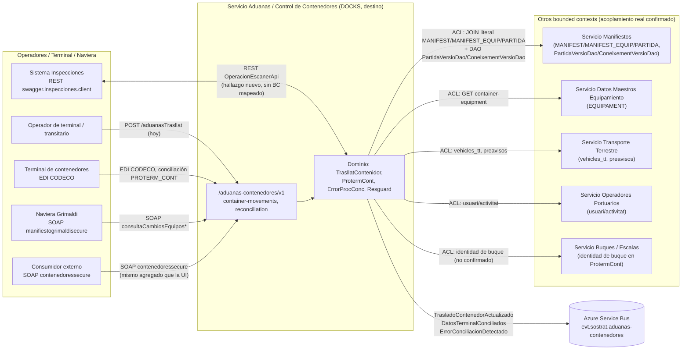

# [IA-GEN] Dossier — Aduanas y Control de Contenedores

> **Borrador generado por IA** (APB AI Framework — síntesis de apb-disc-spec-gen-v1.0/apb-pm-product-analysis-v1.0/apb-arch-c4-model-v1.0/apb-arch-decompose-v1.0) — pendiente validación humana. No distribuir sin revisión.

## 1. Cabecera

- **Nombre**: Aduanas y Control de Contenedores
- **Dominio DDD**: `dom-mercancias-v1` (`proposals/bc-aduanas-contenedores-v1.md:8`)
- **Fase del roadmap**: 3 — Núcleo de Mercancías y Aduanas (`decomposition-roadmap.md`, `jira-backlog.md` EPIC-11)
- **Estado**: DISCOVERED — bounded context propuesto con **nota explícita de consolidación interna pendiente** (`proposals/bc-aduanas-contenedores-v1.md:41`: *"no existe paquete 'cta' en el código; la funcionalidad está repartida entre service/aduanas y service/terminales"*), verificado campo a campo contra el checkout real de `SOSTRAT-Sostrat-MJ8`
- **Bounded context de origen**: `proposals/bc-aduanas-contenedores-v1.md`
- **Épica**: `jira-backlog.md` EPIC-11 — Consolidación y extracción de Aduanas/Control de Contenedores

## 2. Resumen ejecutivo

Aduanas y Control de Contenedores gestiona el traslado y tránsito aduanero de contenedores dentro del recinto portuario y la conciliación de los datos operativos que reportan las terminales de contenedores (COARRI/CODECO, cruce de partidas/equipos). Es, tal como ya advertía la propuesta original, un bounded context **físicamente disperso** entre dos paquetes Java del monolito — `service/aduanas` (13 rutas Struts propias, satélite) y `service/terminales` (10 rutas Struts en el `struts-config.xml` principal) — sin límite de módulo real hoy. Esta verificación confirma exactamente el conteo de **23 rutas Struts activas** (13 + 10, coincide con `coverage-audit.md:50,52`) y añade **cinco hallazgos nuevos** que corrigen de forma sustancial la propuesta original y el contrato ya publicado:

1. **El contrato API/evento actual está grounded sobre el DTO equivocado.** `openapi-aduanas-contenedores.yaml`, `events-catalog.md §12` y `api-surface-by-phase.md` modelan `TrasladoContenedorActualizado`/`/container-movements` sobre `dataaccess/dto/MovimientoContenedor.java` — una clase que, verificada con `grep` exhaustivo sobre todo el checkout (`sostrat/`, `sostrat-BATCH/`, `sostratWSCXF/`), **no tiene ningún otro punto de uso**: ni DAO, ni Action, ni servicio la referencia; su única mención fuera de su propio fichero es una propiedad de bean **comentada** en `applicationContext-beans.xml:1132` (`cnDatosMovimientoContenedor`), que además apunta a una clase (`CN_DatosMovimientoContenedor_Impl`) que no existe en ningún módulo del checkout. La entidad **real** que sustenta la única pantalla activa del "traslado" (`/aduanasTrasllat` → `TrasladosAction.java`) y las 3 operaciones activas del SOAP `contenedoressecure` es **`TrasllatContenidor`** (tabla real `TRASLLAT_CONTENIDOR`, confirmada por SQL literal en `TrasllatContenidorDaoImpl.java`), con una forma de datos completamente distinta — ver §5/§9.
2. **Acoplamiento real, profundo y multi-punto hacia Manifiestos**, no documentado en `bc-aduanas-contenedores-v1.md` (que solo cita Equipamiento como upstream) ni en `decomposition-roadmap.md`: import directo de `ManifestEquip`/`PartidaPk`, DAO `ManifestEquipExtendedDao` y servicio `CN_Partida` en `CN_TrasllatContenidor_Impl.java`; inyección directa de `PartidaVersioDao` (Manifiestos) en los **tres** mayores god classes de `terminales` (`CN_ProtermCont_Impl`, `CN_ProferCont_Impl`, `CN_CodecoCont_Impl`) y de `ConeixementVersioDao` en `CN_ProtermCont_Impl`; y SQL literal con JOIN directo a `MANIFEST`, `MANIFEST_SERVEI`, `MANIFEST_EQUIP`, `CONEIXEMENT`, `CONEIXEMENT_DESCONSOLIDACIO`, `PARTIDA`, `PARTIDA_DESCONSOLIDACIO`, `V_TC_PARTIDAS` en `TrasllatContenidorDaoImpl.java`. Es un acoplamiento **unidireccional** (Aduanas → Manifiestos): `dossier-12-manifiestos.md §7` ya confirmó "0 resultados de `dto.aduanas`/`service.aduanas` en el paquete `manifiestos`" — esa afirmación sigue siendo cierta y no se corrige, pero queda incompleta si no se lee junto con esta verificación desde el lado de Aduanas.
3. **Acoplamiento adicional no documentado con Transporte Terrestre** (tabla `vehicles_tt` vía `VehicleDao`/`VehiclePk`, método `getNumberPreavisosTT`), **Operadores Portuarios** (tabla `usuari`/`activitat`, validación de conductor) y **Buques/Escalas** (`ProtermContBase` incluye campos de buque `idvaixell`/`numllodys`/`callsign`/`nomvaixell`; `CN_CodecoCont_Impl` importa `EscalaAspecte`).
4. **Gap de checkout más severo que el ya conocido de Aguada**: las clases DTO reales de escritura del dominio (`TrasllatContenidor`, `TrasllatContenidorPk`, `Resguard`, `ResguardOperador`, `LogTransitosEscaner`, paquete `org.apb.sostrat.dataaccess.dto.aduanas`) están **ausentes por completo** del módulo `sostrat` de este checkout — ni como fuente ni compiladas en ningún `.jar` del repositorio — pese a ser importadas activamente por 15+ clases reales (`TrasladosAction`, `CN_TrasllatContenidor`, `CN_TrasllatContenidor_Impl`, `CN_Resguard`, `CN_ResguardOperador`...). Solo existe una copia con idéntico nombre de paquete en el módulo `sostratWSCXF` (capa SOAP), usada aquí como mejor evidencia disponible con esta salvedad explícita (§5/§14).
5. **Integración REST ya moderna, sin documentar en ningún dossier previo**: `CN_TrasllatContenidor_Impl.java` consume un cliente REST generado (`org.apb.sostrat.swagger.inspecciones.client.api.OperacionEscanerApi`) para reposicionar un tránsito (`PosicionamientoModifEnTransitoInputDto`) — sugiere que parte de la integración de escaneo/control de acceso ya vive fuera del monolito en un servicio "Inspecciones" no identificado en `bc-pif-v1` ni `bc-inspeccion-scpp-v1`. Requiere confirmación de Arquitectura APB (§14).

Correcciones cuantitativas adicionales: el catálogo `ErrorProcConc.CODERR_*` tiene **111 constantes** (rango 100-6000), no "~40 (1001-7001)" como cita `events-catalog.md §12`; y `ProtermCont`/`ProtermContBase` tiene **34 campos reales** (27 propios + 7 de auditoría), no los ~10 modelados en el contrato actual.

## 3. Análisis funcional

### Responsabilidad de negocio
Control del tránsito y traslado físico de contenedores en régimen aduanero dentro del recinto portuario (origen/destino, matrícula, equipo, partida/manifiesto asociado), la conciliación de los datos operativos que reportan las terminales de contenedores (llegada/salida, tara, alineación, EDI CODECO) y la gestión de resguardos/documentación de terminal asociada a cada traslado.

### Actores
- Operador de terminal / transitario (registra traslados y consulta situación aduanera vía `/aduanasTrasllat`, `/aduanasTransit`, `/aduanasConsultaContenedor`).
- Naviera Grimaldi (consumidor SOAP externo, `manifiestogrimaldisecure`, activo).
- Sistema/operador que registra traslados vía SOAP `contenedoressecure` (consumidor externo, mismo servicio `CN_TrasllatContenidor` que la UI interna).
- Terminal de contenedores (fuente de los ficheros de conciliación PROTERM/CODECO, batch `sostrat-batch-Conciliacion*.xml`).
- Sistema "Inspecciones" (consumidor/proveedor REST moderno vía `swagger.inspecciones.client`, integración de escaneo — hallazgo nuevo, §2/§14).

### Casos de uso reales (grounded en las 23 rutas Struts confirmadas — 13 de `struts-config-aduanas.xml` + 10 de `org.apb.sostrat.mvc.control.terminales.*` en `struts-config.xml` principal)
- **Traslado de contenedores**: `/aduanasTrasllat` → `TrasladosAction.java` (504 líneas), `/listaTrasllatAudit` → `TrasladosAuditAction.java` — alta/consulta/auditoría de `TrasllatContenidor`.
- **Tránsito aduanero**: `/aduanasTransit` → `TransitosAction.java` (usa `CN_TransitContenidor`/`CN_TransitGrupatge`, tránsito individual y en grupaje).
- **Consulta de contenedor**: `/aduanasConsultaContenedor` → `ConsultaContenedorAction.java` (usa `CN_ConsultaContenedor`).
- **Listas de carga**: `/aduanasLlistasCarrega` → `TConLlistesCarregaAction.java`, `/aduanasEquipsLlistasCarrega` → `TConLlistaCarregaAction.java`.
- **Datos de aduana**: `/datosAduanas` y `/datosAduanas_popup` → `TConDatosAduanaAction.java` (usa `CN_DatosAduanas`).
- **Entrada de terminal / cruce de datos**: `/aduanasEntradaTerminal` → `EntradaTerminalAction.java`, `/creuamentDadesTerminal` → `TConCreuamentDadesTerminalAction.java` (usa `CN_CreuamentDadesTerminal`).
- **Mensajes EDI**: `/missatgesEDI` y `/missatgesEDI_popup` → `TConMensajesEDIAction.java` (usa `CN_MissatgesEDI`).
- **Proternifs**: `/proternifs` → `TConProternifsAction.java` (usa `CN_Proternifs`).
- **Terminales (10 rutas, `mvc.control.terminales`, en `struts-config.xml` principal, sin fichero satélite propio activo)**: `/profercont` (`CN_ProferCont`), `/protermcont` (`CN_ProtermCont`, conciliación), `/granelSolid`/`/granelLiquid`/`/tancGranelSolid`/`/tancGranelLiquid` (graneles), `/automovils` (vehículos), `/trazabilidad`, `/regulacion`, `/renfeCont` (ferroviario en terminal).

### Reglas de negocio confirmadas en código
- `TrasllatContenidor` (tabla `TRASLLAT_CONTENIDOR`, PK `IDTRASLLATS`, secuencia `SEQ_TRASLLAT_CONTENIDOR`) es la raíz de agregado real del traslado: `matricula`/`refequipament`, `origen`/`desti`, `dathoraorigen`/`dathoradesti`, `idequipament` (FK a Equipamiento), `idpartida`/`numpartida`/`idmanifest` (FK a Manifiestos), `nif` (conductor), `estat`, `idtransaccio` (correlación con el SOAP externo) — confirmado en `TrasllatContenidorDaoImpl.java` (`sostratWSCXF`), única fuente disponible del modelo real (§14).
- `mrnSumaria` (parámetro del SOAP `contenedoressecure`) se resuelve contra `Manifest.codedi` (`TrasllatContenidorDaoImpl.findIdmanifestBySumaria`): `SELECT MAX(M.IDMANIFEST) FROM MANIFEST M WHERE M.CODEDI = :mrnSumaria` — confirma que el "MRN" aduanero de un traslado es literalmente el `codedi` de Manifiestos, el mismo campo que ya usa `manifiestogrimaldisecure` como clave de correlación (`dossier-12-manifiestos.md §9`).
- El traslado se resuelve contra Manifiestos vía la cadena `MANIFEST_EQUIP → PARTIDA_DESCONSOLIDACIO → EQUIPAMENT → PARTIDA` (SQL literal `SQL_FIND_PARTIDA`/`SQL_FIND_NUMPARTIDA`/`SQL_FIND_MANIFEST`), no por una FK directa simple.
- La conciliación de datos de terminal (`ProtermCont`, tabla `PROTERM_CONT`, PK `IDREGISTRE`) es un registro rico de 27 campos propios (no ~10 como se documentó): identidad de escala (`idsubport`/`anyescala`/`numescala`/`dataescala`/`numescalaterminal`), **identidad de buque** (`idvaixell`/`numllodys`/`callsign`/`nomvaixell`), operación (`operacio`/`dataoperacio`/`manipulacio`/`refequipament`/`digitcontrol`/`codtamany`/`frigorific`/`plebuit`), **partes comerciales** (`consignatari`/`armador`/`tipuscodiarmador`), `pes`, `grua`, `estibador`, `estado`, trazabilidad del fichero de carga (`nomfitxer`/`dataproces`), más 7 campos de auditoría estándar.
- La igualdad de negocio de `ProtermCont` no usa la PK técnica: `equals()` compara `refequipament + operacio + numescalaterminal` — confirma que esta es la clave de negocio real de conciliación (coincide con `events-catalog.md §12`).
- `ErrorProcConc` (errores/warnings de conciliación, PK `iderror`) tiene un catálogo real de **111 constantes `CODERR_*`** (rango numérico 100–6000, no 1001–7001) y 8 valores de `tipuserror` (`TIPERR_CN/CV/TER/SSI/CNC/STI/ALI/COA`, confirmados exactos) — corrección cuantitativa de `events-catalog.md §12`.
- El SOAP `contenedoressecure` (3 operaciones activas) delega literalmente en el mismo servicio que la pantalla interna: `ContenedoresSecureImpl.actualizarTrasladoContenedor/crearTrasladoDesdeInspeccion/actualizarTrasladoDesdeInspeccion` → `ServiceLocator.getCN_TrasllatContenidor().actualizarTrasladoContenedor(...)` — confirma que UI interna y canal externo comparten el mismo agregado (`TrasllatContenidor`), no dos modelos distintos.

### Qué NO incluye
No gestiona el manifiesto de mercancías en sí (`Manifest`/`Partida`, eso es `bc-manifiestos-v1` — aunque este contexto lo **consulta y referencia** intensamente, ver §2/§7), no gestiona el dato maestro del contenedor/equipo (`Equipament`, eso es `bc-datos-maestros-equipamiento-v1`, solo consumido por referencia), no gestiona el depósito en muelle libre T6 (eso es `bc-depotsis-v1` — la duplicación de 13 rutas de `struts-config-aduanas.xml` dentro de `struts-config-depotsis.xml`, ya documentada en `dossier-04-depotsis.md §4`, es deuda de configuración, no una relación funcional real). No incluye WASDIS (MARPOL/residuos) ni PAXLST (lista de pasajeros/Cruceros) — verificado con 0 referencias a ambos términos en `service/aduanas` y `service/terminales`, confirma lo ya establecido en `dossier-12-manifiestos.md §7`. COARRI aparece únicamente como comentario de rango de error (`//COARRI-36 a 39 Warnings`, `CN_ErrorProcConc_Impl.java:207`), no como integración real — el circuito EDI de conciliación de terminal activo de este módulo es **CODECO** (vía `CN_CodecoCont_Impl`/tabla ETL `EtlTbCodecoWs`, distinto pero relacionado con el CODECO de Transporte Terrestre, ver §9).

## 4. Alcance de migración — qué se migra y qué NO por no estar en uso

- **Se migran las 23 rutas Struts activas confirmadas**: 13 de `struts-config-aduanas.xml` (satélite, cargado en `web.xml`) + 10 de `mvc.control.terminales.*` en `struts-config.xml` principal.
- **No se migra `struts-config-terminales.xml`** (1 acción, `/errorsTerminals` → `TConErrorsTerminalsAction`) — ya registrado como código muerto confirmado en `dead-code-register.md #19` (no cargado por `web.xml`).
- **Hallazgo nuevo de esta verificación — 3 Struts Actions huérfanas, confianza ALTA**: `CErrorEquipoAction.java`, `CErrorNivelEquipoAction.java`, `CErrorNivelTramoAction.java` (`mvc/control/aduanas/`, 48 líneas cada una) tienen los 5 métodos de plantilla (`doGenerarPantalla`/`doInsert`/`doUpdate`/`doDelete`/`doObtenerListado`) vacíos con `//TODO: Implement this`, **no están registradas en ningún `struts-config*.xml`** del checkout, y no tienen ninguna otra referencia en todo el repositorio (`grep` exhaustivo sin resultados). Mismo nivel de confianza objetiva que las entradas ya registradas en `dead-code-register.md` (código nunca implementado, nunca enrutado). **No migrar** — recomendado añadir a `dead-code-register.md`.
- **Hallazgo nuevo — wiring Spring obsoleto/huérfano**: `applicationContext-beans.xml` (líneas 1129-1132) tiene 4 propiedades comentadas (`cnProfercont`, `cnProtercont`, `cnCodeco`, `cnDatosMovimientoContenedor`) que referencian beans (`cn_Profercont`, `cn_Protercont`, `cn_Codeco`, `cn_DatosMovimientoContenedor`) apuntando a clases (`CN_Profercont_Impl`, `CN_Protercont_Impl`, `CN_Codeco_Impl` en `service.impl`, `CN_DatosMovimientoContenedor_Impl`) que **no existen** en el checkout bajo esos nombres exactos — las clases reales activas equivalentes (`CN_ProferCont_Impl`, `CN_ProtermCont_Impl`, `CN_CodecoCont_Impl` en `service.terminales.impl`) usan una convención de nombre distinta y están conectadas vía anotación `@Component`, no vía este bloque XML. Es configuración residual de una refactorización anterior — no afecta al alcance de migración (las clases reales SÍ están activas por otra vía), pero confirma que `MovimientoContenedor`/`CN_DatosMovimientoContenedor` nunca tuvo una implementación real conectada.
- **No migrar el contrato actual de `/container-movements` tal cual está definido** — está grounded sobre `MovimientoContenedor.java`, un DTO sin ningún uso real (§2). El recurso debe rediseñarse sobre `TrasllatContenidor` antes de comprometer el contrato definitivo (ver §9/§14).
- **Se migra** el modelo real de `TrasllatContenidor` (tabla `TRASLLAT_CONTENIDOR`), `ProtermCont`/`ErrorProcConc` (conciliación, ya con contrato parcial correcto en su forma pero incompleto en campos) y `Resguard`/`ResguardOperador` (tabla `TRASLLAT_TERMINAL_RESGUARD`, hoy sin ningún contrato API/evento — gap nuevo, ver §14).
- **No se ha encontrado código muerto adicional** más allá de lo ya señalado en `dead-code-register.md` (#19) y los 2 hallazgos nuevos de este apartado.

## 5. Modelo de datos

**Nota de procedencia obligatoria**: los DTOs de escritura del dominio (`TrasllatContenidor`, `TrasllatContenidorBase`, `TrasllatContenidorPk`, `Resguard`, `ResguardOperador`) están **ausentes del módulo `sostrat`** de este checkout bajo el paquete `org.apb.sostrat.dataaccess.dto.aduanas` (el directorio ni siquiera existe), pese a ser importados activamente por `TrasladosAction.java`, `CN_TrasllatContenidor.java` y `CN_TrasllatContenidor_Impl.java` del propio módulo `sostrat`. La única copia disponible con idéntico nombre de paquete vive en el módulo `sostratWSCXF` (capa SOAP) — se usa aquí como mejor evidencia disponible, con esta salvedad explícita (ver §14). Los campos de `ProtermCont`/`ErrorProcConc` (módulo `sostrat`, paquete `dataaccess/dto/terminales/`) sí están confirmados directamente en el checkout principal.

### `TrasllatContenidor` (tabla `TRASLLAT_CONTENIDOR`, PK `IDTRASLLATS`)
Fuente: `TrasllatContenidorDaoImpl.java`/`TrasllatContenidorBase.java` (`sostratWSCXF`), confirmado por SQL literal (`SQL_INSERT`/`SQL_UPDATE`/`SQL_SELECT`).

| Campo | Columna Oracle | Nota |
|---|---|---|
| `idtrasllats` | `IDTRASLLATS` | PK, generado por secuencia `SEQ_TRASLLAT_CONTENIDOR` |
| `idusuari` | `IDUSUARI` | |
| `matricula` | `MATRICULA` | matrícula del vehículo/contenedor según el flujo |
| `dathoradesti` | `DATHORADESTI` | fecha/hora de llegada a destino |
| `desti` | `DESTI` | destino (código, `Long`) |
| `idequipament` | `IDEQUIPAMENT` | **FK a `EQUIPAMENT`** (`bc-datos-maestros-equipamiento-v1`) |
| `origen` | `ORIGEN` | origen (código, `Long`) |
| `dathoraorigen` | `DATHORAORIGEN` | fecha/hora de salida de origen |
| `observacions` | `OBSERVACIONS` | |
| `idpartida` | `IDPARTIDA` | **FK a `PARTIDA`** (`bc-manifiestos-v1`) |
| `numpartida` | `NUMPARTIDA` | |
| `idmanifest` | `IDMANIFEST` | **FK a `MANIFEST`** (`bc-manifiestos-v1`) |
| `estat` | `ESTAT` | estado del traslado (catálogo no confirmado en esta pasada) |
| `refequipament` | `REFEQUIPAMENT` | matrícula/referencia real del equipo |
| `nif` | `NIF` | NIF del conductor |
| `idtransaccio` | `IDTRANSACCIO` | correlación con el SOAP externo `contenedoressecure` |
| `datalta`/`datmodificacio`/`idopealta`/`idopemodificacio`/`idprocalta`/`idprocmodificacio`/`guid` | — | auditoría/concurrencia estándar |

### `Resguard` / `ResguardOperador` (tabla `TRASLLAT_TERMINAL_RESGUARD`, PK `IDRESGUARD`)
Confirmado por `TrasllatContenidorDaoImpl.getIdTerminalResguard(String terminal)`: `SELECT MAX(IDRESGUARD) FROM TRASLLAT_TERMINAL_RESGUARD WHERE NIFTERMINAL = :terminal`. Servicios reales `CN_Resguard`/`CN_ResguardOperador` (`service/aduanas/`, implementaciones `CN_Resguard_Impl`/`CN_ResguardOperador_Impl`), consumidos por `TrasladosAction.java`. Estructura de campos completa no confirmada en esta pasada (ausente del checkout, mismo gap que `TrasllatContenidor`) — pendiente.

### `ProtermCont` (tabla `PROTERM_CONT`, PK `IDREGISTRE`) — confirmado en el checkout principal
`ProtermCont extends ProtermContBase`. **34 campos reales** (27 propios de `ProtermContBase` + 7 de auditoría en `ProtermCont`), no los ~10 ya modelados en `events-catalog.md §12`/`openapi-aduanas-contenedores.yaml`:

`idregistre` (PK), `idsubport`, `anyescala`, `numescala`, `dataescala`, `numescalaterminal`, `idvaixell`, `numllodys`, `callsign`, `nomvaixell`, `operacio`, `dataoperacio`, `manipulacio`, `refequipament`, `digitcontrol`, `codtamany`, `frigorific`, `plebuit`, `consignatari`, `armador`, `tipuscodiarmador`, `pes`, `grua`, `nomfitxer`, `dataproces`, `estibador`, `estado` + auditoría (`datalta`/`datmodificacio`/`idopealta`/`idopemodificacio`/`idprocalta`/`idprocmodificacio`/`guid`). Igualdad de negocio: `refequipament + operacio + numescalaterminal` (`equals()` de `ProtermCont.java`).

### `ErrorProcConc` (errores/warnings de conciliación, PK `iderror`) — confirmado en el checkout principal
111 líneas de constantes `CODERR_*` (rango 100–6000) + 8 constantes `TIPERR_*` (`CN`/`CV`/`TER`/`SSI`/`CNC`/`STI`/`ALI`/`COA`, confirmadas exactas). 366 líneas totales del fichero.

### `MovimientoContenedor` (dataaccess/dto/MovimientoContenedor.java) — DTO huérfano, no confirmado como grounding válido
Campos: `identificador`, `tipoMovimiento`, `fechaCargaDescarga`, `fechaEntradaSalida`, `viaEntradaSalida`, `codResultado`. Clase `Serializable` simple, sin anotación de persistencia, sin DAO propio, sin ningún otro punto de uso confirmado en todo el checkout (§2). **No debe considerarse el modelo de datos real de "traslado de contenedor"** — ese rol lo cumple `TrasllatContenidor`.

### Tablas/vistas de solo lectura relevantes
`VTcMAduanaContenidor` (vista, situación aduanera: `escala`/`referencia`/`datentrada`/`declarante`/`estado`/`muelle`/`dua`/`mercancia`/`matricula`/`idequipament`/`anyescala`/`idsubport`), `VTcTrasllatContenidor`/`VTcTrasllatContenidorAudit` (vistas de listado/auditoría del traslado), `V_TC_PARTIDAS` (vista de Manifiestos consumida por Aduanas para resolver `idpartida` por `codedi`+`numpartida`), `EtlTbCodecoWs` (tabla ETL de mensajes CODECO de terminal, ver §9).

### Confirmación explícita sobre `PARTIDA_VERSIO`
`context/apb/knowledge/APB_KNOWLEDGE_BASE.md` atribuye correctamente `PARTIDA_VERSIO` a "Versiones de partidas de manifiestos" — este bounded context **no es propietario** de esa tabla. Aduanas/Contenedores no tiene tabla `PARTIDA`/`PARTIDA_VERSIO` propia: solo referencia `idpartida`/`numpartida` (columnas de `TRASLLAT_CONTENIDOR`) y consume `PartidaVersioDao` (inyectado directamente en `CN_ProtermCont_Impl`, `CN_ProferCont_Impl` y `CN_CodecoCont_Impl`) como cliente de Manifiestos, confirmando el acoplamiento real ya señalado en §2.

### Mapeo a Azure SQL
Migración directa tabla-a-tabla: `TRASLLAT_CONTENIDOR`→`ContainerTransfer` (o equivalente), `TRASLLAT_TERMINAL_RESGUARD`→`TerminalVoucher`, `PROTERM_CONT`→tabla de conciliación propia del servicio. `PARTIDA`/`MANIFEST`/`EQUIPAMENT` no se migran aquí — se consumen vía ACL de los servicios de Manifiestos y Datos Maestros de Equipamiento. No se ha diseñado el esquema Azure SQL definitivo en esta pasada.

## 6. Arquitectura técnica

Stack DOCKS (.NET, Azure SQL, EntraID, Service Bus, APIM), servicio dedicado tras `/aduanas-contenedores/v1` (`specs/openapi-aduanas-contenedores.yaml:22`). El propio contrato ya declara la precondición de consolidación interna previa `service/aduanas` + `service/terminales` (`openapi-aduanas-contenedores.yaml:12-14`, `jira-backlog.md` EPIC-11) — **esta verificación confirma que la consolidación debe ir más allá de unir dos paquetes**: debe absorber explícitamente el diseño de un ACL hacia Manifiestos (§2/§7), no solo hacia Equipamiento como declara hoy la propuesta.

- **God class real más grande del bounded context**: `CN_ProtermCont_Impl.java` (**2.054 líneas**, `service/terminales/impl/`) — no `CN_TrasllatContenidor_Impl.java` (524 líneas, la mayor del paquete `aduanas` propiamente dicho), que es la única clase implícitamente citada en la propuesta original vía sus DTOs. Otras clases grandes de `terminales`: `CN_ProferCont_Impl.java` (1.248), `CN_ConciliacioController_Impl.java` (925, orquesta la conciliación sin persistir directamente — ya citado en `events-catalog.md §12`), `CN_Quarz_CargaTerminales_Impl.java` (745, batch de carga de terminales), `CN_NotificacionsTerminals_Impl.java` (565).
- **Doble canal de escritura sobre el mismo agregado**: la UI interna (`TrasladosAction` → `/aduanasTrasllat`) y el SOAP externo `contenedoressecure` (3 operaciones) invocan literalmente el mismo servicio `CN_TrasllatContenidor.actualizarTrasladoContenedor(...)` — el diseño destino debe preservar un único punto de entrada de escritura para `TrasllatContenidor`, con la API REST nueva y el SOAP legacy (durante la transición) como dos adaptadores del mismo caso de uso, no dos modelos paralelos.
- **Acoplamiento real hacia Manifiestos** (§2): DAO (`ManifestEquipExtendedDao`, `PartidaVersioDao`, `ConeixementVersioDao`), servicio (`CN_Partida`) y SQL literal (JOIN a `MANIFEST`/`MANIFEST_SERVEI`/`MANIFEST_EQUIP`/`CONEIXEMENT`/`PARTIDA`). Es una dependencia más profunda en superficie de código que la ya documentada Manifiestos↔Escalas (`dossier-12-manifiestos.md §6`), aunque unidireccional.
- **Acoplamiento hacia Transporte Terrestre** (tabla `vehicles_tt`, `VehicleDao`/`VehiclePk`, método `getNumberPreavisosTT(Long idequipament)`), **Operadores Portuarios** (tabla `usuari`/`activitat`, validación de NIF de conductor) y **Buques/Escalas** (campos de buque en `ProtermContBase`, import de `EscalaAspecte` en `CN_CodecoCont_Impl`).
- **Integración REST ya moderna sin documentar**: `CN_TrasllatContenidor_Impl.java` inyecta `OperacionEscanerApi` (`org.apb.sostrat.swagger.inspecciones.client`, cliente REST generado) para `PosicionamientoModifEnTransitoInputDto` — un sistema "Inspecciones" externo ya consumido vía REST, sin mapeo confirmado a `bc-pif-v1` ni `bc-inspeccion-scpp-v1` (ver §14).
- **CDC Oracle → Azure SQL** para la fase de convivencia, igual que el resto de servicios en fase de transición (`decomposition-roadmap.md`).

## 7. Dominio DDD

- **Bounded context**: `bc-aduanas-contenedores-v1`, `parent_domain: dom-mercancias-v1` (`proposals/bc-aduanas-contenedores-v1.md:8`).
- **Confirmación de la nota de consolidación interna**: la propuesta original (`notes`, línea 41) es correcta y esta verificación la refuerza — no existe hoy ningún límite de paquete/módulo entre `service/aduanas` y `service/terminales`; ambos comparten agregados (`TrasllatContenidor` es consumido/afectado por clases de `terminales` vía conciliación) y dependencias externas (Manifiestos, Equipamiento).
- **Verificación de solapamiento/no-duplicación con otros BC ya documentados**:
  - **`bc-manifiestos-v1`**: acoplamiento real confirmado en esta verificación (§2/§6), no documentado en `bc-aduanas-contenedores-v1.md` ni en `bc-manifiestos-v1.md`. Es **unidireccional** — `dossier-12-manifiestos.md §7` confirmó "0 resultados de `dto.aduanas`/`service.aduanas` en el paquete `manifiestos`", lo que sigue siendo correcto: Manifiestos no depende de Aduanas, pero Aduanas depende intensamente de Manifiestos (DAO, servicio, SQL literal). No hay solapamiento de agregados: `TrasllatContenidor` (Aduanas) es una entidad distinta de `Manifest`/`Partida`/`ManifestServei`/`Coneixement` (Manifiestos) — la relación es de referencia (FK `idmanifest`/`idpartida`), no de propiedad compartida.
  - **`bc-datos-maestros-equipamiento-v1`**: confirmado y cuantificado — 3 ficheros de `service/aduanas` (`CN_Carregues_Impl`, `CN_Transit_Impl`, `CN_TrasllatContenidor_Impl`) + 1 de `service/terminales` (`CN_ProtermCont_Impl`) importan `Equipament` directamente, coincide exacto con `dossier-01-datos-maestros-equipamiento.md §4` ("aduanas: 3, ... terminales: 1, `CN_ProtermCont_Impl.java`"). Sin solapamiento de agregado — `TrasllatContenidor`/`ProtermCont` solo referencian `Equipament` por `idequipament`/`refequipament`, nunca lo redefinen.
  - **`bc-depotsis-v1`**: sin relación funcional real — la duplicación de las 13 rutas de `struts-config-aduanas.xml` dentro de `struts-config-depotsis.xml` (documentada en `dossier-04-depotsis.md §4`) es deuda de configuración Struts, no una dependencia de dominio. Confirmado desde el lado de Aduanas: ningún fichero de `service/aduanas`/`service/terminales` importa nada de `depotsis`.
  - **`bc-transporte-terrestre-v1`**: acoplamiento real nuevo, no documentado — tabla `vehicles_tt` (validación de matrícula de camión) y método `getNumberPreavisosTT`.
  - **`bc-operadores-portuarios-v1`** (EPIC-17, aún sin `parent_domain` confirmado): acoplamiento real nuevo — tabla `usuari`/`activitat` (validación de NIF de conductor, `existeDniConductor`).
  - **`bc-buques-v1`/Escalas**: acoplamiento real nuevo — `ProtermContBase` incluye identidad de buque (`idvaixell`/`numllodys`/`callsign`/`nomvaixell`) y `CN_CodecoCont_Impl` importa `EscalaAspecte`. No se ha confirmado si estos campos se resuelven hoy contra el maestro de Buques o se capturan de forma independiente — pendiente (§14).
  - **Sin solapamiento en rutas Struts**: `coverage-audit.md:50,52` clasifica los módulos `aduanas` (13) y `terminales` (10) íntegros y en exclusiva bajo `bc-aduanas-contenedores-v1`, sin repartirse con ningún otro BC.
  - **`manifiestogrimaldisecure`**: mismo gap de clasificación ya señalado en `dossier-12-manifiestos.md §14` (namespace de paquete de Manifiestos, pero tratado como parte del circuito de eventos de Aduanas/Contenedores en `asyncapi-fase3.yaml:71-73` y en `coverage-audit.md:112`) — reconfirmado también desde este lado, sin resolver la ambigüedad (pendiente de decisión de negocio, no duplicado aquí).

## 8. Pantallas UI

Ver `ui-screens-backlog.md` §"App: Aduanas / Control de Contenedores" (Fase 3):
1. **Listado de Movimientos de Contenedor** (`dxDataGrid`) — columnas: `identificador`, `tipoMovimiento`, `fechaCargaDescarga`, `fechaEntradaSalida`.
2. **Consulta de Situación Aduanera** (`dxDataGrid`, solo lectura sobre la vista `VTcMAduanaContenidor`) — columnas: `matricula`, `dua`, `estado`, `muelle`, `mercancia`.

**Gap crítico frente al backlog de UI, encontrado en esta verificación**: la pantalla 1 está diseñada sobre las columnas de `MovimientoContenedor` (`identificador`, `tipoMovimiento`...), el DTO huérfano de §2 — sus columnas no corresponden a ningún campo real de `TrasllatContenidor` (que usa `matricula`/`refequipament`, `origen`/`desti`, `dathoraorigen`/`dathoradesti`, `estat`). Debe rediseñarse antes de construirse. Tampoco hay pantalla propuesta para `ProtermCont`/conciliación (pese a ser el mayor god class real del módulo, `CN_ProtermCont_Impl`, 2.054 líneas) ni para `Resguard`/`ResguardOperador` — mismo patrón de gap ya señalado en `dossier-05-pps.md §8`, `dossier-09-transporte-terrestre.md §8` y `dossier-12-manifiestos.md §8` para sus respectivos módulos.

## 9. APIs

| Método | Ruta | Descripción | Grounded en |
|---|---|---|---|
| GET | `/container-movements` | Listar movimientos (filtro `matricula`, paginación cursor) | `specs/openapi-aduanas-contenedores.yaml` |
| POST | `/container-movements` | Registrar movimiento | `specs/openapi-aduanas-contenedores.yaml` |
| GET | `/container-movements/customs-status` | Situación aduanera (solo lectura, vista `VTcMAduanaContenidor`) | `specs/openapi-aduanas-contenedores.yaml` |
| GET | `/reconciliation/terminal-data` | Datos de terminal conciliados (`ProtermCont`) | `specs/openapi-aduanas-contenedores.yaml` |
| GET | `/reconciliation/errors` | Errores/warnings de conciliación (`ErrorProcConc`) | `specs/openapi-aduanas-contenedores.yaml` |

Contrato completo: `specs/openapi-aduanas-contenedores.yaml`. **Corrección necesaria antes de aprobar el contrato** (hallazgo central de esta verificación, §2/§5): el esquema `ContainerMovement`/`ContainerMovementCreate` está grounded sobre `MovimientoContenedor.java`, un DTO sin ningún uso real confirmado en el checkout. Debe rediseñarse sobre los campos reales de `TrasllatContenidor` (`matricula`/`refequipament`, `origen`/`desti`, `dathoraorigen`/`dathoradesti`, `idequipament`, `idmanifest`/`idpartida`/`numpartida`, `estat`, `nif`, `idtransaccio`) antes de comprometer una versión 1 definitiva — el esquema `TerminalReconciliationData`/`ReconciliationError` sí está bien grounded en su forma pero **le faltan 24 de los 34 campos reales de `ProtermCont`** (identidad de buque, partes comerciales, `pes`, `grua`, trazabilidad de fichero). No hay recurso API para `Resguard`/`ResguardOperador` (tabla `TRASLLAT_TERMINAL_RESGUARD`) pese a ser parte real del flujo de traslado (`getIdTerminalResguard`).

**Operaciones SOAP/EDI relevantes como contexto de integración legacy**:

| Servicio | Operaciones | Rol respecto a Aduanas/Contenedores | Estado |
|---|---|---|---|
| `contenedoressecure` | `ActualizarTrasladoContenedor`, `CrearTrasladoDesdeInspeccion`, `ActualizarTrasladoDesdeInspeccion` | Canal externo del **mismo agregado** `TrasllatContenidor` que la UI interna (`TrasladosAction`) — confirmado, delega en `CN_TrasllatContenidor.actualizarTrasladoContenedor` | Activo, registrado en `cxf-servlet.xml:101-104` |
| `manifiestogrimaldisecure` | `consultaCambiosEquiposPorCodEdi`, `consultaCambiosEquiposPorRango` | Consulta de cambios de estado de contenedores para la naviera Grimaldi; namespace de paquete de Manifiestos pero tratado como parte del circuito de eventos de Aduanas/Contenedores (`asyncapi-fase3.yaml:71-73`) — gap de clasificación ya señalado en `dossier-12-manifiestos.md §14`, reconfirmado aquí sin resolver | Activo, registrado en `cxf-servlet.xml:91-92` |
| CODECO (EDI, no SOAP) | `CN_CodecoCont_Impl.java` (`service/terminales`), alimentado por la tabla ETL `EtlTbCodecoWs` (mensajes CODECO de terminal: `terminalNif`, `consignatariMercNif`, `contenidorMatricula`, `preavisCodi`, `funcioCodeco`...) | Circuito EDI de conciliación de contenedor en terminal, **distinto** del CODECO de Transporte Terrestre (`CN_CODECO_Impl.java`, `service/transporteterrestre/codeco/`) pese al mismo nombre de protocolo — confirma que "CODECO" tiene dos consumidores reales e independientes en SÒSTRAT, no uno solo | Activo (clase `@Component` real, DAOs de Manifiestos inyectados) |
| COARRI | Ninguna operación real encontrada — única mención es un comentario de rango de código de error (`//COARRI-36 a 39`, `CN_ErrorProcConc_Impl.java:207`) | No es una integración activa de este módulo | No aplica |
| WASDIS / PAXLST | 0 referencias en `service/aduanas`/`service/terminales` | Confirmado que no pertenecen a este módulo (WASDIS = MARPOL, PAXLST = Cruceros, ya establecido en `dossier-12-manifiestos.md §7`) | No aplica |
| `swagger.inspecciones.client` (REST, no SOAP) | `OperacionEscanerApi.posicionamientoModifEnTransito` (y otras: `ControlAccesoApi`, `NotificacionApi`, `PanelApi`, `RetornoPilasApi`) | Cliente REST ya generado, consumido por `CN_TrasllatContenidor_Impl` para reposicionar un tránsito vía escáner — sistema "Inspecciones" externo no mapeado a ningún BC documentado (hallazgo nuevo, §14) | Activo en código, origen del servicio "Inspecciones" no confirmado |

## 10. Eventos

| Evento | Trigger | Payload (resumen) | Fuente |
|---|---|---|---|
| `TrasladoContenedorActualizado` | Alta/actualización de un traslado (UI interna o SOAP `contenedoressecure`) | **Debe redefinirse sobre `TrasllatContenidor`** (`idtrasllats`, `matricula`/`refequipament`, `origen`/`desti`, `dathoraorigen`/`dathoradesti`, `idequipament`, `idmanifest`/`idpartida`, `estat`) — el payload actual (`events-catalog.md §12`, sobre `MovimientoContenedor`) no está grounded en código real activo, ver §2/§9 | `TrasllatContenidorDaoImpl.java` (`sostratWSCXF`), `TrasladosAction.java` |
| `DatosTerminalConciliados` | Conciliación de datos de terminal (`ProtermCont`) | Payload actual (`idregistre`, `idsubport`, `anyescala`, `numescala`, `numescalaterminal`, `refequipament`, `operacio`, `dataoperacio`, `estado`, `estibador`) correcto en su forma pero **incompleto** — faltan 24 de 34 campos reales (identidad de buque, partes comerciales, `pes`, `grua`) | `ProtermCont.java`, `CN_ConciliacioController_Impl.java` |
| `ErrorConciliacionDetectado` | Discrepancia detectada en la conciliación | `iderror`, `tipuserror` (8 valores confirmados), `errorwarning` (`E`/`W`), `coderror` (**111 constantes reales, no ~40**), `descripcio`, `refequipament` | `ErrorProcConc.java` |

Canal: `evt.sostrat.aduanas-contenedores` (AMQP, Azure Service Bus), con dead-letter exchange dedicado (`specs/asyncapi-fase3.yaml:31-35`). Contrato completo: `specs/asyncapi-fase3.yaml` §`MovimientoContenedorData`/`ProtermContData`; documentación de payload también en `events-catalog.md §12`. El propio `asyncapi-fase3.yaml:71-73` ya documenta correctamente el problema de integración con la naviera Grimaldi (*"Consumidor externo... no puede recibir eventos AMQP directamente... requiere ACL/adaptador SOAP↔evento"*), pero el payload base (`MovimientoContenedorData`) sigue heredando el error de grounding de §2 — debe corregirse junto con el resto del contrato REST.

## 11. Diagrama topológico (C4 nivel 1)

## 12. Estrategia de convivencia con el modelo actual

1. **Consolidación interna de `service/aduanas` + `service/terminales` antes de extraer (EPIC-11), con alcance ampliado**: no basta con unificar los dos paquetes — debe absorberse el diseño de un ACL hacia Manifiestos (DAO `PartidaVersioDao`/`ConeixementVersioDao`/`ManifestEquipExtendedDao`, servicio `CN_Partida`, SQL literal) desde el día 1, no como un descubrimiento posterior. `CN_ProtermCont_Impl.java` (2.054 líneas) debe incluirse explícitamente en el alcance del refactor de EPIC-11 — es la god class real más grande del módulo, no citada por nombre en la épica actual.
2. **Corregir el grounding del contrato antes de considerar el diseño API/eventos "listo para desarrollo"**: `openapi-aduanas-contenedores.yaml` y `events-catalog.md §12` deben redefinirse sobre `TrasllatContenidor`, no sobre `MovimientoContenedor` — es un cambio de contrato, no de implementación, y es más barato corregirlo ahora (el servicio aún no está en producción) que después de que consumidores externos (SOAP `contenedoressecure`, Grimaldi) empiecen a integrar contra un modelo que no corresponde al real.
3. **Mantener un único punto de escritura para `TrasllatContenidor` durante la transición**: la UI interna y el SOAP `contenedoressecure` ya comparten el mismo servicio hoy (`CN_TrasllatContenidor`) — el diseño destino debe preservar esa propiedad (un solo servicio de dominio, dos adaptadores: REST nuevo y SOAP legacy vía ACL) en vez de duplicar lógica de negocio en dos sitios durante la convivencia.
4. **Grimaldi requiere ACL SOAP↔evento explícito**, ya señalado correctamente en `asyncapi-fase3.yaml:71-73` — no migrar ese consumidor externo de golpe.
5. **El circuito CODECO de terminal (vía `EtlTbCodecoWs`) debe tratarse como fuente de ingesta propia de este servicio**, distinta del CODECO de Transporte Terrestre — confirmar con negocio si ambos circuitos deben converger en un único adaptador EDI CODECO compartido (infraestructura transversal) o mantenerse independientes por bounded context.
6. **Confirmar el origen y alcance del sistema "Inspecciones" (`swagger.inspecciones.client`) antes de diseñar el ACL definitivo** — podría ser un servicio ya migrado (útil como referencia de patrón REST) o un sistema de terceros no documentado en el catálogo de dominios de APB.
7. **Cerrar el gap de campos de `ProtermCont`/API de `Resguard` antes de comprometer fecha de cutover completo** — hoy el contrato de conciliación cubre 10 de 34 campos reales, y `Resguard`/`ResguardOperador` no tienen ningún contrato.

## 13. Testing y seguridad

- **Estrategia de testing**: no se ha localizado una sección dedicada a Aduanas/Contenedores en `testing-strategy-fase2-4.md` más allá de la mención genérica de conectores/ACL — gap de evidencia, no de ausencia confirmada.
  - **Nuevo, recomendado por esta verificación**: test de contrato explícito verificando que `TrasladoContenedorActualizado` se emite con los campos reales de `TrasllatContenidor`, no con los de `MovimientoContenedor` — dado el hallazgo central de §2, este es el riesgo de regresión más alto de todo el bounded context si no se corrige antes de implementar.
  - Test de integración para el doble canal de escritura (UI interna + SOAP `contenedoressecure`) verificando que ambos producen el mismo resultado sobre el mismo agregado.
  - Test de integración para la dependencia real hacia `PartidaVersioDao`/`ConeixementVersioDao`/`CN_Partida` (Manifiestos) — sin mención en ninguna estrategia de testing existente, gap nuevo.
- **Threat model**: no se ha localizado ninguna entrada específica de Aduanas/Contenedores en `threat-model-fase2-4.md`. Gap de evidencia explícito, no se afirma su ausencia de riesgo.
  - **Superficie a evaluar, no cubierta hoy**: el doble canal de escritura externo (SOAP `contenedoressecure` con `strToken`, más el consumidor `manifiestogrimaldisecure`) — ambos son puntos de entrada externos directos al agregado `TrasllatContenidor`, mismo patrón de riesgo que el ya señalado para Kaba en `dossier-05-pps.md §13` (integración externa sin modelar en el threat model base).
- Ningún campo de credencial identificado en los modelos de datos confirmados (`ProtermCont`, `ErrorProcConc`, `TrasllatContenidor`) — el SOAP `TrasladoType` sí incluye `strToken`, un token de autenticación del canal externo, a tratar como secreto en el diseño destino (no como campo de negocio persistido).

## 14. Riesgos y gaps de evidencia conocidos

- **Hallazgo central — contrato API/evento grounded sobre un DTO huérfano (`MovimientoContenedor`)**: corregir antes de aprobar `openapi-aduanas-contenedores.yaml`/`events-catalog.md §12` como definitivos. Impacto: cualquier implementación construida contra el contrato actual no correspondería a ningún flujo de negocio real observable en el código.
- **Gap de checkout más severo que el ya conocido para Aguada (EPIC-06)**: `TrasllatContenidor`, `TrasllatContenidorPk`, `Resguard`, `ResguardOperador`, `LogTransitosEscaner` (paquete `org.apb.sostrat.dataaccess.dto.aduanas`) están ausentes del módulo `sostrat` — ni fuente ni compilados en ningún `.jar` del repositorio (a diferencia de `SaSolicitud`, que sí está compilado en `sostrat-BATCH/lib/sostrat.jar`). Solo existe una copia idéntica de paquete en `sostratWSCXF`, usada como mejor evidencia disponible en este dossier. Recomendado: solicitar a IN2 o localizar en otro repositorio el módulo `sostrat` completo con este paquete, mismo tratamiento que la tarea técnica ya abierta para Aguada en `jira-backlog.md` EPIC-00.
- **Acoplamiento real hacia Manifiestos no documentado previamente** en `bc-aduanas-contenedores-v1.md` ni en `decomposition-roadmap.md` — es la dependencia externa más profunda del módulo (DAO, servicio y SQL literal), y bloquea el criterio de éxito de EPIC-11 tal como está escrito hoy si no se planifica explícitamente vía ACL.
- **Acoplamientos adicionales no documentados**: Transporte Terrestre (`vehicles_tt`), Operadores Portuarios (`usuari`/`activitat`), Buques/Escalas (identidad de buque en `ProtermCont`, `EscalaAspecte` en `CN_CodecoCont_Impl`).
- **Sistema "Inspecciones" (REST, `swagger.inspecciones.client`) consumido por `CN_TrasllatContenidor_Impl` sin mapeo a ningún bounded context documentado** — requiere confirmación de Arquitectura APB sobre si es un servicio ya migrado, un sistema de terceros, o parte de `bc-pif-v1`/`bc-inspeccion-scpp-v1` bajo otro nombre.
- **`CODERR_*` real: 111 constantes (100-6000), no ~40 (1001-7001)** como cita `events-catalog.md §12`/`openapi-aduanas-contenedores.yaml` — corrección cuantitativa.
- **`ProtermCont` real: 34 campos, no ~10** modelados en el contrato actual — incluye identidad de buque y partes comerciales no expuestas hoy.
- **`Resguard`/`ResguardOperador` sin contrato API/evento** pese a ser parte real del flujo (`getIdTerminalResguard`) y su estructura de campos no confirmada en esta pasada (mismo gap de checkout que `TrasllatContenidor`).
- **Clasificación de `manifiestogrimaldisecure` sin resolver** — mismo gap ya señalado en `dossier-12-manifiestos.md §14`, no duplicado ni resuelto aquí, pendiente de decisión de negocio/arquitectura conjunta entre ambos dossiers.
- **Catálogo de valores de `TrasllatContenidor.estat` no confirmado** — vive como `String` libre en la evidencia disponible, sin enumeración de valores extraída en esta pasada.
- **3 Struts Actions huérfanas nuevas** (`CErrorEquipoAction`, `CErrorNivelEquipoAction`, `CErrorNivelTramoAction`) y **wiring Spring obsoleto** (`cnProfercont`/`cnProtercont`/`cnCodeco`/`cnDatosMovimientoContenedor` comentados en `applicationContext-beans.xml`) — recomendado añadir a `dead-code-register.md`.

## 15. Estimación de esfuerzo

Ver `jira-backlog.md` EPIC-11 (4 historias, 34 pts: 13+8+8+5):
1. Unificar `service/aduanas` y `service/terminales` en un único paquete de dominio — 13 pts.
2. Registrar el traslado de un contenedor (`POST /container-movements`) — 8 pts.
3. Naviera Grimaldi sigue consultando cambios de equipos por código EDI — 8 pts.
4. Consultar el estado de un contenedor en tránsito (`GET /container-movements?matricula=...`) — 5 pts.

**Nota de esta verificación — el alcance técnico de EPIC-11 debe ampliarse, no solo confirmarse**: la historia 1 ("unificar `service/aduanas` y `service/terminales`") es correcta en su formulación pero infravalora el trabajo real si no incluye explícitamente el diseño del ACL hacia Manifiestos (§2/§6/§12) — hoy la unificación de paquetes por sí sola no resuelve la dependencia de datos hacia `MANIFEST`/`PARTIDA`. La historia 2 (`POST /container-movements`) **no puede implementarse tal como está redactada** sin antes corregir el contrato (§2/§9/§14) — su criterio de aceptación implícito (grounded en `MovimientoContenedor`) no corresponde a ningún flujo real. No se ha reestimado el esfuerzo en story points de: (a) el ACL hacia Manifiestos, (b) la corrección del contrato sobre `TrasllatContenidor`, (c) recuperar el código fuente ausente de `dataaccess/dto/aduanas` del módulo `sostrat`, (d) el contrato de `Resguard`/`ResguardOperador` — pendiente de una iteración de refinamiento con el equipo antes de sprint planning.

## 16. Checklist de validación

**Funcional**:
- [ ] Confirmar con negocio si el contrato de traslado de contenedor debe modelarse sobre `TrasllatContenidor` (recomendado por esta verificación) o si `MovimientoContenedor` representa un requisito de producto nuevo aún no implementado en el legacy.
- [ ] Confirmar el catálogo de valores real de `TrasllatContenidor.estat`.
- [ ] Confirmar el origen y alcance del sistema "Inspecciones" (`swagger.inspecciones.client`/`OperacionEscanerApi`) — ¿servicio ya migrado, sistema de terceros, o parte de PIF/SCPP bajo otro nombre?
- [ ] Confirmar, junto con el equipo de Manifiestos, si `manifiestogrimaldisecure` pertenece al alcance de migración de Aduanas/Contenedores o de Manifiestos (mismo gap señalado en ambos dossiers).
- [ ] Validar si `Resguard`/`ResguardOperador` necesitan pantalla y API propias en el MVP de Fase 3 o pueden diferirse.

**Desarrollo**:
- [ ] Solicitar a IN2 o localizar en otro repositorio el código fuente completo de `org.apb.sostrat.dataaccess.dto.aduanas` (`TrasllatContenidor`, `TrasllatContenidorPk`, `Resguard`, `ResguardOperador`, `LogTransitosEscaner`) del módulo `sostrat` — confirmado ausente de este checkout (ni fuente ni compilado), mismo tratamiento que la tarea ya abierta para Aguada.
- [ ] Corregir `specs/openapi-aduanas-contenedores.yaml` y `events-catalog.md §12`: redefinir `ContainerMovement`/`TrasladoContenedorActualizado` sobre los campos reales de `TrasllatContenidor`, no sobre `MovimientoContenedor`.
- [ ] Ampliar `specs/openapi-aduanas-contenedores.yaml` (`TerminalReconciliationData`) con los 24 campos de `ProtermCont` actualmente ausentes del contrato.
- [ ] Diseñar el ACL hacia el servicio de Manifiestos (hoy DAO/servicio Java directo + SQL literal) antes de cerrar el alcance de EPIC-11.
- [ ] Ampliar el alcance de EPIC-11 para incluir explícitamente `CN_ProtermCont_Impl.java` (2.054 líneas, la mayor god class real del módulo).
- [ ] Añadir a `dead-code-register.md`: las 3 Struts Actions huérfanas (`CErrorEquipoAction`, `CErrorNivelEquipoAction`, `CErrorNivelTramoAction`) y el wiring Spring obsoleto de `applicationContext-beans.xml` (líneas 1129-1132).
- [ ] Corregir `events-catalog.md §12`: el catálogo `CODERR_*` tiene 111 constantes (100-6000), no ~40 (1001-7001).
- [ ] Confirmar con Arquitectura APB si el acoplamiento hacia Transporte Terrestre (`vehicles_tt`), Operadores Portuarios (`usuari`/`activitat`) y Buques/Escalas (identidad de buque en `ProtermCont`) requiere ACL propio o puede resolverse vía los maestros ya diseñados en fases anteriores.
- [ ] Ejecutar threat model STRIDE dedicado sobre el doble canal de escritura externo (SOAP `contenedoressecure` + `manifiestogrimaldisecure`).

## 17. Historial de cambios

| Versión | Fecha | Autor | Cambio |
|---------|-------|-------|--------|
| 1.0.0 | 2026-07-13 | APB AI Framework | Dossier inicial, a petición explícita del usuario. Verificado campo a campo contra el checkout real de `SOSTRAT-Sostrat-MJ8` (`struts-config-aduanas.xml`, `struts-config.xml` principal, `struts-config-terminales.xml`, `web.xml`, `TrasllatContenidorDaoImpl.java`/`TrasllatContenidorBase.java`/`TrasllatContenidorPk.java` de `sostratWSCXF`, `ProtermCont.java`/`ProtermContBase.java`/`ErrorProcConc.java`, `CN_TrasllatContenidor_Impl.java`, `CN_CodecoCont_Impl.java`, `CN_ProtermCont_Impl.java`, `cxf-servlet.xml`, `applicationContext-beans.xml`, `sostrat-batch-Conciliacion.xml`). Corrige `openapi-aduanas-contenedores.yaml`/`events-catalog.md §12`: el contrato de traslado de contenedor está grounded sobre `MovimientoContenedor.java`, un DTO sin ningún uso real confirmado — el agregado real es `TrasllatContenidor` (tabla `TRASLLAT_CONTENIDOR`), compartido por la UI interna y el SOAP `contenedoressecure`. Añade acoplamiento real no documentado hacia Manifiestos (DAO/servicio/SQL literal), Transporte Terrestre, Operadores Portuarios y Buques/Escalas. Corrige el catálogo `CODERR_*` (111, no ~40) y el modelo de `ProtermCont` (34 campos, no ~10). Identifica gap de checkout crítico (paquete `dataaccess.dto.aduanas` ausente del módulo `sostrat`) y una integración REST moderna sin documentar (`swagger.inspecciones.client`) |
