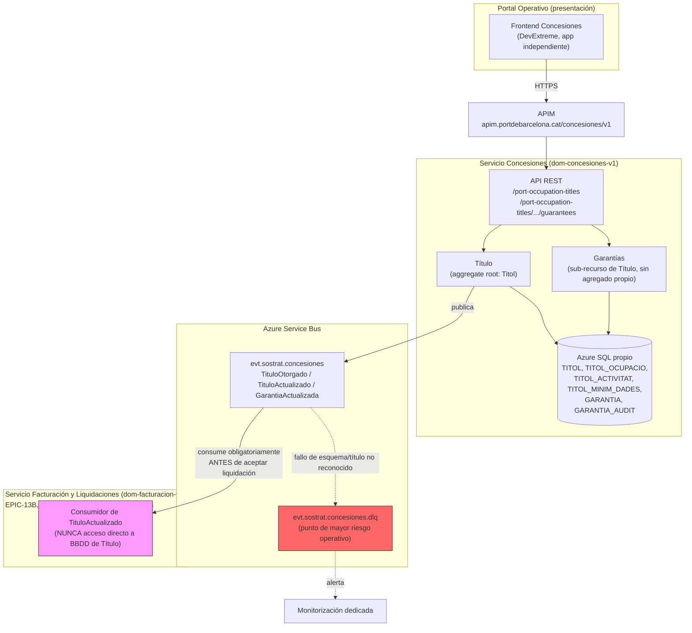

# [IA-GEN] Dossier — Concesiones (Título / Garantías)

> **Borrador generado por IA** (APB AI Framework — síntesis de apb-disc-spec-gen-v1.0/apb-pm-product-analysis-v1.0/apb-arch-c4-model-v1.0/apb-arch-decompose-v1.0) — pendiente validación humana. No distribuir sin revisión.

## 1. Cabecera

- **Nombre**: Concesiones (Título / Garantías)
- **Dominio DDD**: `dom-concesiones-v1` (ya existente en `apb-domain-catalog` — CONCB/GESGAR)
- **Fase del roadmap**: 4 — `decomposition-roadmap.md` §"Fase 4 — Concesiones y Facturación (máximo riesgo, se aborda al final)"
- **Estado**: PROVISIONAL — bounded contexts en estado `discovered` (no `approved`), dependiente de EPIC-12 (evento `TituloActualizado` en producción) como prerequisito duro
- **Bounded contexts**: `proposals/bc-titulo-v1.md` + `proposals/bc-garantias-v1.md` — un único servicio cubre ambos, Garantías no tiene identidad de agregado propia
- **Épica**: `jira-backlog.md` EPIC-13A — Extracción de Concesiones (Título / Garantías)

## 2. Resumen ejecutivo

Concesiones es el servicio que otorga y gestiona los títulos de ocupación y actividad portuaria (lo que la hipótesis Jira inicial denominaba "Concesión", corregido tras el análisis de código: el concepto real en el modelo de datos es **Título**) y las garantías económicas asociadas a esos títulos. Es uno de los dos servicios en que se descompone el antiguo núcleo financiero de SÒSTRAT — el otro es Facturación y Liquidaciones (`dossier` separado, EPIC-13B) — tras revertirse la decisión inicial de fusionarlos en un único servicio (`jira-backlog.md` v3→v4, 2026-07-11): Concesiones y Facturación ya son dos dominios de negocio distintos y con dueño propio en `apb-domain-catalog`.

El hallazgo más importante para esta extracción no es funcional sino de acoplamiento: en el código actual, `CN_Liquidacion_Impl.java:434` escribe directamente sobre la tabla `TITOL_MINIM_DADES` (confirmado leyendo el fichero fuente — ver §12). Esa escritura cruzada es la razón de ser del evento `TituloActualizado`, que se convierte en el evento fundacional de toda la Fase 4 (§10): sin él en producción, Concesiones y Facturación no pueden desplegarse como servicios independientes con bases de datos separadas sin romper la consistencia actual.

## 3. Análisis funcional

Concesiones cubre **dos sub-flujos del mismo servicio**, no dos capacidades independientes:

### Sub-flujo 1: Título (otorgamiento, ocupaciones, actividades)

**Responsabilidad**: gestionar el ciclo de vida de un título de ocupación o actividad portuaria — su otorgamiento, las ocupaciones de dominio público que autoriza, las actividades portuarias que ampara y su documentación asociada.

**Actores**:
- Gestor de títulos (rol de negocio APB) — otorga, renueva y gestiona el estado de un título.
- Servicio de Facturación y Liquidaciones (consumidor externo, vía evento `TituloActualizado`) — antes escribía directamente en tablas de Título, ahora las consume vía evento.
- Servicio de Garantías (mismo servicio, sub-flujo interno) — filtra y opera siempre sobre `IDTITOL`.

**Casos de uso reales (grounded en `specs/openapi-concesiones.yaml` y `jira-backlog.md` EPIC-13A)**:
- Otorgar un nuevo título (`POST /port-occupation-titles` con `idperiodicitat`, `garantia`, `idtitolprecedent`) — grounded en `PortOccupationTitleCreate`.
- Consultar un título por su clave compuesta (`GET /port-occupation-titles/{idsubport}/{idtitol}`).
- Listar títulos filtrando por estado (`GET /port-occupation-titles?idestattitol=...`, paginado por cursor).
- Transicionar el estado del título (`idestattitol`) reflejando su ciclo de vida (otorgado, vigente, caducado) — historia de usuario `jira-backlog.md` EPIC-13A #2. **Gap de evidencia**: el dominio de valores completo de `idestattitol` no está confirmado; `TitolEstat.java` (tabla `TITOL_ESTAT`) existe en el código real y confirma que es un catálogo propio, pero el DTO expone un único campo (`idestattitol`, `String`) sin enumeración de valores — ver §14.
- Registrar una renovación de ocupación (`obtenerRenovacionVigente` en `CN_TitolOcupacio_Impl.java`, ver §4 para el hallazgo de código muerto asociado a este mismo método).

### Sub-flujo 2: Garantías (registro, evidencias, auditoría)

**Responsabilidad**: gestionar las garantías económicas asociadas a un título — su registro, sus evidencias documentales (`GarantiaEvidencia`, no "Evidencia" como simplificaba `bc-garantias-v1.md`, ver §5) y su auditoría de cambios (`GarantiaAudit`).

**Actores**:
- Gestor de garantías (rol de negocio APB).

**Casos de uso reales**:
- Consultar las garantías de un título (`GET /port-occupation-titles/{idsubport}/{idtitol}/guarantees`).
- Registrar una nueva garantía (`POST .../guarantees` con `nomgarantia`, `tipus`, `impgarconstituit`, `datinivigencia`, `datfivigencia`).
- Adjuntar evidencias documentales de una garantía (`CN_Evidencias_Impl.java`, 1.733 líneas — service confirmado, sin exponer aún en el contrato OpenAPI actual).
- Consultar el histórico de auditoría de una garantía (`CN_GarantiaAudit_Impl.java`, 196 líneas, grounded en tabla `GARANTIA_AUDIT` — hereda todos los campos de `Garantia` más `seq`, `dataudit`, `idproces`, `idoperador`, `idtipoperacio`).

### Reglas de negocio confirmadas

- Una garantía **siempre** existe en función de un título (`IDTITOL`) — no tiene identidad de agregado propia en el código (`bc-garantias-v1.md`, confirmado por `Garantia.java` que no expone ninguna operación de búsqueda independiente de `idtitol`).
- La escritura de `PORTLIQUIDACIO`/`ANYLIQUIDACIO`/`NUMLIQUIDACIO`/`LIQUIDAT` sobre `TITOL_MINIM_DADES` (ver §5) pertenece hoy operativamente al dominio de Liquidación, no al de Título — es precisamente el acoplamiento que el evento `TituloActualizado` sustituye (§12).

### Qué NO incluye

Concesiones **no calcula liquidaciones ni gestiona facturación** — aunque hoy Liquidación escribe directamente sobre tablas de Título (`bc-titulo-v1.md`, confirmado en código, ver §12), esto es el anti-patrón legacy a corregir, no el diseño destino. El cálculo de importes, la generación de liquidaciones y la emisión de facturas pertenecen íntegramente al servicio Facturación y Liquidaciones (`dom-facturacion-v1`, EPIC-13B, dossier separado).

## 4. Alcance de migración — qué se migra y qué NO

**Se migra**:
- El sub-flujo Título completo: otorgamiento, ocupaciones (`TitolOcupacio`), actividades (`TitolActivitat`), documentación de concesiones y planes especiales asociados (`service/documentconcessions/`, `service/plaespecial/`).
- El sub-flujo Garantías completo: registro, evidencias (`GarantiaEvidencia`/`GarantiaEvidenciaDoc`/`GarantiaEvidenciaNotes`), auditoría (`GarantiaAudit`).

**No se migra — hallazgo de código muerto confirmado**:

`sostrat/src/org/apb/sostrat/service/impl/CN_TitolOcupacio_Impl.java:1725` contiene el comentario del propio desarrollador: *"este metodo no se llamaba en ninguna parte y la sql esta mal formada"*, precediendo un método sobrecargado `obtenerRenovacionVigente(TitolOcupacioPk, Date)` completamente comentado (líneas 1726-1751, ~26 líneas). Verificado leyendo el fichero fuente completo: el comentario y el bloque comentado son exactos a lo citado en `dead-code-register.md` (hallazgo #1, confianza ALTA).

**Matiz importante no recogido en `dead-code-register.md`**: inmediatamente después del bloque comentado (línea 1753) existe una **segunda implementación activa** del mismo método `obtenerRenovacionVigente(TitolOcupacioPk pObjDto, Date pFecha)`, con una firma idéntica pero construida con concatenación de String en vez de placeholders parametrizados (`"IDSUBPORT='" + pObjDto.getIdsubport() + "' AND ..."`). Esta versión activa **sí se invoca** (es la que hay que migrar, no la comentada) — al migrar, además de excluir el bloque muerto, vale la pena que desarrollo revise si esta segunda versión reintroduce un riesgo de inyección SQL que la versión parametrizada (la comentada, con placeholders `?`) evitaba; no se puede determinar desde este análisis si esa fue la razón real por la que se sustituyó una por otra.

**No se migra — otras exclusiones**:
- El paquete `concesiones` original del código está casi vacío (`bc-titulo-v1.md`, nota) — el dominio real está disperso en `service/impl` (sin paquete propio), `service/titolminim/`, `service/documentconcessions/` y `service/plaespecial/`; no hay contenido adicional que excluir en ese paquete vacío, solo la corrección de la hipótesis inicial.
- La escritura directa `UPDATE TITOL_MINIM_DADES` desde `CN_Liquidacion_Impl.java:434` no se migra como está — se sustituye por el consumo del evento `TituloActualizado` en el servicio de Facturación y Liquidaciones (ver §12).

## 5. Modelo de datos

### Título — tabla `TITOL` (PK: `idsubport` + `idtitol`), grounded en `sostrat/src/org/apb/sostrat/dataaccess/dto/Titol.java`

| Campo | Tipo Java | Columna real | Nullable | Mapeo Azure SQL propuesto |
|---|---|---|---|---|
| idsubport | String | IDSUBPORT (PK1) | No | `nvarchar` |
| idtitol | Integer | IDTITOL (PK2) | No | `int` |
| datlliurament | Date | DATLLIURAMENT | Sí | `datetime2` |
| datatorgament | Date | DATATORGAMENT | Sí | `datetime2` |
| datsolicitud | Date | DATSOLICITUD | Sí | `datetime2` |
| idtitolprecedent | Integer | IDTITOLPRECEDENT | Sí | `int` (FK autoreferencial) |
| idestattitol | String | IDESTATTITOL | Sí | `nvarchar` — FK a catálogo `TITOL_ESTAT` (ver gap §14) |
| idperiodicitat | String | IDPERIODICITAT | Sí | `nvarchar` |
| datrebut | Date | DATREBUT | Sí | `datetime2` |
| guid / guidsrv | Long / String | GUID / GUIDSRV | Sí | control de concurrencia legacy — a decidir si se mantiene o se sustituye por `rowversion` |
| noaviscaducitat | String | NOAVISCADUCITAT | Sí | `nvarchar` |
| garantia | String | GARANTIA | Sí | `nvarchar` — **nombre de campo potencialmente confuso**: es un campo de `TITOL`, no una referencia a una fila de `GARANTIA`; confirmar semántica exacta con negocio antes de nombrar el campo destino |

**Nota de discrepancia verificada**: `bc-titulo-v1.md` describe `CN_Titol_Impl.java` como "1.888 líneas, sin paquete propio". La medición directa del fichero real (`sostrat/src/org/apb/sostrat/service/impl/CN_Titol_Impl.java`, `wc -l`) da **1.943 líneas** — diferencia menor (~3%) probablemente por normalización de fin de línea o versión del checkout en el momento de cada análisis; no cambia la conclusión de "god class sin paquete propio", pero se corrige aquí el dato citado.

### Sub-entidades de Título (no expuestas aún en el contrato OpenAPI, confirmadas en código)

- **TitolOcupacio** (tabla `TITOL_OCUPACIO`, PK `idsubport+idtitol+seqocupacio`): `factsuspocupacio`, `factsuspibi`, `facavancat`, `exemptfactocupacio`, `exemptfactibi`, `datultliqocupacio`, `datultliqibi`, `datinicireclamacio` — campos de facturación/exención de ocupación (grounded en `dataaccess/dto/TitolOcupacio.java`).
- **TitolActivitat** (tabla `TITOL_ACTIVITAT`, PK `idsubport+idtitol+seqactivitat`): `factsuspesa`, `actualitzaipc`, `idunitat`, `idmesuraactivitat`, `idcriteri`, `datultliquidacio` (grounded en `dataaccess/dto/TitolActivitat.java`).
- **TitolMinimDades** (tabla `TITOL_MINIM_DADES`, PK `idsubport+idtitol+seqminim`) — **esta es la tabla afectada por la escritura cruzada de Liquidación** (§12): `datinivigencia`, `datfivigencia`, `valorminim`, `valoracreditat`, `valorunitat`, `observacions`, `complert`, `liquidat`, y los tres campos que `CN_Liquidacion_Impl.java:434` pone a `NULL` al eliminar una liquidación: `portliquidacio`, `anyliquidacio`, `numliquidacio` (grounded en `dataaccess/dto/TitolMinimDades.java`).
- **TitolEstat** (tabla `TITOL_ESTAT`): un único campo confirmado, `idestattitol` (String) — confirma que existe un catálogo propio de estados, pero el DTO no enumera los valores válidos (ver gap §14).

### Garantía — tabla `GARANTIA` (PK: `idsubport` + `seqgarantia`), grounded en `sostrat/src/org/apb/sostrat/dataaccess/dto/Garantia.java`

| Campo | Tipo Java | Columna real | Nullable | Mapeo Azure SQL propuesto |
|---|---|---|---|---|
| idsubport | String | IDSUBPORT (PK1) | No | `nvarchar` |
| seqgarantia | Long | SEQGARANTIA (PK2) | No | `bigint` |
| iddepgestor | String | IDDEPGESTOR | Sí | `nvarchar` |
| idusuari | String | IDUSUARI | Sí | `nvarchar` — FK a Operadores Portuarios (fuera de alcance de este servicio) |
| nomgarantia | String | NOMGARANTIA | Sí | `nvarchar` |
| idestatgarantia | String | IDESTATGARANTIA | Sí | `nvarchar` |
| idtitol | Integer | IDTITOL | Sí (FK lógica obligatoria) | `int` — referencia al agregado Título |
| tipus | String | TIPUS | Sí | `nvarchar` |
| impgarexiactual | BigDecimal | IMPGAREXIACTUAL | Sí | `decimal(18,2)` |
| impgarconstituit | BigDecimal | IMPGARCONSTITUIT | Sí | `decimal(18,2)` |
| impgarcontitol | BigDecimal | IMPGARCONTITOL | Sí | `decimal(18,2)` |
| impgarconempresa | BigDecimal | IMPGARCONEMPRESA | Sí | `decimal(18,2)` |
| datasolicitud / datinivigencia / datfivigencia / datproprevisio | Date | (íd.) | Sí | `datetime2` |
| datadaractualitzacio / datadarnotificacio | Date | (íd.) | Sí | `datetime2` |
| observacions | String | OBSERVACIONS | Sí | `nvarchar(max)` |
| idopealta / idopemodificacio / datalta / datmodificacio / idprocalta / idprocmodificacio | — | auditoría estándar | Sí | igual que resto del roadmap |
| idmotiu | String | IDMOTIU | Sí | `nvarchar` |
| **exprovisional** | String | IDMOTIU (Javadoc duplicado) | Sí | **ver gap confirmado abajo** |
| codexpedienteadmin | String | CODEXPEDIENTEADMIN (ticket GESGAR-89) | Sí | `nvarchar` |

**Gap confirmado — `Garantia.exprovisional`**: el Javadoc del campo `exprovisional` (línea 155-158 de `Garantia.java`) es literalmente *"This attribute maps to the column IDMOTIU in the GARANTIA table"* — el mismo texto exacto que el Javadoc del campo `idmotiu` justo encima (líneas 150-153). Es decir, el comentario de `exprovisional` está copiado sin actualizar del campo anterior y **no dice a qué columna real mapea**. `jira-backlog.md` EPIC-13A ya registra esta ambigüedad como tarea técnica pendiente de resolver con el equipo funcional antes de fijar el schema definitivo del recurso `guarantees`. Confirmado por lectura directa del fichero fuente: el gap es real, no una interpretación.

### Sub-entidades de Garantía (confirmadas en código, no en `bc-garantias-v1.md` con el nombre exacto)

- **GarantiaAudit** (tabla `GARANTIA_AUDIT`) — extiende `Garantia` (herencia real de clase) y añade: `seq`, `dataudit`, `idproces`, `idoperador`, `idtipoperacio`. Servicio: `CN_GarantiaAudit_Impl.java` (196 líneas).
- **GarantiaEvidencia** / **GarantiaEvidenciaDoc** / **GarantiaEvidenciaAudit** / **GarantiaEvidenciaNotes** — el nombre real en código es **`GarantiaEvidencia`**, no "Evidencia" como simplifica `bc-garantias-v1.md`. Servicio: `CN_Evidencias_Impl.java` (1.733 líneas) — service considerablemente más grande que `CN_Garantias_Impl.java` (837 líneas, el "más razonable en tamaño" según la nota original del bounded context — confirmado por medición directa).

## 6. Arquitectura técnica

Stack DOCKS: **.NET** sobre **Container Apps**, **Azure SQL** propio del servicio (no compartido con Facturación tras la extracción — `jira-backlog.md` EPIC-13A, tarea técnica "Migración de datos de `TITOL`, `GARANTIA` a Azure SQL propio de este servicio"), autenticación **EntraID** (OAuth2 client credentials, ver `specs/openapi-concesiones.yaml` `securitySchemes.entraId`), eventos vía **Azure Service Bus** (`apb-sostrat.servicebus.windows.net`, canal `evt.sostrat.concesiones`), publicado tras **APIM** (`https://apim.portdebarcelona.cat/concesiones/v1`).

Migración de datos: **CDC (Change Data Capture) desde Oracle hacia Azure SQL** durante la transición, con Oracle como fuente de verdad hasta el corte (cutover) de esta fase — mismo patrón que el resto del roadmap (`decomposition-roadmap.md` §4).

## 7. Dominio DDD

- **Dominio**: `dom-concesiones-v1` (ya existente en `apb-domain-catalog` — CONCB/GESGAR, confirmado en `specs/openapi-concesiones.yaml`, no un dominio inventado para este análisis).
- **Bounded contexts**: `bc-titulo-v1` (aggregate root: `Titol`) y `bc-garantias-v1` (sin aggregate propio confirmado — Garantía depende de `IDTITOL` y se modela como **sub-recurso de Título**, no como colección independiente; `testing-strategy-fase2-4.md` Fase 4 exige explícitamente un test de contrato que verifique esto).
- **Patrón de integración con `bc-liquidacion-v1`**: hoy es de facto un "shared-kernel" involuntario por las escrituras cruzadas de tabla (`bc-titulo-v1.md`, nota) — **no es el diseño objetivo**. El objetivo es sustituirlo por integración basada en eventos (`upstream_contexts: []`, `downstream_contexts: [bc-liquidacion-v1, bc-garantias-v1]` en `bc-titulo-v1.md`).
- **Frontera formal con `bc-liquidacion-v1`/`bc-facturacion-v1`**: el evento `TituloActualizado` es la frontera — confirmado no solo en la propuesta de bounded context sino en el propio AsyncAPI (`specs/asyncapi-fase4.yaml`, descripción del documento: *"sin este evento en producción, los dos servicios no pueden desplegarse de forma independiente"*). No hay solapamiento de responsabilidad: Concesiones nunca calcula importes ni genera liquidaciones (§3); Facturación y Liquidaciones nunca escribe sobre tablas de Título tras la migración (verificado como test de contrato obligatorio, `testing-strategy-fase2-4.md` Fase 4).

## 8. Pantallas UI

Grounded en `ui-screens-backlog.md` §"App: Concesiones (Título / Garantías) — mapea a `dom-concesiones-v1`" (Fase 4):

1. **Listado de Títulos** (`dxDataGrid`) — columnas: `idsubport/idtitol`, `datatorgament`, `idestattitol`, `idperiodicitat`.
2. **Ficha de Título** (`dxForm` + `dxTabPanel`) — pestaña "Datos generales" + pestaña "Garantías" con `dxDataGrid` maestro-detalle: `nomgarantia`, `tipus`, `impgarexiactual`, `impgarconstituit`, `datfivigencia`.

Stack de frontend obligatorio (`context/apb/standards/STANDARD_DEVELOPMENT.md`, vía `ui-screens-backlog.md`): DevExtreme JavaScript puro, WCAG 2.1 AA mínimo. Esta app es una de las **15 aplicaciones backend** del portal, cada una con frontend, pipeline y ciclo de vida propios, integradas solo a nivel de presentación en un portal operativo único (`ui-screens-backlog.md` §"Portal Operativo").

**Nota de alcance de pantallas**: no hay pantalla propuesta para las evidencias documentales de garantía (`GarantiaEvidencia`) ni para la auditoría (`GarantiaAudit`) en `ui-screens-backlog.md` — el inventario de pantallas solo cubre el flujo principal Título+Garantías; ambos servicios de backend (§5) existen y son considerablemente grandes (`CN_Evidencias_Impl.java`, 1.733 líneas), por lo que probablemente falten pantallas de negocio no capturadas en esta primera pasada.

## 9. APIs

Grounded en `specs/openapi-concesiones.yaml` (`x-ai-skill: apb-arch-api-contract-v1.0`).

| Método | Ruta | Descripción | Request/Response |
|---|---|---|---|
| GET | `/port-occupation-titles` | Listar títulos, filtro por `idestattitol`, paginado por `cursor` | `PortOccupationTitle[]` + `Pagination` |
| POST | `/port-occupation-titles` | Otorgar un nuevo título | `PortOccupationTitleCreate` → `PortOccupationTitle` (201) |
| GET | `/port-occupation-titles/{idsubport}/{idtitol}` | Consultar un título por clave compuesta | `PortOccupationTitle` (200) / 404 |
| GET | `/port-occupation-titles/{idsubport}/{idtitol}/guarantees` | Listar garantías de un título (sub-recurso, no colección independiente) | `Guarantee[]` |
| POST | `/port-occupation-titles/{idsubport}/{idtitol}/guarantees` | Registrar una garantía | `GuaranteeCreate` → `Guarantee` (201) |

**Sin `PATCH` abierto sobre título**: el contrato actual **no expone ningún endpoint de actualización directa de título** (ni `PUT` ni `PATCH`) — la única vía de actualización de estado es interna al servicio y se propaga hacia fuera exclusivamente vía el evento `TituloActualizado` (§10), nunca mediante API síncrona expuesta a otros servicios. Esto es una decisión de diseño coherente con eliminar el patrón de escritura directa: si `Facturación y Liquidaciones` necesitara "actualizar" un título, tendría que hacerlo a través de este mismo servicio emitiendo el evento, no llamando a un endpoint de escritura cruzada.

Seguridad: OAuth2 `clientCredentials` contra EntraID (`concesiones.read`/`concesiones.write`), errores en formato RFC 7807 (`ProblemDetails`).

## 10. Eventos

Grounded en `specs/asyncapi-fase4.yaml` (AsyncAPI 2.6.0, canal `evt.sostrat.concesiones`, transporte Azure Service Bus/AMQP).

| Evento | Trigger | Consumidores | Payload (schema) |
|---|---|---|---|
| TituloOtorgado | Alta de un nuevo título | — (no confirmado consumidor específico en esta pasada) | `TituloData`: `idsubport`, `idtitol`, `idestattitol`, `idtitolprecedent`, `garantia` |
| **TituloActualizado** | Cualquier cambio relevante de un título existente | **Facturación y Liquidaciones** (consumo obligatorio antes de aceptar cualquier liquidación sobre ese título) | `TituloData` (mismo schema que arriba) |
| GarantiaActualizada | Cambio de estado de una garantía | — (no confirmado consumidor específico) | `GarantiaData`: `idsubport`, `seqgarantia`, `idtitol`, `idestatgarantia`, `impgarexiactual` |

### Por qué `TituloActualizado` es el evento fundacional de toda la Fase 4

El propio AsyncAPI lo declara explícitamente en su descripción de documento (`specs/asyncapi-fase4.yaml`, líneas 6-13): *"`TituloActualizado` es el evento fundacional de esta fase: sustituye la escritura directa detectada en el legacy (`UPDATE TITOL_MINIM_DADES` desde `CN_Liquidacion_Impl.java:434`) — sin este evento en producción, los dos servicios no pueden desplegarse de forma independiente"*.

La razón estructural es de consistencia transaccional: hoy, `CN_Liquidacion_Impl.java` y `CN_Titol_Impl.java`/`CN_TitolOcupacio_Impl.java` comparten la misma base de datos Oracle, por lo que una transacción puede modificar tablas de ambos dominios de forma atómica. Al separar Concesiones y Facturación en bases de datos Azure SQL distintas (§6), esa atomicidad deja de existir — el evento `TituloActualizado`, publicado en Service Bus y consumido de forma asíncrona, es el único mecanismo que sustituye esa consistencia transaccional perdida sin resucitar el acceso directo a BBDD cruzado.

El AsyncAPI también fija explícitamente la regla de negocio (`x-business-rules`): *"Consumido obligatoriamente por Facturación y Liquidaciones antes de aceptar cualquier liquidación sobre un título."*

### Qué pasa si falla

`specs/asyncapi-fase4.yaml` define el manejo de error explícitamente (`x-error-handling`): si Facturación y Liquidaciones no puede procesar el evento (esquema inválido, título no reconocido), el mensaje va a **Dead Letter Queue** (`evt.sostrat.concesiones.dlq`, ya declarada como binding AMQP del canal) **más alerta**. El propio contrato lo marca como *"el punto de mayor riesgo operativo de toda la Fase 4, requiere monitorización dedicada desde el primer día"* — coincide textualmente con la amenaza #10 del threat model (§13), que lo califica de riesgo **Crítico**, el más alto de todo el roadmap de Fase 2-4.

## 11. Diagrama topológico (C4, Mermaid)



**Nota de diseño explícita**: este diagrama **no muestra ninguna llamada síncrona directa** entre Concesiones y Facturación y Liquidaciones — la única integración es evento-driven vía Service Bus. Cualquier propuesta de diseño que introduzca una llamada API síncrona de Facturación hacia Concesiones para "leer el título en tiempo real" reproduciría el mismo problema estructural (acoplamiento fuerte entre ambos ciclos de despliegue) que motivó separar los servicios, aunque ya no sea una escritura de BBDD.

## 12. Estrategia de convivencia con el modelo actual

El paso crítico previo a cualquier extracción física de Concesiones **no es la extracción en sí, sino sustituir la escritura directa por un anti-corruption layer (ACL) basado en eventos**. Esto es EPIC-12 (`jira-backlog.md`, "Desacoplamiento Título↔Liquidación") y es, según el propio backlog, "prerequisito de EPIC-13A/EPIC-13B" — no una mejora arquitectónica opcional sino un **requisito duro**.

**Evidencia verificada del anti-patrón actual** (`sostrat/src/org/apb/sostrat/service/liquidacion/impl/CN_Liquidacion_Impl.java`, método `eliminar`, línea 434):

```java
// Modif 05/01/2011 vsevilla. Borramos el titulo asociado si existe
ServiceLocatorCoreDao.getGenericJDBCDao().updateSQL(
    "UPDATE TITOL_MINIM_DADES SET PORTLIQUIDACIO=NULL, ANYLIQUIDACIO=NULL, NUMLIQUIDACIO=NULL" + lSqlWhere,
    pObjLiquidacioPk.getPortliquidacio(), pObjLiquidacioPk.getAnyliquidacio(), pObjLiquidacioPk.getNumliquidacio());
```

Confirmado por lectura directa del fichero fuente: la referencia de línea sigue siendo correcta (línea 434 exacta) y la cita del comentario ("Modif 05/01/2011 vsevilla. Borramos el titulo asociado si existe") coincide con lo esperado. La sentencia se ejecuta dentro del flujo de **eliminación de una liquidación** — al borrar una liquidación, el código pone a `NULL` la referencia de esa liquidación en `TITOL_MINIM_DADES` (los mismos tres campos `PORTLIQUIDACIO`/`ANYLIQUIDACIO`/`NUMLIQUIDACIO` confirmados en el DTO `TitolMinimDades.java`, §5), en vez de que Título gestione su propio estado de forma autónoma.

`jira-backlog.md` EPIC-12 registra la tarea técnica de auditar las **13 clases `*Dependencias_Impl`** de Liquidación para confirmar que no quedan más escrituras cruzadas sin identificar — esta línea 434 es solo la escritura ya documentada explícitamente en las propuestas de bounded context, no necesariamente la única.

**Secuenciación de convivencia** (`decomposition-roadmap.md` Fase 4, "Secuenciación interna"):
1. EPIC-12 sustituye la escritura directa por la publicación/consumo de `TituloActualizado`, validado en staging **≥2 semanas** antes de retirar el código legacy (criterio de éxito explícito de EPIC-12).
2. Solo entonces se extrae físicamente Concesiones (EPIC-13A) — menor acoplamiento saliente que Facturación (solo Garantías depende de Título).
3. Solo cuando `TituloActualizado` está maduro y consumido en producción por el nuevo servicio de Concesiones, se extrae Facturación y Liquidaciones (EPIC-13B), que consumirá el evento en lugar de escribir directamente.

Durante la transición, BBDD compartida (Oracle) se acepta **solo como estado transitorio**, con corte de escritura (cutover) documentado en el ADR de la fase — nunca antes de validar el evento en producción.

## 13. Testing y seguridad

### Amenaza crítica del roadmap (threat-model-fase2-4.md, amenaza #10)

Cita textual del threat model (`threat-model-fase2-4.md`, tabla de amenazas):

> **#10 — Tampering — Escritura directa en tablas de Título desde Facturación y Liquidaciones, repitiendo el anti-patrón legacy exacto que motivó separar estos dos servicios — Elemento: Concesiones ↔ Facturación y Liquidaciones — Severidad: Crítica — Control mitigador: Test de contrato obligatorio en cada pipeline + revisión de código específica en cada PR que toque este límite — es el mayor riesgo de todo el roadmap por ser la repetición literal de un problema ya conocido.**

Esta es, según el propio documento, la amenaza de mayor severidad ("Crítica") de las 7 identificadas para las Fases 2-4, y la única descrita explícitamente como "el mayor riesgo de todo el roadmap" — no solo de esta fase.

### Testing (testing-strategy-fase2-4.md, §Fase 4 → Concesiones)

- **Unit**: `TituloActualizado` debe publicarse en cada cambio de `idestattitol` — **test de regresión obligatorio**: verificar que no existe ningún camino de código que actualice `TITOL`/`TITOL_MINIM_DADES` sin pasar por la publicación del evento. Es, textualmente, "la garantía de que el anti-patrón legacy no vuelve".
- **Contract**: `Garantia` sin agregado propio — verificar que el contrato de API refleja esto (sub-recurso de título, no colección independiente).
- Pirámide de testing aplicada a los 10 servicios de Fase 2-4: Unit 60% / Contract 20% / Integration 15% / E2E 5%.
- Del lado de Facturación y Liquidaciones (servicio consumidor, dossier separado): el contrato exige explícitamente verificar que ese servicio "**NUNCA escribe directamente en tablas de Título**" en cada pipeline, no como test opcional.

### Checklist de seguridad pre-producción (aplica directamente a este servicio)

- [ ] Test de contrato "Facturación y Liquidaciones nunca escribe en tablas de Título" ejecutándose en CI (amenaza #10).
- [ ] Nombre real del dominio de valores de `idestattitol` confirmado con negocio antes de implementar la máquina de estados (bloqueo compartido con EPIC-12, ver §14).
- [ ] Ambigüedad de `Garantia.exprovisional` resuelta con el equipo funcional antes de fijar el schema de `guarantees` (§5, §14).

## 14. Riesgos y gaps de evidencia

| # | Riesgo/gap | Evidencia | Impacto | Estado |
|---|---|---|---|---|
| 1 | Dominio de valores de `idestattitol` no confirmado | `TitolEstat.java` solo expone el campo `idestattitol` (String), sin enumeración; tabla `TITOL_ESTAT` confirmada como catálogo propio pero sin valores extraídos | Bloquea el diseño de la máquina de estados del título y del evento `TituloActualizado` | Abierto — `jira-backlog.md` EPIC-12/EPIC-13A |
| 2 | Javadoc ambiguo/duplicado en `Garantia.exprovisional` | Confirmado por lectura directa: el Javadoc copia literalmente el de `idmotiu` ("maps to the column IDMOTIU"), sin decir a qué columna real mapea `exprovisional` | Bloquea fijar el schema definitivo del recurso `guarantees` | Abierto — requiere confirmación con equipo funcional |
| 3 | Discrepancia menor de tamaño en `CN_Titol_Impl.java` | `bc-titulo-v1.md` cita 1.888 líneas; medición directa (`wc -l`) da 1.943 | Bajo — no cambia la conclusión de "god class", solo el dato exacto | Corregido en este dossier (§5) |
| 4 | Consumidores no confirmados de `TituloOtorgado` y `GarantiaActualizada` | `specs/asyncapi-fase4.yaml` declara ambos eventos con schema pero sin `x-business-rules` de consumidor obligatorio (a diferencia de `TituloActualizado`) | Medio — puede que existan consumidores no documentados o que estos eventos sean solo informativos | Abierto |
| 5 | Pantallas de Evidencias/Auditoría de Garantía no cubiertas en `ui-screens-backlog.md` | Solo 2 pantallas propuestas para toda la app (§8); `CN_Evidencias_Impl.java` (1.733 líneas) sugiere funcionalidad sustancial sin pantalla propuesta | Medio — riesgo de subestimar el alcance de UI en la estimación de esfuerzo | Abierto |
| 6 | Auditoría completa de escrituras cruzadas de Liquidación pendiente | `jira-backlog.md` EPIC-12: solo se ha confirmado 1 de potencialmente más escrituras entre las 13 clases `*Dependencias_Impl` de Liquidación | Alto — el evento `TituloActualizado` podría no cubrir el 100% del acoplamiento real hasta completar esa auditoría | Abierto, bloqueante de EPIC-12 |
| 7 | Matriz de acoplamiento cualitativa, no confirmada por herramienta automatizada | `decomposition-roadmap.md` §1: "no se ha tenido acceso a SonarQube/NDepend... debe confirmarse con un análisis estático automatizado antes de comprometer fechas" | Medio | Abierto, aplica a todo el roadmap |

## 15. Estimación de esfuerzo

Basado en `jira-backlog.md` EPIC-13A (story points ilustrativos, primera pasada de t-shirt sizing — requiere refinamiento real con equipos antes de sprint planning):

| Historia | Story points |
|---|---|
| Otorgar un nuevo título (`POST /port-occupation-titles`) | 13 |
| Transición de estado del título (`idestattitol`) | 8 |
| Consultar garantías asociadas a un título | 5 |
| Consumo de `TituloActualizado` por Facturación (historia del lado consumidor, pero acoplada al diseño del evento) | 8 |
| **Total historias EPIC-13A** | **34 pts** |

Tareas técnicas adicionales sin story points asignados: migración de datos `TITOL`/`GARANTIA` a Azure SQL propio; resolución de la ambigüedad de `exprovisional` con negocio.

**Dependencia dura de esfuerzo no incluida en el recuento**: EPIC-12 (Desacoplamiento Título↔Liquidación) debe completarse **antes**, con evento validado en staging ≥2 semanas — este es esfuerzo adicional y bloqueante, no paralelo, no capturado en las 34 pts de arriba.

**Riesgo técnico**: Alto (`jira-backlog.md` EPIC-13A) — coherente con la calificación de la Fase 4 completa como "Muy alto — mayor riesgo del roadmap" en `decomposition-roadmap.md` §6.

## 16. Checklist de validación

### Funcional

- [ ] Confirmar con negocio el dominio de valores completo de `idestattitol` (catálogo real en `TITOL_ESTAT`, no enumerado en esta extracción).
- [ ] Resolver con el equipo funcional a qué columna real mapea `Garantia.exprovisional` (Javadoc duplicado/ambiguo).
- [ ] Confirmar la semántica exacta del campo `Titol.garantia` (texto libre vs. referencia) — no confundir con el recurso `guarantees`.
- [ ] Validar si las pantallas de Evidencias de Garantía y Auditoría de Garantía deben incluirse en el alcance de UI de esta app o quedar fuera de la primera entrega.

### Desarrollo

- [ ] No iniciar la extracción física de Concesiones sin el evento `TituloActualizado` validado en staging ≥2 semanas (criterio de éxito de EPIC-12).
- [ ] Completar la auditoría de las 13 clases `*Dependencias_Impl` de Liquidación antes de dar por cerrado el desacoplamiento (EPIC-12).
- [ ] Test de contrato obligatorio en CI: ninguna escritura directa sobre tablas de Título desde Facturación y Liquidaciones (amenaza #10, severidad Crítica).
- [ ] Revisar si la implementación activa de `obtenerRenovacionVigente` (línea 1753 de `CN_TitolOcupacio_Impl.java`, con SQL por concatenación de String) debe reescribirse con parámetros antes de migrar, en vez de replicar la construcción de SQL tal cual.
- [ ] Confirmar que el contrato de API de `guarantees` se implementa como sub-recurso de título (no colección independiente) — test de contrato explícito ya exigido por `testing-strategy-fase2-4.md`.
- [ ] Diseñar y publicar formalmente en AsyncAPI el flujo de Dead Letter Queue + alerta de `TituloActualizado` (hoy descrito en prosa en `specs/asyncapi-fase4.yaml`, no como configuración operativa detallada).

## 17. Historial de cambios

| Versión | Fecha | Autor | Cambio |
|---------|-------|-------|--------|
| 1.0.0 | 2026-07-13 | APB AI Framework | Dossier inicial, a petición explícita del usuario. Verifica y confirma el hallazgo de código muerto en `CN_TitolOcupacio_Impl.java:1725`, la escritura directa en `CN_Liquidacion_Impl.java:434` sobre `TITOL_MINIM_DADES`, y el Javadoc ambiguo de `Garantia.exprovisional` contra el código fuente real de `SOSTRAT-Sostrat-MJ8`. Corrige el dato de tamaño de `CN_Titol_Impl.java` (1.943 líneas medidas vs. 1.888 citadas en `bc-titulo-v1.md`). |
