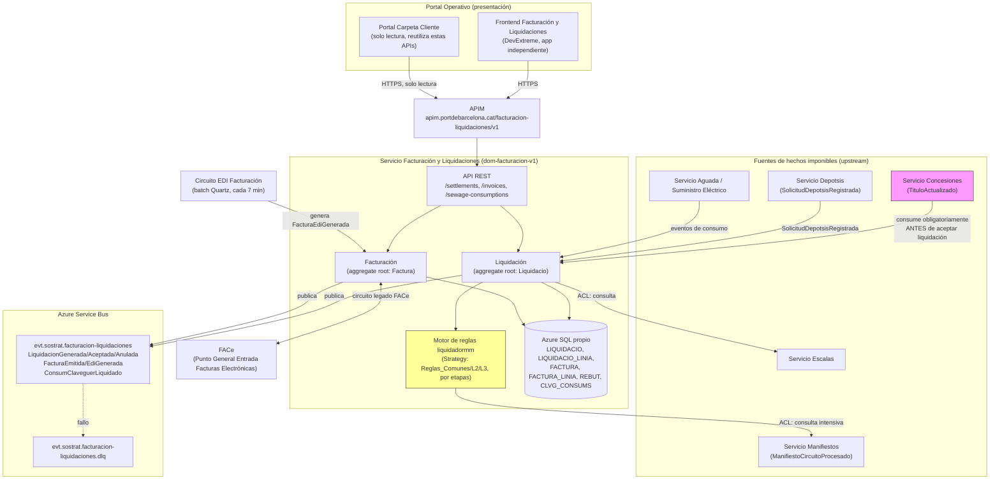

# [IA-GEN] Dossier — Facturación y Liquidaciones

> **Borrador generado por IA** (APB AI Framework — síntesis de apb-disc-spec-gen-v1.0/apb-pm-product-analysis-v1.0/apb-arch-c4-model-v1.0/apb-arch-decompose-v1.0) — pendiente validación humana. No distribuir sin revisión.

## 1. Cabecera

- **Nombre**: Facturación y Liquidaciones
- **Dominio DDD**: `dom-facturacion-v1` (dominio real de alcance todo el puerto — T0-T5, P33, REB, ODP; este dossier cubre solo el alcance identificado en SÒSTRAT, `jira-backlog.md` EPIC-13B)
- **Fase del roadmap**: 4 — "Concesiones y Facturación (máximo riesgo, se aborda al final)", extraído **después** de Concesiones (`decomposition-roadmap.md`)
- **Estado**: PROVISIONAL — bounded contexts en estado `discovered`, dependiente de EPIC-13A (Concesiones) y EPIC-12 (evento `TituloActualizado` en producción) como prerequisitos duros
- **Bounded contexts**: `proposals/bc-liquidacion-v1.md` + `proposals/bc-facturacion-v1.md` — dos BC dentro de un único servicio de despliegue (`dom-facturacion-v1`), tal como Concesiones agrupa Título+Garantías
- **Épica**: `jira-backlog.md` EPIC-13B — Extracción de Facturación y Liquidaciones (dependencias: EPIC-13A, EPIC-12, EPIC-00)

## 2. Resumen ejecutivo

Facturación y Liquidaciones es el núcleo financiero de SÒSTRAT: calcula el importe a cobrar por prácticamente cualquier hecho imponible que ocurre en el puerto (escalas, ocupación de título, actividad portuaria, manifiestos de mercancía, suministros a buque, marinas, vehículos abandonados, peticiones FBD) y emite la factura correspondiente, estándar o electrónica (Facturae). Es, junto con Concesiones (`dossier-14-concesiones.md`), el otro lado del antiguo "núcleo financiero" único de SÒSTRAT, separado en dos servicios el 2026-07-11 tras reparentar contra el catálogo real de dominios de APB.

**Esta verificación confirma con exactitud las cifras de rutas Struts ya citadas en `coverage-audit.md`** (`liquidacion` 36, `facturas` 55, `factestandar` 43 — total 134, sin fichero satélite: los tres paquetes viven íntegros en `struts-config.xml` principal) y añade **cinco hallazgos nuevos, no presentes en `bc-liquidacion-v1.md`/`bc-facturacion-v1.md`/`dead-code-register.md`**, en línea con el patrón ya detectado en `dossier-12-manifiestos.md` y `dossier-13-aduanas-contenedores.md` de god classes infravaloradas y acoplamiento no documentado:

1. **Las god classes reales son sustancialmente mayores que las citadas, y varias de las más grandes no están documentadas en absoluto.** En Liquidación, `CN_LiqLC_Impl.java` tiene **5.001 líneas** (no "+3.600" como cita `bc-liquidacion-v1.md`) y `CN_LiqL6_Impl.java` (**4.730 líneas**) y `CN_LiqIBI_Impl.java` (**2.422 líneas**) no aparecen citadas en ningún documento previo — ambas son mayores que `CN_Liquidacion_Impl.java` (2.230 líneas reales, no 2.057). En Facturación, `CN_EDI_Helper_Factura_Comun_Impl.java` (**5.413 líneas**) es la mayor god class real de todo el bounded context y no está citada en `bc-facturacion-v1.md`, que solo menciona `CN_Facturas_Impl.java` (2.377 líneas reales, no 2.111). En el sub-flujo `factestandar`, `CN_LiqT5T0_Impl.java` (**4.079 líneas**, liquidación de tasas T0-T5 en marinas) es mayor que `CN_Rebut_Impl.java` (3.983 líneas, la única citada por nombre en `dead-code-register.md`) y tampoco está documentada. Ver §4/§6/§15.
2. **El motor de reglas de liquidación de mercancías (`service/liquidadormm/`) es un bounded context de facto propio, con arquitectura de Strategy/rules-engine configurable, y su acoplamiento con Manifiestos es el mayor de todo el análisis de esta serie de dossiers**: 91+51+11 = **153 referencias** al paquete `manifiestos.gestion` (DTOs, adaptadores) y **56** a `escalas`, solo dentro de `service/liquidadormm/`. Es la implementación real detrás de las 9 rutas Struts `manifiestos/liquidadormm` ya documentadas en `dossier-12-manifiestos.md §3` — la UI vive en el namespace de Manifiestos, pero el cálculo (y sus 3.363+2.340+1.319 líneas de `LiquidadorMM_Reglas_L3`/`CN_LiquidadorMM_Gen_2Etapa_Impl`/`LiquidadorMM_Reglas_Comunes`) es responsabilidad de negocio de Liquidación. Ver §6/§7.
3. **El registro de código muerto contiene 2 falsos positivos objetivos en este módulo**: de los 4 comentarios `"NO SE USA PARA LA L2"` en `LiquidadorMM_Reglas_L2.java` (`dead-code-register.md` #10-13), solo 2 preceden bloques realmente comentados; los otros 2 (`calcularQUOTA`, `calcularNUM9` sobre `ManifestEquipamentDTO`) son implementaciones activas de métodos declarados en la interfaz `ILiquidadorMM_Reglas_Comunes`, invocadas polimórficamente en producción — deben migrarse. El mismo patrón aplica a `CN_LiquidadorMM_Pasajeros_Impl.java:245` (`dead-code-register.md` #9, `"NO USAR"`): es un override obligatorio de un método abstracto declarado en `CN_LiquidadorMM_Gen_1Etapa_Impl.java:322` e invocado en la línea 143 de esa misma clase base — no es código muerto, es un no-op deliberado del patrón Strategy (los pasajeros no preliquidan equipos). Ver §4/§14.
4. **14 clases `*Dependencias_Impl`, no 13** como cita `bc-liquidacion-v1.md`/`dossier-14-concesiones.md`: existe una decimocuarta, `LiquidacionMMDependencias_Impl.java`, en `service/liquidadormm/impl/` — fuera del directorio `service/liquidacion/impl/` donde se contaron las 13 originales. Corrige el alcance de la tarea técnica de EPIC-12 ("auditar las 13 clases..."). Ver §4/§7/§14.
5. **El contrato `specs/openapi-facturacion-liquidaciones.yaml` está bien fundamentado sobre las entidades reales correctas** (`Liquidacio`/`LiquidacioLinia`/`Factura`/`ClvgConsums`) — a diferencia del patrón detectado en `dossier-13-aduanas-contenedores.md` (entidad equivocada), aquí el problema **no es de grounding sino de cobertura de campos**: `Liquidacio.java` tiene **101 campos reales** (el esquema `Settlement` modela 18), `Factura.java` tiene **64** (`Invoice` modela 15), y **`FacturaLinia.java` (36 campos) no tiene ningún recurso API** pese a que `SettlementLine` sí existe para el lado de Liquidación. Ver §9/§14.

## 3. Análisis funcional

### Responsabilidad de negocio

Calcular el importe a liquidar por cualquier hecho imponible portuario (escala, ocupación/actividad de título, manifiesto de mercancías, suministro a buque, atraque en marina, vehículo abandonado, petición FBD) y emitir la factura correspondiente — estándar o Facturae (electrónica, con firma XML) — a partir de una liquidación aceptada, incluyendo el circuito EDI de facturación batch y el portal de autoconsulta de cliente (`carpetaclientes`).

### Actores

- Gestor financiero APB (genera, revisa y acepta/anula liquidaciones; emite facturas).
- Cliente/consignatario/naviera (sujeto facturado; consulta sus propias facturas/liquidaciones vía el portal `carpetaclientes`).
- Servicio de Concesiones (productor externo del evento `TituloActualizado`, consumido por Liquidación en lugar de la escritura directa legacy — ver §12, `dossier-14-concesiones.md §10`).
- Servicios upstream que generan hechos imponibles: Escalas, Manifiestos (vía el motor `liquidadormm`), Depotsis, MMPP (indirecto), Suministros (Aguada/Electricidad).
- FACe (Punto General de Entrada de Facturas Electrónicas del Estado — confirmado por el paquete `ws.face`, 11 referencias en `facturas`/`factestandar`, y los campos `Factura.numregface`/`estatface`).

### Casos de uso reales (grounded en las 134 rutas Struts confirmadas — `liquidacion` 36 + `facturas` 55 + `factestandar` 43, todas en `struts-config.xml` principal, sin fichero satélite)

- **Gestión de liquidación (cabecera)**: `LiquidacionAction.java` (1.116 líneas, la mayor Action del sub-flujo), `LiquidacionAspectoAction.java` (867 líneas), `LiquidacionLineaAction.java`, `LineasBonificacioLiqAction.java` (bonificaciones), `LiquidacionProcesRevisionAction.java`, `ObservacionesLiqAction.java`, `LiquidacionesFiltradasAction.java`/`LiquidacionesSinLoteAction.java` (listados filtrados/sin lote), `LiquidacionTituloAction.java` (relación con Título), `LiquidacioProcesAction.java`/`LiqProcesInciAction.java`/`LiqProcesLiquidacionesAction.java` (proceso batch de generación), `LiquidacionLoteAction.java` (lotes de liquidación).
- **Liquidaciones por tipo de tasa (Título)**: `LiqIBIAction.java` (IBI/Bienes Inmuebles, sirve a `CN_LiqIBI_Impl.java`, 2.422 líneas), `LiqLCAction.java` (canon de ocupación, sirve a `CN_LiqLC_Impl.java`, **5.001 líneas — la mayor god class real de Liquidación**), `LiqL6Action.java` (tasa de actividad por criterio económico — `CriterioImporte`: `CIFRA_NEGOCIO`, `VOL_ACTIVIDAD`, `TOTAL_TO`, `IMPORTE_MINIMO`, cada uno con variante "límite inferior" — sirve a `CN_LiqL6_Impl.java`, **4.730 líneas**, no citada en ningún documento previo).
- **Gestión de facturación (cabecera)**: `FacturasAction.java` (**1.530 líneas**, la mayor Action del sub-flujo), `FacturaLineaAction.java`/`FacturaLineaBonifAction.java`, `FacturaAmbFetImpAction.java`/`FacturaFetImpAction.java`/`FacturaObservacionesFetAction.java` (hecho imponible), `SerieFacturaAction.java`/`NumeracionSerieAnyoAction.java` (numeración/serie), `FacturaReclamacionAction.java`/`FacturaAReclamarAction.java`/`LiquidacionReclamacionAction.java`/`LiquidacionAReclamarAction.java` (reclamaciones), `FacturaExpedientClientAction.java`, `RemesaDomiciliacioN19Action.java`/`RegDomiciliacioN19Action.java` (domiciliación bancaria SEPA N19), `FacturaBannerAction.java`, `FacturasLoteAction.java`, `FacturaRespFaceAction.java` (respuesta del circuito FACe).
- **Notificación de factura**: `NotificacioDeFacturaAction.java` (470 líneas), `NotificaZipAction.java`/`NotificaZipFacturesAction.java` (envío por lote/ZIP), `ProcesDeNotificacioAction.java`, `NotificaHistEstatsAction.java`.
- **Recibos (`factestandar/rebuts`)**: `RebutAction.java` (**1.538 líneas, la mayor Action de todo el bounded context**), `RebutListAction.java` (956 líneas), `RebutMultasAction.java` (708 líneas, multas — integración Gespol/Vinfoval), `RebutTraspasoAction.java` (680 líneas), `RebutTramNotesAction.java`, `RebutAuditAction.java`, `RebutFichBancAction.java` (fichero bancario de cobro), `RebutLlistaGespolAction.java`.
- **Marinas (`factestandar/marinas`)**: `MarinaAtraqueAction.java` (949 líneas, atraque/liquidación T0-T5 de marinas — sirve a `CN_LiqT5T0_Impl.java`, **4.079 líneas, no documentada en ningún dossier/registro previo**), `MarinaAction.java` (920 líneas), `ImportarExcel.java` (801 líneas, carga masiva), `FacturaMarinaAction.java`, `MarinaAtraqueResumAction.java`, `MarinaTipusLiquidacioAnyAction.java`.
- **Peticiones FBD (`factestandar/peticiofbd`)**: `PeticioFBDAction.java` (717 líneas, sirve a `CN_PeticioFBD_Impl.java`, **3.768 líneas**), `PeticioFBDDocAction.java`, `PeticioFBDLineaAction.java`, `PeticioFBDAuditAction.java`.
- **Suministros facturables (`factestandar/suministros`)**: sirve a `CN_SuministreVaixell_Impl.java` (1.216 líneas) y `CN_SuministreOcupacio_Impl.java` (994 líneas) — sin Action de mayor volumen individual identificada en este muestreo, ver §14.
- **Vehículos abandonados (`factestandar/vehiclesAbandonats`)**: `VehicleAbandonatAction.java` (664 líneas), `VehicleAbandonatDocAction.java`, `VehicleAbandonatAuditAction.java`, `VehicleAbandonatHistAction.java`, `FileDownload.java`.
- **Portal de cliente (`carpetaclientes`, 13 rutas, 9 Actions, confirmado clase por clase)**: `FacturasCCAction extends FacturasAction`, `LiquidacionCCAction`, `FacturaLiCCAction`, `FacturaFiCCAction`, `FacturaFetImpCCAction`, `FacturaLineaCCAction`, `FacturasDeNotificacionCCAction`, `NotificacioDeFacturaCCAction`, `UsuariCCAction` — confirma exactamente la nota de `jira-backlog.md:431` ("puede sustituirse reutilizando las APIs de Facturación/Liquidación ya extraídas, sin desarrollo adicional"): es una capa de solo-lectura sobre las mismas Actions, sin modelo de dominio propio.

### Reglas de negocio confirmadas en código

- `Liquidacio` (tabla `LIQUIDACIO`, PK `portliquidacio+anyliquidacio+numliquidacio`) tiene **101 campos reales** confirmados uno a uno en `Liquidacio.java` (3.563 líneas de fichero, mayormente Javadoc de mapeo columna a columna) — muy por encima de los ~18 modelados en `specs/openapi-facturacion-liquidaciones.yaml` (ver §5/§9/§14).
- El estado `idestatliq` tiene **6 valores reales confirmados exactos**: `GE` (Generada), `SE` (Seleccionada), `AC` (Aceptada), `FA` (Facturada), `AN` (Anulada), `ES` (Esborrany/borrador) — coincide exactamente con `events-catalog.md §5` y `specs/openapi-facturacion-liquidaciones.yaml` (`EstatLiquidacio` enum). **Sin corrección necesaria aquí** — a diferencia de otros dossiers de esta serie, el contrato de estados ya está bien fundamentado.
- `Liquidacio` incluye campos de correlación cruzada directa con otros dominios sin pasar por evento: `portescala`/`anyescala`/`numescala` (Escalas), `idtitol`/`hihatitol`/`porttitol`/`titolopcional`/`nomtitol` (Título), `manifestcodedi` (Manifiestos, mismo campo de correlación `codedi` que ya usan `manifiestogrimaldisecure` y el traslado de contenedores — `dossier-12-manifiestos.md §9`, `dossier-13-aduanas-contenedores.md §5`), `idvaixell`/`nomvaixell` (Buques), `numliqas400` (referencia a la migración legacy AS400, coherente con la retirada de códigos de entidad de `jira-backlog.md` EPIC-16).
- `Factura` (tabla `FACTURA`, PK `idserfactura+portfactura+anyfactura+numfactura`, confirmado en `FacturaPk.java`) tiene **64 campos reales**, incluyendo los binarios `pdfdupfactura`/`pdfsignat`/`xmlsignat` (BLOB, nunca deben viajar en el JSON — ya correctamente excluidos del contrato, ver §9) y los de circuito FACe: `numregface`, `estatface`, `rebjusrecedi`.
- `LiquidacioLinia` (tabla `LIQUIDACIO_LINIA`) tiene **44 campos reales** (el contrato modela 6); `FacturaLinia` (tabla no confirmada por Javadoc en esta pasada, DTO `dataaccess/dto/FacturaLinia.java`) tiene **36 campos reales** y **no tiene ningún recurso API** en el contrato actual, pese a que `SettlementLine` sí existe para el lado espejo de Liquidación (ver §9/§14).
- Facturación EDI es un circuito batch activo (`sostrat-batch-facturacionEDI.xml`, job `FACTURACIONEDI`, importado sin comentar en `spring-batch.xml:44`) con disparo Quartz `SimpleTriggerFactoryBean` (`startDelay` 2 min, `repeatInterval` **420.000 ms = 7 minutos**) — confirma la afirmación de `bc-facturacion-v1.md` ("el circuito de facturación EDI también se ejecuta vía batch") con la cadencia exacta, no documentada previamente.
- El módulo `carpetaclientes` (13 rutas, 9 Actions) confirma exactamente la hipótesis de `jira-backlog.md:431`: sus Actions **extienden literalmente** las de Facturación/Liquidación (`FacturasCCAction extends FacturasAction`, patrón repetido en las 9 clases) — es una vista de portal, no un modelo de dominio propio.

### Qué NO incluye

No otorga ni gestiona el título de ocupación en sí (`Titol`/`TitolOcupacio`/`TitolActivitat`) — eso es Concesiones (`dossier-14-concesiones.md`); Liquidación **lee** intensamente esas entidades (ver §7) pero no las posee. No gestiona las garantías económicas del título (`bc-garantias-v1`, dentro de Concesiones). No calcula el hecho imponible original de cada dominio — Escalas, Manifiestos (vía Título/manifiesto), Depotsis, Suministros y MMPP generan el hecho imponible; Liquidación solo lo consume y calcula el importe. No emite el título de deuda ni gestiona el cobro bancario más allá del fichero de domiciliación N19/fichero bancario de recibos (`RebutFichBancAction`) — la gestión de tesorería/contabilidad más amplia (si existe) está fuera del alcance de SÒSTRAT confirmado en este checkout.

## 4. Alcance de migración — qué se migra y qué NO por no estar en uso

**Se migran las 134 rutas Struts confirmadas** (`liquidacion` 36 + `facturas` 55 + `factestandar` 43, exacto por `grep -c` sobre `struts-config.xml`, coincide con `coverage-audit.md:36-40`), más las 13 rutas de `carpetaclientes` como capa de portal sin modelo propio (reutiliza las APIs de este mismo servicio, sin desarrollo de dominio adicional — confirmado en código, `FacturasCCAction extends FacturasAction`, ver §3).

**Código muerto ya confirmado en `dead-code-register.md` de este módulo (4 hallazgos citados, esta verificación corrige 3 de ellos)**:

| # (`dead-code-register.md`) | Ítem | Veredicto original | Veredicto de esta verificación |
|---|---|---|---|
| 8 | `CN_Rebut_Impl.java:1659` — comentario *"El tipo de recibo cepos parece obsoleto"* | No migrar (confianza MEDIA, verbo "parece") | **Confirmado exacto** (línea 1659 verificada carácter a carácter). Confianza MEDIA correcta — es un comentario de duda del propio desarrollador, no una declaración inequívoca; recomendado confirmar con negocio antes de excluir el tipo de recibo `TIPREC12_COBRO_CEPOS` del modelo destino. |
| 9 | `CN_LiquidadorMM_Pasajeros_Impl.java:245` — *"NO USAR"*, método `preliquidarEquipo` | No migrar | **CORRECCIÓN — sí migrar.** `preliquidarEquipo` es un método `abstract` declarado en `CN_LiquidadorMM_Gen_1Etapa_Impl.java:322` e invocado polimórficamente en la línea 143 de esa misma clase base, dentro del pipeline genérico de preliquidación. El comentario `//NO USAR` no significa código inalcanzable: es un override obligatorio del patrón Strategy con cuerpo intencionalmente vacío (*"EN PASAJEROS NO SE PRELIQUIDAN LOS EQUIPOS"*) — se ejecuta en producción para cada equipo de una partida de pasajeros. |
| 10-13 | `LiquidadorMM_Reglas_L2.java:823,828,833,838` — 4x *"NO SE USA PARA LA L2"* | No migrar (las 4) | **CORRECCIÓN PARCIAL.** Solo 2 de las 4 preceden código realmente comentado (bloques `/* ... */` y `// ...`, líneas ~827-830 y ~833-837, confirmado no migrar). Las otras 2 (`calcularQUOTA(PreliquidacioEquipDTO,...)` línea ~822 y `calcularNUM9(ManifestEquipamentDTO)` línea ~836) son implementaciones **activas** de métodos declarados en la interfaz `ILiquidadorMM_Reglas_Comunes.java` (líneas 15/22), invocadas polimórficamente desde `CN_LiquidadorMM_Gen_2Etapa_Impl.java`/`CN_LiquidadorMM_Mercancia_Impl.java` — el comentario significa "este cálculo no aplica al nivel tarifario L2", no "código inalcanzable". **Deben migrarse** como parte del motor de reglas (retornan `null` deliberadamente, patrón null-object). |

**Hallazgo nuevo, no en `dead-code-register.md`**: no se ha encontrado código muerto adicional en `service/liquidacion/`, `service/facturas/` ni `service/factestandar/` en el muestreo de esta pasada (búsqueda de bloques comentados con justificación explícita tipo "NO SE USA"/"obsoleto" — sin resultados nuevos más allá de los 3 ítems anteriores). No se descarta que exista más, dado el volumen del módulo (306 ficheros Java entre `liquidacion`+`facturas`+`factestandar`+`liquidadormm`) — no auditado exhaustivamente método a método.

**Corrección de alcance de EPIC-12** (`jira-backlog.md`, tarea "Auditoría exhaustiva de las 13 clases `*Dependencias_Impl`"): existe una **14ª clase**, `LiquidacionMMDependencias_Impl.java` (`service/liquidadormm/impl/`), fuera del directorio donde se contaron las 13 originales (`service/liquidacion/impl/`) — debe incluirse en el alcance de esa auditoría. Un muestreo puntual de `LiquidacionTitolDependencias_Impl.java` (214 líneas) en esta verificación **no encontró** sentencias `UPDATE`/`INSERT` adicionales sobre tablas de Título — no sustituye la auditoría completa que EPIC-12 ya tiene pendiente, solo aporta un primer punto de partida negativo.

**No se migra tal cual** el patrón de escritura directa `UPDATE TITOL_MINIM_DADES` desde `CN_Liquidacion_Impl.java:434` (ya documentado en `dossier-14-concesiones.md §12`) — se sustituye por el consumo del evento `TituloActualizado` (EPIC-12, prerequisito duro de esta extracción).

## 5. Modelo de datos

Todos los campos siguientes están extraídos directamente de los DTOs reales en `sostrat/src/org/apb/sostrat/dataaccess/dto/` del checkout `SOSTRAT-Sostrat-MJ8`. Dado el volumen (101+64+44+36+29 = 274 campos reales solo en las 5 entidades principales), se listan los campos de negocio más relevantes; el recuento total exacto se da para dimensionar correctamente el gap de contrato (§9/§14).

### `Liquidacio` (tabla `LIQUIDACIO`, PK `portliquidacio+anyliquidacio+numliquidacio`) — **101 campos reales**, confirmado en `Liquidacio.java` (3.563 líneas)

| Campo | Nota |
|---|---|
| `portliquidacio`/`anyliquidacio`/`numliquidacio` | PK compuesta, `String`/`Integer`/`Long` |
| `idestatliq`/`idestatliqant` | Estado actual/anterior — 6 valores reales `GE/SE/AC/FA/AN/ES` (constantes `ID_ESTAT_*`, confirmadas exactas) |
| `portescala`/`anyescala`/`numescala` | Correlación directa con Escalas (sin FK declarada, campos planos) |
| `idtitol`/`hihatitol`/`porttitol`/`titolopcional`/`nomtitol` | Correlación directa con Título — 5 campos, no solo `idtitol` como simplifica el contrato actual |
| `manifestcodedi` | Correlación directa con `Manifest.codedi` (Manifiestos) — mismo campo de correlación que usa `manifiestogrimaldisecure` (`dossier-12-manifiestos.md §9`) y `TrasllatContenidor` (`dossier-13-aduanas-contenedores.md §5`); **no está en el contrato actual** |
| `idvaixell`/`nomvaixell` | Correlación con Buques |
| `idtarifa`/`idsubtarifa` | Catálogo de tarifas (`TarifaDades`) |
| `impbasec`/`impivac`/`imptotalc`/`idtipiva`/`perivac`/`multiiva` | Importes y fiscalidad |
| `serfacturaemi`/`portfacturaemi`/`anyfacturaemi`/`numfacturaemi` | FK lógica a `Factura` emitida a partir de esta liquidación |
| `numliqas400` | Referencia a numeración legacy AS400 (coherente con `jira-backlog.md` EPIC-16, retirada de códigos de entidad AS400) |
| `idservei` | Correlación con `ManifestServei`/"Tramo" de Manifiestos (preliquidación de mercancías) |
| `datreclamacio`/`nodomiciliar`/`datvenciment` | Gestión de reclamación y domiciliación |
| `nomconsignatari`/`nomarmador`/`nomlinregular` | Datos de terceros desnormalizados (Operadores Portuarios) |
| ... (85 campos adicionales confirmados: auditoría estándar, campos `anum1c`-`anum10c`/`num1c`-`num5c` de acumulados numerados, `guidsrv`, `esborrany`, `navinternacional`, `filereference`, `tipusrectificativa`) | Ver `Liquidacio.java` para el listado completo |

### `LiquidacioLinia` (tabla `LIQUIDACIO_LINIA`) — **44 campos reales**, contrato actual modela 6 (`concepte`, `unitats1`, `quota`, `impbase`, `impiva`, `numlinliquidacio`)

### `Factura` (tabla `FACTURA`, PK `idserfactura+portfactura+anyfactura+numfactura`, confirmado en `FacturaPk.java`) — **64 campos reales**, confirmado en `Factura.java` (2.256 líneas)

| Campo | Nota |
|---|---|
| `idserfactura`/`portfactura`/`anyfactura`/`numfactura` | PK compuesta (orden real: idserfactura, portfactura, anyfactura, numfactura — el contrato actual ordena el path de forma distinta, `/invoices/{portfactura}/{anyfactura}/{idserfactura}/{numfactura}`, revisar consistencia) |
| `serfacanulacio`/`portfacanulacio`/`anyfacanulacio`/`numfacanulacio` + `serfacanulada`/`portfacanulada`/`anyfacanulada`/`numfacanulada` | 8 campos de anulación/factura anulada — no modelados en el contrato actual |
| `pdfdupfactura`/`pdfsignat`/`xmlsignat` | BLOB — correctamente excluidos del JSON, servidos solo vía `GET /invoices/.../pdf` |
| `facexml`/`numregface`/`estatface`/`rebjusrecedi` | Circuito FACe (Punto General de Entrada de Facturas Electrónicas) |
| `combancari`/`envviaedi` | Domiciliación bancaria / vía de envío |
| `sercarpeta`/`portcarpeta`/`anycarpeta`/`seqcarpeta` | Correlación con expediente/carpeta de cliente |
| ... (46 campos adicionales: auditoría estándar, `preupublic`, `notmissatger`, `tipusrectificativa`, `reffactura`) | Ver `Factura.java` |

### `FacturaLinia` (dataaccess/dto/FacturaLinia.java) — **36 campos reales**, **sin recurso API en el contrato actual** (ver §9/§14)

### `Rebut` (tabla `REBUT`, PK incluye `port+anyo+numrebut+idservei`, confirmado en `dataaccess/dto/rebuts/Rebut.java`) — entidad de `bc-facturacion-v1.md`

**Nota de ambigüedad de nomenclatura, hallazgo nuevo de esta verificación**: existe una **segunda clase `Rebut` completamente distinta**, `dataaccess/dto/transporteterrestre/Rebut.java` (tabla `REBUT_TT`, sin relación de herencia ni de paquete con la de Facturación). `bc-facturacion-v1.md` lista `Rebut` como entidad sin namespace — al fijar el lenguaje ubicuo del servicio destino, debe cualificarse explícitamente como "Rebut (Facturación, tabla `REBUT`)" para no confundirlo con el recibo de Transporte Terrestre.

### `ClvgConsums` (tabla `CLVG_CONSUMS`, PK `idconsum`, confirmado en `dataaccess/dto/clavegueram/ClvgConsums.java`) — **29 campos reales**, contrato actual (`SewageConsumption`) modela 9. Reparentado provisionalmente a este servicio de despliegue (`jira-backlog.md` EPIC-13B, historia 5) pese a tener `dom-clavegueram-v1` propio en el catálogo — decisión operativa, no de modelado (`specs/openapi-facturacion-liquidaciones.yaml`, cabecera del documento).

### Mapeo a Azure SQL

Migración directa tabla-a-tabla: `LIQUIDACIO`/`LIQUIDACIO_LINIA`, `FACTURA`/`FACTURA_LINIA` (nombre de tabla no confirmado por Javadoc en esta pasada), `REBUT`, `CLVG_CONSUMS` a Azure SQL propio de este servicio (`jira-backlog.md` EPIC-13B, no compartido con Concesiones). No se ha diseñado el esquema Azure SQL definitivo en esta pasada.

## 6. Arquitectura técnica

Stack DOCKS: **.NET** sobre **Container Apps**, **Azure SQL** propio del servicio, autenticación **EntraID** (OAuth2 client credentials, `specs/openapi-facturacion-liquidaciones.yaml securitySchemes.entraId`), eventos vía **Azure Service Bus** (canal `evt.sostrat.facturacion-liquidaciones`), publicado tras **APIM** (`https://apim.portdebarcelona.cat/facturacion-liquidaciones/v1`).

**Motor de reglas de liquidación de mercancías (`service/liquidadormm/`) — arquitectura propia que requiere tratamiento específico en la migración**: es un patrón Strategy/rules-engine configurable, no una simple clase de cálculo:

- **Interfaz común**: `ILiquidadorMM_Reglas_Comunes.java` declara los métodos de cálculo (`calcularQUOTA`, `calcularNUM9`, `calcularNUM4`...) que cada nivel tarifario debe implementar.
- **Implementaciones por nivel tarifario**: `LiquidadorMM_Reglas_Comunes.java` (1.319 líneas, base), `LiquidadorMM_Reglas_L2.java` (844 líneas) y `LiquidadorMM_Reglas_L3.java` (**3.363 líneas, la mayor clase de todo `service/liquidadormm/`**) — cada una implementa el mismo contrato con lógica de cálculo distinta según el nivel tarifario, incluyendo no-ops deliberados donde un cálculo no aplica a ese nivel (ver §4).
- **Orquestación por etapas**: `CN_LiquidadorMM_Gen_1Etapa_Impl.java`, `CN_LiquidadorMM_Gen_2Etapa_Impl.java` (2.340 líneas) y `CN_LiquidadorMM_Gen_3Etapa_Impl.java` orquestan un pipeline de preliquidación en etapas sucesivas, con `CN_LiquidadorMM_Mercancia_Impl.java` (881 líneas) y `CN_LiquidadorMM_Pasajeros_Impl.java` (293 líneas) como especializaciones por tipo de tráfico (mercancía vs. pasajeros).
- **Parametrización por criterio configurable**: `CriterioImporte` (enum, `org.apb.sostrat.utility.liquidadores`, ticket FACT-1223) define 10 criterios de cálculo (`MIN_VT_LA`, `TOTAL_TO`, `IMPORTE_MINIMO`, `CIFRA_NEGOCIO`, `VOL_ACTIVIDAD`, cada uno con variante "límite inferior") — usado por `CN_LiqL6_Impl.java` (tasa de actividad) para seleccionar la fórmula de cálculo según el tipo de actividad portuaria, en vez de codificar la fórmula de forma fija.
- **Catálogos cacheados que alimentan las reglas**: `BaremDadesCachedDao` (baremos/tramos tarifarios), `BonificacioDadesCachedDao` (bonificaciones), `MercaderiaDadesCachedDao`, `PaisCachedDao`, `ServeiMaritimAnyCachedDao` — confirman que el motor no calcula sobre valores embebidos en código, sino sobre tablas de referencia versionadas por año (`ServeiMaritimAny`).

**Implicación para la migración**: este motor debe tratarse como un componente de dominio propio dentro del servicio de Liquidación — no como una utilidad transversal ni como parte de Manifiestos (pese a que sus 9 rutas Struts vivan en el namespace de Manifiestos) — y su refactor (romper `LiquidadorMM_Reglas_L3.java`, 3.363 líneas, y `CN_LiquidadorMM_Gen_2Etapa_Impl.java`, 2.340 líneas) debe planificarse con el mismo criterio que el refactor ya exigido a `CN_LiqLC_Impl.java`/`CN_LiqL6_Impl.java` (ver §15) antes de la extracción.

**God classes reales del bounded context, de mayor a menor tamaño** (confirmado por `wc -l`, corrige `bc-liquidacion-v1.md`/`bc-facturacion-v1.md`/`dead-code-register.md`):

| Clase | Líneas | Sub-flujo | Documentada previamente |
|---|---|---|---|
| `CN_EDI_Helper_Factura_Comun_Impl.java` | 5.413 | Facturación (EDI) | No |
| `CN_LiqLC_Impl.java` | 5.001 | Liquidación (canon ocupación) | Sí, pero como "+3.600" (infravalorada ~1.400 líneas) |
| `CN_LiqL6_Impl.java` | 4.730 | Liquidación (tasa actividad) | No |
| `CN_LiqT5T0_Impl.java` | 4.079 | Facturación (marinas T0-T5) | No |
| `CN_Rebut_Impl.java` | 3.983 | Facturación (recibos) | Solo en `dead-code-register.md`, sin tamaño |
| `CN_PeticioFBD_Impl.java` | 3.768 | Facturación (peticiones FBD) | No |
| `LiquidadorMM_Reglas_L3.java` | 3.363 | Motor de reglas MM | No |
| `CN_ProcesoCrearFacturaElectronica_Impl.java` | 2.526 | Facturación (Facturae) | No |
| `CN_EDI_Helper_Factura_INVOIC_Impl.java` | 2.083 | Facturación (EDI) | No |
| `CN_ProcesoNotificaciones_Impl.java` | 2.377 | Facturación (notificación) | No |
| `CN_Facturas_Impl.java` | 2.377 | Facturación (cabecera) | Sí, pero como "2.111" (infravalorada ~266 líneas) |
| `CN_LiqIBI_Impl.java` | 2.422 | Liquidación (IBI) | No |
| `CN_Liquidacion_Impl.java` | 2.230 | Liquidación (cabecera) | Sí, pero como "2.057" (infravalorada ~170 líneas) |
| `CN_LiquidadorMM_Gen_2Etapa_Impl.java` | 2.340 | Motor de reglas MM | No |

**Circuito EDI de facturación**: batch Quartz activo (`sostrat-batch-facturacionEDI.xml`, job `FACTURACIONEDI`, importado sin comentar en `sostrat-BATCH/src/spring-batch.xml:44`), `SimpleTriggerFactoryBean` con `startDelay` 2 min y `repeatInterval` **7 minutos** — debe migrarse preservando esta cadencia near-real-time, mismo patrón que el circuito IFCSUM de Manifiestos (cada 5 min, `dossier-12-manifiestos.md §6`) y CODECO de Transporte Terrestre.

Migración de datos: **CDC (Change Data Capture) desde Oracle hacia Azure SQL** durante la transición, mismo patrón que el resto del roadmap.

## 7. Dominio DDD

- **Dominio**: `dom-facturacion-v1` (dominio real de alcance todo el puerto — T0-T5/P33/REB/ODP; este servicio solo cubre el alcance identificado en SÒSTRAT, `specs/openapi-facturacion-liquidaciones.yaml`, cabecera).
- **Bounded contexts**: `bc-liquidacion-v1` (aggregate root: `Liquidacio`) y `bc-facturacion-v1` (aggregate root: `Factura`) — un único servicio de despliegue cubre ambos, tal como Concesiones agrupa Título+Garantías (`dossier-14-concesiones.md §7`). Facturación es downstream de Liquidación (patrón ACL declarado en `bc-facturacion-v1.md`, vía `LiquidacionGenericDependenciasUtil.java`, confirmado real en `sostrat/src/org/apb/sostrat/utility/dependencias/`, usado por `CN_Facturas_Impl.java` y las 14 clases `*Dependencias_Impl` — ver §4).
- **Verificación de solapamiento/no-duplicación con `dom-concesiones-v1` (`dossier-14-concesiones.md`)**: sin solapamiento de agregado — `Liquidacio`/`Factura` (este servicio) son entidades distintas de `Titol`/`Garantia` (Concesiones); la relación es de referencia (`Liquidacio.idtitol`/`hihatitol`/`porttitol`), no de propiedad compartida. El acoplamiento hoy es de facto un shared-kernel involuntario: no solo la escritura ya documentada `CN_Liquidacion_Impl.java:434` (`UPDATE TITOL_MINIM_DADES`), sino también **lectura directa profunda** de `Titol`/`TitolOcupacio`/`TitolActivitat`/`TitolDades` desde tres god classes de Liquidación (`CN_LiqLC_Impl.java`, `CN_LiqIBI_Impl.java`, `CN_LiqL6_Impl.java`, confirmado por sus imports directos, ver §6) — un acoplamiento de lectura más amplio que el ya documentado en `dossier-14-concesiones.md §12`, que se centra solo en la escritura de línea 434. El objetivo de diseño sigue siendo el mismo (evento `TituloActualizado`), pero el alcance real de "todo lo que hay que sustituir por el evento" es mayor de lo ya estimado.
- **Acoplamiento real confirmado hacia otros bounded contexts, vía las 14 clases `*Dependencias_Impl`** (13 en `service/liquidacion/impl/` + `LiquidacionMMDependencias_Impl.java` en `service/liquidadormm/impl/`, corrige "13" de `bc-liquidacion-v1.md`): `LiquidacionEscalaDependencias_Impl` (Escalas), `LiquidacionTitolDependencias_Impl` (Título), `LiquidacionManifestDependencias_Impl` (Manifiestos), `LiquidacionDepotsisDependencias_Impl` (Depotsis — coincide con la historia de `jira-backlog.md:81`, evento `SolicitudDepotsisRegistrada`), `LiquidacionSuministroBuquesDependencias_Impl`/`LiquidacionSuministroInstFijasDependencias_Impl`/`LiquidacionSeElecticidadDependencias_Impl` (Aguada + Suministro Eléctrico Buques), `LiquidacionBuqueDependencias_Impl` (Buques), `LiquidacionMarinaDependencias_Impl` (Marinas — nombre ambiguo, ver §14), `LiquidacionPFBDDependencias_Impl` (Peticiones FBD, dentro del propio bounded context de Facturación), `LiquidacionConsumsAGBARDependencias_Impl` (consumos de agua AGBAR — posible solape con Aguada/Clavegueram, no confirmado), `LiquidacionAssignacioDependencias_Impl` y `LiquidacionLiquidacioDependencias_Impl` (internas), y la nueva `LiquidacionMMDependencias_Impl` (Manifiestos, vía el motor `liquidadormm`).
- **Acoplamiento cuantificado por import directo**: `service/liquidacion/` importa 11 clases de `escalas`, 30 de `Titol*` (10+8+7+3+2), 14 de `facturas`, 3 de `Vaixell`, 2 de `manifiestos.gestion`, 2 de `factestandar.suministros`, 2 de `clavegueram`, 4 de `Usuari` (Operadores Portuarios). `service/liquidadormm/` (motor de reglas) importa **153 referencias** a `manifiestos.gestion*` y **56** a `escalas` — el acoplamiento más profundo detectado hasta ahora en toda la serie de dossiers de Fase 3-4. `service/facturas/`+`service/factestandar/` importan 19 de `Usuari`, 13 de `liquidacion`, 8 de `transporteterrestre` (además de la colisión de nombre `Rebut`, ver §5/§14), 10 de `MissatgeEdi`, 11 de `ws.face`.
- **Sin solapamiento en rutas Struts**: `coverage-audit.md:36-40` clasifica `liquidacion` (36), `facturas` (55) y `factestandar` (43) íntegros y en exclusiva bajo `bc-liquidacion-v1`/`bc-facturacion-v1`, sin repartirse con ningún otro BC. `carpetaclientes` (13) está explícitamente marcado como "portal, sin modelo propio" — no es un solapamiento real, es reutilización de API (§3/§4).
- **Clavegueram reparentado provisionalmente**: `dom-clavegueram-v1` es un dominio propio en el catálogo (`ui-screens-backlog.md`, app separada), pero `jira-backlog.md` EPIC-13B historia 5 y `specs/openapi-facturacion-liquidaciones.yaml` lo integran como sub-recurso de despliegue de este servicio ("no mantener un servicio de facturación separado para un módulo tan pequeño") — es una decisión operativa explícita, no un error de modelado de dominio.

## 8. Pantallas UI

Grounded en `ui-screens-backlog.md` §"App: Facturación y Liquidaciones — mapea a `dom-facturacion-v1`" (Fase 4):

1. **Listado de Liquidaciones** (`dxDataGrid`) — columnas: `portliquidacio/anyliquidacio/numliquidacio`, `idestatliq` (badge con los 6 estados reales), `nomvaixell`, `imptotalc`. Filtro rápido por estado.
2. **Ficha de Liquidación** (`dxForm` + `dxDataGrid` maestro-detalle de Líneas) — columnas de línea: `concepte`, `unitats1`, `quota`, `impbase`, `impiva`.
3. **Acciones de transición de estado** — `dxButton` "Aceptar"/"Anular", deshabilitados según `idestatliq` actual.
4. **Listado de Facturas** (`dxDataGrid`) — columnas: `numfactura`, `nomclient`, `nif`, `datvenciment`, `idestfacturacio`, `imptotal`.
5. **Ficha de Factura** (`dxForm` + visor de documento) — visor de PDF embebido apuntando a `GET /invoices/{id}/pdf`, el binario nunca se carga como campo de formulario.

**Gap frente al backlog de UI, encontrado en esta verificación**: las 5 pantallas propuestas cubren únicamente `Liquidacio`/`Factura` (cabecera + líneas). No hay pantalla propuesta para `Rebut` (recibos — la Action de mayor volumen real de todo el bounded context, `RebutAction.java`, 1.538 líneas), `Marinas`/atraque T0-T5 (`CN_LiqT5T0_Impl.java`, 4.079 líneas), `PeticioFBD` (`CN_PeticioFBD_Impl.java`, 3.768 líneas), `VehicleAbandonat` ni `ClvgConsums` (Clavegueram sí tiene 2 pantallas propias en `ui-screens-backlog.md`, ver `Fase 4 → App: Clavegueram`, pero desplegadas como app separada). Mismo patrón de gap ya señalado en `dossier-05-pps.md §8`, `dossier-09-transporte-terrestre.md §8`, `dossier-12-manifiestos.md §8` y `dossier-13-aduanas-contenedores.md §8` para sus respectivos módulos — aquí el gap es proporcionalmente mayor dado que el bounded context tiene al menos 6 sub-flujos de negocio reales (Liquidación, Facturación, Rebuts, Marinas, PeticioFBD, VehiclesAbandonats) y solo 2 están cubiertos por el backlog de pantallas.

## 9. APIs

Grounded en `specs/openapi-facturacion-liquidaciones.yaml` (`x-ai-skill: apb-arch-api-contract-v1.0`). **A diferencia del hallazgo central de `dossier-13-aduanas-contenedores.md` (contrato grounded sobre un DTO sin uso real), aquí el contrato SÍ está fundamentado sobre las entidades reales correctas** (`Liquidacio`, `LiquidacioLinia`, `Factura`, `ClvgConsums` — confirmado campo a campo en la mayoría de propiedades modeladas). El problema detectado es de **cobertura**, no de grounding — ver la tabla de gap más abajo.

| Método | Ruta | Descripción | Request/Response |
|---|---|---|---|
| GET | `/settlements` | Listar liquidaciones, filtro `idestatliq`, paginado por `cursor` | `Settlement[]` + `Pagination` |
| POST | `/settlements` | Generar liquidación (`idestatliq=GE`) | `SettlementCreate` → `Settlement` (201) |
| GET | `/settlements/{portliquidacio}/{anyliquidacio}/{numliquidacio}` | Consultar liquidación por PK compuesta | `Settlement` (200) / 404 |
| POST | `/settlements/{id}/accept` | Transición `GE\|SE → AC` | `Settlement` (200) / 409 si `FA`/`AN` |
| POST | `/settlements/{id}/cancel` | Transición `→ AN` | `Settlement` (200) / 409 |
| POST | `/invoices` | Emitir factura | `InvoiceCreate` → `Invoice` (201) |
| GET | `/invoices/{portfactura}/{anyfactura}/{idserfactura}/{numfactura}` | Consultar factura por PK compuesta | `Invoice` (200) / 404 |
| GET | `/invoices/{id}/pdf` | Streaming del PDF firmado (`pdfsignat`, BLOB) | `application/pdf` |
| GET/POST | `/sewage-consumptions` | Consumos de Clavegueram (sub-recurso reparentado) | `SewageConsumption[]` / `SewageConsumptionCreate` |

**Gap de cobertura de campos, cuantificado por esta verificación** (§5): `Settlement` modela 18 de 101 campos reales de `Liquidacio`, `Invoice` modela 15 de 64 de `Factura`, `SewageConsumption` modela 9 de 29 de `ClvgConsums`. **Gap de recurso completo**: no existe ningún recurso para `FacturaLinia` (36 campos reales, sin equivalente al `SettlementLine` que sí existe del lado de Liquidación) ni para `Rebut`/`Marinas`/`PeticioFBD`/`VehicleAbandonat` (los otros cuatro sub-flujos de `factestandar`, con god classes de 3.768 a 4.079 líneas cada uno) — mismo patrón de gap de API ya señalado en los dossiers de PPS, Transporte Terrestre, Manifiestos y Aduanas/Contenedores para sus respectivas entidades secundarias.

**Corrección menor de orden de path params**: `FacturaPk.java` confirma el orden real de la PK como `idserfactura, portfactura, anyfactura, numfactura`; el contrato actual ordena la ruta como `/invoices/{portfactura}/{anyfactura}/{idserfactura}/{numfactura}` — no es un error funcional (son parámetros nombrados, no posicionales en el negocio), pero conviene alinear el orden del path con el orden real de la clave antes de fijar la v1 definitiva.

Seguridad: OAuth2 `clientCredentials` contra EntraID (`facturacion.read`/`facturacion.write`), errores en formato RFC 7807 (`ProblemDetails`).

## 10. Eventos

Grounded en `specs/asyncapi-fase4.yaml` (AsyncAPI 2.6.0, canal `evt.sostrat.facturacion-liquidaciones`, transporte Azure Service Bus/AMQP) — mismo fichero que documenta Concesiones, separado por canal.

| Evento | Trigger | Payload (resumen) | Fuente |
|---|---|---|---|
| `LiquidacionGenerada` | Transición a `idestatliq=GE` | `portliquidacio`/`anyliquidacio`/`numliquidacio`, `idestatliq`, `idtitol`, `imptotalc` | `Liquidacio.java` |
| `LiquidacionAceptada` | Transición a `idestatliq=AC` | mismo payload + `idestatliqant` obligatorio (para validar la transición) | `Liquidacio.java` |
| `LiquidacionAnulada` | Transición a `idestatliq=AN` | mismo payload | `Liquidacio.java` |
| `FacturaEmitida` | Emisión de factura | `portfactura`/`anyfactura`/`idserfactura`/`numfactura`, `idestfacturacio`, `imptotal` — el BLOB (`pdfdupfactura`/`pdfsignat`) nunca viaja en el evento, se recupera vía `GET /invoices/.../pdf` | `Factura.java` |
| `FacturaEdiGenerada` | Generación vía circuito EDI batch (`FACTURACIONEDI`, cron cada 7 min) | mismo payload que `FacturaEmitida` | `Factura.java`, `sostrat-batch-facturacionEDI.xml` |
| `ConsumClaveguerLiquidado` | Liquidación de consumo de Clavegueram | `idconsum`, `polissa`, `consum`, `estat` | `ClvgConsums.java` |

**Evento consumido (no producido) por este servicio**: `TituloActualizado` (publicado por Concesiones) — "consumido obligatoriamente antes de aceptar cualquier liquidación sobre un título" (`specs/asyncapi-fase4.yaml`, regla de negocio ya documentada en `dossier-14-concesiones.md §10`). Esta verificación no repite ese análisis (ya cubierto en el dossier hermano) pero **confirma que el alcance real de "todo lo que debe sustituirse por este evento" es mayor de lo estimado** (§7): no solo la escritura de línea 434, sino la lectura directa de `Titol`/`TitolOcupacio`/`TitolActivitat` desde `CN_LiqLC_Impl`/`CN_LiqIBI_Impl`/`CN_LiqL6_Impl`.

**Gap confirmado**: no existe evento dedicado para `Rebut`, `Marinas`/T0-T5, `PeticioFBD` ni `VehicleAbandonat` — mismo patrón de gap ya señalado en §8/§9 para UI/API. Tampoco hay evento para el propio motor `liquidadormm` (preliquidación de mercancías) pese a que Manifiestos ya declara consumir su resultado (`dossier-12-manifiestos.md §10`, evento `ManifiestoCircuitoProcesado`, consumido por Liquidación según `jira-backlog.md:207` — la relación inversa, "Liquidación publica el resultado de la preliquidación de mercancía hacia quien lo necesite", no tiene evento propio confirmado en `asyncapi-fase4.yaml`).

## 11. Diagrama topológico (C4 nivel 1, Mermaid)

**Nota de diseño**: el motor `liquidadormm` (resaltado) es la dependencia más profunda de todo el diagrama — no una simple llamada ACL puntual sino 153 referencias de código a Manifiestos y 56 a Escalas. Cualquier plan de extracción que trate esta dependencia como un ACL ligero subestimará el esfuerzo real (ver §15).

## 12. Estrategia de convivencia con el modelo actual

Núcleo financiero crítico — **sin big-bang**, extracción solo tras Concesiones (EPIC-13A) y el evento `TituloActualizado` en producción ≥2 semanas (EPIC-12), tal como fija `jira-backlog.md` EPIC-13B (dependencias: EPIC-13A, EPIC-12, EPIC-00).

1. **Refactor interno previo obligatorio, con alcance ampliado por esta verificación**: no basta con `CN_Liquidacion_Impl.java` (2.230 líneas) y `CN_Facturas_Impl.java` (2.377 líneas) — deben incluirse explícitamente en el alcance del refactor pre-extracción `CN_LiqLC_Impl.java` (5.001), `CN_LiqL6_Impl.java` (4.730), `CN_LiqIBI_Impl.java` (2.422), `CN_EDI_Helper_Factura_Comun_Impl.java` (5.413), `CN_LiqT5T0_Impl.java` (4.079), `CN_Rebut_Impl.java` (3.983), `CN_PeticioFBD_Impl.java` (3.768) y el motor `LiquidadorMM_Reglas_L3.java` (3.363)/`CN_LiquidadorMM_Gen_2Etapa_Impl.java` (2.340) — ninguna de ellas tenía tarea de refactor asignada en `jira-backlog.md` EPIC-13B antes de esta verificación.
2. **Sustituir primero el acoplamiento de lectura y escritura con Título, no solo la escritura ya conocida**: EPIC-12 debe cubrir explícitamente las lecturas directas de `Titol`/`TitolOcupacio`/`TitolActivitat` desde `CN_LiqLC_Impl`/`CN_LiqIBI_Impl`/`CN_LiqL6_Impl` (§7), no solo `CN_Liquidacion_Impl.java:434`.
3. **Tratar el motor `liquidadormm` como un componente de ACL hacia Manifiestos desde el primer día del diseño**, no como un descubrimiento posterior — su acoplamiento (153 referencias) es mayor que el ya documentado entre Aduanas/Contenedores y Manifiestos (`dossier-13-aduanas-contenedores.md §2`, el mayor detectado hasta ahora en la serie).
4. **Strangler fig por sub-flujo de negocio**: extraer en el orden `Liquidacio` (cabecera) → motor `liquidadormm` (ACL hacia Manifiestos/Escalas) → `Factura` (cabecera) → `Rebut`/`Marinas`/`PeticioFBD`/`VehicleAbandonats` (sub-flujos de `factestandar`) → `carpetaclientes` (portal, última pieza, sin lógica propia que migrar).
5. **El circuito EDI de facturación (cron 7 min) debe migrarse preservando su cadencia**, igual que el circuito IFCSUM de Manifiestos (5 min) y CODECO de Transporte Terrestre — no degradar a batch diario.
6. **Cerrar el gap de cobertura de campos y de recursos secundarios (`FacturaLinia`, `Rebut`, `Marinas`, `PeticioFBD`, `VehicleAbandonat`) antes de comprometer fecha de cutover completo** — el contrato actual, aunque bien fundamentado, cubre una fracción minoritaria de los campos reales y de los sub-flujos de negocio.
7. **Completar la auditoría de las 14 clases `*Dependencias_Impl`** (no 13) antes de dar por cerrado EPIC-12.

## 13. Testing y seguridad

### Amenaza heredada del threat model de Fase 2-4 (aplica directamente a este servicio)

Cita textual (`threat-model-fase2-4.md`, amenaza #10, ya citada en `dossier-14-concesiones.md §13`): *"Tampering — Escritura directa en tablas de Título desde Facturación y Liquidaciones... Severidad: Crítica... es el mayor riesgo de todo el roadmap por ser la repetición literal de un problema ya conocido."* **Esta verificación amplía el alcance de esa amenaza**: no es solo la escritura ya conocida, sino también la lectura directa profunda desde `CN_LiqLC_Impl`/`CN_LiqIBI_Impl`/`CN_LiqL6_Impl` (§7/§12) — el test de contrato "nunca escribe en tablas de Título" (ya exigido por `dossier-14-concesiones.md §13`) debe ampliarse a "nunca **lee ni escribe** directamente tablas de Título", cubriendo también el consumo del evento `TituloActualizado` como única fuente de esos datos.

### Testing (`testing-strategy-fase2-4.md`, aplicable a Fase 4)

- **Unit**: prioridad alta en las transiciones de estado de `Liquidacio.idestatliq` (`GE→SE→AC→FA`, o `→AN` desde cualquier estado no terminal) — ya exigido como criterio de aceptación explícito en `jira-backlog.md` EPIC-13B historia 2 (`POST /settlements/{id}/accept` desde `FA`/`AN` debe devolver 409, confirmado también en el propio contrato OpenAPI).
- **Contract**: test de contrato obligatorio verificando que este servicio nunca escribe (y, por la ampliación de esta verificación, nunca lee directamente) tablas de Título — reutiliza el mismo test ya exigido desde el lado de Concesiones.
- **Integration**: nuevo, recomendado por esta verificación — test de integración para el motor `liquidadormm` verificando que su ACL hacia Manifiestos (153 referencias de código real) no reintroduce acceso directo a BBDD tras la extracción; sin mención actual en `testing-strategy-fase2-4.md`.
- Pirámide de testing aplicada a los servicios de Fase 4: Unit 60% / Contract 20% / Integration 15% / E2E 5% (mismo estándar que el resto del roadmap).

### Seguridad

- Campos BLOB (`pdfdupfactura`, `pdfsignat`, `xmlsignat`) correctamente excluidos del JSON principal en el contrato actual — servidos solo vía streaming (`GET /invoices/.../pdf`), buena práctica ya aplicada, sin corrección necesaria.
- Ningún campo de credencial identificado directamente en `Liquidacio`/`Factura`/`LiquidacioLinia`/`FacturaLinia`/`ClvgConsums`. El circuito FACe (`numregface`/`estatface`) y el circuito EDI de facturación son superficies de integración externa que deben tratarse con el mismo criterio que Kaba en PPS (`dossier-05-pps.md §13`) — canal externo sin modelar explícitamente en el threat model base.
- **Checklist de seguridad pre-producción**: test de contrato "nunca lee ni escribe directamente tablas de Título" en CI (ampliación de la amenaza #10); confirmar el catálogo real de `RebutFichBancAction`/domiciliación N19 no expone datos bancarios sensibles fuera del flujo de fichero cifrado esperado (no auditado en detalle en esta pasada, ver §14).

## 14. Riesgos y gaps de evidencia conocidos

- **God classes reales sustancialmente mayores y varias no documentadas en absoluto**: `CN_EDI_Helper_Factura_Comun_Impl.java` (5.413), `CN_LiqLC_Impl.java` (5.001, no "+3.600"), `CN_LiqL6_Impl.java` (4.730), `CN_LiqT5T0_Impl.java` (4.079), `CN_PeticioFBD_Impl.java` (3.768), `LiquidadorMM_Reglas_L3.java` (3.363) — ver §2/§6/§12.
- **14 clases `*Dependencias_Impl`, no 13** — `LiquidacionMMDependencias_Impl.java` en `service/liquidadormm/impl/` no contado en `bc-liquidacion-v1.md`/`dossier-14-concesiones.md`. Corrige el alcance de la tarea técnica de EPIC-12.
- **Acoplamiento de lectura profundo con Título no documentado previamente**: `CN_LiqLC_Impl`/`CN_LiqIBI_Impl`/`CN_LiqL6_Impl` importan directamente `Titol`/`TitolOcupacio`/`TitolActivitat`/`TitolDades` — más allá de la escritura ya conocida en `CN_Liquidacion_Impl.java:434`. No se ha completado una auditoría exhaustiva de qué campos se leen ni con qué frecuencia.
- **2 falsos positivos objetivos en `dead-code-register.md`**: `CN_LiquidadorMM_Pasajeros_Impl.java:245` y 2 de los 4 comentarios de `LiquidadorMM_Reglas_L2.java` son implementaciones activas del patrón Strategy, no código muerto — corregir el registro antes de excluirlas de la migración.
- **Gap de cobertura de campos en el contrato de API**: `Settlement`/`Invoice`/`SewageConsumption` modelan 18/64→15, 15/64, 9/29 de los campos reales respectivamente; `FacturaLinia` (36 campos) no tiene recurso API pese a que `SettlementLine` sí existe; `Rebut`, `Marinas`/T0-T5, `PeticioFBD`, `VehicleAbandonat` (4 sub-flujos de `factestandar`, god classes de 3.768-4.079 líneas) no tienen recurso API, pantalla ni evento propio.
- **Colisión de nombre `Rebut`**: dos DTOs distintos (`dataaccess.dto.rebuts.Rebut`, tabla `REBUT`, Facturación; `dataaccess.dto.transporteterrestre.Rebut`, tabla `REBUT_TT`, Transporte Terrestre) — riesgo de confusión al fijar el lenguaje ubicuo del servicio destino si no se cualifica explícitamente.
- **`LiquidacionMarinaDependencias_Impl` y el sub-flujo `factestandar/marinas` (T0-T5, atraque) — relación con `bc-marinas-pesca-v1` no confirmada**: el nombre "Marina" en `service/liquidacion/impl/LiquidacionMarinaDependencias_Impl.java` y en `factestandar/marinas/` (tasas T0-T5 de atraque) podría no ser el mismo concepto que `bc-marinas-pesca-v1` (marinas deportivas/pesca, `coverage-audit.md:56`, módulo `gpesca`) — no se ha verificado en esta pasada si ambos "Marina" se refieren al mismo dominio de negocio o son homónimos, mismo patrón de riesgo de ambigüedad ya señalado para `manifiestogrimaldisecure` en dossiers anteriores. Recomendado confirmar con negocio antes de fijar el lenguaje ubicuo.
- **`LiquidacionConsumsAGBARDependencias_Impl` — posible solape no confirmado con Aguada/Clavegueram**: el nombre sugiere consumos de agua (AGBAR es la operadora de aguas de Barcelona), sin verificar en esta pasada si se solapa con `bc-aguada-v1` o con `ClvgConsums`/Clavegueram (que son conceptualmente distintos — alcantarillado, no agua potable). No investigado con evidencia de código adicional en esta pasada.
- **Sub-flujo `suministros` de `factestandar` sin Action de mayor volumen identificada individualmente**: a diferencia de los otros 4 sub-flujos (`rebuts`, `marinas`, `peticiofbd`, `vehiclesAbandonats`), no se identificó en este muestreo una Action Struts dominante para `factestandar/suministros` pese a que sus service classes (`CN_SuministreVaixell_Impl.java`, 1.216 líneas; `CN_SuministreOcupacio_Impl.java`, 994 líneas) son sustanciales — pendiente de revisión adicional.
- **Auditoría de las 14 clases `*Dependencias_Impl` no completada**: el muestreo puntual de `LiquidacionTitolDependencias_Impl.java` (214 líneas, sin `UPDATE`/`INSERT` encontrados) es solo un primer punto de partida negativo, no sustituye la auditoría exhaustiva que EPIC-12 ya tiene pendiente sobre las 14 clases.
- **306 ficheros Java entre `liquidacion`+`facturas`+`factestandar`+`liquidadormm` no auditados exhaustivamente método a método** para código muerto adicional más allá de los 3 ítems ya en `dead-code-register.md` — no se descarta que exista más.

## 15. Estimación de esfuerzo

Basado en `jira-backlog.md` EPIC-13B (5 historias, story points ilustrativos, primera pasada de t-shirt sizing):

| Historia | Story points |
|---|---|
| Generar liquidación (`POST /settlements`) a partir de eventos de Escalas/Título/Manifiestos | 13 |
| Transición de estado `GE→SE→AC→FA`/`→AN` con validación de máquina de estados | 8 |
| Emitir factura Facturae a partir de liquidación aceptada (`POST /invoices`) | 13 |
| Descargar PDF firmado de factura (`GET /invoices/{id}/pdf`) | 5 |
| Integrar liquidaciones de Clavegueram (`ConsumClaveguerLiquidado`) en este servicio | 5 |
| **Total historias EPIC-13B** | **44 pts** |

Tareas técnicas adicionales sin story points asignados: migración de datos `LIQUIDACIO`/`LIQUIDACIO_LINIA`/`FACTURA` a Azure SQL propio; auditoría de las 14 clases `*Dependencias_Impl` (corregido de 13).

**Ampliación de alcance no capturada en las 44 pts, identificada por esta verificación**:
- Refactor pre-extracción de las 9 god classes adicionales no citadas previamente (§12) — no reestimado, pendiente de refinamiento con el equipo.
- Diseño del ACL del motor `liquidadormm` hacia Manifiestos (153 referencias de código) — el acoplamiento más profundo de la serie, probablemente subestimado si se trata como un ACL simple.
- Cierre del gap de API/UI/eventos de `FacturaLinia`, `Rebut`, `Marinas`, `PeticioFBD`, `VehicleAbandonat` — 4 sub-flujos completos de `factestandar` sin cobertura de contrato.

**Dependencia dura no incluida en el recuento**: EPIC-13A (Concesiones) y EPIC-12 (`TituloActualizado` en producción ≥2 semanas) deben completarse antes — bloqueante, no paralelo.

**Riesgo técnico**: Muy alto (`jira-backlog.md` EPIC-13B, coincide con la calificación de Fase 4 completa como "mayor riesgo del roadmap" en `decomposition-roadmap.md`) — esta verificación no reduce esa calificación, la refuerza con evidencia adicional de acoplamiento (motor `liquidadormm`, lecturas de Título no documentadas).

## 16. Checklist de validación

### Funcional

- [ ] Confirmar con negocio si el "Marina" de `LiquidacionMarinaDependencias_Impl`/`factestandar/marinas` (tasas T0-T5, atraque) es el mismo concepto que `bc-marinas-pesca-v1` o un homónimo — riesgo de ambigüedad de lenguaje ubicuo.
- [ ] Confirmar si `LiquidacionConsumsAGBARDependencias_Impl` se solapa con Aguada o con Clavegueram, o es un tercer concepto de consumo de agua no modelado aún.
- [ ] Confirmar con negocio el tipo de recibo `TIPREC12_COBRO_CEPOS` (`CN_Rebut_Impl.java:1659`) — el propio código usa el verbo "parece obsoleto", no una declaración inequívoca.
- [ ] Validar si `Rebut`, `Marinas`, `PeticioFBD` y `VehicleAbandonat` necesitan pantallas y API propias en el MVP de Fase 4 o pueden diferirse — actualmente sin ninguna cobertura de contrato.

### Desarrollo

- [ ] Ampliar el alcance de refactor pre-extracción de EPIC-13B para incluir explícitamente las 9 god classes identificadas en §12 (5.413 a 2.340 líneas), no solo `CN_Liquidacion_Impl`/`CN_Facturas_Impl`.
- [ ] Corregir `dead-code-register.md`: `CN_LiquidadorMM_Pasajeros_Impl.java:245` y 2 de los 4 puntos de `LiquidadorMM_Reglas_L2.java` son código activo (patrón Strategy), no código muerto.
- [ ] Ampliar el alcance de la auditoría de EPIC-12 de "13" a "14" clases `*Dependencias_Impl`, incluyendo `LiquidacionMMDependencias_Impl.java`.
- [ ] Ampliar el alcance de EPIC-12 para cubrir también las lecturas directas de `Titol`/`TitolOcupacio`/`TitolActivitat` desde `CN_LiqLC_Impl`/`CN_LiqIBI_Impl`/`CN_LiqL6_Impl`, no solo la escritura de `CN_Liquidacion_Impl.java:434`.
- [ ] Diseñar el ACL del motor `liquidadormm` hacia Manifiestos y Escalas antes de cerrar el alcance de EPIC-13B — es la dependencia de código más profunda detectada en toda la serie de dossiers de Fase 3-4 (153 referencias).
- [ ] Ampliar `specs/openapi-facturacion-liquidaciones.yaml` con los campos reales faltantes de `Settlement`/`Invoice`/`SewageConsumption` y diseñar los recursos faltantes (`FacturaLinia`, `Rebut`, `Marinas`, `PeticioFBD`, `VehicleAbandonat`).
- [ ] Corregir el orden de los path params de `/invoices/{...}` para que coincida con el orden real de `FacturaPk.java` (`idserfactura, portfactura, anyfactura, numfactura`).
- [ ] Cualificar explícitamente "Rebut" en el lenguaje ubicuo del servicio destino para no confundirlo con `Rebut`/`REBUT_TT` de Transporte Terrestre.

## 17. Historial de cambios

| Versión | Fecha | Autor | Cambio |
|---------|-------|-------|--------|
| 1.0.0 | 2026-07-13 | APB AI Framework | Dossier inicial, a petición explícita del usuario. Verificado campo a campo contra el checkout real de `SOSTRAT-Sostrat-MJ8` (`Liquidacio.java`/`LiquidacioLinia.java`/`Factura.java`/`FacturaLinia.java`/`ClvgConsums.java`, `struts-config.xml`, `service/liquidacion/`, `service/facturas/`, `service/factestandar/`, `service/liquidadormm/`, `sostrat-batch-facturacionEDI.xml`). Confirma las cifras de rutas Struts de `coverage-audit.md` (36/55/43). Corrige `bc-liquidacion-v1.md`/`bc-facturacion-v1.md`: (1) god classes reales sustancialmente mayores y varias no documentadas (`CN_LiqLC_Impl` 5.001 líneas, `CN_LiqL6_Impl` 4.730, `CN_EDI_Helper_Factura_Comun_Impl` 5.413, entre otras); (2) 14 clases `*Dependencias_Impl`, no 13; (3) acoplamiento de lectura profundo con Título no documentado, más allá de la escritura ya conocida; (4) el motor de reglas `liquidadormm` tiene arquitectura Strategy/rules-engine propia con 153 referencias de código a Manifiestos. Corrige `dead-code-register.md`: 3 de los 6 puntos citados en este módulo son implementaciones activas del patrón Strategy, no código muerto. Confirma que `specs/openapi-facturacion-liquidaciones.yaml` está bien fundamentado sobre las entidades correctas, con un gap de cobertura de campos y de recursos secundarios cuantificado explícitamente. |
