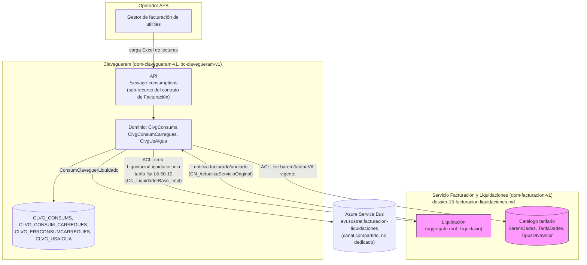

# [IA-GEN] Dossier — Clavegueram

> **Borrador generado por IA** (APB AI Framework — síntesis de apb-disc-spec-gen-v1.0/apb-pm-product-analysis-v1.0/apb-arch-c4-model-v1.0/apb-arch-decompose-v1.0) — pendiente validación humana. No distribuir sin revisión.
>
> **Estado de este documento**: esta verificación contra el código real (`service/clavegueram/`, `mvc/control/clavegueram/`, `dataaccess/dto/clavegueram/`, `dataaccess/dao/clavegueram/`) encuentra una **discrepancia de fondo con `dom-clavegueram-v1.md` y `bc-clavegueram-v1.md`**: ambos documentos afirman *"ninguna dependencia de código detectada hacia otros dominios de SÒSTRAT"* / *"sin acoplamiento detectado a otros dominios de negocio de SÒSTRAT"`. El código real muestra lo contrario — Clavegueram **escribe directamente en `Liquidacio`/`LiquidacioLinia`** a través del mismo framework de "hecho imponible" que usan Aguada, Depotsis, Suministros y Manifiestos (motor `liquidadormm`), documentado en `dossier-15-facturacion-liquidaciones.md`. Esta verificación **no revierte la decisión de dominio propio** (`dom-clavegueram-v1`, tomada explícitamente por el usuario el 2026-07-11 — sigue siendo una capacidad de negocio distinta y con bajo volumen), pero corrige la premisa de "sin acoplamiento" y **resuelve una pregunta abierta explícita de `dossier-15-facturacion-liquidaciones.md §14`** sobre la clase `LiquidacionConsumsAGBARDependencias_Impl`. Ver §2 y §7.

## 1. Cabecera

- **Nombre**: Clavegueram (liquidación de consumos de alcantarillado — servicio municipal facturado a usuarios del puerto)
- **Dominio DDD**: `dom-clavegueram-v1` (dominio de negocio propio, nuevo — ver `proposals/dom-clavegueram-v1.md`, decisión explícita del usuario de no forzar el reparenting bajo Facturación)
- **Fase del roadmap**: **sin asignar de forma consistente** — `jira-backlog.md` EPIC-15 lo trata como extracción independiente y oportunista (Fase 0-2, sin bloquear el roadmap), mientras que `jira-backlog.md` EPIC-13B historia 5 lo despliega **dentro** del servicio de Facturación y Liquidaciones (Fase 4). Esta verificación no puede resolver cuál de las dos épicas es la vigente — ver §7/§14.
- **Estado**: PROVISIONAL — el bounded context y el dominio propio en sí (`bc-clavegueram-v1`, `dom-clavegueram-v1`) se mantienen válidos como capacidad de negocio; se corrige la premisa de acoplamiento cero y se señala la inconsistencia de planificación entre EPIC-15 y EPIC-13B
- **Bounded context de origen**: `proposals/bc-clavegueram-v1.md` / `proposals/dom-clavegueram-v1.md`
- **Épica**: `jira-backlog.md` EPIC-15 (historias 1-2, "Servicios Transversales de Plataforma") **y** EPIC-13B (historia 5, "Extracción de Facturación y Liquidaciones") — duplicidad de planificación no resuelta, ver §15

## 2. Resumen ejecutivo

Clavegueram es, por volumen, el bounded context más pequeño de toda esta serie de dossiers: **3 rutas Struts reales** (`/fitxersClaveg`, `/detallFitxersClaveg`, `/consumsClaveg`, confirmado en `struts-config.xml:1460-1462`, coincide exactamente con `coverage-audit.md:61` "clavegueram | 3 | bc-clavegueram-v1"), 3 pares interfaz/implementación de servicio y 4 tablas Oracle. Gestiona la carga por fichero Excel de lecturas de consumo de alcantarillado, su liquidación (generación de una línea de `Liquidacio` con la tarifa `L6-50-10`) y su desliquidación/anulación.

**Corrección central de esta verificación**: `dom-clavegueram-v1.md` y `bc-clavegueram-v1.md` afirman ambos que no hay acoplamiento de código hacia otros dominios. El código real contradice esto de forma inequívoca en cuatro puntos concretos: (1) `CN_LiquidadorConsums_impl.java` **extiende** `CN_LiquidadorBase_Impl` (`service/factestandar/suministros/impl/`), la misma clase base que usan los liquidadores de Suministro a Buques, Suministro de Ocupación y Suministro Eléctrico, y **escribe directamente registros en `Liquidacio`/`LiquidacioLinia`** vía el servicio `cnLiquidacio`, heredado de esa base; (2) `ClvgImportarExcel.java` **extiende** `org.apb.sostrat.mvc.control.factestandar.marinas.ImportarExcel` — la misma clase base de importación masiva que usa el sub-flujo de Marinas de Facturación (`dossier-15-facturacion-liquidaciones.md §3`, 801 líneas); (3) `CN_Clvg_Consums` **implementa** `CN_ActualizaServicioOriginal` (`org.apb.sostrat.service.facturas`), el contrato genérico que usan Aguada, Depotsis, Suministros y el `Tramo` de Manifiestos para que Facturación notifique el estado "facturado" a cada módulo de origen; (4) existe una clase `LiquidacionConsumsAGBARDependencias_Impl.java` en `service/liquidacion/impl/` (una de las 14 clases `*Dependencias_Impl` ya contadas en `dossier-15-facturacion-liquidaciones.md §4/§7`) que **es exclusivamente sobre Clavegueram** (importa `ClvgConsumsDao`, `ClvgConsums`, `CN_Clvg_Consums`) — **esto resuelve la pregunta abierta explícita de `dossier-15-facturacion-liquidaciones.md §14`**: *"`LiquidacionConsumsAGBARDependencias_Impl` — posible solape no confirmado con Aguada/Clavegueram... no investigado con evidencia de código adicional en esta pasada"*. La respuesta, con evidencia de código: el nombre "AGBAR" (la operadora de aguas de Barcelona) es el nombre histórico de esta clase de dependencias, pero su contenido real es 100% Clavegueram, sin relación con Aguada.

En consecuencia, la decisión operativa de `jira-backlog.md` EPIC-13B historia 5 (desplegar Clavegueram dentro del servicio de Facturación, "no mantener un servicio de facturación separado para un módulo tan pequeño") está mejor fundamentada de lo que el propio `dossier-15-facturacion-liquidaciones.md §7` reconocía — no es solo una conveniencia operativa, es un acoplamiento de código real y multi-punto con el motor de liquidación. Esto entra en tensión directa con `jira-backlog.md` EPIC-15, que sigue describiendo Clavegueram como candidato a **externalizarse** a un proveedor genérico de facturación de utilities, una opción que no tiene en cuenta que su lógica de tarifa (`L6-50-10`, catálogo `ClvgUsAigua`→`BaremDades`/`TarifaDades`) vive hoy dentro del mismo motor de reglas que Liquidación.

## 3. Análisis funcional

### Responsabilidad de negocio
Cargar lecturas de consumo de alcantarillado desde ficheros Excel remitidos periódicamente, validarlas, liquidarlas (generar una línea de liquidación con tarifa `L6-50-10` a partir de una tabla de baremos por uso de agua) y permitir su anulación/desliquidación antes de facturarse.

### Actores
- **Gestor de facturación de utilities / operador APB**: carga ficheros de consumo, revisa errores de carga, liquida o desliquida consumos, anula lecturas erróneas.
- **Servicio de Liquidación** (`CN_Liquidacion`, vía `cnLiquidacio`, heredado de `CN_LiquidadorBase_Impl`): destinatario real de la liquidación generada — Clavegueram no posee su propia tabla de liquidaciones, escribe en `LIQUIDACIO`/`LIQUIDACIO_LINIA` del bounded context de Facturación.
- **Servicio de Facturación** (`CN_ActualizaServicioOriginal`, implementado por `CN_Clvg_Consums`): notifica a Clavegueram cuándo una liquidación asociada pasa a estado facturado, para que actualice `ClvgConsums.estat`.

### Casos de uso reales (grounded en `ConsumsAction.java`, `FitxersAction.java`, `DetallFitxersAction.java`, 3 rutas Struts confirmadas)
- **Carga de fichero de lecturas** (`/fitxersClaveg` → `FitxersAction.carregarFitxer`) — sube un Excel, lo valida celda a celda (`CN_Clvg_Fitxers_Impl.obtenerConsumsExcel`, el método más extenso del módulo, líneas 273-1257 de una clase de 1.494 líneas — la única "god class" real de este dominio, aunque pequeña en comparación con las de Facturación/Manifiestos) y registra el resultado (`ClvgConsumCarregues`, tabla `CLVG_CONSUM_CARREGUES`) junto con sus errores/avisos (`ClvgErrconsumcarregues`, tabla `CLVG_ERRCONSUMCARREGUES`).
- **Listado y detalle de cargas de fichero** (`/fitxersClaveg` `obtenerListadoLocal` → forward `clavegLlistaFitxers`; `/detallFitxersClaveg` → forward `clavegDetallCarregaFitxersPopup`) — vía la vista `VTcClvgFitxers`/`VTcClvgErrorsCarrega`.
- **Listado y detalle de consumos** (`/consumsClaveg` `obtenerListadoLocal` → forward `clavegLlistaConsums`, vista `VTcClvgConsums`).
- **Anular un consumo** (`ConsumsAction.anularConsum`) — solo permitido en estado `Pendiente` (constante `ESTADO_PENDIENTE`, valor literal no confirmado en este checkout, ver §14).
- **Liquidar un consumo, individual o múltiple** (`ConsumsAction.liquidarConsumSimple`/`liquidarConsums` → `CN_Clvg_Consums.liquidar` → `CN_LiquidadorConsums.liquidarL65010`) — genera una `Liquidacio` con tarifa fija `L6-50-10` (`TarifaPk("L6","50","10")`) y una única línea, calculando importe base como `consum × quota` (quota obtenida de `BaremDades` según el uso de agua del consumo, `ClvgUsAigua.codi`→`idbarem`) e IVA según `TipusDIvaValor` vigente en la fecha de lectura.
- **Desliquidar un consumo, individual o múltiple** (`ConsumsAction.desliquidarConsumSimple`/`desliquidarConsums` → `CN_Clvg_Consums.desliquidar`/`desliquidarMultiple`) — solo permitido en estado `Liquidado`; elimina la `Liquidacio` asociada (`cnLiquidacio.eliminar`) si ésta sigue en estado `GE` (Generada); si está en otro estado, produce un error explícito (mensaje `CONSUM.desliquidar.notallowed.byStatus`).

### Reglas de negocio confirmadas en código
- **Tarifa fija por uso**: toda liquidación de Clavegueram usa la tarifa `L6-50-10` (misma familia `L6` que la tasa de actividad de `CN_LiqL6_Impl.java`, `dossier-15-facturacion-liquidaciones.md §3/§6`, aunque es una subtarifa/extensión distinta, `50-10`, dedicada — no se ha confirmado si comparten motor de cálculo o solo el prefijo `L6` de la jerarquía tarifaria, ver §14).
- **Resolución de barem (importe unitario) vía catálogo `ClvgUsAigua`**: el código de uso de agua del consumo (`ClvgConsums.codiusaigua`) se resuelve contra `ClvgUsAigua` (tabla `CLVG_USAIGUA`, PK `codi`) para obtener `idbarem`, que a su vez se consulta contra `BaremDades` (catálogo compartido con el resto de Liquidación) vigente en la fecha de lectura.
- **Sujeto pasivo resuelto por NIF**: `CN_LiquidadorConsums_impl.recuperaUsuariDeBD` busca el `Usuari` (Operadores Portuarios) por NIF exacto (`UPPER(NIF) = ...`) para asignarlo como sujeto pasivo de la liquidación; si no existe, la liquidación falla.
- **Signo del consumo determina la serie de factura**: `pObjDatosConsum.getConsum() >= 0` usa la serie `FRA` (factura estándar); un consumo negativo (abono/corrección) usa la serie `ABN` (abono).
- **Comentarios `TODO` sin resolver en el propio cálculo de importes** (`CN_LiquidadorConsums_impl.java:106-108`): el importe base y el IVA de cabecera de la liquidación se fijan a `BigDecimal.valueOf(0)` con un comentario del propio desarrollador (`"D'on es treu aquesta info???"` / `"És així correcte???"`) — el importe real vive en la línea de liquidación (`LiquidacioLinia.impbase`/`impiva`), pero la cabecera (`Liquidacio.impbasec`/`impivac`) nunca se recalcula a partir de la línea. No confirmado si esto es un defecto conocido o si algún proceso batch posterior recalcula la cabecera — ver §14.
- **Máquina de estados de `ClvgConsums.estat`**: al menos 3 estados reales usados en código (`ESTADO_PENDIENTE`, `ESTADO_LIQUIDADO`, `ESTADO_FACTURADO`, referenciados por nombre de constante en `CN_Clvg_Consums_Impl.java`/`ConsumsAction.java`) — sus valores literales (letra/código) no están confirmados en este checkout porque la clase que los declara (`ClvgConsumsDaoExt`) no está presente (ver §14).

### Qué NO incluye
No gestiona el alta del padrón de usuarios de agua/alcantarillado (`ClvgUsAigua` es un catálogo de baremos por tipo de uso, no un padrón de abonados) ni la lectura física del contador — solo la carga por fichero de lecturas ya tomadas. No emite la factura en sí (eso es responsabilidad de Facturación, `dossier-15-facturacion-liquidaciones.md`) — Clavegueram solo genera la liquidación y recibe la notificación de vuelta cuando se factura. No es la tasa/tarifa portuaria estándar T0-T5 (eso también es Facturación) — es la liquidación de un suministro municipal específico.

## 4. Alcance de migración — qué se migra y qué NO por no estar en uso

- **Se migran las 3 rutas Struts confirmadas** (`/fitxersClaveg`, `/detallFitxersClaveg`, `/consumsClaveg`), coincide exacto con `coverage-audit.md:61`.
- **Sin hallazgos de código muerto en `dead-code-register.md`** para este módulo (verificado por búsqueda explícita del término `clavegueram`/`Clvg` sobre ese registro — cero resultados) — confirmado también por esta verificación: no se ha encontrado ningún bloque comentado con justificación tipo "NO SE USA"/"obsoleto" en `service/clavegueram/`, `mvc/control/clavegueram/` ni `utility/clavegueram/` (solo 4 comentarios `TODO` sin resolver, ver §3, que no son código muerto sino trabajo pendiente).
- **Gap de evidencia, no de código muerto**: 5 clases DAO están referenciadas, importadas y registradas como bean Spring activo (`applicationContext-beans-dao.xml:6886-6906`: `clvgUsAiguaDao`, `clvgConsumCarreguesDaoExt`, `clvgConsumsDao`, `clvgErrconsumcarreguesDao`, `clvgErrconsumcarreguesIdiomaDao`) pero **su fichero `.java` no existe en este checkout** (`dataaccess/dao/clavegueram/` no existe como directorio; solo existen las clases `*DaoException` correspondientes). Mismo patrón ya señalado como Confianza MEDIA para Aguada en `dead-code-register.md` ítem #1: *"Podría existir solo compilada fuera de esta copia"* — no es evidencia de código muerto, es una limitación de este checkout concreto. No debe excluirse de la migración por este motivo.
- **Se migra íntegro el flujo de carga de Excel y su validación** (`CN_Clvg_Fitxers_Impl.obtenerConsumsExcel`, ~1.000 líneas) — es la única lógica de negocio no trivial del módulo.

## 5. Modelo de datos

Todos los campos siguientes están extraídos directamente de los DTOs reales en `sostrat/src/org/apb/sostrat/dataaccess/dto/clavegueram/` del checkout `SOSTRAT-Sostrat-MJ8`, contando literalmente las declaraciones de campo (no los comentarios Javadoc, para evitar el patrón de sobre-conteo corregido en dossiers anteriores).

### `ClvgConsums` (tabla `CLVG_CONSUMS`, PK simple `idconsum`, confirmado en `ClvgConsumsPk.java`) — **25 campos reales**

**Corrección respecto a `dossier-15-facturacion-liquidaciones.md §5`**: ese dossier cita "29 campos reales" para `ClvgConsums.java`; el recuento campo a campo de esta verificación (declaraciones `protected`/`private`, excluyendo los `booleanNull` de control de nulidad de tipos primitivos y `serialVersionUID`) da **25**. La discrepancia probablemente viene de contar los campos `*Null` (`lecturaantNull`, `lecturaactNull`, `idserveiNull`, `guidNull`) como campos de negocio adicionales — son artefactos técnicos del generador de DTOs, no columnas reales.

| Campo | Tipo Java | Nota |
|---|---|---|
| `idconsum` | long | PK |
| `idcarrega` | long | FK a `ClvgConsumCarregues` (la carga de fichero que originó este registro) |
| `polissa` | String | identificador de póliza/contrato de suministro |
| `dv` | String | dígito de verificación |
| `nif` | String | NIF del titular, usado para resolver `Usuari` (sujeto pasivo) |
| `titular` | String | nombre del titular, desnormalizado |
| `direccio` | String | dirección del punto de suministro |
| `lot` | String | lote de carga |
| `consum` | double | volumen consumido; negativo = abono |
| `lecturaant`/`lecturaact` | double | lectura anterior/actual del contador |
| `codiusaigua` | String | FK conceptual a `ClvgUsAigua` (determina el barem/tarifa) |
| `tipuslectura` | String | tipo de lectura |
| `zona` | String | zona del suministro |
| `datalecturaant`/`datalecturaact` | Date | fecha de cada lectura |
| `estat` | String | estado del consumo (Pendiente/Liquidado/Facturado, valores literales no confirmados, ver §14) |
| `idservei` | long | correlación con `Liquidacio.idservei` — clave real usada por `LiquidacionConsumsAGBARDependencias_Impl` y por `desliquidar()` para localizar la liquidación asociada |
| `guid` | long | control de concurrencia optimista |
| `dataalta`/`datmodificacio`/`idopealta`/`idopemodificacio`/`idprocalta`/`idprocmodificacio` | auditoría estándar (6 campos) |

### `ClvgConsumCarregues` (tabla `CLVG_CONSUM_CARREGUES`, PK `idcarrega`) — **12 campos reales**

**Corrección de nomenclatura respecto a `bc-clavegueram-v1.md`**: ese documento lista una entidad `ClvgFitxers` como parte del modelo de dominio. No existe ningún DTO llamado literalmente `ClvgFitxers` en `dataaccess.dto.clavegueram` — la entidad real que respalda el servicio `CN_Clvg_Fitxers`/las pantallas "Fitxers" es `ClvgConsumCarregues` (tabla `CLVG_CONSUM_CARREGUES`), expuesta para lectura a través de la vista `VTcClvgFitxers`. El nombre de servicio/acción (`Fitxers`) no coincide con el nombre de la tabla/entidad base — mismo patrón de nomenclatura engañosa ya señalado para otros conectores en la serie (`dossier-05-pps.md §14`, `CN_PorticConnector`).

Campos: `idcarrega` (PK), `nomfitxer`, `datainicarrega`, `datafi carrega` (inicio/fin del proceso de carga), `estat`, `dataalta`, `datmodificacio`, `idopealta`, `idopemodificacio`, `idprocalta`, `idprocmodificacio`, `guid`.

### `ClvgErrconsumcarregues` (tabla `CLVG_ERRCONSUMCARREGUES`, PK compuesta) — **12 campos reales**

Registro de errores/avisos por línea de fichero: `idcarrega` (FK), `iderror` (PK parcial), `codi`, `nivell` (nivel de severidad: error/aviso), `numliniafitxer` (línea del Excel donde ocurrió), más 6 campos de auditoría estándar y `guid`.

### `ClvgUsAigua` (tabla `CLVG_USAIGUA`, PK `codi`) — **5 campos reales**

Catálogo pequeño que vincula un código de uso de agua con la tarifa: `codi` (PK), `idtarifa`, `idsubtarifa`, `extensio`, `idbarem`. **Es el punto de acoplamiento de datos más directo con el catálogo tarifario de Liquidación** (`BaremDades`, `TarifaDades` — mismas tablas de referencia usadas por el resto del bounded context de Facturación y Liquidaciones, `dossier-15-facturacion-liquidaciones.md §6`).

### Nota de cobertura del modelo de datos

El contrato actual (`specs/openapi-facturacion-liquidaciones.yaml`, esquema `SewageConsumption`) modela **9 de los 25 campos reales** de `ClvgConsums` (`idconsum`, `idcarrega`, `polissa`, `nif`, `titular`, `consum`, `lecturaant`, `lecturaact`, `estat`) y **ninguno** de `ClvgConsumCarregues`, `ClvgErrconsumcarregues` ni `ClvgUsAigua`. Faltan, entre otros, `codiusaigua` (crítico: es el campo que determina la tarifa/barem aplicado, sin él no se puede reproducir el cálculo de liquidación desde fuera) e `idservei` (crítico: es la clave de correlación real con `Liquidacio`, usada tanto por `desliquidar()` como por `LiquidacionConsumsAGBARDependencias_Impl` para la navegación cruzada).

### Mapeo a Azure SQL
Migración directa tabla-a-tabla: `CLVG_CONSUMS`, `CLVG_CONSUM_CARREGUES`, `CLVG_ERRCONSUMCARREGUES`, `CLVG_USAIGUA`. Si se opta por desplegar Clavegueram dentro del servicio de Facturación (EPIC-13B historia 5, ver §7/§12), estas tablas viven en la misma base Azure SQL que `LIQUIDACIO`/`FACTURA`; si se opta por mantenerlo como servicio propio (EPIC-15), necesita su propia base con una integración ACL hacia el catálogo `BaremDades`/`TarifaDades` de Liquidación. No se ha diseñado el esquema definitivo en esta pasada.

## 6. Arquitectura técnica

Stack DOCKS (.NET, Azure SQL, EntraID, Service Bus, APIM) — servicio de tamaño mínimo, pero **no autocontenido en su lógica de negocio central**: la liquidación (el único cálculo no trivial del módulo) depende del catálogo tarifario y del propio agregado `Liquidacio` de Facturación.

Dos patrones de integración reales confirmados en código, ambos deben tratarse como Anti-Corruption Layer si Clavegueram se despliega como servicio separado de Facturación:

- **Escritura del agregado `Liquidacio`**: `CN_LiquidadorConsums_impl` no publica un evento ni llama a una API — invoca directamente `cnLiquidacio.crearLiquidacion()`/`anyadirLiquidacion()`/`anyadirLinea()`/`eliminar()`, heredados de `CN_LiquidadorBase_Impl`. En destino, esto debe convertirse en una llamada a la API de Liquidación (`POST /settlements`) o, si se despliega dentro del mismo servicio (EPIC-13B), puede seguir siendo una llamada de dominio interna sin cruzar un límite de red.
- **Lectura del catálogo tarifario**: `TarifaDades`, `TarifaDadesIdioma`, `BaremDades`, `TipusDIvaValor` son tablas de referencia propiedad de Liquidación, leídas directamente por `CN_LiquidadorConsums_impl` — mismo patrón (aunque de menor escala) que el motor `liquidadormm` documentado en `dossier-15-facturacion-liquidaciones.md §6` para Manifiestos.
- **Notificación de vuelta**: `CN_Clvg_Consums.actualizarFacturaEstado`/`anularFacturaEstado` (implementando `CN_ActualizaServicioOriginal`) son invocados por el framework genérico de Facturación cuando una liquidación pasa a facturada/anulada — el mecanismo de invocación real (llamada directa vs. reflexión vía `LiquidacionConsumsAGBARDependencias_Impl.obtenerNegocioServicioOriginal()`) no se ha trazado en detalle en esta pasada, pero la clase `*Dependencias_Impl` confirma que es el mismo mecanismo de despacho genérico usado por las 14 clases equivalentes de Liquidación.

**God class real del módulo**: `CN_Clvg_Fitxers_Impl.java` (1.494 líneas, no citada con tamaño en `bc-clavegueram-v1.md`), concentrada casi enteramente en el método `obtenerConsumsExcel` (~1.000 líneas de validación celda a celda de un Excel de 14 columnas). Es pequeña comparada con las god classes de Facturación/Manifiestos (dossiers 12/13/15), pero es desproporcionadamente grande para un módulo de solo 3 rutas — candidata clara a refactor antes de portar a .NET (separar parseo, validación y persistencia).

## 7. Dominio DDD

- **Dominio y bounded context**: `dom-clavegueram-v1`/`bc-clavegueram-v1`, ambos `status: discovered`, creados el 2026-07-11 tras la decisión explícita del usuario de no reparentar este BC bajo Facturación por encaje conceptual pobre (`dom-clavegueram-v1.md`: *"es facturación de un suministro municipal (alcantarillado) a usuarios del puerto, no una tasa/tarifa portuaria (T0-T5)"*). **Esta verificación no cuestiona esa decisión de negocio** — Clavegueram sigue siendo una capacidad de negocio distinguible de la facturación portuaria estándar.

- **Corrección de la premisa de acoplamiento cero**: tanto `dom-clavegueram-v1.md` (*"Ninguna dependencia de código detectada hacia otros dominios de SÒSTRAT"*) como `bc-clavegueram-v1.md` (*"Sin acoplamiento detectado a otros dominios de negocio de SÒSTRAT"*) son incorrectos a la luz del código real. Cuatro puntos de acoplamiento confirmados (detalle en §2/§6):
  1. `CN_LiquidadorConsums_impl extends CN_LiquidadorBase_Impl` (`service/factestandar/suministros/impl/`) — escritura directa de `Liquidacio`/`LiquidacioLinia`.
  2. `ClvgImportarExcel extends ImportarExcel` (`mvc/control/factestandar/marinas/`) — reutilización de la base de importación masiva de Marinas.
  3. `CN_Clvg_Consums implements CN_ActualizaServicioOriginal` (`service/facturas/`) — mismo contrato que implementan Aguada, Depotsis, Suministros y el `Tramo` de Manifiestos.
  4. `LiquidacionConsumsAGBARDependencias_Impl.java` (`service/liquidacion/impl/`) — una de las 14 clases `*Dependencias_Impl` ya contadas en `dossier-15-facturacion-liquidaciones.md §4/§7`, dedicada en exclusiva a Clavegueram.

- **Resolución de la pregunta abierta de `dossier-15-facturacion-liquidaciones.md §14`/§16**: *"Confirmar si `LiquidacionConsumsAGBARDependencias_Impl` se solapa con Aguada o con Clavegueram, o es un tercer concepto de consumo de agua no modelado aún"*. Con evidencia de código (imports de `ClvgConsumsDao`, `ClvgConsums`, `CN_Clvg_Consums`, cero referencia a Aguada): **es exclusivamente Clavegueram**. El nombre "AGBAR" (Aigües de Barcelona, la operadora de aguas/alcantarillado de la ciudad) es terminología heredada del negocio, no indica una tercera entidad de dominio ni solapamiento con `bc-aguada-v1`. Recomendado renombrar esta clase en destino (p.ej. `LiquidacionClavegueramDependencias_Impl`) para evitar la ambigüedad que ya causó la pregunta sin resolver en el dossier hermano.

- **Naturaleza del acoplamiento**: es de **integración vía framework compartido** (interfaces `Liquidable`/`CN_ActualizaServicioOriginal`/`Liquidacion_Dependencias`, clase base `CN_LiquidadorBase_Impl`), no de tabla compartida ni de escritura cruzada fuera de esos puntos de extensión — es cualitativamente el mismo patrón que usan Aguada, Depotsis, Suministro a Buques, Suministro de Ocupación, Suministro Eléctrico y (a mayor escala) el motor `liquidadormm` de Manifiestos, todos documentados como "fuentes de hecho imponible" en `dossier-15-facturacion-liquidaciones.md §3/§11`. Clavegueram debería añadirse explícitamente a esa lista de "servicios upstream que generan hecho imponible" — hoy no aparece mencionado allí.

- **Inconsistencia de planificación no resuelta en `jira-backlog.md`**: EPIC-15 (*"servicio de utilities... candidato explícito a externalizarse... podría no merecer ni siquiera un microservicio DOCKS propio"*) y EPIC-13B historia 5 (*"integrar las liquidaciones de Clavegueram en este mismo servicio de Facturación... no mantener un servicio de facturación separado"*) describen dos destinos arquitectónicos incompatibles para la misma funcionalidad, con historias de usuario solapadas (EPIC-15 historias 1-2: `POST`/`GET /sewage-consumptions`; EPIC-13B historia 5: "integrar liquidaciones de Clavegueram", 5 pts). La evidencia de código de este dossier **inclina la balanza hacia EPIC-13B**: externalizar Clavegueram a un proveedor de utilities genérico (como sugiere EPIC-15) requeriría o bien replicar la lógica de tarifa `L6-50-10`/barem fuera del motor de Liquidación, o bien mantener una integración ACL activa hacia él — ninguna de las dos opciones es "sin lógica que migrar" como asume EPIC-15. Debe resolverse con Arquitectura APB antes de cerrar el alcance de cualquiera de las dos épicas (ver §14/§16).

- **Sin solapamiento de rutas Struts**: `coverage-audit.md:61` clasifica las 3 rutas de `clavegueram` en exclusiva bajo `bc-clavegueram-v1`, sin repartirse con ningún otro BC.

## 8. Pantallas UI

`ui-screens-backlog.md` §"App: Clavegueram — mapea a `dom-clavegueram-v1`" (Fase 4, tratada como app separada de Facturación pese al despliegue operativo conjunto de EPIC-13B) propone solo 2 pantallas:
1. **Listado de Consumos** (`dxDataGrid`) — columnas: `idconsum`, `polissa`, `titular`, `consum`, `lecturaant/lecturaact`, `estat`.
2. **Alta de Lectura de Consumo** (`dxForm`) — campos: `polissa`, `nif`, `titular`, `lecturaact`.

**Gap frente al backlog de UI, confirmado por esta verificación**: el backlog no cubre ninguna de las pantallas reales de mayor complejidad funcional del módulo, todas con `tiles-defs.xml`/JSP confirmados:
- **Carga de fichero de lecturas** (`CarregaFitxers.jsp`, tile `clavegCarregaFitxersPopup`) y su **resultado** (`ResultatCarregaFitxers.jsp`).
- **Listado y detalle de cargas de fichero** (`TConFitxers.jsp`, `DetallCarregaFitxers.jsp`) con su listado de errores/avisos por línea de Excel.
- **Anulación de un consumo** (`PantallaAnularConsum.jsp`).
- **Mensaje de desliquidación** (`desliquidarConsumsMsg.jsp`) y **pantalla de consumos no liquidables** (`PantallaNoLiquidables.jsp`) — sugiere una validación previa explícita de "qué consumos de la selección no se pueden liquidar" antes de lanzar la liquidación múltiple, no reflejada en ninguna historia de `jira-backlog.md`.

Del inventario real de 9 JSP (`WebContent/jsp/clavegueram/`), el backlog de UI solo cubre, de forma aproximada, la pantalla de listado — el flujo de carga de fichero (la única lógica de negocio no trivial del módulo, §6) no tiene ninguna pantalla propuesta. Mismo patrón de gap ya señalado en `dossier-05-pps.md §8`, `dossier-15-facturacion-liquidaciones.md §8` para sus respectivos módulos.

## 9. APIs

**No existe un fichero `specs/openapi-clavegueram.yaml` dedicado** — confirmado por listado directo del directorio `specs/` (26 ficheros, ninguno con ese nombre). El único contrato existente para este dominio vive como sub-recurso dentro de `specs/openapi-facturacion-liquidaciones.yaml` (`tags: sewage-consumptions`), consistente con el reparenting operativo de EPIC-13B pero en tensión con el estado de `dom-clavegueram-v1` como dominio propio (§7).

| Método | Ruta | Descripción | Grounded en |
|---|---|---|---|
| GET | `/sewage-consumptions` | Listar consumos, filtro `polissa`, paginado por `cursor` | `ClvgConsums.java` (esquema `SewageConsumption`, 9/25 campos, ver §5) |
| POST | `/sewage-consumptions` | Registrar una lectura de consumo | `ClvgConsums.java` (esquema `SewageConsumptionCreate`: `polissa`, `nif`, `titular`, `lecturaact`) |

**Gap de cobertura confirmado**: no existe ningún recurso API para `ClvgConsumCarregues` (carga de fichero), `ClvgErrconsumcarregues` (errores de carga) ni `ClvgUsAigua` (catálogo de barem) — es decir, la totalidad del flujo real de negocio descrito en §3 (carga → validación → liquidación → desliquidación) **no tiene contrato de API más allá del alta de una lectura individual**. No hay endpoint para liquidar (`POST /sewage-consumptions/{id}/settle`), desliquidar ni anular, pese a que son las cuatro acciones reales de negocio de `ConsumsAction.java`.

## 10. Eventos

**No existe un fichero `specs/asyncapi-clavegueram.yaml` dedicado.** El único evento del dominio, `ConsumClaveguerLiquidado`, está definido dentro de `specs/asyncapi-fase4.yaml` (el mismo fichero que Concesiones y Facturación/Liquidaciones), publicado en el canal `evt.sostrat.facturacion-liquidaciones` — **no en un canal propio de Clavegueram** — con DLQ compartida `evt.sostrat.facturacion-liquidaciones.dlq`.

| Evento | Trigger | Payload (resumen) | Fuente |
|---|---|---|---|
| `ConsumClaveguerLiquidado` | Liquidación de un consumo (`CN_Clvg_Consums.liquidar`) | `idconsum` (obligatorio), `polissa`, `consum`, `estat` | `ClvgConsums.java`, `specs/asyncapi-fase4.yaml:80-83`, schema `ConsumClaveguerData` |

**Inconsistencia menor entre documentos**: `events-catalog.md §19` describe el payload de `ConsumClaveguerLiquidado` con 9 campos (`idconsum`, `idcarrega`, `polissa`, `nif`, `titular`, `consum`, `lecturaant`, `lecturaact`, `estat`), mientras que el esquema real `ConsumClaveguerData` en `specs/asyncapi-fase4.yaml:112-115` solo define 4 (`idconsum`, `polissa`, `consum`, `estat`) — el fichero de especificación formal es la fuente más restrictiva y probablemente la vigente para implementación, pero conviene alinear ambos documentos antes de fijar el contrato definitivo.

**Sin evento propio** para la carga de fichero (alta/fin de un lote `ClvgConsumCarregues`), su resultado de validación, ni la anulación/desliquidación de un consumo — mismo patrón de gap ya señalado en §8/§9.

## 11. Diagrama topológico (C4 nivel 1)

**Nota de diseño**: a diferencia del resto de dossiers de esta serie, aquí el diagrama muestra un servicio pequeño con **dos** dependencias ACL hacia el mismo bounded context vecino (escritura de `Liquidacio` + lectura del catálogo tarifario) — es la razón de código real detrás de la opción de despliegue conjunto de EPIC-13B (§7/§12).

## 12. Estrategia de convivencia con el modelo actual

1. **Decidir primero entre EPIC-15 (servicio propio) y EPIC-13B historia 5 (desplegado dentro de Facturación) antes de diseñar nada** — es una decisión arquitectónica bloqueante, no solo de planificación, dado el acoplamiento de código real confirmado en §6/§7. Ninguna de las dos épicas debe ejecutarse hasta resolver esta contradicción con Arquitectura APB.
2. **Si se opta por servicio propio (mantener `dom-clavegueram-v1` como microservicio separado)**: el acceso al catálogo tarifario (`BaremDades`/`TarifaDades`/`TipusDIvaValor`) y a la creación de `Liquidacio` debe convertirse en llamadas a la API de Liquidación (`POST /settlements`, `GET` de baremos si se expone), nunca en acceso directo a su base de datos — mismo principio de mínimo privilegio aplicado al resto del roadmap.
3. **Si se opta por despliegue conjunto (EPIC-13B historia 5)**: Clavegueram pasa a ser un sub-módulo del servicio de Facturación y Liquidaciones, con sus 4 tablas en la misma base Azure SQL — coherente con el hallazgo de esta verificación de que el acoplamiento real es más profundo de lo que se pensaba. El dominio de negocio (`dom-clavegueram-v1`) puede seguir existiendo como clasificación DDD/documental sin que eso obligue a un despliegue físico separado (mismo patrón que Clavegueram ya tiene hoy dentro de `specs/openapi-facturacion-liquidaciones.yaml`).
4. **Strangler fig por sub-flujo, en cualquiera de las dos opciones**: extraer primero el listado/consulta de consumos (sin dependencia de escritura), después el flujo de carga de fichero (autocontenido), y en último lugar liquidar/desliquidar (el único punto con dependencia dura hacia Liquidación).
5. **Cerrar el gap de API/evento antes de comprometer fecha de cutover** (§9/§10): no existen hoy endpoints ni eventos para carga de fichero, liquidar, desliquidar ni anular — solo alta y listado de lecturas.
6. **Renombrar `LiquidacionConsumsAGBARDependencias_Impl`** en el diseño destino para eliminar la ambigüedad de nombre que causó la pregunta sin resolver en `dossier-15-facturacion-liquidaciones.md §14` (§7).

## 13. Testing y seguridad

- **Estrategia de testing**: no hay una sección dedicada a Clavegueram en `testing-strategy-fase2-4.md` (revisado, sin resultados) — debe añadirse. Casos mínimos grounded en código real:
  - Unit: `liquidarL65010` con `codiusaigua` sin barem vigente debe producir el error `INC_FALTABAREM` sin crear la `Liquidacio` (`CN_LiquidadorConsums_impl.java:241-243`); anular un consumo que no está en estado Pendiente debe rechazarse; desliquidar un consumo cuya `Liquidacio` asociada no está en estado `GE` debe producir `CONSUM.desliquidar.notallowed.byStatus`.
  - Contract: schema de `ConsumClaveguerLiquidado` — **alinear primero `events-catalog.md` con `specs/asyncapi-fase4.yaml`** (discrepancia de campos, §10) antes de fijar el test.
  - Integration: si se opta por servicio propio (§12), test de integración obligatorio verificando que la creación de `Liquidacio` y la lectura del catálogo tarifario pasan por la API de Liquidación y no por acceso directo a su base de datos — mismo principio ya exigido a PPS/Kaba (`dossier-05-pps.md §13`) y al motor `liquidadormm` (`dossier-15-facturacion-liquidaciones.md §13`).
- **Seguridad**: `ClvgConsums` contiene datos de identificación de terceros (`nif`, `titular`, `direccio`) — no clasificados explícitamente como datos personales en ningún threat model de la serie revisado en esta pasada (`threat-model-fase2-4.md`, sin mención a Clavegueram). Debe evaluarse si aplica normativa de protección de datos (RGPD) al tratarse de NIF/dirección de personas físicas o jurídicas, y si el nuevo servicio necesita los mismos controles de acceso que Operadores Portuarios (`Usuari`) para estos campos.
- Los cuatro comentarios `TODO` sin resolver en el cálculo de importes de cabecera (§3) deben resolverse con negocio antes de dar por cerrado el contrato de cálculo en destino — no se debe migrar un `BigDecimal.valueOf(0)` hardcodeado sin entender primero si es un defecto latente del legacy.

## 14. Riesgos y gaps de evidencia conocidos

- **Corrección de máxima prioridad**: `dom-clavegueram-v1.md`/`bc-clavegueram-v1.md` afirman acoplamiento cero; el código real muestra 4 puntos de acoplamiento concretos con el bounded context de Facturación y Liquidaciones (§2/§7). Debe corregirse la nota de ambos documentos antes de que se use como base para decisiones de arquitectura.
- **Inconsistencia de planificación no resuelta**: `jira-backlog.md` EPIC-15 (servicio propio, candidato a externalizar) vs. EPIC-13B historia 5 (desplegado dentro de Facturación) — describen destinos arquitectónicos incompatibles para el mismo dominio, con historias de usuario parcialmente solapadas (§7/§15).
- **Corrección de campo count**: `dossier-15-facturacion-liquidaciones.md §5` cita 29 campos reales de `ClvgConsums`; el recuento de esta verificación (excluyendo campos técnicos `*Null`) da 25 (§5).
- **Corrección de nomenclatura**: `bc-clavegueram-v1.md` cita una entidad `ClvgFitxers` que no existe como DTO base — la entidad real es `ClvgConsumCarregues` (§5).
- **Resuelto por esta verificación**: la pregunta abierta de `dossier-15-facturacion-liquidaciones.md §14` sobre `LiquidacionConsumsAGBARDependencias_Impl` — es exclusivamente Clavegueram, no Aguada ni un tercer concepto (§7).
- **Gap de evidencia, no de código muerto**: 5 clases DAO base (`ClvgConsumsDaoImplExt`, `ClvgUsAiguaDaoImpl`, `ClvgConsumCarreguesDaoImplExt`, `ClvgErrconsumcarreguesDaoImpl`, `ClvgErrconsumcarreguesIdiomaDaoImpl`) están registradas como bean Spring activo pero ausentes de este checkout — mismo patrón ya aceptado como Confianza MEDIA para Aguada en `dead-code-register.md` (§4).
- **Valores literales del estado `ClvgConsums.estat` no confirmados**: se usan por nombre de constante (`ESTADO_PENDIENTE`, `ESTADO_LIQUIDADO`, `ESTADO_FACTURADO`) en el código de servicio, pero la clase que las declara no está en este checkout (mismo gap que el ítem anterior) — no se puede confirmar si son códigos de una letra u otro formato.
- **Cálculo de importe de cabecera con `TODO` sin resolver**: `CN_LiquidadorConsums_impl.java:106-108` fija `impbasec`/`impivac`/`imptotalc` de la cabecera de liquidación a valores fijos con comentarios explícitos del desarrollador cuestionando su corrección — no confirmado si es un defecto conocido o si se recalcula en otro punto no localizado en esta pasada.
- **Relación exacta entre la tarifa `L6-50-10` de Clavegueram y la tasa de actividad `L6` liquidada por `CN_LiqL6_Impl.java`** (`dossier-15-facturacion-liquidaciones.md §3`) no confirmada — comparten el prefijo de familia tarifaria `L6` pero no se ha verificado si comparten motor de cálculo, tabla de baremos, o son simplemente entradas distintas del mismo catálogo jerárquico de tarifas. No confirmable sin acceso a negocio/documentación funcional del catálogo tarifario completo.
- **Sin cobertura de threat model**: no hay mención a Clavegueram en `threat-model-fase2-4.md` pese a que trata datos de identificación de terceros (NIF, titular, dirección) — ver §13.

## 15. Estimación de esfuerzo

`jira-backlog.md` describe el esfuerzo de Clavegueram en **dos épicas distintas y no reconciliadas**:

- **EPIC-15** (Servicios Transversales de Plataforma), historias 1-2: registrar lectura de consumo (`POST /sewage-consumptions`, 5 pts) + consultar histórico por póliza (`GET /sewage-consumptions?polissa=...`, 3 pts) = **8 pts**, más la tarea técnica *"confirmar con negocio la prioridad real de Clavegueram — es candidato explícito a externalizarse"*.
- **EPIC-13B** (Extracción de Facturación y Liquidaciones), historia 5: *"integrar las liquidaciones de Clavegueram en este mismo servicio de Facturación"* = **5 pts**.

**Ninguna de las dos estimaciones cubre el alcance real confirmado por esta verificación**: el flujo de carga de fichero Excel (la única lógica de negocio no trivial, §3/§6), la validación línea a línea, ni las acciones de liquidar/desliquidar/anular individuales y múltiples tienen historia de usuario ni story points asignados en ninguna de las dos épicas — solo el alta y consulta de una lectura individual está cubierto.

**Recomendación de esta verificación**: antes de dar por válida cualquiera de las dos estimaciones, resolver la contradicción arquitectónica de §7/§12 (servicio propio vs. desplegado dentro de Facturación) — el esfuerzo real difiere sustancialmente entre ambas opciones (una requiere diseñar y mantener un ACL hacia el catálogo tarifario de Liquidación; la otra no).

## 16. Checklist de validación

**Funcional**:
- [ ] Confirmar con Arquitectura APB si Clavegueram se despliega como servicio DOCKS propio (EPIC-15) o dentro del servicio de Facturación y Liquidaciones (EPIC-13B historia 5) — decisión bloqueante dado el acoplamiento de código real confirmado (§7/§12).
- [ ] Confirmar con negocio los valores literales del dominio de `ClvgConsums.estat` (Pendiente/Liquidado/Facturado y posible estado de anulado).
- [ ] Confirmar si el `TODO` de importe de cabecera sin resolver (`CN_LiquidadorConsums_impl.java:106-108`) es un defecto conocido del legacy o si el importe se recalcula en otro punto.
- [ ] Confirmar la relación real entre la tarifa `L6-50-10` de Clavegueram y la tasa de actividad `L6` de `CN_LiqL6_Impl.java` (mismo prefijo de familia tarifaria, relación no confirmada).
- [ ] Evaluar si `nif`/`titular`/`direccio` de `ClvgConsums` requieren tratamiento RGPD explícito en el threat model destino.

**Desarrollo**:
- [ ] Corregir `dom-clavegueram-v1.md`/`bc-clavegueram-v1.md`: la premisa de "sin acoplamiento" es incorrecta — documentar los 4 puntos de acoplamiento confirmados (§7).
- [ ] Renombrar `LiquidacionConsumsAGBARDependencias_Impl` en el diseño destino para eliminar la ambigüedad de nombre (§7/§12).
- [ ] Reconciliar `jira-backlog.md` EPIC-15 y EPIC-13B historia 5 en una única fuente de verdad de planificación para Clavegueram (§15).
- [ ] Ampliar `specs/openapi-facturacion-liquidaciones.yaml` (o crear un `openapi-clavegueram.yaml` dedicado, según la decisión de despliegue) con los recursos faltantes: carga de fichero, liquidar, desliquidar, anular.
- [ ] Alinear `events-catalog.md` con el esquema real `ConsumClaveguerData` de `specs/asyncapi-fase4.yaml` (discrepancia de 9 vs. 4 campos, §10).
- [ ] Confirmar si las 5 clases DAO ausentes de este checkout existen en el repositorio real de producción antes de asumir que necesitan reescribirse desde cero (§14).
- [ ] Refactorizar `CN_Clvg_Fitxers_Impl.obtenerConsumsExcel` (~1.000 líneas en un único método) antes de portar a .NET.

## 17. Historial de cambios

| Versión | Fecha | Autor | Cambio |
|---------|-------|-------|--------|
| 1.0.0 | 2026-07-13 | APB AI Framework | Dossier inicial, a petición explícita del usuario. Verificación contra el checkout real de `SOSTRAT-Sostrat-MJ8` (`service/clavegueram/`, `mvc/control/clavegueram/`, `dataaccess/dto/clavegueram/`, `dataaccess/dao/clavegueram/`, `struts-config.xml`, `applicationContext-beans*.xml`, `tiles-defs.xml`, `specs/openapi-facturacion-liquidaciones.yaml`, `specs/asyncapi-fase4.yaml`). Corrige `dom-clavegueram-v1.md`/`bc-clavegueram-v1.md`: la premisa de "sin acoplamiento hacia otros dominios" es incorrecta — 4 puntos de acoplamiento de código real confirmados hacia Facturación y Liquidaciones. Resuelve la pregunta abierta de `dossier-15-facturacion-liquidaciones.md §14` sobre `LiquidacionConsumsAGBARDependencias_Impl` (es exclusivamente Clavegueram). Corrige el recuento de campos de `ClvgConsums` (25, no 29) y la nomenclatura de la entidad `ClvgFitxers` (no existe; es `ClvgConsumCarregues`). Señala una inconsistencia de planificación no resuelta entre `jira-backlog.md` EPIC-15 y EPIC-13B historia 5. |
