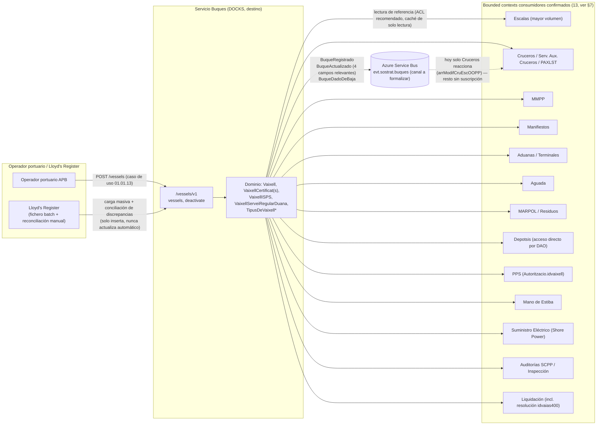

# [IA-GEN] Dossier — Buques (Ship Master Data)

> **Borrador generado por IA** (APB AI Framework — síntesis de apb-disc-spec-gen-v1.0/apb-pm-product-analysis-v1.0/apb-arch-c4-model-v1.0/apb-arch-decompose-v1.0) — pendiente validación humana. No distribuir sin revisión.

## 1. Cabecera

- **Nombre**: Buques (Ship Master Data)
- **Dominio DDD**: `dom-operaciones-maritimas-v1` (`proposals/bc-buques-v1.md:11`) — **`parent_domain` confirmado, no tentativo**, a diferencia de `bc-operadores-portuarios-v1` y `bc-efficiency-network-v1`, que comparten un bloqueante de decisión de dominio (ver §7).
- **Fase del roadmap**: 6 — bounded contexts descubiertos en la auditoría de cobertura 2026-07-13 (`coverage-audit.md`), `jira-backlog.md` EPIC-16
- **Estado**: DISCOVERED — bounded context propuesto, verificado campo a campo contra el checkout real de `SOSTRAT-Sostrat-MJ8`
- **Bounded context de origen**: `proposals/bc-buques-v1.md`
- **Épica**: `jira-backlog.md` EPIC-16 — Extracción Buques (Ship Master Data)
- **Nota de gobernanza**: `discovery/ddd-sostrat-mj8/pr-instructions.md §2.1` ya marca `buques.md` como listo para enviarse al PR del catálogo de dominios ("sí enviar... no requiere validación con ARGOS, es un maestro de referencia independiente"), a diferencia de `escalas.md` (bloqueado) y de `bc-operadores-portuarios-v1`/`bc-efficiency-network-v1` (bloqueados por `parent_domain` tentativo).

## 2. Resumen ejecutivo

Buques mantiene la ficha técnica maestra de cada buque que opera en el puerto (identificación, dimensiones, capacidades, certificados, ISPS, clasificación Lloyd's, servicio regular de aduana) en la tabla `VAIXELL` y sus 6 tablas satélite. Es, en términos de tamaño de código, uno de los bounded contexts **más pequeños y menos acoplados internamente** de todo SÒSTRAT (ninguna clase de servicio supera las 1.240 líneas), pero esta verificación confirma que es, en cambio, **el maestro de referencia con el mayor abanico de consumidores reales de todo el checkout** — muy por encima de lo que documentaba `bc-buques-v1.md`.

**Cuatro hallazgos nuevos de esta verificación, no presentes en la documentación previa de discovery**:

1. **El abanico real de consumidores es al menos 4 veces mayor que el documentado.** `bc-buques-v1.md:86` y `jira-backlog.md:349` solo citan Escalas, Cruceros y MMPP como consumidores. Un grep exhaustivo de `import org.apb.sostrat.dataaccess.dto.Vaixell;` sobre todo el checkout (`sostrat/`, `sostrat-CARGASINICIALES/`) devuelve **145 ficheros**, y de `import org.apb.sostrat.service.CN_Vaixell` (interfaz de servicio) **67 ficheros**, repartidos en al menos **13 bounded contexts/módulos funcionales distintos** además de Manifiestos y Aduanas/Terminales (ya confirmados por `dossier-12-manifiestos.md` y `dossier-13-aduanas-contenedores.md`): Escalas (el mayor, 11+ clases), Cruceros (incluye Servicios Auxiliares de Cruceros y PAXLST), MMPP/Hazmat, **Aguada** (`bc-aguada-v1`), **MARPOL/Residuos** (`bc-marpol-residuos-v1`, incluye el circuito EDI WASDIS), **Depotsis** (`bc-depotsis-v1`, acceso directo por DAO sin pasar por el servicio), **PPS** (`bc-pps-v1` — `CN_Autoritzacio_Impl.java` consume `Vaixell` para resolver el campo `Autoritzacio.idvaixell` ya documentado en `dossier-05-pps.md §5`), **Mano de Estiba** (`bc-mano-estiba-v1`), **Suministro Eléctrico a Buques/Shore Power** (`bc-suministro-electrico-buques-v1`), **auditorías SCPP/Inspección** (candidato a `bc-inspeccion-scpp-v1`) y **Liquidación** (`bc-liquidacion-v1`, incluye resolución de un identificador legacy AS400, ver hallazgo 3). Ver §7/§11 para el mapa completo con evidencia por fichero.
2. **Integración externa real confirmada, no documentada**: el maestro **no es puramente mantenido a mano** — existe un circuito de importación masiva desde **Lloyd's Register** (`CargaBDLloydsAction.java`, 754 líneas; `CN_Vaixell.actualizarDeLloyds(operador)`, "solo realiza inserciones nuevas, no actualizaciones"; DTOs `VaixellLloyds`/`VaixellLloydsCopia`) con una pantalla de conciliación de discrepancias dedicada (`/discrepancias` → `DiscrepanciasAction.java`, sobre la vista `VTcDiscrepancias`, acciones `DV_VAIXELL`/`DL_VAIXELL`) y reportes de excepción de banderas/buques/puertos "no encontrados" (`rptCargaFicheroLloyds*.xml`). Es una integración de **fichero + reconciliación manual**, no una API en vivo — corrige la premisa implícita de `jira-backlog.md`/`bc-buques-v1.md` de que Buques es un catálogo cerrado sin fuente externa.
3. **Campo `idvaias400` activo, no solo histórico**: es un identificador heredado de un sistema AS400 predecesor (con su propio generador de secuencia alfanumérica, `CN_Vaixell_AS400Util.java`, 284 líneas), pero **sigue consultándose activamente en producción** — `CN_Liquidacion_Impl.getIdVaixellSostrat(pIdVaixellAS400)` resuelve un `Vaixell` real por este campo durante la liquidación. No es código muerto ni un campo puramente heredado sin uso.
4. **El contrato de API actual (`specs/openapi-buques.yaml`) solo modela 14 de los 68 atributos reales de `Vaixell.java`** (~20% de cobertura), no tiene ningún sub-recurso para certificados/ISPS/servicio regular de aduana pese a que `api-surface-by-phase.md:260` ya los da por hechos, no tiene endpoint de restauración (`restaurar`) pese a que `CN_Vaixell.restaurar()` es un método real y `jira-backlog.md:356` lo cita como historia de usuario, y tipa `bandera` como `string` libre cuando el campo real es `Integer` (FK a un catálogo de banderas/puertos, con un campo `banderaISO` de enriquecimiento aparte) — ver §5/§9/§14.

Corrección cuantitativa menor: `bc-buques-v1.md:57` cita "20 rutas Struts (19 activas + 1 comentada)" para el paquete `Vaixell`/`TipusDeVaixell`. El recuento exacto por parseo de `struts-config.xml` (acciones cuyo `type` es `org.apb.sostrat.mvc.control.TipusDeVaixell*Action`/`Vaixell*Action`) da **21 rutas totales, 20 activas y 1 comentada** (`/vaixellsCertificadoAltresAudit`, línea 318) — coincide exactamente con `coverage-audit.md:87` ("Vaixell / TipusDeVaixell | 21"), no con la cifra de `bc-buques-v1.md`. Además, dos rutas funcionalmente parte de Buques (`/discrepancias`, `/cargaBDLloyds`, conciliación con Lloyd's Register) usan clases con nombre distinto (`DiscrepanciasAction`, `CargaBDLloydsAction`) y por tanto no las captura un grep ingenuo por el patrón `Vaixell*`/`TipusDeVaixell*` — funcionalmente pertenecen al alcance de migración de este BC aunque el conteo oficial de la auditoría (21) no las incluya.

## 3. Análisis funcional

### Responsabilidad de negocio
Mantiene la ficha técnica maestra de cada buque que opera en el puerto: identificación (IMO/`numlloyds`, `callsign`, `mmsi`, bandera), dimensiones (eslora, manga, calado, puntal, TPM, GT), capacidades (contenedores/TEUs, graneles, líquidos, pasajeros, vehículos, camiones), rampas RoRo, certificados, estatus ISPS, clasificación Lloyd's (incluida su importación masiva y conciliación de discrepancias) y servicio regular de aduana.

### Actores
- Operador portuario APB (alta/modificación/baja de la ficha del buque, caso de uso formal "01.01.13 Mantenimiento de Buques").
- Sistema batch de carga Lloyd's Register (actor externo, vía fichero — `CargaBDLloydsAction`/`CN_Vaixell.actualizarDeLloyds`).
- Al menos 13 módulos consumidores internos (Escalas, Cruceros, MMPP, Manifiestos, Aduanas/Terminales, Aguada, MARPOL, Depotsis, PPS, Mano de Estiba, Suministro Eléctrico, SCPP/Inspección, Liquidación) que leen el maestro como referencia — ver §7.

### Casos de uso reales (grounded en las rutas Struts confirmadas — `org.apb.sostrat.mvc.control.{Vaixell*,TipusDeVaixell*}Action`, `struts-config.xml`, sin fichero satélite propio)
- **Mantenimiento del buque (caso de uso formal "01.01.13 Mantenimiento de Buques", comentario literal en `struts-config.xml:325-333`)**: `/vaixells` y `/vaixells_popup` → `VaixellAction.java` (1.239 líneas, la Action más grande del módulo), `/vaixellServeiRegularDuana`(`_popup`) → `VaixellServeiRegularDuanaAction`/`VaixellServeiRegularDuanaEmergenteAction`, `/vaixellISPS`(`_popup`) → `VaixellISPSAction`/`VaixellISPSEmergenteAction`. **Nota importante**: el comentario formal "01.01.13" en el código solo envuelve estas 5 rutas, no las 21 completas del módulo — no debe leerse como que todo el BC comparte una única referencia de caso de uso.
- **Certificados**: `/vaixellsCertificado` → `VaixellCertificatAction`, `/vaixellsCertificadoAudit` → `VaixellCertificatAuditAction`, `/vaixellsCertificadoAltres` → `VaixellCertificatsAction` (certificados "de otro tipo", tabla `VAIXELL_CERTIFICATS`, con auditoría completa), `/vaixellsCertificadoAltresAudit` (**comentada**, dead-code confirmado, ver §4).
- **Auditoría del maestro**: `/vaixellAudit`(`_popup`) → `VaixellAuditAction`, `/vaixellAuditEmergente` → `VaixellAuditEmergenteAction`.
- **Tipos de buque (catálogos satélite)**: `/tipusDeVaixellAPB`(`_popup`), `/tipusDeVaixellEDI`, `/tipusDeVaixellLL`, `/tipusDeVaixellPE` → 4 Actions dedicadas, catálogos independientes por origen del tipo (APB/EDI/Lloyd's/PE).
- **Lloyd's Register**: `/vaixellLloyds` → `VaixellLloydsAction`, `/vaixellLloydsEmergente` → `VaixellLloydsEmergenteAction` (**clase `.java` ausente del checkout**, ya registrado como ítem de confianza media en `dead-code-register.md:69`, no confirmado como muerto), `/cargaBDLloyds` → `CargaBDLloydsAction` (import masivo por fichero), `/discrepancias` → `DiscrepanciasAction` (conciliación de discrepancias buque-vs-Lloyd's).
- **Discrepancias**: `CN_Vaixell.obtenerDiscrepancias`/`actualizarDiscrepancias` — comparación campo a campo entre el registro `VAIXELL` y el dato de Lloyd's importado.

### Reglas de negocio confirmadas en código
- `Vaixell` (tabla `VAIXELL`, PK `idvaixell`) tiene **68 atributos Java declarados localmente** (ver §5), de los cuales 3 (`banderaISO`, `portregistreISO`, `portinspeccioISO`) comparten Javadoc de columna con su contraparte `Integer` (`bandera`, `portregistre`, `portinspeccio`) — son campos de enriquecimiento (código ISO resuelto por join), no columnas físicas adicionales confirmadas de forma independiente.
- `Vaixell` extiende `DtoGenerico` (paquete `core`, **ausente de este checkout** — mismo patrón de gap ya señalado para otras clases `core.*` en dossiers previos), por lo que no puede confirmarse en esta pasada si hereda campos de auditoría adicionales no declarados localmente.
- Dos arrays estáticos de negocio embebidos en el propio DTO gobiernan la propagación de cambios hacia Cruceros: `arrModificacionCE = {nomvaixell, maxmaniga, maxcalat, maxeslora}` (campos relevantes para el mantenimiento desde `CreuerEscala`) y `arrModifCruEscOOPP = {maxcalat, maxeslora}` (campos que disparan notificación a Operaciones Portuarias de Cruceros ante una modificación hecha desde el mantenimiento de `CreuerEscala`) — confirmado en `Vaixell.java:230-237`, ya citado correctamente en `bc-buques-v1.md` y en `events-catalog.md §Buques`.
- `CN_Vaixell.crear`/`modificar` gestionan certificados en dos colecciones paralelas (`certificados` y `certificadosAltres`, ticket `MVM-91`) con listas de PKs a borrar (`elementosBorrar`/`elementosBorrarAltres`) — el alta/modificación real es una operación compuesta sobre `Vaixell` + `VaixellCertificat[]` + `VaixellCertificats[]`, no una escritura simple de una sola tabla.
- `CN_Vaixell.modificar` recibe explícitamente `pStrNumlloyds` (el IMO/Lloyd's anterior) como parámetro — sugiere una regla de validación de cambio de número Lloyd's no explorada en detalle en esta pasada (ver §14).
- `darDeBaja`/`restaurar` son operaciones reales y distintas de `eliminar` (borrado físico) — confirma el patrón de baja lógica ya citado por `bc-buques-v1.md`.
- `actualizarDeLloyds(operador)`: "solo realiza inserciones nuevas, no actualizaciones de registros ya existentes" (Javadoc literal de `CN_Vaixell.java:156-157`) — regla de negocio explícita sobre el circuito de importación externa.
- `idvaias400` se resuelve activamente desde Liquidación (`CN_Liquidacion_Impl.getIdVaixellSostrat`) — no es un campo solo decorativo/histórico.

### Qué NO incluye
No gestiona la escala/atraque en sí (`bc-escalas-v1`), ni la asignación de consignatario/armador a un servicio marítimo concreto (entidad puente `ServeiMaritimVaixellUsuari`, `bc-operadores-portuarios-v1`), ni el suministro de agua/electricidad al buque atracado (`bc-aguada-v1`/`bc-suministro-electrico-buques-v1`, que solo referencian `Vaixell` por FK), ni el cálculo de tasas/liquidación (`bc-liquidacion-v1`, que también solo referencia el maestro). Sin evidencia de consumo directo desde PIF (`bc-pif-v1`) — 0 resultados de `dto.Vaixell`/`CN_Vaixell` en `mvc/control/pif`/`service/pif` — confirma la nota ya presente en `jira-backlog.md:359` y `bc-buques-v1.md`.

## 4. Alcance de migración — qué se migra y qué NO por no estar en uso

- **Se migran las 20 rutas activas confirmadas** del patrón `Vaixell*`/`TipusDeVaixell*Action` (21 totales − 1 comentada), más `/discrepancias` y `/cargaBDLloyds` (funcionalmente parte de Buques, aunque sus Actions no siguen el patrón de nombre — ver §2/§3).
- **1 ruta comentada confirmada, ya en `dead-code-register.md:37`**: `/vaixellsCertificadoAltresAudit` → `VaixellCertificatsAuditAction` (`struts-config.xml:318`). **No migrar.**
- **1 ruta activa con clase ausente del checkout, ya registrada en `dead-code-register.md:69` con confianza media (no alta)**: `/vaixellLloydsEmergente` → `VaixellLloydsEmergenteAction` — confirmado en esta verificación que el fichero `.java` no existe en `mvc/control/` (solo existe `VaixellEmergenteAction.java`, una clase distinta). Coherente con el registro existente: no se sube a confianza ALTA porque, como el resto de ítems de esa categoría, podría estar compilada fuera de esta copia del checkout.
- **No se ha encontrado código muerto adicional** en las clases propias de Buques (`VaixellAction.java`, `CN_Vaixell_Impl.java`, `CN_Vaixell.java`) más allá de lo ya citado — sin `@Deprecated`, `TODO`/`FIXME` ni bloques comentados relevantes en esas tres clases.
- **Se migra el circuito de importación Lloyd's Register** (`CargaBDLloydsAction`, `CN_Vaixell.actualizarDeLloyds`, conciliación de discrepancias) como una integración real, no como código descartable — es la única fuente de enriquecimiento externo confirmada del maestro (ver §2/§6).
- **Se migra `idvaias400`** como dato activo, no como campo histórico a deprecar — tiene un consumidor real en Liquidación.

## 5. Modelo de datos

Todos los campos siguientes están extraídos directamente de los DTOs reales en `sostrat/src/org/apb/sostrat/dataaccess/dto/` del checkout `SOSTRAT-Sostrat-MJ8`.

### `Vaixell` (tabla `VAIXELL`, PK `idvaixell`)
**68 atributos Java declarados localmente**, confirmados uno a uno por Javadoc de columna en `Vaixell.java`:

`idvaixell` (PK, `Long`), `nomvaixell`, `callsign`, `bandera` (`Integer`, FK a catálogo de banderas — **no `String` libre**), `banderaISO` (enriquecimiento, mismo Javadoc de columna que `bandera`), `portregistre` (`Integer`)/`portregistreISO`, `datconstruccio`, `gt`, `numlloyds`, `tpm`, `maxmaniga`, `puntal`, `maxcalat`, `maxeslora`, `numrampes`, `desrampa1`, `lonrampa1`, `amprampa1`, `altarboladura`, `potencia`, `velservei`, `tipcasc`, `numhelix`, `deshelix`, `captls`, `numpassatgers`, `numcabines`, `numcotxes`, `numcamions`, `metlincarroro`, `numteus`, `numrefteus`, `captancs`, `capcarrefrigerada`, `capgranel`, `capliquids`, `numbodegues`, `bcm`, `origt`, `orieslora`, `oribandera`, `orinom`, `oricallsign`, `orialtres` (campos `ori*` — valores "originales" previos a corrección/modificación, no documentados con más detalle en el propio DTO), `mmsi`, `tipvaixell`, `caplasbrut`, `captanfangs`, `captansentines`, `capaigbrut`, `capescombraries` (capacidades de residuos MARPOL — explica el consumo real desde `bc-marpol-residuos-v1`, ver §7), `portinspeccio` (`Integer`)/`portinspeccioISO`, `datinspeccio`, `defpendents`, `datcerarqueig`, `datvigcerigs`, `observacions`, `socclassificacio`, `comasseguradora`, `clubpandi`, `datbaixa`, `idvaias400` (correlación legacy AS400, activo — ver §2/§3), `guid`, `dadescertificat`, `interior`, `lng` (propulsión gas licuado, ticket ESCA-1789).

**Nota de cobertura**: `bc-buques-v1.md:74` cita "40+ campos" en su resumen y sus `notes` citan "66 columnas confirmadas por Javadoc de columna". El recuento exacto de esta verificación es **68 atributos Java**, de los cuales 3 (`banderaISO`/`portregistreISO`/`portinspeccioISO`) no tienen columna física propia confirmada de forma independiente (comparten Javadoc con su contraparte `Integer`) — la cifra de "66" es razonablemente cercana pero no se ha podido verificar contra el DDL Oracle real en esta pasada (mismo tipo de limitación de evidencia que otros dossiers de esta serie).

### `VaixellPk` — PK simple, `idvaixell` (`Long`).

### `VaixellAudit` (tabla `VAIXELL_AUDIT`) — mismo patrón que `SolicitudAudit` en PPS
`seqaudit` (PK), `dataaudit`, `tipoperacio`, `proces`, `idvaixell`, `operador`, `numlloyds`, `nomvaixell`, `callsign`, `portregistre`, `bandera`, `datconstruccio`, `gt`, `tpm`, más el resto de campos técnicos del buque replicados con fines de auditoría (no volcados campo a campo en esta pasada por ser una réplica funcional de `Vaixell`).

### `VaixellCertificat` (sin tabla propia confirmada — DTO ligero usado en memoria)
`idvaixell`, `datinivigencia`, `datfivigencia`, `datrecepcio`, `gt`, `maniga`, `eslora`, `calat` — sin campos de auditoría, PK compuesta (`VaixellCertificatPK`: `idvaixell`+`datinivigencia`). Es la forma "certificado principal" gestionada por `VaixellAction`/`CN_Vaixell.crear`/`modificar` (parámetro `certificados`).

### `VaixellCertificats` (tabla `VAIXELL_CERTIFICATS`, PK `idcertificat`) — certificados "de otro tipo" ("Altres")
`idcertificat` (PK), `idvaixell`, `idtipcertvaix`, `datinivigencia`, `datfivigencia`, `datrecepcio`, `valor1`, `valor2`, más auditoría completa (`idopealta`/`idopemodificacio`/`datalta`/`datmodificacio`/`idprocalta`/`idprocmodificacio`/`guid`) — gestionado por `VaixellCertificatsAction`/`CN_Vaixell.crear`/`modificar` (parámetro `certificadosAltres`).

### `VaixellISPS` (tabla `VAIXELL_ISPS`, PK compuesta `idvaixell`+`datinivigencia`)
`idvaixell`, `datinivigencia`, `datfivigencia`, más auditoría completa. Estatus ISPS del buque por período de vigencia.

### `VaixellServeiRegularDuana` (tabla `VAIXELL_SERVEI_REGULAR_DUANA`, PK compuesta `idvaixell`+`datinivigencia`)
`idvaixell`, `datinivigencia`, `datfivigencia`, más auditoría completa. Adscripción del buque a un servicio regular de aduana por período de vigencia.

### `VaixellLloyds` / `VaixellLloydsCopia` (integración externa, ver §2/§6)
DTOs del circuito de importación masiva desde Lloyd's Register — estructura de campos no volcada campo a campo en esta pasada (foco de esta verificación fue confirmar la existencia real de la integración, no su forma completa).

### `TipusDeVaixell{APB,EDI,LL,PE}` + variantes `*Idioma` (catálogos satélite independientes)
4 catálogos de tipo de buque según su origen (APB propio, EDI, Lloyd's, "PE" — no expandido en el código), cada uno con su propia tabla, PK y variante multi-idioma (`*Idioma`). Corresponde al `value_objects: ["TipusDeVaixell (APB/EDI/LL/PE)"]` ya citado en `bc-buques-v1.md`.

### Mapeo a Azure SQL
Migración directa tabla-a-tabla: `VAIXELL` → `Vessels` (o equivalente), `VAIXELL_AUDIT` → histórico de auditoría (candidato a tabla append-only), `VAIXELL_CERTIFICATS`/`VaixellCertificat` (en memoria) → `VesselCertificates`, `VAIXELL_ISPS` → `VesselIspsStatus`, `VAIXELL_SERVEI_REGULAR_DUANA` → `VesselCustomsRegularService`, catálogos `TipusDeVaixell*` → tablas de referencia propias. No se ha diseñado el esquema Azure SQL definitivo en esta pasada.

## 6. Arquitectura técnica

Stack DOCKS (.NET, Azure SQL, EntraID, Service Bus, APIM), servicio dedicado tras `/vessels/v1` (`specs/openapi-buques.yaml:19`).

- **Patrón de diseño destino: servicio de referencia/catálogo maestro con fan-out alto de consumidores** — dado el hallazgo de §2 (13+ módulos consumidores reales, no 3), el servicio de Buques debe diseñarse desde el día uno asumiendo un volumen de lectura mucho mayor que el de un BC "satélite" típico de esta serie. Recomendado: caché de solo lectura en cada consumidor (patrón ya insinuado por el propio legacy, que en varios módulos accede a `VaixellDao` directamente en vez de vía servicio — ver Depotsis en §7) o un servicio de referencia con alta disponibilidad y baja latencia, no un microservicio transaccional pesado.
- **Ningún "god class" real en el propio módulo**: `CN_Vaixell_Impl.java` (963 líneas) y `VaixellAction.java` (1.239 líneas) son las clases más grandes del BC — muy por debajo de los umbrales de refactor obligatorio ya aplicados a otros módulos de esta serie (p. ej. `CN_Escala_Impl.java`, 10.829 líneas, uno de los principales consumidores de Buques). No se requiere refactor de caracterización previo a la extracción, a diferencia de Manifiestos/Aduanas.
- **Integración externa real — Lloyd's Register (ver §2)**: circuito de fichero + reconciliación manual, no una API en vivo. En el diseño destino debe modelarse como un adaptador de ingesta por fichero (ACL) con su propia cola de discrepancias, preservando la regla de negocio "solo inserta, nunca actualiza automáticamente" y el flujo de reportes de excepción ("no encontrados").
- **`idvaias400`/`CN_Vaixell_AS400Util`**: mantener como campo de correlación activo (consumido por Liquidación) — no eliminar en el diseño destino sin antes confirmar con el equipo de Liquidación si sigue siendo necesario o si puede sustituirse por la PK real (`idvaixell`) en todos los flujos.
- **Propagación de cambios a consumidores**: el patrón legacy de arrays estáticos (`arrModificacionCE`/`arrModifCruEscOOPP`) que limitan qué campos disparan notificación cruzada debe traducirse a una regla de publicación de eventos explícita (ver §10), no a una suscripción Java directa — es el único mecanismo de propagación de cambios ya modelado en el legacy, y el resto de los 13 consumidores confirmados en §7 no tienen ningún mecanismo de notificación equivalente hoy (acceden al dato por lectura directa, sin invalidación de caché ni evento).

## 7. Dominio DDD

- **Bounded context**: `bc-buques-v1`, `parent_domain: dom-operaciones-maritimas-v1` (`proposals/bc-buques-v1.md:11`) — **confirmado, no tentativo**. `coverage-audit.md:128` y `pr-instructions.md §2.1` tratan a Buques como un caso distinto de `bc-operadores-portuarios-v1`/`bc-efficiency-network-v1`: estos dos comparten el bloqueante "`parent_domain` tentativo, pendiente de decisión de Arquitectura APB" (`bc-operadores-portuarios-v1.md:54`, `bc-efficiency-network-v1.md:15`), mientras que Buques ya está listo para el PR del catálogo sin ese bloqueante — es, en la propia terminología de `pr-instructions.md §2.1`, "un maestro de referencia independiente".
- **Mapa completo de consumidores confirmados, con evidencia** (corrige `bc-buques-v1.md:86`, que solo citaba Escalas/Cruceros/MMPP como `downstream_contexts`):

| Bounded context consumidor | Evidencia de código | Tipo de acoplamiento |
|---|---|---|
| `bc-escalas-v1` | 11+ clases de servicio (`CN_Escala_Impl`, `CN_Atracada_Impl`, `CN_Berman_Impl`, `CN_LiquidacionEscala_Impl`, `CN_HelperMailEscalas_Impl`, `CN_OperacioPractic_Impl`...) + 13 Actions | Import directo DTO + servicio; mayor volumen de todo el checkout |
| `bc-cruceros-v1` (incl. Servicios Auxiliares de Cruceros y PAXLST) | `CN_CreuerEscala_Impl`, `CN_ExplanadaCreuer_Impl`, `CN_PassatgeCruiseBus_Impl`, `CN_CruceroBusDetalle_Impl`, `CN_Escala_PAXLST_Impl` | Ya citado en `bc-buques-v1.md`; único consumidor con propagación de cambios explícita (`arrModifCruEscOOPP`) |
| `bc-mmpp-v1` | `CN_MMPP_Hazmat_Impl`, `CN_MmppAutoritzacio_Impl`, `CN_MmppNotif_Impl`, `CN_MmppBuscadorUtil_Impl` | Ya citado en `bc-buques-v1.md` |
| `bc-manifiestos-v1` | Confirmado por `dossier-12-manifiestos.md §7` (`CN_Manifest_Impl`, tabla propia `VAIXELL_IVA_MANIFEST`) | Confirmado en dossier previo, coherente con esta verificación |
| `bc-aduanas-contenedores-v1` | Confirmado por `dossier-13-aduanas-contenedores.md §7` (`CN_ProtermCont_Impl`, identidad de buque en `ProtermContBase`) | Confirmado en dossier previo, coherente con esta verificación |
| `bc-aguada-v1` | `CN_SolicitudAguadaImpl`, `CN_RegistroSuministroImpl`, `CN_HelperComunicacionAguadaImpl`, `AgendaAction`, `SolicitudAguadaAction` | **Nuevo, no documentado antes** |
| `bc-marpol-residuos-v1` | `CN_MarpolBatch_Impl`, `CN_ResidusEscala_Impl`, `CN_TarifasResidus_Impl`, `CN_Escala_WASDIS_Impl`, adaptadores EDI WASDIS | **Nuevo, no documentado antes** — coherente con los campos de capacidad de residuos de `Vaixell` (`caplasbrut`/`captanfangs`/`captansentines`/`capaigbrut`/`capescombraries`) |
| `bc-depotsis-v1` | `CN_Depotsis_Impl.java` — acceso **directo por `VaixellDao`**, sin pasar por `CN_Vaixell` | **Nuevo, no documentado antes**; único consumidor confirmado que se salta la capa de servicio |
| `bc-pps-v1` | `CN_Autoritzacio_Impl.java` — resuelve `Autoritzacio.idvaixell` (campo ya confirmado en `dossier-05-pps.md §5`) | **Nuevo, no documentado antes**; cierra el círculo con el dossier de PPS |
| `bc-mano-estiba-v1` | `CN_ManoEstibaImpl.java` — `ServiceLocator.getCnVaixell().obtenerObjeto(...)` | **Nuevo, no documentado antes** |
| `bc-suministro-electrico-buques-v1` | `CN_SeElectricitat_Impl.java` (inyecta `CN_Vaixell`) | **Nuevo, no documentado antes** |
| Auditorías SCPP/Inspección (candidato `bc-inspeccion-scpp-v1`) | `CN_IncidenciaEQAudit_Impl`, `CN_InspeccioAudit_Impl` — resuelven `Vaixell` por `VaixellDao` para componer la descripción de una incidencia | **Nuevo, no documentado antes** |
| `bc-liquidacion-v1` | `CN_Liquidacion_Impl`, `CN_Liquidacion_MM_Impl`, `CN_LiquidadorMM_Impl` — incluye resolución del legacy `idvaias400` | **Nuevo, no documentado antes** |
| COARRI (infraestructura EDI transversal, `coverage-audit.md:114`, no un BC de negocio) | `OperacionesCompletAction`, `OperacionesContenedoresCompletAction`, `OperacionesOnlineAction` | Infra transversal, no requiere BC propio |

- **Verificación de solapamiento/no-duplicación**:
  - **`bc-operadores-portuarios-v1` (`Usuari`)**: agregado distinto, sin solapamiento — Buques modela el activo físico (el barco), Operadores Portuarios modela al tercero de negocio (consignatario/armador). La relación entre ambos vive en un tercer BC/entidad puente (`ServeiMaritimVaixellUsuari`, propiedad de Escalas), no en Buques. Ninguno de los dos `parent_domain` está en conflicto porque Buques ya tiene el suyo confirmado (ver arriba) — el bloqueante de Operadores Portuarios/Efficiency Network no se hereda hacia Buques pese a compartir `dom-operaciones-maritimas-v1` como candidato.
  - **`bc-efficiency-network-v1` (`EmpresaBC extends Usuari`)**: sin relación de código encontrada con `Vaixell`/`CN_Vaixell` — es una especialización de Operadores Portuarios, no de Buques.
  - **Sin solapamiento en rutas Struts**: `coverage-audit.md:87` clasifica las 21 rutas `Vaixell`/`TipusDeVaixell` íntegras y en exclusiva bajo `bc-buques-v1`, sin repartirse con ningún otro BC de la auditoría de cobertura.
  - **Coherencia con dossiers previos**: el mapa de consumidores de esta sección no contradice nada ya afirmado por `dossier-12-manifiestos.md §7` ni `dossier-13-aduanas-contenedores.md §7` — los amplía con los 11 consumidores adicionales no cubiertos por esos dos dossiers (que solo documentaban la relación desde su propio lado).

## 8. Pantallas UI

Ver `ui-screens-backlog.md` §"App: Buques" (Fase 6):
1. **Listado de Buques** (`dxDataGrid`) — columnas: `nomvaixell`, `callsign`, `mmsi`, `bandera`, `tipvaixell`, `maxeslora/maxcalat/maxmaniga`.
2. **Ficha de Buque** (`dxForm` + `dxTabPanel`) — pestañas "Datos generales", "Certificados" (`dxDataGrid` maestro-detalle), "ISPS", "Lloyd's".

**Gap frente al backlog de UI, encontrado en esta verificación**: no hay pantalla propuesta para la conciliación de discrepancias con Lloyd's Register (`/discrepancias`, `DiscrepanciasAction`) ni para el propio proceso de carga masiva (`/cargaBDLloyds`, `CargaBDLloydsAction`) — pese a ser un flujo operativo real y activo (ver §2/§6), no solo un catálogo de referencia. Tampoco hay pantalla para `VaixellServeiRegularDuana` (servicio regular de aduana) ni para los 4 catálogos `TipusDeVaixell{APB,EDI,LL,PE}`. Mismo patrón de gap ya señalado en `dossier-05-pps.md §8`, `dossier-12-manifiestos.md §8` y `dossier-13-aduanas-contenedores.md §8` para sus respectivos módulos: la pantalla propuesta cubre la ficha principal y su entidad más visible (Certificados), pero no las entidades/flujos secundarios reales.

## 9. APIs

| Método | Ruta | Descripción | Grounded en |
|---|---|---|---|
| GET | `/vessels` | Listar buques (filtros `mmsi`/`callsign`, paginación cursor) | `Vaixell.java` |
| POST | `/vessels` | Dar de alta un buque (caso de uso "01.01.13") | `CN_Vaixell.crear` |
| GET | `/vessels/{idvaixell}` | Consultar ficha técnica | `VaixellPk.java` |
| PATCH | `/vessels/{idvaixell}` | Modificar ficha técnica (dispara `BuqueActualizado`) | `CN_Vaixell.modificar` |
| POST | `/vessels/{idvaixell}/deactivate` | Dar de baja (`darDeBaja`) | `CN_Vaixell.darDeBaja` |

Contrato completo: `specs/openapi-buques.yaml`. **Gaps confirmados por esta verificación, con el mismo nivel de escepticismo aplicado a los dossiers previos de esta serie**:
- **Cobertura de campos muy incompleta**: el esquema `Vessel`/`VesselCreate` solo modela 14 de los 68 atributos reales de `Vaixell.java` (`idvaixell`, `nomvaixell`, `callsign`, `bandera`, `mmsi`, `numlloyds`, `gt`, `tpm`, `maxeslora`, `maxcalat`, `maxmaniga`, `tipvaixell`, `lng`, `datbaixa`) — faltan, entre otros, todas las capacidades de carga/residuos (`capliquids`, `capgranel`, `numteus`, `caplasbrut`...), los datos de inspección (`portinspeccio`, `datinspeccio`, `defpendents`), el arqueo (`datcerarqueig`, `datvigcerigs`) y `idvaias400` (activo, consumido por Liquidación — ver §2/§6).
- **Tipo incorrecto en `bandera`**: el spec lo declara `type: string` con la descripción "Grounded: Vaixell.bandera" — el campo real es `Integer` (FK a un catálogo de banderas/puertos), con `banderaISO` como campo de enriquecimiento aparte. El contrato actual conflaciona ambos.
- **Sin endpoint de restauración**: `CN_Vaixell.restaurar()` es un método real y `jira-backlog.md:356` ya lo cita como historia de usuario ("dar de baja/restaurar un buque"), pero `openapi-buques.yaml` solo define `/vessels/{idvaixell}/deactivate`, sin `/restore` o equivalente.
- **Sin sub-recursos de certificados/ISPS/servicio regular de aduana**: pese a que `api-surface-by-phase.md:260` ya da por hecho `GET /vessels/{idvaixell}/certificates` ("evidencia `VaixellCertificat.java`/`VaixellCertificats.java`"), **ese path no existe en `specs/openapi-buques.yaml`** — es una discrepancia entre la documentación de superficie de API (que asume el endpoint) y el contrato OpenAPI real (que no lo define). Tampoco hay recurso para ISPS ni para el servicio regular de aduana.
- **Sin recurso para la conciliación Lloyd's/discrepancias**: el flujo real de `CN_Vaixell.actualizarDeLloyds`/`obtenerDiscrepancias`/`actualizarDiscrepancias` no tiene ningún endpoint propuesto.

## 10. Eventos

| Evento | Trigger | Payload (resumen) | Fuente |
|---|---|---|---|
| `BuqueRegistrado` | Alta de un buque (`CN_Vaixell.crear`) | `idvaixell`, `nomvaixell`, `callsign`, `mmsi`, `numlloyds`, `maxeslora`, `maxcalat`, `maxmaniga` | `Vaixell.java`, `events-catalog.md §Buques` |
| `BuqueActualizado` | Modificación de la ficha (`CN_Vaixell.modificar`) | mismo payload que `BuqueRegistrado` | `Vaixell.java` |
| `BuqueDadoDeBaja` | Baja lógica (`CN_Vaixell.darDeBaja`) | `idvaixell`, `datbaixa` | `Vaixell.java` |

**Regla de negocio real, ya documentada correctamente en `events-catalog.md §Buques` y `openapi-buques.yaml:94-96`**: `BuqueActualizado` solo debe disparar revalidación en Cruceros cuando cambian `nomvaixell`/`maxmaniga`/`maxcalat`/`maxeslora` (evidencia directa del array `arrModifCruEscOOPP`, `Vaixell.java:237`) — el resto de los 13 consumidores confirmados en §7 **no tienen hoy ningún mecanismo de suscripción a cambios equivalente**, lo que es un gap real de diseño destino (leen el dato una vez y no se invalida su copia/caché ante un cambio del maestro) — ver §12/§14.

Canal: `evt.sostrat.buques` (Azure Service Bus, a definir — no hay `asyncapi-fase6.yaml` en este repositorio; `events-catalog.md §Buques` documenta el payload pero no el canal AMQP formal). **Gap**: a diferencia de las Fases 0-4, no existe un fichero AsyncAPI dedicado a la Fase 6 — pendiente de generar antes de cerrar el contrato de eventos definitivo.

## 11. Diagrama topológico (C4 nivel 1)

## 12. Estrategia de convivencia con el modelo actual

1. **Buques debe migrarse ANTES o EN PARALELO con sus consumidores, no después — al revés que la mayoría de los BCs de esta serie**: dado el fan-out real confirmado en §7 (13+ bounded contexts consumidores, muchos de ellos aún en fases tempranas o sin fecha de extracción), extraer Buques tarde obligaría a mantener durante mucho tiempo un doble acceso (directo a `VAIXELL` desde el monolito + API nueva desde los servicios ya migrados), multiplicado por el mayor número de consumidores de todo el catálogo. Al ser, además, el BC de menor complejidad interna de todo SÒSTRAT (sin god classes, sin refactor de caracterización previo necesario — ver §6), es también el candidato de menor riesgo técnico para adelantar en el roadmap: **valor de negocio alto + riesgo técnico medio (solo por el volumen de consumidores, no por la complejidad del propio módulo)**, tal como ya lo cataloga `jira-backlog.md:348`.
2. **Publicar la API de referencia primero, migrar el circuito Lloyd's Register después**: `POST/GET/PATCH /vessels` cubre el 90%+ del volumen de consumo real (lectura de ficha técnica); el circuito de carga masiva + discrepancias es una operación batch de baja frecuencia y puede migrarse en una segunda ola sin bloquear a los consumidores.
3. **Los consumidores deben migrar de "acceso directo a `VAIXELL`" a "cliente del API de Buques" de forma progresiva, priorizando por volumen de acoplamiento real**: Escalas primero (el consumidor más profundo), seguido de Manifiestos/Aduanas (ya con dossiers propios que asumen esta dependencia — `dossier-12-manifiestos.md §12`, `dossier-13-aduanas-contenedores.md §12`), y el resto de consumidores nuevos identificados en esta verificación (Aguada, MARPOL, Depotsis, PPS, Mano de Estiba, Suministro Eléctrico, SCPP, Liquidación) en fases posteriores según su propio roadmap de extracción — **ninguno de ellos debería seguir escribiendo lógica nueva contra `VaixellDao`/`CN_Vaixell` directo una vez el servicio de Buques esté en producción**, incluido el caso especial de Depotsis, que hoy se salta la capa de servicio.
4. **Diseñar la propagación de cambios como evento de dominio real (Azure Service Bus), no como suscripción Java directa**: hoy solo Cruceros reacciona a cambios del maestro (`arrModifCruEscOOPP`), y lo hace vía un mecanismo interno (Swing EventBus/array estático) sin equivalente en el resto de los 12 consumidores restantes. El diseño destino debe evaluar si el resto de consumidores necesitan también invalidación activa de su copia de datos o si les basta con una lectura bajo demanda con caché corta — pendiente de una sesión de diseño explícita (ver §14).
5. **Modelar la integración Lloyd's Register como ACL de ingesta por fichero**, preservando la regla "solo inserta, nunca actualiza automático" y el flujo de reportes de excepción — no simplificar a una sincronización automática completa sin decisión de negocio explícita, dado que hoy la reconciliación de discrepancias es un paso manual deliberado.

## 13. Testing y seguridad

- **Estrategia de testing**: no se ha localizado una sección dedicada a Buques en `testing-strategy-fase2-4.md` (documento de Fases 2-4; Buques es Fase 6, descubierto después). Gap de evidencia, no de ausencia de riesgo — recomendado generar una estrategia de testing propia de Fase 6 antes de sprint planning.
  - **Recomendado por esta verificación, dado el fan-out real (§7)**: tests de contrato explícitos para los 13 consumidores confirmados, no solo para los 3 ya documentados (Escalas/Cruceros/MMPP) — el mayor riesgo de regresión de este BC no está en su propia lógica (pequeña y sin god classes) sino en romper silenciosamente a un consumidor no descubierto hasta ahora.
  - Test de integración para la regla "`BuqueActualizado` solo revalida Cruceros si cambian `nomvaixell`/`maxmaniga`/`maxcalat`/`maxeslora`" — ya insinuado por `openapi-buques.yaml:94-96`, sin test explícito documentado todavía.
  - Test de integración para el circuito de carga Lloyd's Register ("solo inserta, nunca actualiza") y para la conciliación de discrepancias.
- **Threat model**: no se ha localizado ninguna entrada específica de Buques en `threat-model-fase2-4.md` (mismo motivo: Buques es Fase 6). Gap de evidencia explícito.
  - **Superficie a evaluar, no cubierta hoy**: el circuito de importación Lloyd's Register es una ingesta de datos de un tercero externo (fichero) que alimenta un maestro de referencia consumido transversalmente por 13+ bounded contexts — un dato corrupto o mal conciliado se propagaría ampliamente. Merece su propio análisis STRIDE antes de producción, mismo patrón de riesgo ya señalado para integraciones externas en `dossier-05-pps.md §13` (Kaba) y `dossier-13-aduanas-contenedores.md §13` (doble canal SOAP).
- Ningún campo de credencial identificado en el modelo de datos de Buques (`Vaixell`, `VaixellCertificat(s)`, `VaixellISPS`, `VaixellServeiRegularDuana`).

## 14. Riesgos y gaps de evidencia conocidos

- **14º consumidor confirmado — microservicio .NET ya en producción, no legacy (2026-07-14)**: `APB.API.LRT` (repo `otros/APB.API.LRT`, Líneas Regulares) lee `VAIXELL` directamente vía Entity Framework (`BarcoRepository.cs`) — a diferencia de los 13 consumidores ya listados (todos módulos Java internos del propio monolito), este es un microservicio DOCKS ya construido, candidato inmediato a consumir la futura API de Buques en vez de seguir apuntando a Oracle. El mismo repo también **escribe** en `ESCALA` (ver `dossier-00-escalas-migracion-argos.md §14`). `APB.API.LRG` no accede a SÒSTRAT directamente — solo llama a la API de LRT. Ver `EXTERNAL_CONSUMERS_AUDIT.md §2` fila 6.
- **Fan-out de consumidores muy superior al documentado**: `bc-buques-v1.md` y `jira-backlog.md` EPIC-16 solo planifican para 3 consumidores (Escalas/Cruceros/MMPP); la evidencia real confirma 13+. El criterio de éxito de EPIC-16 ("Escalas/Cruceros/MMPP consumen el maestro vía API en vez de acceso directo a VAIXELL") debe ampliarse explícitamente a los 10 consumidores adicionales confirmados, o el corte del acceso directo a `VAIXELL` quedará incompleto.
- **Integración externa Lloyd's Register no documentada previamente** — ni en `bc-buques-v1.md` ni en `jira-backlog.md` EPIC-16, pese a ser la única fuente de enriquecimiento externo real del maestro. No estimada en story points (ver §15).
- **`idvaias400` activo, no solo histórico** — riesgo de eliminación accidental en el diseño destino si se trata como deuda puramente heredada sin antes confirmar con Liquidación.
- **Contrato de API con cobertura de campos muy incompleta (14/68) y un error de tipo (`bandera`)** — no debe darse por "listo para desarrollo" sin ampliar el esquema `Vessel`/`VesselCreate` y sin sub-recursos de certificados/ISPS/servicio regular de aduana/discrepancias Lloyd's.
- **Discrepancia entre `api-surface-by-phase.md` (asume `GET /vessels/{id}/certificates`) y el contrato OpenAPI real (no lo define)** — corregir uno de los dos documentos antes de considerarlos consistentes.
- **Sin AsyncAPI de Fase 6** — el canal de eventos de Buques (`evt.sostrat.buques`) no tiene contrato formal, a diferencia de las Fases 0-4.
- **Propagación de cambios solo diseñada para Cruceros** — el resto de 12 consumidores confirmados no tienen mecanismo de invalidación/notificación equivalente hoy; pendiente de decisión de diseño (evento genérico vs. lectura bajo demanda con caché).
- **`Vaixell` extiende `DtoGenerico`, clase `core` ausente de este checkout** — no puede confirmarse si hereda campos de auditoría adicionales no declarados localmente en `Vaixell.java`.
- **Estructura completa de `VaixellLloyds`/`VaixellLloydsCopia` no volcada campo a campo** en esta pasada — se confirmó la existencia real del circuito, no su forma de datos completa.
- **Semántica de los campos `ori*` (`origt`, `orieslora`, `oribandera`, `orinom`, `oricallsign`, `orialtres`) no confirmada** — aparentan ser valores "originales" previos a una corrección, sin comentario de negocio en el DTO que lo confirme.
- **Regla de validación de `pStrNumlloyds` en `CN_Vaixell.modificar` no explorada en detalle** — el método recibe explícitamente el IMO/Lloyd's anterior como parámetro, sugiriendo una regla de negocio sobre cambio de identificador Lloyd's no documentada.
- **Cifra de "66 columnas"/"40+ campos" de `bc-buques-v1.md` vs. las 68 confirmadas aquí** — diferencia pequeña, no verificable contra el DDL Oracle real en esta pasada (mismo tipo de limitación de evidencia de otros dossiers de la serie).

## 15. Estimación de esfuerzo

Ver `jira-backlog.md` EPIC-16 (4 historias, 21 pts: 8+5+5+3):
1. Dar de alta un buque (`POST /vessels`) — 8 pts.
2. Recibir `BuqueActualizado` en Cruceros con el filtro de 4 campos — 5 pts. Criterio de aceptación ya explícito: solo esos 4 campos disparan el evento.
3. Consultar ficha técnica por IMO desde MMPP — 5 pts.
4. Dar de baja/restaurar un buque — 3 pts.

**Nota de esta verificación — el alcance real de EPIC-16 está infravalorado, no solo en su criterio de éxito sino en story points**: las 4 historias actuales solo cubren el flujo CRUD básico y la relación con Cruceros/MMPP. No se ha estimado el esfuerzo de:
- (a) diseñar y migrar el ACL de ingesta Lloyd's Register (fichero + discrepancias) — hallazgo nuevo de esta verificación, sin story points existentes;
- (b) migrar los 10 consumidores adicionales confirmados en §7 (Aguada, MARPOL, Depotsis, PPS, Mano de Estiba, Suministro Eléctrico, SCPP, Liquidación, y completar Manifiestos/Aduanas ya parcialmente cubiertos por sus propios EPICs) del acceso directo a `VAIXELL` al nuevo API;
- (c) ampliar el contrato de API (`specs/openapi-buques.yaml`) a los 68 campos reales y a los sub-recursos de certificados/ISPS/servicio regular de aduana/discrepancias;
- (d) generar el AsyncAPI de Fase 6, hoy inexistente.
Pendiente de una iteración de refinamiento con el equipo antes de sprint planning — el "valor de negocio alto" ya asignado en `jira-backlog.md:348` se confirma y se refuerza con esta verificación, pero el "riesgo técnico medio" debe leerse como "riesgo de coordinación alto por volumen de consumidores", no como riesgo de complejidad interna del propio módulo (que es bajo, ver §6).

## 16. Checklist de validación

**Funcional**:
- [ ] Confirmar con negocio el alcance real de migración del circuito Lloyd's Register (¿se mantiene como fichero + reconciliación manual, o se moderniza a una integración en vivo con Lloyd's/IHS Fairplay?).
- [ ] Confirmar con Liquidación si `idvaias400` sigue siendo necesario en el diseño destino o puede sustituirse por `idvaixell`.
- [ ] Validar la semántica de negocio real de los campos `ori*` (`origt`, `orieslora`, `oribandera`, `orinom`, `oricallsign`, `orialtres`).
- [ ] Confirmar la regla de negocio real detrás del parámetro `pStrNumlloyds` en `CN_Vaixell.modificar` (validación de cambio de IMO/Lloyd's).
- [ ] Confirmar con cada uno de los 10 consumidores nuevos identificados (§7) su plan de migración desde acceso directo a `VAIXELL` hacia el nuevo API.

**Desarrollo**:
- [ ] Ampliar `jira-backlog.md` EPIC-16 con historias para: ACL de ingesta Lloyd's Register, migración de los 10 consumidores adicionales, ampliación del contrato de API a los 68 campos reales, AsyncAPI de Fase 6.
- [ ] Corregir `specs/openapi-buques.yaml`: tipar `bandera` como entero (FK), añadir los 54 campos ausentes del esquema `Vessel`/`VesselCreate`, añadir endpoint de restauración (`/vessels/{id}/restore`), añadir sub-recursos de certificados/ISPS/servicio regular de aduana/discrepancias.
- [ ] Reconciliar `api-surface-by-phase.md:260` (asume `GET /vessels/{id}/certificates`) con `specs/openapi-buques.yaml` (no lo define).
- [ ] Corregir `bc-buques-v1.md`: `downstream_contexts` solo cita 3 BCs; ampliar con los 10 consumidores adicionales confirmados en §7.
- [ ] Corregir el recuento de rutas Struts de `bc-buques-v1.md` (20 total/19 activas) a 21 total/20 activas, coherente con `coverage-audit.md:87`.
- [ ] Diseñar el mecanismo de propagación de cambios (evento Service Bus) para los 12 consumidores que hoy no tienen ningún mecanismo de notificación equivalente al de Cruceros.
- [ ] Confirmar con Arquitectura APB si `idvaias400`/`CN_Vaixell_AS400Util` se migra tal cual o se sustituye por un generador de ID nativo de la plataforma destino.

## 17. Historial de cambios

| Versión | Fecha | Autor | Cambio |
|---------|-------|-------|--------|
| 1.0.0 | 2026-07-13 | APB AI Framework | Dossier inicial, a petición explícita del usuario. Verificado campo a campo contra el checkout real de `SOSTRAT-Sostrat-MJ8` (`Vaixell.java` y las 6 tablas satélite, `CN_Vaixell.java`/`_Impl`, `VaixellAction.java`, `struts-config.xml`, `CargaBDLloydsAction.java`, `CN_Vaixell_AS400Util.java`, grep exhaustivo de imports de `dto.Vaixell`/`service.CN_Vaixell` sobre todo el checkout). Corrige `bc-buques-v1.md`: (1) el abanico real de consumidores es de 13+ bounded contexts, no 3 (Escalas/Cruceros/MMPP) — añade Aguada, MARPOL/Residuos, Depotsis, PPS, Mano de Estiba, Suministro Eléctrico a Buques, auditorías SCPP/Inspección y Liquidación, además de Manifiestos/Aduanas ya confirmados por sus propios dossiers; (2) existe una integración externa real no documentada (importación masiva desde Lloyd's Register + conciliación de discrepancias); (3) el campo `idvaias400` está activo (consumido por Liquidación), no es solo histórico; (4) recuento de rutas Struts corregido a 21 total/20 activas (no 20/19); (5) `specs/openapi-buques.yaml` solo cubre 14 de 68 campos reales y tipa incorrectamente `bandera` como string libre |
