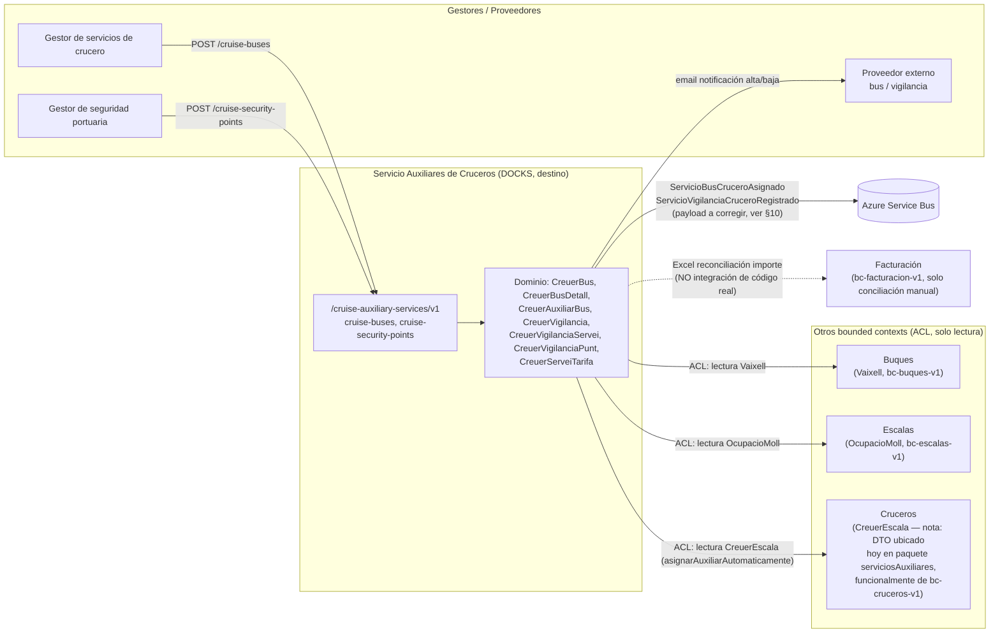

# [IA-GEN] Dossier — Servicios Auxiliares de Cruceros

> **Borrador generado por IA** (APB AI Framework — síntesis de apb-disc-spec-gen-v1.0/apb-pm-product-analysis-v1.0/apb-arch-c4-model-v1.0/apb-arch-decompose-v1.0) — pendiente validación humana. No distribuir sin revisión.

## 1. Cabecera

- **Nombre**: Servicios Auxiliares de Cruceros
- **Dominio DDD**: `dom-cruceros-v1` — dominio de negocio de primer nivel ya existente en `apb-domain-catalog` (no anidado bajo Operaciones Marítimas: "Decisión B (Débora): dominio propio... por su lenguaje (rotación/frecuencia/acuerdo comercial) y stakeholders distintos", `catalog-comparison.md:26`)
- **Fase del roadmap**: 6 (nueva — bounded context descubierto en la auditoría de cobertura 2026-07-13, sin ticket Jira de módulo propio)
- **Estado**: DISCOVERED — bounded context propuesto, con evidencia de código verificada campo a campo contra el checkout real de `SOSTRAT-Sostrat-MJ8`
- **Bounded context de origen**: `proposals/bc-servicios-auxiliares-cruceros-v1.md`
- **Épica**: `jira-backlog.md` EPIC-18 — Extracción Servicios Auxiliares de Cruceros

## 2. Resumen ejecutivo

Servicios Auxiliares de Cruceros gestiona dos servicios en tierra que se contratan a proveedores externos para las escalas de crucero de un día dado en el puerto: buses de traslado de pasajeros y vigilancia/seguridad en muelle, junto con las tarifas de ambos. Es un módulo pequeño en número de rutas (**15 confirmadas, no 4 Actions como sugería la propuesta original sino 8**) pero con una cantidad de lógica de negocio desproporcionada para su tamaño: ~6.800 líneas en las 8 clases `Action` y ~7.100 líneas más en sus 7 implementaciones de servicio (`CN_*_Impl`), con reglas como asignación automática de proveedor auxiliar y generación de correos electrónicos a proveedores.

**Hallazgo nuevo y de mayor impacto de esta verificación**: los campos `numescala`/`anyescala`/`ocupacio` (bus) y `numescala`/`anyescala`/`moll` (vigilancia) que aparecen en `specs/openapi-servicios-auxiliares-cruceros.yaml`, `events-catalog.md`, `api-surface-by-phase.md` y `ui-screens-backlog.md` **no existen en ninguno de los DTOs reales** (`CreuerBus.java`, `CreuerVigilanciaPunt.java`, ni en la vista `VTcCreuerBus.java`). `CreuerBus`/`CreuerVigilancia` son agregados **por día natural** (campo `dia`/`data`), no por escala individual — un mismo bus o servicio de vigilancia puede cubrir varias escalas de crucero del mismo día. `CreuerVigilanciaPunt` es un catálogo maestro de puntos físicos de vigilancia (`idsubport`/`idzonaport`), reutilizable entre escalas, sin ningún vínculo directo a una escala concreta. La vinculación real con la escala de crucero se produce a nivel de servicio (`CN_CruceroAuxiliarBus_Impl.java` importa `CreuerEscalaDao`) y de planificación (`CreuerDia.java`, `PlanificacionCrucerosDTO.java`), no como columna en `CREUER_BUS`/`CREUER_VIGILANCIA_PUNT`. Los cuatro documentos citados necesitan una segunda iteración antes de considerarse grounded (ver §9/§14).

**Segundo hallazgo relevante**: la entidad real "escala de crucero" (`CreuerEscala.java`, tabla `CREUER_ESCALA`, con `consignatari`/`armador`/`confirmada`/`idocupacio`) está **físicamente ubicada en el paquete Java `dataaccess.dto.serviciosAuxiliares`**, no en `dataaccess.dto.cruceros` — pero sus Actions (`CreuerEscalaAction`, `CreuerEscalaMovimientosAction`) y su servicio (`service.cruceros.CN_CreuerEscala`) pertenecen al paquete `cruceros`, no a `serviciosAuxiliares`. Es una anomalía de organización de paquetes del código legacy, no una superposición real de bounded contexts — pero debe documentarse explícitamente para que el futuro microservicio de Servicios Auxiliares no incluya por error la tabla `CREUER_ESCALA` (que pertenece a `bc-cruceros-v1`).

## 3. Análisis funcional

### Responsabilidad de negocio
Gestión de dos servicios auxiliares en tierra para escalas de crucero — buses de traslado de pasajeros y vigilancia/seguridad en muelle —, sus tarifas, y un informe de reconciliación de importes.

### Actores
- Gestor de servicios de crucero (planifica y da de alta buses de traslado para un día).
- Gestor de seguridad portuaria (registra puntos y servicios de vigilancia en muelle).
- Proveedor externo (`idprestador`; recibe notificaciones por correo electrónico al asignársele o retirársele un servicio — `enviarEmailProveedorEliminar`, `generarContenidoCorreoInformacionAuxiliar`, `CN_CruceroAuxiliarBus_Impl.java`).
- Gestor de facturación/administración (revisa el Excel de `ComprobarFacturasAction` para conciliar importes manualmente — ver nota de alcance en §4).

### Casos de uso reales (grounded en las 15 rutas Struts confirmadas de `struts-config.xml:554-592`, mapeadas a 8 clases `Action`, no 4)

| Ruta(s) | Action | Descripción |
|---|---|---|
| `/cruceroBus`, `/cruceroBus_popup` | `CruceroBusAction` (1.340 líneas) | Alta/gestión de un bus de traslado para un día (`dia`, `festiu`, `horenvsolicitud`, `observacions`). |
| `/cruceroBusDetalle`, `/cruceroBusDetalle_popup` | `CruceroBusDetalleAction` (570 líneas) | Detalle/ocupación del bus por subíndice (`CreuerBusDetall`: `quantitat`, `horainici/horafin`, `durada`, `idprestador`, `idtarifa`). |
| `/cruceroAuxiliarBus`, `/cruceroAuxiliarBus_popup` | `CruceroAuxiliarBusAction` (1.057 líneas) | Asignación del proveedor/tarifa/horario auxiliar al bus (`CreuerAuxiliarBus`), con **asignación automática de proveedor** (`asignarAuxiliarAutomaticamente`, `CN_CruceroAuxiliarBus.java:214`) y envío de email al proveedor en alta/baja. |
| `/cruceroVigilancia`, `/cruceroVigilancia_popup` | `CruceroVigilanciaAction` (1.019 líneas) | Alta/gestión de un servicio de vigilancia para un día (`CreuerVigilancia`: `data`, `festiu`, `horenvsolicitud`). |
| `/cruceroVigilanciaServicio`, `/cruceroVigilanciaServicio_popup` | `CruceroVigilanciaServicioAction` (556 líneas) | Asignación de proveedor/tarifa/horario a un punto de vigilancia concreto (`CreuerVigilanciaServei`: `idpuntvigilancia`, `idprestador`, `idtarifa`, `auxvigilant`). |
| `/puntosVigilancia`, `/puntosVigilancia_popup` | `CruceroPuntoVigilanciaAction` (414 líneas) | Mantenimiento del catálogo maestro de puntos de vigilancia (`CreuerVigilanciaPunt`: `idpuntvigilancia`, `nompuntvigilancia`, `idsubport/idzonaport`) y sus muelles/alineaciones asociadas (`CreuerVigilanciaPuntMoll`). **No está ligado a una escala concreta** — es dato maestro reutilizable. |
| `/serviciosAuxiliares`, `/serviciosAuxiliares_popup` | `TarifasServAuxAction` (461 líneas) | Mantenimiento de tarifas de servicios auxiliares (`CreuerServeiTarifa`: PK `idprestador`+`idtarifa`, sin más campos propios — tabla de enlace/catálogo). |
| `/comprobarFacturas` | `ComprobarFacturasAction` (1.390 líneas) | Genera un Excel (`CreuerBusExcel.java`, comentario fuente: *"Clase utilizada para la creación el excel de comprobar factura"*) con el **importe estimado** de bus/vigilancia calculado a partir de la tarifa aplicable — ver corrección de alcance en §4. |

### Qué NO incluye
- No gestiona la escala de crucero en sí. La entidad `CreuerEscala` (tabla `CREUER_ESCALA`) — pese a residir físicamente en el paquete `dataaccess.dto.serviciosAuxiliares` (anomalía, ver §7) — es controlada por Actions y servicio del paquete `cruceros` (`mvc.control.cruceros.CreuerEscalaAction`, `service.cruceros.CN_CreuerEscala`), no por este módulo.
- No gestiona el buque (`Vaixell`) ni la ocupación de muelle/atracada (`OcupacioMoll`) — ambos se consumen en modo lectura (ver §7, dependencias confirmadas).
- **No emite ni concilia facturas reales de Facturación** — `ComprobarFacturasAction.java` no importa ninguna clase del dominio de facturas (`grep` de imports confirmó cero coincidencias); genera un Excel con un importe **calculado localmente** a partir de `CreuerServeiTarifa`, no una consulta a `bc-facturacion-v1`. Corrige la nota `"Toca tangencialmente Facturación"` de `bc-servicios-auxiliares-cruceros-v1.md:47` y la historia de usuario 3 de `jira-backlog.md` EPIC-18 (ver §14).

## 4. Alcance de migración — qué se migra y qué NO por no estar en uso

- **Se migran las 15 rutas Struts confirmadas** (`struts-config.xml` líneas 554-563, 569-572, 592 — recuento exacto, coincide con `coverage-audit.md:46` "serviciosAuxiliares | 15 | bc-servicios-auxiliares-cruceros-v1").
- **Corrección respecto a `bc-servicios-auxiliares-cruceros-v1.md:74`**: el módulo tiene **8 clases `Action`** (`CruceroBusAction`, `CruceroBusDetalleAction`, `CruceroAuxiliarBusAction`, `CruceroVigilanciaAction`, `CruceroVigilanciaServicioAction`, `CruceroPuntoVigilanciaAction`, `TarifasServAuxAction`, `ComprobarFacturasAction`), no las 4 citadas en la nota de la propuesta original (`CruceroBusAction`, `CruceroVigilanciaAction`, `TarifasServAuxAction`, `ComprobarFacturasAction`) — faltaban `CruceroBusDetalleAction`, `CruceroAuxiliarBusAction`, `CruceroVigilanciaServicioAction` y `CruceroPuntoVigilanciaAction`, que en conjunto son responsables de una parte sustancial de la lógica de negocio real del módulo (asignación de proveedor, cálculo de duración, catálogo de puntos de vigilancia).
- **No se ha encontrado código muerto en este módulo**: búsqueda explícita de comentarios tipo "NO SE USA"/"obsoleto"/"@Deprecated" en `mvc/control/serviciosAuxiliares/` y `service/serviciosAuxiliares/` (Actions + interfaces + impls) — **cero coincidencias**. Consistente con la ausencia de este módulo en `dead-code-register.md`. No se propone ninguna adición a ese registro.
- **`ComprobarFacturasAction` se migra, pero como generador de informe de reconciliación autocontenido**, no como integración con Facturación — no hay ninguna dependencia de código a migrar hacia `bc-facturacion-v1` en esta Action (ver §3, §14).
- El catálogo de puntos de vigilancia (`CreuerVigilanciaPunt`/`CreuerVigilanciaPuntMoll`) es dato maestro de bajo volumen — se migra íntegro, sin partición.

## 5. Modelo de datos

Todos los campos siguientes están extraídos directamente de los DTOs reales en `sostrat/src/org/apb/sostrat/dataaccess/dto/serviciosAuxiliares/` del checkout `SOSTRAT-Sostrat-MJ8`.

### `CreuerBus` (tabla `CREUER_BUS`, PK `idcrebus`)
`idcrebus` (Long), `dia` (Date), `festiu` (String), `horenvsolicitud` (Date), `observacions`, `obsinternes`, `maxsubindex` (Integer — control de subíndice máximo del servicio), campos de auditoría estándar (`idopealta/idopemodificacio/datalta/datmodificacio/idprocalta/idprocmodificacio/guid`). Relaciones de objeto: `List<CreuerBusDetall> creuerBusDetall` (1:N) y `CreuerAuxiliarBus creuerAuxiliarBus` (1:1). **No tiene `numescala`/`anyescala`/`ocupacio` como columnas propias.**

### `CreuerBusDetall` (tabla `CREUER_BUS_DETALL`, PK `idcrebus`+`subindex`)
`quantitat` (Integer — este es el campo real de "ocupación", no `ocupacio`), `horainici`/`horafin` (Integer), `durada` (Integer), `auxiliar` (String), `idprestador`, `idtarifa`, más auditoría.

### `CreuerAuxiliarBus` (tabla `CREUER_AUXILIAR_BUS`, PK `idcrebus`)
`idprestador`, `idtarifa`, `horainici`/`horafin` (Integer), `durada`, `quantitat`, `horenvsolicitud`, `observacions`, `obsinternes`, `cobrador` (Integer), más auditoría. Es el registro de "quién presta el servicio y a qué tarifa" para un `CreuerBus` dado.

### `CreuerVigilancia` (tabla `CREUER_VIGILANCIA`, PK `idcrevigilancia`)
`data` (Date), `festiu`, `horenvsolicitud`, `observacions`, `obsinternes`, auditoría. Relación `List<CreuerVigilanciaServei>` (1:N). Mismo patrón "por día" que `CreuerBus` — **tampoco tiene `numescala`/`anyescala`**.

### `CreuerVigilanciaServei` (tabla `CREUER_VIGILANCIA_SERVEI`, PK `idcrevigilancia`+`idpuntvigilancia`)
`idprestador`, `idtarifa`, `horainici`/`horafin` (Integer), `durada`, `quantitat`, `horenvsolicitud`, `auxvigilant` (Integer). Vincula un servicio de vigilancia del día con un punto de vigilancia concreto del catálogo maestro.

### `CreuerVigilanciaPunt` (tabla `CREUER_VIGILANCIA_PUNT`, PK `idpuntvigilancia`, Integer)
`nompuntvigilancia` (String), `datbaixa` (Date — baja lógica), `idsubport`, `idzonaport` (localización física en el recinto), auditoría, `CreuerVigilanciaPuntMoll[] alineaciones`. **Dato maestro/catálogo, sin columna de escala ni de día.**

### `CreuerVigilanciaPuntMoll` (tabla `CREUER_VIGILANCIA_PUNT_MOLL`, PK `idpuntvigilancia`+`idsubport`+`idporta`)
Clase ligera (no extiende `DtoGenerico`/`MiniAuditoriaConcurrencia`): `idpuntvigilancia`, `idsubport`, `idporta` (Long). Enlaza un punto de vigilancia con una puerta/muelle físico.

### `CreuerServeiTarifa` (tabla `CREUER_SERVEI_TARIFA`, PK `idprestador`+`idtarifa`)
Solo esos dos campos — tabla de enlace/catálogo, sin atributos propios de precio en este DTO (el precio se resuelve en otra parte del maestro de tarifas, no verificado en esta pasada — ver §14).

### `CreuerDia` (solo lectura, sin tabla propia declarada en el DTO — vista de planificación)
`nomvaixell`, `descalineacio`, `horaini/horafin`, `embarcament/desembarcament/transit` (Integer), `idvaixell`, `idocupacio`, `inici/fi`, `cobertura` (Float), `idalineacio` — es el DTO que sí cruza información de escalas/buques del día para ayudar a planificar buses/vigilancia, usado por `CN_CruceroBus_Impl.java` vía `CreuerDiaDao`.

### Nota de anomalía de paquete (no confundir con el modelo de este BC)
`CreuerEscala.java` (tabla `CREUER_ESCALA`, 1.218 líneas — PK `idesccreuer`, campos `idocupacio`, `consignatari`, `armador`, `confirmada`, `datsolicitud`, `datdecisio`, `mejorestimacionembarque/desembarcament/transit`...) y `CreuerEscalaDoc.java` (tabla `CREUER_ESCALA_DOC`) están ubicados en el paquete `dataaccess.dto.serviciosAuxiliares`, pero pertenecen funcionalmente a `bc-cruceros-v1` (sus Actions viven en `mvc.control.cruceros`, su servicio en `service.cruceros.CN_CreuerEscala`). **No se incluyen en el modelo de datos de este BC** — ver §7.

### Mapeo a Azure SQL
Migración directa tabla-a-tabla: `CREUER_BUS`, `CREUER_BUS_DETALL`, `CREUER_AUXILIAR_BUS`, `CREUER_VIGILANCIA`, `CREUER_VIGILANCIA_SERVEI`, `CREUER_VIGILANCIA_PUNT`, `CREUER_VIGILANCIA_PUNT_MOLL`, `CREUER_SERVEI_TARIFA` como agregados/entidades propias. No se ha diseñado el esquema Azure SQL definitivo en esta pasada.

## 6. Arquitectura técnica

Stack DOCKS (.NET, Azure SQL, EntraID, Service Bus, APIM), servicio dedicado tras `/cruise-auxiliary-services/v1` (`specs/openapi-servicios-auxiliares-cruceros.yaml:19`).

Dado que el servicio consume datos de otros dominios en modo lectura (Buques, Escalas y, transitivamente, Cruceros — ver §7), debe implementarse como **consumidor vía ACL/eventos**, no con acceso directo a las tablas `VAIXELL`/`OCUPACIO_MOLL`/`CREUER_ESCALA` del origen legacy. El envío de emails a proveedores (`CN_CruceroAuxiliarBus_Impl.java`) debe migrarse a un servicio de notificación desacoplado (consistente con `dom-transversal-arq-v1`, ya usado como referencia en otros dossiers de esta serie), no reimplementarse como lógica de envío SMTP embebida en el dominio.

## 7. Dominio DDD

- **Bounded context**: `bc-servicios-auxiliares-cruceros-v1`, `parent_domain: dom-cruceros-v1` (`proposals/bc-servicios-auxiliares-cruceros-v1.md`).
- **`dom-cruceros-v1` es un dominio de negocio de primer nivel ya confirmado en el catálogo real**, no anidado bajo Operaciones Marítimas — decisión explícita de negocio citada en `catalog-comparison.md:26`: *"dominio propio, no subdominio de Operaciones Marítimas, por su lenguaje (rotación/frecuencia/acuerdo comercial) y stakeholders distintos"*. El `parent_domain` de esta propuesta ya está bien encajado, sin bloqueo de diseño pendiente.
- **No existe todavía un dossier principal de "Cruceros"** en `discovery/ddd-sostrat-mj8/app-dossiers/` (verificado por listado del directorio: hay dossiers 00 a 17 más este 18, ninguno dedicado a Cruceros como app principal) — este dossier documenta el BC satélite (buses/vigilancia), no el BC principal (`bc-cruceros-v1`, agregado `CreuerEscalaAudit` + la entidad real `CreuerEscala`, ver más abajo). **No se genera aquí** por estar fuera del alcance de esta tarea; se deja como nota explícita para el equipo.
- **Relación con `bc-cruceros-v1`**: la propuesta original declara un patrón `conformist`/`downstream` respecto a `bc-cruceros-v1` (`bc-servicios-auxiliares-cruceros-v1.md:31-38`). La evidencia de código confirma que la dependencia real y verificable **no es con `CreuerEscalaAudit`** (el único agregado documentado hoy en `bc-cruceros-v1.md`), sino con tres cosas distintas, todas confirmadas por import directo:
  1. **`Vaixell`** (Buques) — `CN_CruceroBusDetalle_Impl.java:31` importa `org.apb.sostrat.dataaccess.dto.Vaixell` directamente.
  2. **`OcupacioMoll`** (Escalas/atracada) — `CN_CruceroBusDetalle_Impl.java:32` y `CN_CruceroVigilancia_Impl.java:43` importan `org.apb.sostrat.dataaccess.dto.escalas.OcupacioMoll` y su DAO directamente.
  3. **`CreuerEscala`** (la escala de crucero real, no `CreuerEscalaAudit`) — `CN_CruceroAuxiliarBus_Impl.java:36` importa `org.apb.sostrat.dataaccess.dao.serviciosAuxiliares.CreuerEscalaDao` directamente, y `CN_CruceroAuxiliarBus.java:212-216` (`asignarAuxiliarAutomaticamente`) declara `throws ... CreuerEscalaDaoException` en su firma.
- **Anomalía de organización de paquetes, verificada y a documentar para evitar mala interpretación futura**: `CreuerEscala.java` (tabla `CREUER_ESCALA`) y `CreuerEscalaDoc.java` (tabla `CREUER_ESCALA_DOC`) están físicamente en el paquete `dataaccess.dto.serviciosAuxiliares`, pero sus Actions (`CreuerEscalaAction`, `CreuerEscalaMovimientosAction`, `CreuerEscalaRepresentacioAction` — rutas `/cruceroEscalaOOPP`, `/cruceroEscalaConsig`, `/planificacionCruceros`, `/cruceroEscalaMovimientosOOPP/Consig`, `struts-config.xml:567-581`) y su servicio (`service.cruceros.CN_CreuerEscala`/`CN_CreuerEscala_Impl`) pertenecen al paquete `cruceros`. Estas 8 rutas **ya están contadas dentro de las 19 rutas del módulo `cruceros`** en `coverage-audit.md:45`, no dentro de las 15 de `serviciosAuxiliares` — confirmado por `grep` de `type="org.apb.sostrat.mvc.control.*"` en `struts-config.xml`, sin solapamiento de rutas entre ambos módulos. **No hay solapamiento real de bounded contexts**, solo una tabla de datos ubicada en el paquete Java equivocado — pero cualquier futuro dossier de `bc-cruceros-v1` debe saber que su entidad principal (`CreuerEscala`) vive en `dataaccess/dto/serviciosAuxiliares/CreuerEscala.java`, no en `dataaccess/dto/cruceros/`.
- **Verificación de no-duplicación con otros BC nuevos de la auditoría**: `coverage-audit.md:46` clasifica las 15 rutas del módulo `serviciosAuxiliares` en exclusiva bajo `bc-servicios-auxiliares-cruceros-v1`, sin repartirse con `bc-inspeccion-scpp-v1`, `bc-tramites-cliente-v1` ni ningún otro BC de Fase 6.

## 8. Pantallas UI

`ui-screens-backlog.md:132-134` propone solo 2 pantallas para este BC, **con columnas que no están grounded en los DTOs reales** (usan `numescala/anyescala`/`ocupacio`/`moll`, inexistentes — ver §2/§5):

1. **Listado de Buses de Traslado** (`dxDataGrid`) — columnas propuestas incorrectas (`numescala/anyescala`, `ocupacio`). **Columnas corregidas grounded**: `dia`, `festiu`, `horenvsolicitud`, `observacions` (cabecera `CreuerBus`) + pestaña de detalle con `subindex`/`quantitat`/`horainici-horafin`/`idprestador`/`idtarifa` (`CreuerBusDetall`).
2. **Listado de Puntos de Vigilancia** (`dxDataGrid`) — columnas propuestas incorrectas (`idpuntvigilancia`, `moll`, `numescala/anyescala`). **Columnas corregidas grounded**: `idpuntvigilancia`, `nompuntvigilancia`, `idsubport`, `idzonaport`, `datbaixa` (catálogo maestro, sin columna de escala).

**Pantallas ausentes del backlog, pese a tener Action y volumen de lógica de negocio dedicados**: Asignación de Auxiliar de Bus (`CreuerAuxiliarBus`, con el flujo de asignación automática y notificación por email), Servicio de Vigilancia por Punto (`CreuerVigilanciaServei`), Tarifas de Servicios Auxiliares (`CreuerServeiTarifa`/`TarifasServAuxAction`), e Informe de Reconciliación (`ComprobarFacturasAction`, exportación Excel).

## 9. APIs

| Método | Ruta | Descripción | Grounded en |
|---|---|---|---|
| GET | `/cruise-buses` | Listar buses de traslado (filtros `numescala`/`anyescala` — **no grounded**, ver nota) | `CreuerBus.java` |
| POST | `/cruise-buses` | Registrar un bus de traslado | `CreuerBus.java` |
| GET | `/cruise-security-points` | Listar puntos de vigilancia (filtros `numescala`/`anyescala` — **no grounded**, ver nota) | `CreuerVigilanciaPunt.java` |
| POST | `/cruise-security-points` | Registrar un punto de vigilancia | `CreuerVigilanciaPunt.java` |

Contrato: `specs/openapi-servicios-auxiliares-cruceros.yaml`. **Gaps confirmados en esta verificación**:
- Los esquemas `CruiseBus`/`CruiseBusCreate` (`openapi-...yaml:126-145`) declaran `numescala`, `anyescala`, `ocupacio` como propiedades de `CreuerBus` — **ninguno de los tres existe en el DTO fuente real**. El campo de ocupación real es `CreuerBusDetall.quantitat`, y no hay ningún campo de escala en `CreuerBus`.
- Los esquemas `CruiseSecurityPoint`/`CruiseSecurityPointCreate` (líneas 146-165) declaran `numescala`, `anyescala`, `moll` — tampoco existen en `CreuerVigilanciaPunt`. El campo real más cercano a "moll" es `CreuerVigilanciaPuntMoll` (vía `idsubport`+`idporta`), y no hay columna de escala en absoluto: `CreuerVigilanciaPunt` es catálogo maestro.
- Los parámetros de filtro `numescala`/`anyescala` en `GET /cruise-buses` y `GET /cruise-security-points` (líneas 35-40, 81-86) no corresponden a ningún campo filtrable real de esas dos entidades.
- **No cubre en absoluto** `CreuerAuxiliarBus`, `CreuerVigilanciaServei`, `CreuerServeiTarifa` ni el informe de `ComprobarFacturasAction` — pese a que `CreuerAuxiliarBus`/`CreuerVigilanciaServei` son los agregados con la lógica de negocio real (asignación de proveedor, tarifa, notificación). Antes de implementar, este contrato necesita una segunda iteración con los campos verificados en §5.

## 10. Eventos

| Evento | Trigger | Payload (según `events-catalog.md:723-727`) | Corrección grounded |
|---|---|---|---|
| `ServicioBusCruceroAsignado` | Asignación de auxiliar a un bus (`CreuerAuxiliarBus`) | `{ idcreuerbus, numescala, anyescala, ocupacio }` | **`numescala`/`anyescala`/`ocupacio` no existen en el DTO fuente.** Payload real grounded: `{ idcrebus, dia, idprestador, idtarifa, horainici, horafin, quantitat }` (`CreuerBus`+`CreuerAuxiliarBus`). |
| `ServicioVigilanciaCruceroRegistrado` | Registro de servicio de vigilancia (`CreuerVigilanciaServei`) | Mismo payload que arriba (compartido, según la fuente) | Payload real grounded: `{ idcrevigilancia, idpuntvigilancia, idprestador, idtarifa, horainici, horafin, quantitat, auxvigilant }`. |

Canal: no se especifica un canal AMQP dedicado para Fase 6 en ningún documento existente (`asyncapi-fase2.yaml` cubre solo Fase 2). **Gap**: no existe todavía un `asyncapi-fase6.yaml` ni sección equivalente para los 6 BC de la auditoría de cobertura — pendiente de una iteración de discovery dedicada a Fase 6 (ver §13/§14).

## 11. Diagrama topológico (C4 nivel 1)

## 12. Estrategia de convivencia con el modelo actual

1. **Strangler fig sobre las 15 rutas**, agrupando por sub-agregado: primero el catálogo maestro de puntos de vigilancia y tarifas (`CruceroPuntoVigilanciaAction`, `TarifasServAuxAction` — bajo acoplamiento, sin lógica de negocio compleja), después buses/vigilancia del día (`CruceroBusAction`, `CruceroVigilanciaAction`) y por último la asignación de proveedores (`CruceroAuxiliarBusAction`, `CruceroVigilanciaServicioAction` — mayor lógica embebida: asignación automática, email).
2. **Secuenciar después (o junto con) la extracción de Buques y Escalas**: la dependencia directa confirmada con `Vaixell`/`OcupacioMoll` (§7) significa que este servicio no puede desplegarse de forma aislada sin una ACL estable hacia esos dos bounded contexts — coordinarlo con `bc-buques-v1`/Escalas antes de comprometer fecha de cutover.
3. **No dar por cerrado el límite con `bc-cruceros-v1` hasta que exista su dossier principal**: dado que la entidad real `CreuerEscala` vive físicamente en el paquete `serviciosAuxiliares` (§7), cualquier extracción automatizada por paquete Java corre el riesgo de arrastrar por error la tabla `CREUER_ESCALA` a este microservicio. Requiere una decisión explícita de Arquitectura APB documentada antes de generar el esquema Azure SQL definitivo.
4. **`ComprobarFacturasAction` se puede migrar de forma independiente y sin coordinación con Facturación** — al no tener dependencia de código real con ese dominio (§3), es un candidato de bajo riesgo/"quick win" dentro de la Fase 6.
5. **Externalizar el envío de emails a proveedores** a un servicio de notificación transversal (`dom-transversal-arq-v1`) en lugar de reimplementar lógica SMTP dentro del dominio — actualmente embebida en `CN_CruceroAuxiliarBus_Impl.java`.

## 13. Testing y seguridad

- **No existe todavía una `testing-strategy-fase6.md` ni un `threat-model-fase6.md`** — verificado por listado de ficheros del directorio raíz de discovery (`testing-strategy-fase2-4.md` y `threat-model-fase0-1.md`/`threat-model-fase2-4.md` cubren solo Fases 0-4). **Gap explícito**: los 6 BC de Fase 6 (incluido este) no tienen todavía una estrategia de testing/threat model dedicada; se recomienda aplicar como base la pirámide de `testing-strategy-fase2-4.md` (Unit 60% / Contract 20% / Integration 15% / E2E 5%) hasta que exista una versión Fase 6 propia.
- Casos de test sugeridos (grounded en reglas reales del código, no genéricos):
  - Unit: `POST /cruise-buses` sin `dia` debe rechazarse; `asignarAuxiliarAutomaticamente` no debe asignar un proveedor si no cumple las condiciones de negocio (`CN_CruceroAuxiliarBus.java:199-216`).
  - Contract: el payload real de `ServicioBusCruceroAsignado`/`ServicioVigilanciaCruceroRegistrado` debe corregirse antes de fijar el esquema AsyncAPI (§10).
  - Integration: ACL hacia `OcupacioMollDao`/`VaixellDao`/`CreuerEscalaDao` con test doubles, nunca las tablas legacy reales en CI.
- **Ningún campo de credencial identificado** en los 8 DTOs de este módulo leídos campo a campo (§5) — confirmado, sin campos de contraseña/token.
- Los correos electrónicos a proveedores (`enviarEmailProveedorEliminar`, `enviarDatosUnicoEmail`) contienen datos de contacto de terceros (`idprestador`) — sin evidencia de cifrado o de tratamiento especial en el código legacy; a evaluar si aplica algún requisito de protección de datos de terceros en el diseño destino.

## 14. Riesgos y gaps de evidencia conocidos

- **Dependencia cruzada de gobernanza, no de datos (2026-07-14)**: el mismo dominio padre `dom-cruceros-v1` ya tiene un ecosistema .NET real y activo (`APB.API.CRE`, `APB.APP.CRE`, `APB.API.VXL`, `APB.API.SLC`, ~3 meses de desarrollo) que gestiona reservas de atraque de crucero — verificado sin solapamiento de datos con este BC (buses/vigilancia son una sub-capacidad distinta). Sin embargo, el dossier de aplicación final de `bc-cruceros-v1` (pendiente de escribir) debe tenerlo en cuenta: gran parte de lo que ese dossier documentaría ya está construido, no es un candidato a extracción futura. Ver `EXTERNAL_CONSUMERS_AUDIT.md §2` fila 8 y §3.
- **Corrección de alcance de Actions**: la propuesta original citaba 4 Actions; son 8 (§4).
- **Corrección de modelo de datos, de mayor impacto**: 4 documentos (`specs/openapi-servicios-auxiliares-cruceros.yaml`, `events-catalog.md`, `api-surface-by-phase.md`, `ui-screens-backlog.md`) modelan `CreuerBus`/`CreuerVigilanciaPunt` con campos (`numescala`, `anyescala`, `ocupacio`, `moll`) que no existen en los DTOs/vistas reales — corregido campo a campo en §5/§8/§9/§10. Recomendación: regenerar esos 4 artefactos con el modelo verificado de este dossier antes de implementación.
- **Anomalía de paquete `CreuerEscala`/`CreuerEscalaDoc`**: DTOs de `bc-cruceros-v1` ubicados en el paquete `dataaccess.dto.serviciosAuxiliares` — riesgo real de que una extracción automatizada por paquete Java incluya por error la tabla `CREUER_ESCALA` en el microservicio de Servicios Auxiliares (§7).
- **`ComprobarFacturasAction` no es una integración real con Facturación**: sin imports del dominio de facturas confirmados; corrige la nota de `bc-servicios-auxiliares-cruceros-v1.md:47` y la historia de usuario 3 de `jira-backlog.md` EPIC-18 ("para conciliar contra Facturación") — debería redactarse como "generar un informe local de importe estimado para conciliación manual", no como integración de sistemas.
- **No existe todavía un dossier principal de Cruceros** (`bc-cruceros-v1`) en esta serie — este BC satélite depende conceptualmente de él, pero no puede citarse como referencia completa hasta que se genere (§7).
- **`CreuerServeiTarifa` no expone campo de precio en el DTO leído** — el cálculo de importe de `ComprobarFacturasAction`/`CreuerBusExcel` (`precioFijo`, `precioHoraNormal`, `precioHoraExtra`) debe resolverse en otra clase/vista no verificada en esta pasada — pendiente de rastrear el origen exacto del precio antes de fijar el modelo de dominio de tarifas.
- **No existe `testing-strategy-fase6.md`/`threat-model-fase6.md`** para ninguno de los 6 BC de la auditoría de cobertura, incluido este (§13).
- Clases de tamaño considerable sin llegar a "god class" (`CN_CruceroBus_Impl.java` 1.866 líneas, `CN_CruceroAuxiliarBus_Impl.java` 1.629 líneas, `ComprobarFacturasAction.java` 1.390 líneas) — no bloquean la migración pero deberían descomponerse por responsabilidad (planificación / asignación de proveedor / notificación / exportación) durante la extracción, no trasladarse tal cual.

## 15. Estimación de esfuerzo

Ver `jira-backlog.md` EPIC-18 (3 historias, 13 pts):
1. Registrar bus de traslado con ocupación (`CreuerBusDetall`) — 5 pts.
2. Registrar puntos de vigilancia en muelle — 5 pts.
3. Exportar facturas asociadas a servicios auxiliares (`ComprobarFacturasAction`) — 3 pts.

**Notas de esta verificación**:
- La historia 3 debe re-redactarse: no hay integración de código con Facturación que "migrar" — es la generación de un informe local de importe estimado (§14). No cambia la estimación de puntos, pero sí el criterio de aceptación.
- No estimado en `jira-backlog.md`: el esfuerzo de las 4 Actions no citadas en la propuesta original (`CreuerAuxiliarBus`, `CreuerVigilanciaServei`, `CreuerVigilanciaPunt` como catálogo maestro, `CreuerServeiTarifa`) — pendiente de una historia de usuario adicional antes de considerar el EPIC-18 completo, dado que concentran la asignación automática de proveedor y el envío de notificaciones.
- Tarea técnica pendiente ya señalada en `jira-backlog.md:397`: confirmar con negocio si este servicio se despliega junto con Cruceros (Fase 5/ARGOS) o de forma independiente — la evidencia de este dossier (dependencia directa a `CreuerEscala`, §7) es un argumento a favor de coordinarlo con la extracción de Cruceros, no de tratarlo como completamente independiente.

## 16. Checklist de validación

**Funcional**:
- [ ] Confirmar con negocio el origen real del precio de tarifa (`precioFijo`/`precioHoraNormal`/`precioHoraExtra` en `CreuerBusExcel`) — no localizado en `CreuerServeiTarifa.java`.
- [ ] Confirmar si `ComprobarFacturasAction` debe evolucionar a una integración real con Facturación en el diseño destino, o mantenerse como informe de reconciliación manual.
- [ ] Decidir con Arquitectura APB si el servicio se despliega junto con Cruceros (Fase 5/ARGOS) o de forma independiente (tarea técnica ya abierta en `jira-backlog.md` EPIC-18).
- [ ] Validar con negocio las 4 pantallas/recursos ausentes del backlog (Auxiliar de Bus, Servicio de Vigilancia por Punto, Tarifas, Informe de Reconciliación).

**Desarrollo**:
- [ ] Regenerar `specs/openapi-servicios-auxiliares-cruceros.yaml`, `events-catalog.md` §17, `api-surface-by-phase.md` §Fase 6 y `ui-screens-backlog.md` §Servicios Auxiliares de Cruceros con el modelo de datos verificado en §5 (eliminar `numescala`/`anyescala`/`ocupacio`/`moll` inexistentes).
- [ ] Confirmar con Arquitectura APB el tratamiento de la anomalía de paquete `CreuerEscala`/`CreuerEscalaDoc` (§7) antes de generar el esquema Azure SQL definitivo, para no arrastrar por error `CREUER_ESCALA` a este microservicio.
- [ ] Redactar `testing-strategy-fase6.md`/`threat-model-fase6.md` (o extender los de Fase 2-4) para cubrir los 6 BC de la auditoría de cobertura, incluido este.
- [ ] Diseñar el mecanismo de notificación a proveedores externos como servicio transversal, no como lógica SMTP embebida en el dominio.

## 17. Historial de cambios

| Versión | Fecha | Autor | Cambio |
|---------|-------|-------|--------|
| 1.0.0 | 2026-07-13 | APB AI Framework | Dossier inicial, a petición explícita del usuario. Verificado campo a campo contra el checkout real de `SOSTRAT-Sostrat-MJ8` (8 DTOs, 8 Actions, 7 servicios `CN_*`, `struts-config.xml`). Corrige el número de Actions (8, no 4), corrige el modelo de datos de `openapi-servicios-auxiliares-cruceros.yaml`/`events-catalog.md`/`api-surface-by-phase.md`/`ui-screens-backlog.md` (campos `numescala`/`anyescala`/`ocupacio`/`moll` inexistentes en los DTOs reales), documenta la anomalía de paquete de `CreuerEscala`/`CreuerEscalaDoc` (pertenecen a `bc-cruceros-v1` pero están en el paquete Java `serviciosAuxiliares`), y corrige el alcance de `ComprobarFacturasAction` (sin integración de código real con Facturación) |
