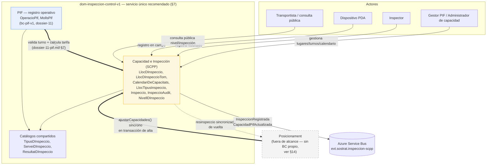

# [IA-GEN] Dossier — Capacidad e Inspección Fronteriza (SCPP)

> **Borrador generado por IA** (APB AI Framework — síntesis de apb-disc-spec-gen-v1.0/apb-pm-product-analysis-v1.0/apb-arch-c4-model-v1.0/apb-arch-decompose-v1.0) — pendiente validación humana. No distribuir sin revisión.

## 1. Cabecera

- **Nombre**: Capacidad e Inspección Fronteriza (SCPP)
- **Dominio DDD**: `dom-inspeccion-control-v1`
- **Fase del roadmap**: 6 (`jira-backlog.md` EPIC-19 — "evaluar mover a Fase 3, junto a EPIC-09, si se confirma la fusión")
- **Estado**: DISCOVERED — bounded context descubierto en la auditoría de cobertura 2026-07-13 (`coverage-audit.md` §1.3, "Inspeccio / LlocDInspeccio"), con la pregunta de fusión con `bc-pif-v1` **ahora resuelta con evidencia de código** en este dossier (ver §7)
- **Bounded context**: `proposals/bc-inspeccion-scpp-v1.md` (flagged explícitamente como candidato a fusión con `bc-pif-v1`)
- **BC hermano**: `proposals/bc-pif-v1.md` / `app-dossiers/dossier-11-pif.md` (ya contiene una verificación previa parcial del solapamiento, ampliada aquí)
- **Épica**: `jira-backlog.md` EPIC-19 ("Extracción Capacidad e Inspección Fronteriza (SCPP)"), dependiente de EPIC-09 ("Extracción MMPP y PIF")

## 2. Resumen ejecutivo

SCPP es la capa de **planificación y capacidad** del Puesto de Inspección Fronteriza: gestiona los lugares físicos de inspección (`LlocDInspeccio`, tabla `LLOC_D_INSPECCIO`), sus turnos y capacidad máxima diaria (`LlocDInspeccioTorn`), el calendario de capacidad ya consumida día a día (`CalendariDeCapacitats`, tabla `CALENDARI_DE_CAPACITATS` — **entidad no documentada en la propuesta original**), los tipos/niveles de inspección permitidos por lugar (`LlocTipusInspeccio` — **tampoco documentada originalmente**) y el registro del resultado formal de cada inspección concreta (`Inspeccio`, tabla `INSPECCIO`, con su catálogo `ResultatDInspeccio` y su auditoría de nivel `NivellDInspeccio`).

**Hallazgo central de este dossier — verificación en profundidad del solapamiento con PIF**: la pregunta abierta en `bc-inspeccion-scpp-v1.md` ("¿fusionar con `bc-pif-v1`?") ya había recibido una primera respuesta en `dossier-11-pif.md` (recomendación: un único servicio con dos agregados, por acoplamiento síncrono a nivel de `CN_OperacioPif_Impl`/`CN_AreaPif_Impl`). Esta verificación **confirma y refuerza** esa recomendación con tres piezas de evidencia nuevas, no citadas en `dossier-11-pif.md`:

1. **`LlocDInspeccio`/`Inspeccio` no son entidades genéricas reutilizadas por otros módulos de control** (aduanas, MMPP, sanidad). Una búsqueda de todas las referencias reales en el código (`grep -rl "LlocDInspeccio"` sobre `sostrat/src`, excluyendo su propio paquete DTO/DAO) muestra que **solo tres clústeres las usan**: PIF (`service/pif/*`, ya documentado), SCPP (su propio paquete) y **Posicionament** (`CN_Posicionament_Impl.java`, 1.873 líneas). Cero referencias desde `mmpp/`, `aduanas/`, `terminales/` o cualquier paquete de sanidad/control fitosanitario. Responde con evidencia negativa a la pregunta planteada: no es una entidad de "punto de inspección" genérica multi-dominio.
2. **El acoplamiento síncrono no es solo PIF↔SCPP, es también Posicionament↔SCPP, y es más profundo de lo documentado**: `CN_Posicionament_Impl.processarPosicionament(...)` invoca directamente `ServiceLocator.getCnCapacitatsInspeccio().ajustarCapacidades(pObjPosicionament)` — un servicio de capacidad dedicado (`CN_CapacitatsInspeccio_Impl.java`, 558 líneas) que calcula la capacidad disponible por turno (`obtenerCapacidadDisponible`) y reasigna la `Posicionament` a un turno/día concreto del calendario de capacidad, todo dentro del mismo flujo transaccional de alta de un posicionamiento. Esto significa que **SCPP no es un satélite de solo lectura de PIF**: es un motor de negocio invocado en escritura desde el propio proceso que origina tanto las operaciones PIF como las inspecciones SCPP.
3. **El origen común por ticket, ya apuntado como hipótesis en ambos BC, está confirmado literalmente en el código**: la ruta Struts `/inspeccioAudit` lleva el comentario `<!-- PIF-1429 -->` en `struts-config.xml:794` (el mismo ticket citado en `bc-inspeccion-scpp-v1.md` y `bc-pif-v1.md` como hipótesis), y sus rutas hermanas `/incidenciaEQAudit` y `/operacioPifAudit` llevan `<!-- PIF-1430 -->` y `<!-- PIF-1431 -->` respectivamente — un mismo lote de tres tickets consecutivos cubriendo auditoría de Inspección, Incidencia EQ y Operación PIF a la vez.

**Conclusión de este dossier (ver §7 para el detalle completo)**: se **confirma** la recomendación de `dossier-11-pif.md` — un único servicio con múltiples agregados — y se añade evidencia de que ese servicio único debería considerar también su frontera con Posicionament como una decisión de arquitectura relacionada (fuera del alcance de fusión PIF/SCPP en sí, pero que comparte la misma causa raíz).

También se ha detectado que `specs/openapi-inspeccion-scpp.yaml` tiene un error de contrato más grave que el ya corregido en `dossier-11-pif.md` (PK de `Inspeccio` inventada, ver §5) y que la propuesta original (`bc-inspeccion-scpp-v1.md`) omite dos entidades reales del dominio (`CalendariDeCapacitats`, `LlocTipusInspeccio`) y un servicio de negocio completo (`CN_CapacitatsInspeccio`).

## 3. Análisis funcional

### Responsabilidad de negocio
Planificación y gestión de la capacidad del recurso físico de inspección fronteriza: alta/gestión de lugares de inspección y sus turnos, cálculo en tiempo real de la capacidad disponible por turno/día, calendario de capacidad ya comprometida, catálogo de tipos/niveles de inspección permitidos por lugar, y registro + auditoría del resultado formal de cada inspección concreta.

### Actores
- Gestor del PIF / administrador de capacidad (alta de lugares, turnos, tipos permitidos).
- Inspector (registra resultado de inspección, nivel, servicio).
- Sistema de Posicionament (dispara el ajuste de capacidad y la asignación de turno de forma síncrona — ver §7).
- Sistema PIF (`OperacioPif`, consume `Inspeccio`/`LlocDInspeccioTorn` para validar horario y calcular tarifa — documentado en `dossier-11-pif.md` §7, confirmado aquí).
- Dispositivo PDA (registro de inspección en campo, `InspeccioPDAAction`).
- Ciudadano/transportista (consulta pública de nivel de inspección, `/public/nivelldinspeccio*`, `/public/inspeccio`).

### Casos de uso reales (grounded en las 23 rutas Struts confirmadas)

**Rutas confirmadas por reproducción exacta del patrón de conteo de `coverage-audit.md`** (`grep -n 'type="org.apb.sostrat.mvc.control\.[A-Za-z]*Inspeccio[A-Za-z]*Action"' struts-config.xml`, paquete raíz): exactamente **16** — coincide con `coverage-audit.md:89` ("Inspeccio / LlocDInspeccio | 16 | Cubierto"). A estas 16 hay que sumar:
- **`/calendariCapacitats` → `CalendariCapacitatsAction`** (struts-config.xml:801) — **no capturada por el patrón de nombre "Inspeccio" y por tanto no contada en las 16**, pero importa directamente `LlocDInspeccio`, `LlocDInspeccioTorn` y `CalendariDeCapacitats` y es, funcionalmente, la pantalla de calendario de capacidad del propio SCPP. El recuento de 16 de `coverage-audit.md` es, por tanto, una infraestimación leve (17 rutas reales en el paquete raíz).
- **3 rutas en paquetes satélite** con nombre `Inspeccio*`: `/inspeccioAudit` (`scppauditorias.InspeccioAuditAction`, PIF-1429), `/inspeccioServei` e `/inspeccioServeiMostra` (`vistasscpp.InspeccioServeiAction`/`InspeccioServeiMostraAction`).
- Las otras 4 rutas de esos mismos paquetes satélite (`scppauditorias`/`vistasscpp`, total 7 según `coverage-audit.md:58`) — `/posicionamentAudit`, `/incidenciaEQAudit` (PIF-1430), `/operacioPifAudit` (PIF-1431), `/posicionamentServei` — **no son de SCPP**: pertenecen a Posicionament e IncidenciaEQ/PIF, pero **comparten paquete Java** con las de Inspección (`org.apb.sostrat.mvc.control.scppauditorias` / `.vistasscpp`). Esto es evidencia adicional, a nivel de organización de paquetes, de que el propio equipo de SÒSTRAT nunca trató PIF/Posicionament/SCPP como módulos separados — los agrupó en los mismos paquetes de auditoría y vistas.

**Casos de uso**:
- **Gestión de lugares de inspección** (`/llocDInspeccio`, `/llocDInspeccio_popup` → `LlocDInspeccioAction.java`, 695 líneas): alta/baja/modificación de `LlocDInspeccio`, con `gescapacitat` (flag de gestión de capacidad) y `capmaxstddia`.
- **Gestión de turnos** (`/llocDInspeccioTorn`, `/llocDInspeccioTorn_popup` → `LlocDInspeccioTornAction.java`, 210 líneas): turnos por lugar con capacidad máxima propia por turno.
- **Calendario de capacidad** (`/calendariCapacitats` → `CalendariCapacitatsAction.java`): alta/modificación manual de un día concreto del calendario de capacidad (`CalendariDeCapacitats`, PK `idllocinspeccio+anycalendari+mes+dia+seqtorn`).
- **Ajuste automático de capacidad** (`CN_CapacitatsInspeccio.ajustarCapacidades(Posicionament)`, invocado desde `CN_Posicionament_Impl` — no expuesto como Struts action, es lógica de servicio pura): calcula la capacidad disponible de un turno (`obtenerCapacidadDisponible`, considera `capmaxstddia` de `LlocDInspeccioTorn` menos lo ya comprometido en `CalendariDeCapacitats`) y reasigna la `Posicionament` a un turno con hueco.
- **Gestión de catálogos** (`/tipusDInspeccio` → `TipusDInspeccioAction.java`, `/serveidinspeccio` → `ServeiDInspeccioAction.java`, `/nivelldinspeccio*` → `NivellDInspeccioAction.java`/`NivellDInspeccioInternetAction.java`).
- **Registro y consulta de inspección** (`/inspeccio`, `/inspeccio_popup` → `InspeccioAction.java`, **1.951 líneas, god class**; `/public/inspeccio` → `InspeccioInternetAction.java`, 310 líneas, consulta pública; `/pda/inspeccioPDA` → `InspeccioPDAAction.java`, **1.648 líneas, god class**).
- **Auditoría de inspección** (`/inspeccioAudit` → `scppauditorias.InspeccioAuditAction.java`, `InspeccioAudit extends Inspeccio` + `seq/dataudit/idoperador/idprocaudit/idtipoperaau`).
- **Vistas de servicio** (`/inspeccioServei`, `/inspeccioServeiMostra` → `vistasscpp.InspeccioServeiAction.java`/`InspeccioServeiMostraAction.java`, sobre `InspeccioServei`/`InspeccioServeiAudit`).

### Reglas de negocio confirmadas en código
- `LlocDInspeccio.gescapacitat` ("S"/otro) es el flag que decide si un lugar gestiona capacidad activamente — `CN_Posicionament_Impl.java:751/817` ramifica el flujo ("ESCENARIO"/"ESPLANADA") según este valor antes de decidir si aplica el cálculo de capacidad.
- La capacidad disponible de un turno se calcula como `capmaxstddia` (de `LlocDInspeccioTorn`, capacidad del turno) menos la ya asignada en `CalendariDeCapacitats` para ese lugar+turno+día (`CN_CapacitatsInspeccio_Impl.obtenerCapacidadDisponible`, líneas 113-176).
- `Inspeccio.resinspeccio` (columna `RESINSPECCIO`) es un código FK contra el catálogo `ResultatDInspeccio.idresinspeccio` (tabla `RESULTAT_D_INSPECCIO`), no un texto libre — confirmado por la consulta `SELECT * FROM RESULTAT_D_INSPECCIO_IDIOMA WHERE IDRESINSPECCIO=? AND CODIDIOMA=?` en `CN_Inspeccio_Impl.java:1472`.
- El resultado de la inspección se **propaga de vuelta a `Posicionament`**: `CN_Inspeccio_Impl.java:1359` hace `lObPosicionament.setResinspeccio(pObjInspeccio.getResinspeccio())` — el campo `resinspeccio` existe duplicado en ambas entidades y se sincroniza en escritura, otra prueba de acoplamiento directo con Posicionament, no solo de lectura.
- `LlocTipusInspeccio` (tabla `LLOC_TIPUS_INSPECCIO`, PK `idllocinspeccio+idtipinspeccio`) define, por combinación lugar+tipo, `mincapdia` (capacidad mínima diaria reservada) y `concapesp` — es la regla que decide qué tipos de inspección son válidos en qué lugar, y con qué reserva de capacidad; se consulta en `CN_Posicionament_Impl.java:214/495` antes de aceptar una asignación de lugar+tipo ("NO ES POSIBLE EL TIPO EN ESE LUGAR" si no existe la combinación).

### Qué NO incluye
No gestiona el registro operativo de la operación concreta de camión/contenedor en el finger de muelle (eso es PIF, `OperacioPif`/`OPERACIO_PIF2`, ver `dossier-11-pif.md`), aunque —como se detalla en §7— ambos comparten transacciones de negocio. Tampoco gestiona el propio `Posicionament` (fuera del alcance de este dossier, aunque la evidencia de §7 sugiere que merece su propia revisión de frontera — no existe todavía una propuesta `bc-posicionament-v1` en `proposals/`).

## 4. Alcance de migración — qué se migra y qué NO por no estar en uso

- **Se migra**: `LlocDInspeccio`, `LlocDInspeccioTorn`, `LlocDInspeccioPeriod` (tabla de períodos de inutilización, ticket PIF-1234), `LlocTipusInspeccio`, `CalendariDeCapacitats`, `Inspeccio`/`InspeccioAudit`, `TipusDInspeccio`/`TipusDInspeccioServei`, `NivellDInspeccio`/`NivellDInspeccioError`, `ServeiDInspeccio`/`ServeiDInspeccioIdioma`, `ResultatDInspeccio`/`ResultatDInspeccioIdioma`, y el servicio de cálculo de capacidad `CN_CapacitatsInspeccio` — **este último, invisible en la propuesta original, es lógica de negocio central y debe migrarse con la misma prioridad que las entidades**, no como un detalle secundario.
- **`dead-code-register.md` no tiene entradas de confianza alta para este módulo.** Se ha repetido la búsqueda de patrones de código muerto declarado (`"no se usa"`, `"obsolet"`, `"deprecated"`, `"no usar"`) sobre los 11 ficheros más relevantes del clúster (`InspeccioAction`, `LlocDInspeccioAction`, `LlocDInspeccioTornAction`, `InspeccioInternetAction`, `InspeccioPDAAction`, `TipusDInspeccioAction`, `NivellDInspeccioAction`, `ServeiDInspeccioAction`, `CalendariCapacitatsAction`, `CN_LlocDInspeccio_Impl`, `CN_CapacitatsInspeccio_Impl`, `CN_CalendariCapacitats_Impl`) sin ningún resultado — consistente con el veredicto ya dado en `dossier-11-pif.md` §4 para PIF.
- **Confirmación de `dead-code-register.md` #2 (confianza media)**: `/incidenciaEQInspeccio` → `IncidenciaEQInspeccioAction` (struts-config.xml:803) está activa en la ruta pero **la clase `.java` no existe en este checkout** — confirmado de nuevo en esta pasada. No se puede afirmar que sea código muerto (podría estar compilada fuera de esta copia), pero tampoco se puede documentar su comportamiento real; excluir del alcance de migración hasta confirmar con el equipo si existe en otra rama/artefacto.
- **Bug funcional detectado, no registrado en `dead-code-register.md`**: `Inspeccio.getUrlimageninspeccion()` (`Inspeccio.java:1667-1670`) tiene el campo real comentado (`//return urlimageninspeccion;`) y devuelve un literal hardcodeado `"ALLALA LALALA LALAL"` en su lugar. El setter (`setUrlimageninspeccion`) sí funciona con normalidad — solo el getter está roto. Esto no es código muerto (el método se invoca y se usa), es un defecto activo que probablemente hace que cualquier consumidor de la URL de imagen de inspección reciba un valor sin sentido en producción hoy. **No trasladar este comportamiento al nuevo servicio** — implementar el getter real (devolver `urlimageninspeccion`) y confirmar con negocio si algún consumidor depende hoy accidentalmente del valor roto.
- **Excluir de la migración**: `/posicionamentlloc` → `PosicionamentLlocAction` (misma zona del `struts-config.xml`, línea 804) — clase no encontrada en el checkout, ya listado como `dead-code-register.md` #3 (confianza media).

## 5. Modelo de datos

Todos los campos siguientes están verificados directamente contra los DTOs reales en `sostrat/src/org/apb/sostrat/dataaccess/dto/` del checkout `SOSTRAT-Sostrat-MJ8`.

### `LlocDInspeccio` (tabla `LLOC_D_INSPECCIO`, PK `idlloc`)
`idlloc` (String, PK), `gescapacitat` (String, flag gestión de capacidad), `capmaxstddia` (**Long**, no Integer — corrige el tipo respecto a `openapi-inspeccion-scpp.yaml`, que lo declara `integer` sin más detalle; el valor real puede superar el rango de un `int32`), `datactnoupif` (Date, referencia de alta al PIF), `datbaixa` (Date), `tipass` (String), `fingers` (String), `inutilitzat` (String, ticket PIF-1234), más auditoría estándar (`datalta/datmodificacio/idopealta/idopemodificacio/idprocalta/idprocmodificacio`). **No existe el campo `descripcio`** que `openapi-inspeccion-scpp.yaml` declara en `BorderInspectionSite.descripcio` — es un campo inventado por el generador del contrato, no tiene respaldo en el DTO real.

### `LlocDInspeccioTorn` (tabla `LLOC_D_INSPECCIO_TORN`, PK `idlloc+seqtorn`)
`idlloc`, `seqtorn` (Integer), `horainici`/`horafi` (**Integer**, no `date-time` — corrige `openapi-inspeccion-scpp.yaml`, que los declara `format: date-time`; en el DTO real son valores numéricos, probablemente hora del día como entero, no timestamps), `capmaxstddia` (Integer — capacidad máxima **del turno**, distinta de la capacidad diaria del lugar), `guid` (Long), `tiptorn` (String).

### `LlocDInspeccioPeriod` (tabla del período de inutilización, PK `idllocper`, ticket PIF-1234)
`idllocper` (Long, PK), `idlloc` (FK), `datainici`/`datafi` (Date), más auditoría estándar. **Entidad no citada en `bc-inspeccion-scpp-v1.md` pese a estar en su propia lista de `entities`** (la propuesta la nombra pero no describe sus campos).

### `LlocTipusInspeccio` (tabla `LLOC_TIPUS_INSPECCIO`, PK `idllocinspeccio+idtipinspeccio`) — **entidad no documentada en `bc-inspeccion-scpp-v1.md`**
`idllocinspeccio` (String — nombre de columna real de **esta** tabla, distinto de la PK de `LlocDInspeccio` que es `idlloc`; ver nota de corrección más abajo), `idtipinspeccio` (FK a `TipusDInspeccio`), `concapesp` (Integer), `mincapdia` (Integer, capacidad mínima diaria reservada para esa combinación lugar+tipo). Es la tabla de reglas que decide qué tipos de inspección son válidos en cada lugar (§3).

### `CalendariDeCapacitats` (tabla `CALENDARI_DE_CAPACITATS`, PK `idllocinspeccio+anycalendari+mes+dia+seqtorn`) — **entidad no documentada en `bc-inspeccion-scpp-v1.md` ni en `openapi-inspeccion-scpp.yaml`**
`idllocinspeccio` (String), `anycalendari`/`mes`/`dia` (Integer), `seqtorn` (Integer, FK a `LlocDInspeccioTorn`), `capmaxdia` (Integer), `capassdia` (Integer, capacidad ya asignada — el contador que `CN_CapacitatsInspeccio` decrementa/verifica en cada asignación), `observacions` (String), `bloquejat` (String, flag), `activo` (String, default `"N"`). Es el calendario día-a-día de consumo de capacidad — sin esta entidad, el modelo de dominio de SCPP está incompleto: es la que hace cumplir en la práctica el `capmaxstddia` declarado en `LlocDInspeccio`/`LlocDInspeccioTorn`.

### Nota de corrección de nombres de columna (origen del error `idllocinspeccio` vs. `idlloc`, ampliando `dossier-11-pif.md` §5)
`dossier-11-pif.md` ya corrigió que la PK real de `LlocDInspeccio` es `idlloc`, no `idllocinspeccio` como afirman `bc-inspeccion-scpp-v1.md`/`openapi-inspeccion-scpp.yaml`/`ui-screens-backlog.md`. Esta verificación **encuentra el origen probable del error**: la columna `IDLLOCINSPECCIO` **sí existe de verdad en el esquema**, pero en las tablas relacionadas `LLOC_TIPUS_INSPECCIO` y `CALENDARI_DE_CAPACITATS` (ambas como FK hacia `LLOC_D_INSPECCIO.IDLLOC`), no en `LLOC_D_INSPECCIO` misma. El generador del contrato probablemente tomó el nombre de columna de una tabla relacionada y lo aplicó por error a la tabla raíz. **Confirmar en los 3 documentos ya señalados por `dossier-11-pif.md`, y no repetir el error al modelar `LlocTipusInspeccio`/`CalendariDeCapacitats` en el contrato definitivo** — en esas dos tablas sí es correcto usar `idllocinspeccio` como nombre de campo/FK.

### `Inspeccio` (tabla `INSPECCIO`, PK compuesta **`sptinspeccio` (String) + `anyinspeccio` (Integer) + `seqinspeccio` (Integer)`**) — **corrección de contrato más importante de este dossier**
`openapi-inspeccion-scpp.yaml` declara el schema `Inspection` con `required: [idinspeccio]` y `idinspeccio: { type: integer, format: int64 }` como si fuera un identificador simple autonumérico. **Ese campo no existe en `Inspeccio.java`**. La PK real es compuesta y sigue el mismo patrón de tres partes que `OperacioPif`/`OPERACIO_PIF2` (documentado en `dossier-11-pif.md` §5): `sptinspeccio` + `anyinspeccio` + `seqinspeccio`, confirmado en `InspeccioPk.java` (constructor de 3 argumentos, `generarPKString()` concatena los tres con `|`). Este es un error de contrato más grave que el ya corregido de `LlocDInspeccio` (aquel solo cambiaba el nombre de un campo string; este inventa un campo entero que no existe y omite la estructura real de la clave). **No fijar el contrato definitivo sin corregir esto.**

Campos reales adicionales relevantes de `Inspeccio` (de ~60 totales, DTO completo en `dataaccess/dto/Inspeccio.java`): `sptposicionament`/`anyposicionament`/`seqposicionament` (FK compuesta a `Posicionament`), `idlloc` (FK a `LlocDInspeccio`, **este sí se llama `idlloc` en `INSPECCIO`**), `matriculaiso`/`matunicarrega`/`digunicarrega`, `idtaric`, `numembalums`/`numinsembalums` (ticket PIF-1656) /`embbuidats`/`emboberts`, `numkilos`/`kilosbuidats`, `idclient`/`idageduanes`/`idtransitari`/`idpeticionari`/`idconsignatari`/`idterminal`, `datsolicitud`/`datinspeccio`/`datentzoninspeccio`/`datposicionament`/`datprecintat`/`datdesprecintat`/`datretirada`/`datsorzoninspeccio`, `inspectoreq`/`inspectorsif`, `obsinspeccio`, **`resinspeccio`** (FK a `ResultatDInspeccio.idresinspeccio` — el campo real detrás del `resultat` del contrato, con nombre distinto), `datcominspeccio`/`comrespendent`, `idautoritzacio` (FK a PPS `Autoritzacio`, cruce de dominio no documentado en ningún BC), `urlimageninspeccion` (getter roto, ver §4), más auditoría estándar.

### `InspeccioAudit` (extiende `Inspeccio`, no tiene tabla propia declarada en el DTO — auditoría de `INSPECCIO`)
Añade `seq` (Long), `dataudit` (Date), `idoperador` (String), `idprocaudit` (String), `idtipoperaau` (String).

### `TipusDInspeccio` (tabla `TIPUS_D_INSPECCIO`, PK `idtipinspeccio`)
`idtipinspeccio` (String, PK), `concapstdinspeccio` (Long), `admmostres` (String, flag), `datbaixa` (Date), más auditoría estándar. Catálogo real, coincide con lo descrito en `bc-inspeccion-scpp-v1.md`.

### `NivellDInspeccio` (tabla `NIVELL_D_INSPECCIO`, PK compuesta `sptnivinspeccio+anynivinspeccio+seqnivinspeccio`) — **corrección de clasificación**: `bc-inspeccion-scpp-v1.md` lo agrupa junto a `TipusDInspeccio`/`ServeiDInspeccio` como si fuera un catálogo más. **No lo es**: tiene PK compuesta de 3 partes (mismo patrón que `Inspeccio`/`OperacioPif`) y campos transaccionales por expediente: `datassignacio`/`datpresentacio`/`datnivell`, `servei`, `inspector`, `uar`, `matriculaiso`/`matunicarrega`/`digunicarrega`, `numexpedient`/`numaltexpedient`, `tipoperacio`, `nivinspeccio`/`tipinspeccio`, `cancanal`, `peticionari`, `terminal`. Es un registro operativo por expediente de inspección de nivel, no un catálogo de valores fijos — debe modelarse como agregado/entidad transaccional propio, no como tabla de referencia.

### `ServeiDInspeccio` (tabla `SERVEI_D_INSPECCIO`, PK `idservei`)
`idservei` (String, PK), `idusuari`, `accpublic` (flag), `datbaixa`, `codicurt`, más auditoría estándar. Catálogo real simple.

### `ResultatDInspeccio` (tabla `RESULTAT_D_INSPECCIO`, PK `idresinspeccio`)
**Un único campo propio** (`idresinspeccio`, String, PK) — la descripción vive en `ResultatDInspeccioIdioma` (tabla i18n por idioma). Catálogo mínimo real.

### Mapeo a Azure SQL
Migración directa tabla-a-tabla de las 10 entidades citadas. Ninguna requiere cambio de forma; sí requieren PK compuestas (Inspeccio, NivellDInspeccio, CalendariDeCapacitats, LlocTipusInspeccio) que deben modelarse como clave compuesta o clave sustituta con índice único, decisión pendiente de diseño de esquema Azure SQL definitivo (no cerrado en esta pasada).

## 6. Arquitectura técnica

Stack DOCKS (.NET, Azure SQL, EntraID vía APIM, Azure Service Bus). Dada la conclusión de §7, el diseño de despliegue de este servicio **no es independiente** del de PIF: la recomendación de este dossier es un único servicio de dominio `dom-inspeccion-control-v1` con los agregados `OperacioPif` (PIF), `LlocDInspeccio`+`LlocDInspeccioTorn`+`CalendariDeCapacitats`+`LlocTipusInspeccio` (capacidad SCPP) e `Inspeccio`+`InspeccioAudit`+`NivellDInspeccio` (resultado de inspección SCPP), con `TipusDInspeccio`/`ServeiDInspeccio`/`ResultatDInspeccio` como catálogos compartidos por los tres. `CN_CapacitatsInspeccio` se modela como servicio de dominio interno de ese mismo bounded context (no como microservicio propio), invocado tanto desde el flujo de alta de `Posicionament` como desde el de asignación de turno de `OperacioPif`.

La frontera con **Posicionament** (fuera del alcance de este dossier, sin bounded context propuesto todavía en `proposals/`) queda identificada como la siguiente decisión de arquitectura pendiente, no resuelta aquí — ver §14.

## 7. Dominio DDD

- **Bounded context**: `bc-inspeccion-scpp-v1`, `parent_domain: dom-inspeccion-control-v1` (`proposals/bc-inspeccion-scpp-v1.md`).
- **Aggregates reales** (corrigiendo/ampliando la lista de la propuesta original): `LlocDInspeccio` (con `LlocDInspeccioTorn`, `LlocDInspeccioPeriod`, `LlocTipusInspeccio` y `CalendariDeCapacitats` como parte de su clúster de capacidad) e `Inspeccio` (con `InspeccioAudit` y `NivellDInspeccio` como parte de su clúster de resultado). `TipusDInspeccio`, `ServeiDInspeccio` y `ResultatDInspeccio` son catálogos de soporte, no aggregates transaccionales.
- **Entidades no incluidas en `bc-inspeccion-scpp-v1.md` original**: `CalendariDeCapacitats` y `LlocTipusInspeccio` (§5) — ninguna de las dos aparece en la lista `entities:` del frontmatter de la propuesta, pese a ser el mecanismo real que hace cumplir la capacidad declarada. Corregir la propuesta antes de darla por definitiva.

### Verificación de solapamiento con `bc-pif-v1`

**Contexto**: `bc-inspeccion-scpp-v1.md` (nota, línea 48) ya recomendaba "evaluar con Arquitectura APB si debe fusionarse [con bc-pif-v1]... dado que comparten dominio y ticket de origen (PIF-1429)". `dossier-11-pif.md` §7 hizo una primera verificación de código a nivel de la capa de servicio de PIF (`CN_Pif_Impl`, `CN_AreaPif_Impl`, `CN_OperacioPif_Impl`) y concluyó: mantener dos agregados (`OperacioPif` y `LlocDInspeccio`/`Inspeccio`) pero **desplegar como un único servicio**, por acoplamiento síncrono transaccional (validación de turno dentro de la actualización de `OperacioPif`, parámetros de tipo `Inspeccio` en la interfaz de servicio de PIF, tarifa dependiente de `TipusDInspeccio`).

**Esta verificación repite el ejercicio desde el lado SCPP** (en vez de desde el lado PIF) y añade tres hallazgos que no estaban en `dossier-11-pif.md`:

1. **`LlocDInspeccio`/`Inspeccio` no se comparten con ningún módulo de control fuera del clúster PIF/SCPP/Posicionament.** Se buscó cada fichero que referencia `LlocDInspeccio` en todo `sostrat/src` (excluyendo su propio paquete DTO/DAO/DTOV): los únicos consumidores son `service/pif/*` (PIF, ya documentado), el propio paquete `scppauditorias`/`vistasscpp`, y `CN_Posicionament_Impl.java`/`PosicionamentAction.java`/`PosicionamentPDAAction.java`/`CN_EDI_Helper_Posicionamiento_*` (Posicionament y su circuito EDI). **Cero** referencias desde `mmpp/`, `aduanas/`, `terminales/`, `depotsis/` o cualquier otro módulo de control aduanero/sanitario. Esto responde directamente a la pregunta planteada en el encargo de este dossier: `LlocDInspeccio` **no** es una entidad genérica de "punto de inspección" reutilizada ampliamente — es específica de este clúster de tres módulos.
2. **El acoplamiento síncrono en escritura no es solo hacia PIF, sino también (y de forma más directa) hacia Posicionament.** `CN_Posicionament_Impl.java` (1.873 líneas) importa `Inspeccio`, `LlocDInspeccio`, `LlocDInspeccioTorn`, `LlocTipusInspeccio` y `NivellDInspeccio` directamente, y en su método de alta de posicionamiento invoca `ServiceLocator.getCnCapacitatsInspeccio().ajustarCapacidades(pObjPosicionament)` (línea 588) — un servicio de negocio de SCPP (`CN_CapacitatsInspeccio_Impl.java`, 558 líneas) que calcula la capacidad disponible de un turno (`obtenerCapacidadDisponible`) y reasigna el posicionamiento a un turno con hueco disponible, actualizando `CalendariDeCapacitats` en la misma transacción. Además, `CN_Inspeccio_Impl.java` sincroniza el campo `resinspeccio` de vuelta hacia `Posicionament` (línea 1359: `lObPosicionament.setResinspeccio(pObjInspeccio.getResinspeccio())`) — hay escritura cruzada en ambas direcciones, no solo lectura.
3. **El origen común por ticket, que en `bc-inspeccion-scpp-v1.md`/`bc-pif-v1.md` era una hipótesis razonada ("mismo ticket de origen PIF-1429"), está confirmado literalmente en comentarios de código**: `struts-config.xml:794` tiene `<!-- PIF-1429 -->` exactamente en la ruta `/inspeccioAudit`; las rutas vecinas `/incidenciaEQAudit` y `/operacioPifAudit` (líneas 835 y 1421) llevan `<!-- PIF-1430 -->` y `<!-- PIF-1431 -->` — un lote de tres tickets consecutivos que cubre auditoría de Inspección (SCPP), Incidencia EQ y Operación PIF a la vez, evidencia de que el equipo original desarrolló y entregó estas tres piezas como una sola unidad de trabajo.

### Valoración fundamentada y recomendación

La distinción conceptual ya establecida (ejecución de la operación PIF vs. capacidad/resultado de la inspección SCPP) **se mantiene como distinción de agregado** — no hay razón para colapsar `OperacioPif` y `LlocDInspeccio`/`Inspeccio` en una única tabla o entidad. Pero, con la evidencia acumulada entre `dossier-11-pif.md` §7 y este dossier:

- **Se confirma la recomendación de `dossier-11-pif.md`**: desplegar PIF y SCPP como **un único servicio con múltiples agregados**, no como dos microservicios con llamada de red entre ellos. La razón de negocio (validación de turno dentro de la transacción de actualización de `OperacioPif`) ya era suficiente por sí sola; esta verificación añade que **también hay escritura síncrona bidireccional entre SCPP y Posicionament** (ajuste de capacidad + sincronización de `resinspeccio`), lo que refuerza — no debilita — la conclusión de que separar en microservicios distintos introduciría llamadas de red dentro de transacciones de negocio hoy atómicas.
- **Hallazgo adicional que amplía el alcance de la decisión, no la contradice**: si se acepta el argumento de "misma transacción de negocio ⇒ mismo servicio" para PIF↔SCPP, **el mismo argumento aplica con la misma fuerza a Posicionament↔SCPP** (línea 588 de `CN_Posicionament_Impl`, ajuste de capacidad síncrono). Posicionament no tiene todavía un bounded context propuesto (`proposals/` no incluye `bc-posicionament-v1`). Esto no es parte del encargo de este dossier (que es específicamente PIF vs. SCPP) pero es una pieza de evidencia que Arquitectura APB debería tener antes de fijar el límite final del servicio — fusionar solo PIF+SCPP sin considerar Posicionament podría simplemente desplazar el problema de acoplamiento síncrono a una frontera distinta en vez de resolverlo. Ver §14.
- **Confirmación adicional de bajo riesgo de la fusión**: como `LlocDInspeccio`/`Inspeccio` no se comparten con ningún otro dominio de negocio (hallazgo #1 arriba), fusionar PIF+SCPP en un mismo servicio no arrastra consigo ninguna dependencia oculta hacia MMPP, Aduanas o Manifiestos — el radio de impacto de la fusión está contenido al propio dominio `dom-inspeccion-control-v1`.

**Recomendación final**: **Fusionar** `bc-inspeccion-scpp-v1` con `bc-pif-v1` en un único servicio de dominio (`dom-inspeccion-control-v1`), con agregados separados `OperacioPif`, `LlocDInspeccio`(+`LlocDInspeccioTorn`+`CalendariDeCapacitats`+`LlocTipusInspeccio`) e `Inspeccio`(+`InspeccioAudit`+`NivellDInspeccio`), catálogos compartidos `TipusDInspeccio`/`ServeiDInspeccio`/`ResultatDInspeccio`, y el servicio de dominio `CN_CapacitatsInspeccio` como lógica interna del mismo servicio. Esta es una recomendación de arquitectura basada en evidencia de código, no una decisión — **requiere validación de Arquitectura APB** (ver checklist §16), igual que en `dossier-11-pif.md`. Se recomienda además que esa misma validación incluya explícitamente la pregunta de si Posicionament debe considerarse parte del mismo servicio o si su acoplamiento síncrono con SCPP se resuelve de otra forma (ver §14).

## 8. Pantallas UI

Ver `ui-screens-backlog.md` §"App: Capacidad e Inspección Fronteriza (SCPP)" (Fase 6, marcada "⚠️ evaluar fusión con PIF"):
1. **Listado de Lugares de Inspección** (`dxDataGrid`) — columnas: `idlloc` (corregido; el backlog usa `idllocinspeccio`, ver §5), `capmaxstddia`, y **no** `descripcio` (campo inexistente, ver §5).
2. **Calendario de Turnos** (`dxScheduler`) — grounded en `LlocDInspeccioTorn`.

**Gap frente al backlog de UI, detectado en esta verificación**: no hay pantalla propuesta para `CalendariDeCapacitats` (el calendario de capacidad ya comprometida, distinto del calendario de turnos), `LlocTipusInspeccio` (matriz lugar×tipo permitido) ni para la gestión de `NivellDInspeccio` (que, como se corrige en §5, es un registro operativo por expediente, no un catálogo, y probablemente necesita su propia pantalla de listado/ficha). Añadir antes de cerrar el backlog de Fase 6.

Pantallas del BC hermano PIF, ya documentadas en `dossier-11-pif.md` §8, relevantes por la recomendación de fusión de §7: Listado/Ficha de Operaciones PIF, Consulta de Área PIF.

## 9. APIs

| Método | Ruta | Descripción | Fuente | Estado de verificación |
|---|---|---|---|---|
| GET | `/border-inspection-sites` | Listar lugares de inspección | `specs/openapi-inspeccion-scpp.yaml` | OK |
| GET | `/border-inspection-sites/{idllocinspeccio}` | Capacidad de un lugar | `specs/openapi-inspeccion-scpp.yaml` | **Nombre de parámetro a corregir a `idlloc`** (§5, ya señalado en `dossier-11-pif.md`) |
| GET | `/border-inspection-sites/{idllocinspeccio}/shifts` | Turnos del lugar | `specs/openapi-inspeccion-scpp.yaml` | Mismo problema de nombre de parámetro; además `horainici`/`horafi` del schema `InspectionShift` están tipados como `date-time` cuando el DTO real es `Integer` (§5) |
| POST | `/inspections` | Registrar resultado de inspección | `specs/openapi-inspeccion-scpp.yaml` | **Schema `Inspection`/`InspectionCreate` usa una PK (`idinspeccio`) que no existe en el DTO real** — la PK real es compuesta `sptinspeccio+anyinspeccio+seqinspeccio` (§5, corrección más importante de este dossier) |
| — | — | Sin cobertura de API para `CalendariDeCapacitats`, `LlocTipusInspeccio` ni `NivellDInspeccio` | — | **Gap real** — ninguna de las tres entidades tiene endpoint propuesto, pese a que `CalendariDeCapacitats`/`LlocTipusInspeccio` son las que hacen cumplir la capacidad en la práctica (§5, §7) |

Referencia PIF (relevante por la recomendación de fusión de §7): `specs/openapi-pif.yaml`, ver tabla completa en `dossier-11-pif.md` §9.

## 10. Eventos

| Evento | Trigger | Payload clave | Fuente | Estado de verificación |
|---|---|---|---|---|
| `InspeccionRegistrada` | Resultado de inspección registrado | `idinspeccio`, `idllocinspeccio`, `resultat` | `specs/asyncapi-fase6.yaml`, `events-catalog.md:729-732` | **Mismo problema de PK que la API** — el payload usa `idinspeccio` (no existe) en vez de la PK compuesta real; `idllocinspeccio` también debería ser `idlloc` cuando se refiere a `LlocDInspeccio` directamente |
| `CapacidadPifActualizada` | Cambio de capacidad de un lugar de inspección | `idllocinspeccio`, `capmaxstddia` | `specs/asyncapi-fase6.yaml` | Nombre de campo a revisar igual que arriba; el evento debería dispararse también desde `CN_CapacitatsInspeccio.ajustarCapacidades()` (§7), no solo desde la gestión manual del lugar — no está grounded todavía en el punto de disparo real de `CalendariDeCapacitats` |
| — | Ajuste automático de capacidad (`CN_CapacitatsInspeccio.ajustarCapacidades`) | — | Código real, sin evento de dominio definido todavía | **Gap**: esta es la operación de negocio más frecuente del clúster (se ejecuta en cada alta de `Posicionament` con `gescapacitat=S`) y no tiene evento de dominio propio en `asyncapi-fase6.yaml` — solo se modela el resultado final (`CapacidadPifActualizada`), no el evento de "capacidad reasignada por posicionamiento" |

Canal: `evt.sostrat.inspeccion-scpp` (`specs/asyncapi-fase6.yaml`).

## 11. Diagrama topológico (C4 nivel 1, Mermaid)

Las líneas gruesas (`==>`) marcan invocación síncrona dentro de una misma unidad transaccional — con PIF (documentado en `dossier-11-pif.md`) y con Posicionament (documentado en este dossier, §7) — que es la base de la recomendación de fusión.

## 12. Estrategia de convivencia con el modelo actual

- **Cutover conjunto con PIF, no independiente**: dado que la recomendación de §7 es un único servicio, el corte debe planificarse junto con `dossier-11-pif.md` §12 — cortar solo SCPP dejaría a `OperacioPif` sin `LlocDInspeccioTorn`/`TipusDInspeccio` para validar horario y calcular tarifa; cortar solo PIF dejaría el ajuste de capacidad de Posicionament sin `CN_CapacitatsInspeccio`.
- **Doble escritura Oracle↔Azure SQL** durante la transición sobre `LLOC_D_INSPECCIO`, `LLOC_D_INSPECCIO_TORN`, `LLOC_D_INSPECCIO_PERIOD`, `LLOC_TIPUS_INSPECCIO`, `CALENDARI_DE_CAPACITATS`, `INSPECCIO`, `NIVELL_D_INSPECCIO`, además de las tablas de PIF ya citadas en `dossier-11-pif.md`.
- **La dependencia con Posicionament es la más delicada de la migración** (§7, §14): mientras Posicionament siga en Oracle/legacy y SCPP se mueva a Azure SQL/.NET, `ajustarCapacidades()` tendría que cruzar la frontera legacy↔nuevo en cada alta de posicionamiento — esto necesita un patrón de integración explícito (¿ACL síncrono vía APIM? ¿degradación a cálculo asíncrono con reconciliación posterior?) que no está diseñado todavía. No asumir que el patrón "strangler fig" estándar del roadmap cubre este caso sin diseño adicional.
- **Los catálogos (`TipusDInspeccio`, `ServeiDInspeccio`, `ResultatDInspeccio`) pueden migrarse primero**, como quick win, al ser tablas de referencia sin lógica de negocio propia ni dependencias de escritura cruzada.

## 13. Testing y seguridad

**Testing**: **confirmado que no existe `testing-strategy` propio para Fase 6** (solo existen `testing-strategy-fase0-1.md` y `testing-strategy-fase2-4.md` en `discovery/ddd-sostrat-mj8/`) — el gap ya señalado en `dossier-11-pif.md` §13 sigue abierto. Debe redactarse antes de sprint planning de EPIC-19, cubriendo explícitamente:
- Unit: cálculo de capacidad disponible (`obtenerCapacidadDisponible`) con casos límite (turno sin `capmaxstddia`, calendario ya al máximo, `gescapacitat` desactivado).
- Contract: `Inspection`/`InspectionCreate` deben usar la PK compuesta real (§5, §9), no `idinspeccio`.
- Integration: escenario síncrono de ajuste de capacidad desde Posicionament (§7) — no puede probarse solo a nivel de SCPP en aislamiento, requiere test doble de Posicionament o entorno de integración conjunto con PIF.

**Seguridad**: **confirmado que no existe `threat-model` propio para Fase 6** (solo `threat-model-fase0-1.md`/`threat-model-fase2-4.md`) — mismo gap ya señalado en `dossier-11-pif.md` §13. Superficie de amenaza no evaluada: disponibilidad del cálculo de capacidad síncrono (¿qué pasa si SCPP no responde durante el alta de un posicionamiento? ¿se bloquea Posicionament o se degrada?) — pregunta idéntica en naturaleza a la ya planteada para PIF, pero ahora también aplica a Posicionament. EntraID/OAuth2 client-credentials vía APIM, consistente con el resto del roadmap (scopes `border-inspection-sites.read/write` ya definidos en `openapi-inspeccion-scpp.yaml`).

## 14. Riesgos y gaps de evidencia conocidos

| Riesgo/gap | Severidad | Detalle |
|---|---|---|
| **Decisión pendiente: fusión con PIF** | Alta | Ver §7. Este dossier recomienda fusionar, con evidencia de código nueva que refuerza (no solo repite) la recomendación de `dossier-11-pif.md`. Requiere validación de Arquitectura APB antes de sprint planning de EPIC-09/EPIC-19. |
| **Frontera con Posicionament no evaluada como bounded context propio** | Alta | Ver §7, §12. `CN_Posicionament_Impl.java` (1.873 líneas) invoca síncronamente `CN_CapacitatsInspeccio` y sincroniza `resinspeccio` en ambas direcciones — el mismo argumento que justifica fusionar PIF+SCPP aplica a Posicionament+SCPP, pero no existe todavía `proposals/bc-posicionament-v1.md`. Fuera del alcance de este dossier, pero debe señalarse a Arquitectura APB antes de fijar el límite final del servicio. |
| Contrato de `Inspection`/`InspectionCreate` usa una PK inventada (`idinspeccio`) | Alta | Ver §5, §9, §10. Corregir antes de fijar `openapi-inspeccion-scpp.yaml` v1 definitivo — es un error más grave que el ya corregido de `LlocDInspeccio.idllocinspeccio`. |
| Dos entidades reales (`CalendariDeCapacitats`, `LlocTipusInspeccio`) y un servicio de negocio (`CN_CapacitatsInspeccio`) ausentes de `bc-inspeccion-scpp-v1.md`/`openapi-inspeccion-scpp.yaml`/`ui-screens-backlog.md` | Alta | Ver §5, §7, §8, §9. Son el mecanismo real que hace cumplir la capacidad — sin ellos el modelo de dominio documentado hasta ahora está incompleto. |
| `NivellDInspeccio` mal clasificado como catálogo en la propuesta original | Media | Ver §5. Es un registro transaccional por expediente (PK compuesta de 3 partes), no una tabla de referencia — afecta al diseño del agregado y a la estrategia de migración (necesita historial/auditoría, no solo CRUD de catálogo). |
| `getUrlimageninspeccion()` devuelve un literal hardcodeado en vez del campo real | Media | Ver §4. Bug activo en producción hoy (no código muerto) — no replicar el comportamiento roto en el nuevo servicio; confirmar con negocio si algún consumidor depende accidentalmente del valor actual. |
| Tipos de dato de `LlocDInspeccioTorn.horainici/horafi` (Integer) y `LlocDInspeccio.capmaxstddia` (Long) no coinciden con el contrato (`date-time`/`integer` sin precisión) | Media | Ver §5, §9. Corregir antes de fijar el contrato definitivo — el tipo `date-time` induce a pensar que son timestamps completos cuando son valores numéricos de hora. |
| `IncidenciaEQInspeccioAction`/`PosicionamentLlocAction` sin clase en el checkout | Baja | Confirmado de nuevo en esta pasada (`dead-code-register.md` #2/#3, confianza media) — no se puede documentar su comportamiento real; no incluir en el alcance de migración hasta confirmar con el equipo. |
| Sin `testing-strategy`/`threat-model` propios para Fase 6 | Media | Ver §13 — mismo gap ya señalado por `dossier-11-pif.md`, sigue sin cubrir. |
| Cruce con PPS no documentado en ningún BC | Baja | `Inspeccio.idautoritzacio` (§5) referencia `Autoritzacio` (entidad de PPS, `dossier-05-pps.md`) — cruce de dominio detectado pero no investigado en profundidad en esta pasada; señalar para una futura verificación si se decide fusionar PIF+SCPP, para no dejar un tercer acoplamiento oculto sin evaluar. |

## 15. Estimación de esfuerzo

Ver `jira-backlog.md` EPIC-19 (2 historias, ~10 pts: consultar capacidad diaria — 5 pts; registrar resultado de inspección — 5 pts) + EPIC-09 (PIF, historias 4-5, ~10 pts, `dossier-11-pif.md` §15).

**Nota de esta verificación**: las 2 historias actuales de EPIC-19 **no cubren** `CalendariDeCapacitats`, `LlocTipusInspeccio` ni el servicio `CN_CapacitatsInspeccio` (§5, §7) — el ajuste automático de capacidad síncrono desde Posicionament es lógica de negocio real y no trivial (cálculo de disponibilidad + reasignación de turno + actualización de calendario, todo en una transacción) que no tiene historia de usuario propia todavía. Si se confirma la recomendación de fusión de §7, la estimación combinada de EPIC-09+EPIC-19 necesita refinamiento conjunto con el equipo antes de comprometerse a una cifra — no es una simple suma de los puntos ya estimados, igual que ya advertía `dossier-11-pif.md` §15 desde el lado PIF.

## 16. Checklist de validación

**Funcional**:
- [ ] **¿Se confirma fusión con PIF o servicios separados?** — decisión explícita de Arquitectura APB, ver §7 (recomendación de este dossier: un único servicio con múltiples agregados, reforzando `dossier-11-pif.md`).
- [ ] **¿Debe incluirse Posicionament en la misma decisión de frontera de servicio?** — ver §7, §14. No es parte formal del alcance PIF/SCPP pero la evidencia de acoplamiento síncrono es de la misma naturaleza.
- [ ] Confirmar con negocio si `IncidenciaEQInspeccioAction`/`PosicionamentLlocAction` siguen en uso pese a no tener clase en este checkout.
- [ ] Confirmar con negocio/UX si `CalendariDeCapacitats`, `LlocTipusInspeccio` y `NivellDInspeccio` necesitan pantallas propias en el MVP de Fase 6 (§8) o pueden diferirse.
- [ ] Confirmar si algún consumidor depende hoy del valor roto de `getUrlimageninspeccion()` antes de corregirlo (§4).

**Desarrollo**:
- [ ] Corregir en `bc-inspeccion-scpp-v1.md`/`openapi-inspeccion-scpp.yaml`/`ui-screens-backlog.md`: PK de `LlocDInspeccio` (`idlloc`, ya señalado en `dossier-11-pif.md`) y **la PK compuesta real de `Inspeccio`** (`sptinspeccio+anyinspeccio+seqinspeccio`, no `idinspeccio` — corrección nueva de este dossier).
- [ ] Añadir `CalendariDeCapacitats` y `LlocTipusInspeccio` al modelo de dominio y al contrato de API de `bc-inspeccion-scpp-v1.md`/`openapi-inspeccion-scpp.yaml` (§5, §9).
- [ ] Corregir tipos de dato en el contrato: `LlocDInspeccioTorn.horainici/horafi` (Integer, no date-time), `LlocDInspeccio.capmaxstddia` (Long).
- [ ] Eliminar el campo `descripcio` de `BorderInspectionSite` en `openapi-inspeccion-scpp.yaml` (no existe en `LlocDInspeccio`) o confirmar con negocio de dónde debería obtenerse (¿tabla de idiomas asociada, análoga a otros catálogos?).
- [ ] Diseñar el patrón de integración entre `CN_CapacitatsInspeccio` y Posicionament para el período de convivencia (§12, §14) — ACL síncrono vía APIM vs. degradación asíncrona, debe validarse con negocio.
- [ ] Redactar `testing-strategy`/`threat-model` propios para Fase 6 (o ampliar los de PIF si se confirma la fusión) — ver §13.
- [ ] Investigar el cruce `Inspeccio.idautoritzacio` → PPS `Autoritzacio` antes de cerrar el modelo de dominio definitivo (§14).

## 17. Historial de cambios

| Versión | Fecha | Autor | Cambio |
|---------|-------|-------|--------|
| 1.0.0 | 2026-07-13 | APB AI Framework | Dossier inicial. Verificación en profundidad del solapamiento SCPP/PIF contra código real (`LlocDInspeccio.java`, `Inspeccio.java`, `CN_Posicionament_Impl.java`, `CN_CapacitatsInspeccio_Impl.java`, `struts-config.xml`), confirmando y reforzando la recomendación de fusión de `dossier-11-pif.md` con evidencia adicional: (a) `LlocDInspeccio`/`Inspeccio` no se reutilizan fuera del clúster PIF/SCPP/Posicionament; (b) acoplamiento síncrono en escritura también con Posicionament, no solo con PIF; (c) origen común por ticket (PIF-1429/1430/1431) confirmado literalmente en comentarios de código. Corrige la PK de `Inspeccio` en el contrato (`idinspeccio` inventado → PK compuesta real `sptinspeccio+anyinspeccio+seqinspeccio`). Añade al modelo de dominio dos entidades no documentadas (`CalendariDeCapacitats`, `LlocTipusInspeccio`) y un servicio de negocio (`CN_CapacitatsInspeccio`). Recalifica `NivellDInspeccio` de catálogo a entidad transaccional. Detecta bug activo en `Inspeccio.getUrlimageninspeccion()`. Identifica como riesgo no resuelto la frontera con Posicionament (sin bounded context propio todavía). |
