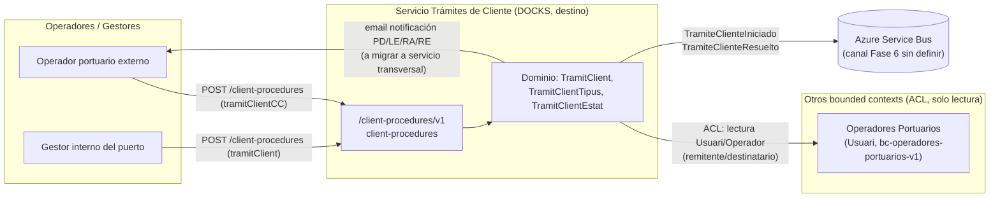

# [IA-GEN] Dossier — Trámites de Cliente

> **Borrador generado por IA** (APB AI Framework — síntesis de apb-disc-spec-gen-v1.0/apb-pm-product-analysis-v1.0/apb-arch-c4-model-v1.0/apb-arch-decompose-v1.0) — pendiente validación humana. No distribuir sin revisión.

## 1. Cabecera

- **Nombre**: Trámites de Cliente
- **Dominio DDD**: `dom-administracion-electronica-v1` — dominio ya existente en `apb-domain-catalog` (`domain-catalog/domains/administracion-electronica/domain.md`), pero **el encaje no está verificado hasta este dossier** (a diferencia de PPS/`dom-acceso-seguridad-fisica-v1`, este `parent_domain` no aparece citado en `catalog-comparison.md` — nunca se reconcilió contra el catálogo real). Ver §7 para el hallazgo de desajuste.
- **Fase del roadmap**: 6 (nueva — bounded context descubierto en la auditoría de cobertura 2026-07-13)
- **Estado**: DISCOVERED — bounded context propuesto, con evidencia de código verificada campo a campo contra el checkout real de `SOSTRAT-Sostrat-MJ8`
- **Bounded context de origen**: `proposals/bc-tramites-cliente-v1.md`
- **Épica**: `jira-backlog.md` EPIC-20 — Extracción Trámites de Cliente

## 2. Resumen ejecutivo

Trámites de Cliente es un módulo pequeño y autocontenido (**3 rutas Struts confirmadas**, coincide exactamente con `coverage-audit.md:63` "carpetaclient | 3") que gestiona un mecanismo de mensajería/expediente bidireccional entre un operador portuario y el puerto: un trámite tiene un asunto (`sentittramit`), pasa por los estados Pendiente→Leído→Realizado/Rechazado, y dispara notificaciones por correo electrónico en cada cambio de estado. Es el módulo más pequeño de los 6 bounded contexts nuevos de la auditoría de cobertura (frente a las 29 rutas de PPS o las 15 de Servicios Auxiliares de Cruceros) y, verificado el código, **no tiene ninguna dependencia de código real hacia otros bounded contexts** salvo la lectura de `Usuari`/`Operador` (para resolver el remitente/destinatario del correo) y el servicio transversal de envío de email (`CN_EnvioMailService`).

**Hallazgo nuevo de mayor impacto de esta verificación**: la funcionalidad de "documentación obligatoria por tipo de trámite", citada tanto en `proposals/bc-tramites-cliente-v1.md` como en el resumen del encargo original de este dossier, **no existe como funcionalidad implementada**. El campo `TramitClientTipus.docobligatori` (columna `DOCOBLIGATORI`) y el campo `TramitClient.iddocumentgd` (columna `IDDOCUMENTGD`, presumible enlace a un gestor documental) están definidos en los DTOs pero **no se leen ni se escriben en ningún punto del código** — cero referencias fuera de los propios DTOs, en `TramitClientAction.java` (329 líneas), `TramitClientDelegate.java`, `CN_TramitClient_Impl.java` (381 líneas) ni en los JSP del módulo (`MTramitClient.jsp`, 546 líneas, sin ningún campo de adjunto/upload). Es un modelo de datos que anticipaba una funcionalidad documental que nunca se construyó, no una funcionalidad activa a migrar.

**Segundo hallazgo relevante**: los tres módulos que el encargo original mencionaba como "sin mapear en conjunto" (`carpetaclient` singular, `carpetaclientes` plural, `documentconcessions`) **no son el mismo bounded context ni están relacionados entre sí en código**. Están ya resueltos, con evidencia, en tres dossiers/documentos distintos (ver §7) — no hay ningún bounded context huérfano pendiente entre los tres.

## 3. Análisis funcional

### Responsabilidad de negocio
Gestión de un expediente/mensaje ("trámite") que un operador portuario (cliente, externo) o un gestor del puerto (interno) inicia hacia la otra parte, con tipificación (`TramitClientTipus`), ciclo de estados y notificación automática por correo electrónico en cada cambio de estado.

### Actores
- Operador portuario externo (tipo de operador `E` en `Usuari`/`Operador`) — inicia o responde trámites vía `/tramitClientCC`.
- Gestor interno del puerto (tipo de operador `I`) — inicia o responde trámites vía `/tramitClient`.
- Destinatario por rol (`OperadorRol`, propiedad `tramitclient.mail.rol`) — cuando el trámite lo envía un operador externo, se notifica también a todos los operadores internos con ese rol, no solo a uno.

### Casos de uso reales (grounded en las 3 rutas Struts confirmadas de `struts-config.xml:197-199`, las 3 mapean a la única clase `TramitClientAction.java`)

| Ruta | Descripción |
|---|---|
| `/tramitClient` | Listado/alta/gestión de trámites desde el lado interno (puerto). |
| `/tramitClient_popup` | Misma Action en variante popup (mismo `type`, sin lógica adicional). |
| `/tramitClientCC` | Listado/alta/gestión de trámites desde el lado externo (operador, portal de autoservicio), con filtro automático por `idusuari` del operador logueado (`TramitClientAction.definirUsuario`, líneas 74-99). |

Las tres rutas comparten la misma clase `TramitClientAction`; la diferenciación interno/externo se resuelve en tiempo de ejecución consultando `Operador.getTipoperador()` (`I`/`E`), no por Action separada.

### Reglas de negocio confirmadas en código
- **Máquina de estados de 4 valores** (`CN_TramitClientEstat.java:19-28`, con Javadoc explícito): `PD` (Pendiente), `LE` (Leído), `RA` (Realizado), `RE` (Rechazado).
- **Transición automática a "Leído"**: al abrir un trámite en estado `PD`, si quien lo abre es el destinatario natural del `sentittramit` del trámite, se marca `LE`, se registra `datalectura = now()` y se envía correo (`TramitClientAction.generarPantallaLocal`, líneas 130-141; `CN_TramitClient_Impl.modificar`, línea 61-63).
- **Campo `sentittramit` (columna `SENTITTRAMIT`, valores `S`/`E` observados en código)**: no hay comentario textual ni fichero de propiedades que documente el significado exacto (no localizado en esta pasada), pero la lógica de `generarPantallaLocal` línea 134 permite inferirlo con confianza razonable: un trámite con `sentittramit="S"` se considera "leído" cuando lo abre un operador **externo** (`E`), y uno con `sentittramit="E"` cuando lo abre un operador **interno** (`I`) — consistente con `S`=Sortint (puerto→cliente) / `E`=Entrant (cliente→puerto) en catalán. **No confirmado textualmente — inferencia de lógica, no cita literal** (ver §14).
- **Cadena de respuesta**: un trámite puede generarse "en respuesta" a otro (`idtramitorigen`, modo `TR` en `generarPantallaLocal` líneas 144-151) heredando el mismo `idtiptramit` del trámite origen.
- **Notificación por correo en cada alta y en las transiciones a `PD`/`LE`/`RA`/`RE`** (`CN_TramitClient_Impl.enviarCorreo`, líneas 195-333): si el destinatario es interno, se resuelve por `idusuari` directo; si es externo, se resuelve además una lista de operadores por rol (`tramitclient.mail.rol`) que reciben copia. El asunto/cuerpo se compone a partir de claves de propiedades (`tramitclient.mail.asunto1..3`, `tramitclient.mail.texto1..6`) parametrizadas por idioma del operador destinatario.
- **No hay maintenance UI para los catálogos `TramitClientTipus`/`TramitClientEstat`**: no existe ninguna `<action path>` en `struts-config.xml` para esas dos entidades (verificado por grep) — se mantienen fuera de la aplicación (probablemente carga directa en BD), a diferencia del propio `TramitClient`.

### Qué NO incluye
- **No incluye gestión documental/adjuntos** — pese a que el modelo de datos sugiere lo contrario (`docobligatori`, `iddocumentgd`), no hay ninguna funcionalidad de subida/adjunto de fichero implementada en este módulo (ver §2, hallazgo principal, y §14).
- **No incluye el portal de autoservicio de facturas/liquidaciones** (`carpetaclientes`, plural) — módulo Java completamente distinto, sin relación de código, cubierto por `bc-facturacion-v1`/`dossier-15-facturacion-liquidaciones.md` (ver §7).
- **No incluye la gestión documental de expedientes de concesión** (`documentconcessions`) — módulo Java completamente distinto, sin relación de código, cubierto por `bc-titulo-v1`/`dossier-14-concesiones.md` (ver §7).
- **No integra con GEISER, Notifica, FACe, Portafirmas ni PLACSP** — los sistemas de la Administración General del Estado que definen el dominio `dom-administracion-electronica-v1` en el catálogo real no aparecen en ningún punto del código de este módulo (cero coincidencias de `GEISER`/`Portafirmas`/`FACe`/`Notifica`/`PLACSP` en todo el paquete `carpetaclient`, ver §7).

## 4. Alcance de migración — qué se migra y qué NO por no estar en uso

- **Se migran las 3 rutas Struts confirmadas** (`struts-config.xml:197-199`, coincide con `coverage-audit.md:63`).
- **No se migra la semántica documental del modelo de datos** (`docobligatori`, `iddocumentgd`) como funcionalidad activa — son columnas sin lectura/escritura en ningún punto del código verificado (Action, Delegate, servicio, JSP). Si negocio confirma que se necesita, es una funcionalidad **nueva** a diseñar en destino, no una migración de lógica existente. Recomendación: añadir este hallazgo a `dead-code-register.md` como confianza MEDIA (campo de dato sin lectura/escritura verificado en código, pero sin declaración textual explícita del tipo "NO SE USA" — no encaja en el patrón de confianza ALTA de ese registro).
- **No se ha encontrado código muerto de bloques/métodos comentados en este módulo** — búsqueda explícita de `@Deprecated`/"NO SE USA"/"obsoleto" en el paquete `carpetaclient` (Action, Delegate, servicio, DTOs): cero coincidencias. El único método comentado en todo el módulo es `generarTramiteRespuesta` (la variante `ActionForward`, líneas 261-281 de `TramitClientAction.java`) — está comentado sin justificación textual explícita, y coexiste con una variante activa del mismo nombre en el flujo `TR` de `generarPantallaLocal`; no se propone como hallazgo de confianza ALTA por falta de una cita textual del tipo "NO SE USA", pero se señala como candidato a revisión.
- Los catálogos `TramitClientTipus`/`TramitClientEstat` (y sus tablas de idioma) se migran íntegros como datos maestros — no tienen UI de mantenimiento en origen, así que el destino debe decidir si expone un CRUD nuevo o los mantiene como semilla de datos gestionada fuera de la aplicación.

## 5. Modelo de datos

Todos los campos siguientes están extraídos directamente de los DTOs reales en `sostrat/src/org/apb/sostrat/dataaccess/dto/` del checkout `SOSTRAT-Sostrat-MJ8`, releídos campo a campo.

### `TramitClient` (tabla `TRAMIT_CLIENT`, PK `idtramit`)

| Campo Java | Columna Oracle | Tipo | Nota |
|---|---|---|---|
| `idtramit` | `IDTRAMIT` | Long | PK |
| `sentittramit` | `SENTITTRAMIT` | String | Dirección del trámite, valores `S`/`E` observados en código — semántica inferida, no confirmada textualmente (§3) |
| `dadesaddicionals` | `DADESADDICIONALS` | String | Datos adicionales libres |
| `datacreacio` | `DATACREACIO` | Date | |
| `datalectura` | `DATALECTURA` | Date | Se rellena automáticamente al pasar a estado `LE` |
| `dataresolucio` | `DATARESOLUCIO` | Date | Se rellena automáticamente al pasar a `RA`/`RE` |
| `observacions` | `OBSERVACIONS` | String | |
| `idusuari` | `IDUSUARI` | String | FK a `Usuari` (Operadores Portuarios) |
| `idtiptramit` | `IDTIPTRAMIT` | String | FK a `TramitClientTipus` |
| `idestattramit` | `IDESTATTRAMIT` | String | Almacena los valores `PD`/`LE`/`RA`/`RE` de `CN_TramitClientEstat` — el nombre de columna no coincide con la PK de la tabla de catálogo (ver nota abajo) |
| `idtramitorigen` | `IDTRAMITORIGEN` | Long | Auto-referencia a otro `TramitClient`, para la cadena "trámite respuesta" |
| `iddocumentgd` | `IDDOCUMENTGD` | String | **Sin lectura/escritura en ningún punto del código verificado** (§2/§4) |
| `idopealta`, `idopemodificacio`, `idprocalta`, `idprocmodificacio` | — | String | Auditoría estándar (`MiniAuditoriaUtil`) |
| `guid` | `GUID` | Long | Control de concurrencia |
| `datalta`, `datmodificacio` | — | Date | Auditoría estándar |

### `TramitClientTipus` (tabla `TRAMIT_CLIENT_TIPUS`, PK `idtiptramit`)

| Campo Java | Columna Oracle | Tipo | Nota |
|---|---|---|---|
| `idtiptramit` | `IDTIPTRAMIT` | String | PK |
| `sentittiptramit` | `SENTITTIPTRAMIT` | String | |
| `docobligatori` | `DOCOBLIGATORI` | String | **Sin lectura/escritura fuera del propio DTO** (§2/§4) |
| `idtiptramitresposa` | `IDTIPTRAMITRESPOSA` | String | Tipo de trámite a usar al generar una respuesta |

Con tabla de idioma asociada `TramitClientTipusIdioma` (PK `idtiptramit`+`codidioma`): `desctiptramit` (descripción localizada, usada en el asunto/cuerpo del correo).

### `TramitClientEstat` (tabla `TRAMIT_CLIENT_ESTAT`, PK `idestatsollicitud`)

Único campo propio: `idestatsollicitud` (String, PK) — **el nombre de columna de la PK (`IDESTATSOLLICITUD`, "solicitud") no coincide con el nombre del campo FK en `TramitClient` (`IDESTATTRAMIT`)** — indicio de que esta tabla de catálogo fue reutilizada/renombrada de un concepto anterior de "sol·licitud", no diseñada específicamente para `TramitClient`. Con tabla de idioma asociada `TramitClientEstatIdioma` para descripciones localizadas.

### Vista `VTcTramitClient` (`V_TC_TRAMIT_CLIENT`, usada por el listado)
Desnormaliza `TramitClient` + `nomraosocial` (razón social del `Usuari`) + `desctiptramit` + `descestat` — confirma que el listado real muestra descripciones, no solo códigos.

### Mapeo a Azure SQL
Migración directa tabla-a-tabla: `TRAMIT_CLIENT`, `TRAMIT_CLIENT_TIPUS` (+ idioma), `TRAMIT_CLIENT_ESTAT` (+ idioma) como agregado + dos catálogos. No se ha diseñado el esquema Azure SQL definitivo en esta pasada.

## 6. Arquitectura técnica

Stack DOCKS (.NET, Azure SQL, EntraID, Service Bus, APIM), servicio dedicado tras `/client-procedures/v1` (`specs/openapi-tramites-cliente.yaml:19`).

Dado que el módulo no tiene ninguna dependencia de código real hacia otro bounded context de negocio (§7) salvo la lectura de `Usuari`/`Operador`, es candidato de **bajo riesgo técnico** para extracción — coincide con la clasificación de `jira-backlog.md:422` ("Riesgo técnico: bajo"). El envío de correo (`CN_EnvioMailService`) debe externalizarse a un servicio de notificación transversal (mismo patrón recomendado en otros dossiers de esta serie, p.ej. `dossier-18-servicios-auxiliares-cruceros.md §6`), no reimplementarse como lógica SMTP embebida en el dominio.

## 7. Dominio DDD

- **Bounded context**: `bc-tramites-cliente-v1`, `parent_domain: dom-administracion-electronica-v1` (`proposals/bc-tramites-cliente-v1.md`).
- **Hallazgo de desajuste de dominio, no señalado hasta este dossier**: `domain-catalog/domains/administracion-electronica/domain.md` define `dom-administracion-electronica-v1` como *"procedimiento administrativo, contratación pública (LCSP/PLACSP), registro (GEISER), notificaciones (Notifica), firma (Portafirmas) y factura electrónica (FACe)"*, con `bounded_contexts: []` (vacío — ningún BC asignado todavía) y `related_systems` centrados en plataformas de la Administración General del Estado. El código real de `TramitClient` **no tiene ningún punto de integración con esos sistemas** — es un mecanismo de mensajería/expediente bilateral cliente↔puerto con notificación por email interno, sin firma electrónica, sin registro GEISER, sin PLACSP. A diferencia de PPS (`dom-acceso-seguridad-fisica-v1`, dossier-05 §7), cuyo encaje **sí** fue reconciliado explícitamente en `catalog-comparison.md:17`, este `parent_domain` **nunca se reconcilió** contra el catálogo real (cero menciones de `dom-administracion-electronica-v1` en `catalog-comparison.md`, verificado por grep). El encaje temático (es "un trámite administrativo") es razonable a nivel de nombre, pero la superficie real de código no comparte ningún sistema con el resto del dominio tal como está definido hoy. **Recomendación**: validar con Arquitectura APB si este BC debe quedar bajo `dom-administracion-electronica-v1` como primer bounded context real de ese dominio (dado que hoy está vacío) o si merece un dominio distinto más ajustado a "mensajería cliente-puerto".
- **Relación con `bc-operadores-portuarios-v1`**: confirmado por código — `TramitClient.idusuari` es FK a `Usuari`, y `TramitClientAction`/`CN_TramitClient_Impl` consultan `OperadorDelegate`/`ServiceLocator.getCnUsuari()` directamente. `jira-backlog.md:422` ya declara esta dependencia (`Dependencias: EPIC-17`); el patrón `integration_pattern: conformist/downstream` de `bc-tramites-cliente-v1.md:27-31` es correcto y confirmado.
- **Verificación de no-duplicación/no-solapamiento — los tres módulos "satélite" mencionados en el encargo de este dossier, resueltos con evidencia**:
  1. **`carpetaclient` (singular, 3 rutas)** = este bounded context (`bc-tramites-cliente-v1`). Único módulo de los tres con modelo de dominio propio (`TramitClient`/`TramitClientTipus`/`TramitClientEstat`).
  2. **`carpetaclientes` (plural, 13 rutas, 9 clases Action)** — **no relacionado en código**. Confirmado por lectura de las 9 clases (`FacturasCCAction extends FacturasAction`, `LiquidacionCCAction extends LiquidacionAction`, `UsuariCCAction extends UsuariAction`, `NotificacioDeFacturaCCAction extends NotificacioDeFacturaAction`, `FacturaFiCCAction`/`FacturaFetImpCCAction extends FacturaFetImpAction`, `FacturasDeNotificacionCCAction extends FacturasCCAction`) — **cero clases nuevas de dominio, cero DTOs propios** (no existe paquete `dataaccess/dto/carpetaclientes`, verificado). Es un portal de autoservicio que reexpone Facturación/Liquidación con filtro por operador, sin lógica de negocio propia. **Ya cubierto**: `bc-facturacion-v1`/`dossier-15-facturacion-liquidaciones.md` (líneas 61, 69, 178, 297 de ese dossier lo confirman con la misma evidencia de código). **No es un bounded context huérfano** — no requiere ninguna acción de este dossier ni de ningún dossier futuro.
  3. **`documentconcessions` (9 rutas, `DocumentConcessionsAction.java`, 1.444 líneas)** — **no relacionado en código**. Cero ocurrencias de `TramitClient` en `DocumentConcessionsAction.java` (verificado por grep); sus imports son `PermisObraPk`, `ProjecteDades`, `TitolActa`, `TitolPk` — pertenece íntegramente al dominio de Título/Concesiones. **Ya cubierto**: `bc-titulo-v1`/`dossier-14-concesiones.md` (línea 65, "documentación de concesiones... `service/documentconcessions/`"). El nombre "documento" es la única coincidencia superficial con `TramitClient.iddocumentgd` (campo no usado, §2) — no hay ninguna relación de código real entre ambos módulos. **No es un bounded context huérfano.**
  
  **Conclusión de la verificación pedida**: de los tres módulos mencionados como "sin mapear en conjunto" en el encargo de esta tarea, **ninguno queda sin bounded context propio** — uno es este dossier, y los otros dos ya están asignados y documentados en dossiers existentes con evidencia de código verificada. No hay gap pendiente de bounded context en este trío.

## 8. Pantallas UI

Ver `ui-screens-backlog.md:140-142` §"App: Trámites de Cliente":
1. **Listado de Trámites** (`dxDataGrid`) — columnas propuestas: `idtramit`, `idtipustramit`, `idestat`, `datcreacio`. **Corrección de nombres de columna grounded**: los campos reales son `idtramit`, `idtiptramit` (no `idtipustramit`), `idestattramit` (no `idestat`), `datacreacio` (no `datcreacio`) — mismo patrón de nombres ligeramente distintos que en `openapi-tramites-cliente.yaml` (§9). Columnas reales adicionales disponibles en la vista `VTcTramitClient`: `nomraosocial`, `desctiptramit`, `descestat` (ya desnormalizadas para listado).
2. **Ficha de Trámite** (`dxForm` + adjuntos, según el backlog) — **el "+ adjuntos" no está grounded**: no existe ningún campo de adjunto en `MTramitClient.jsp` (546 líneas, sin campo de fichero/upload, verificado). Corregir a `dxForm` simple con los campos reales de §5, sin sección de adjuntos, salvo que negocio confirme que esa funcionalidad debe construirse de nuevo (§4/§14).

## 9. APIs

| Método | Ruta | Descripción | Grounded en |
|---|---|---|---|
| GET | `/client-procedures` | Listar trámites (filtro `idusuari`, `idtipustramit`, paginado) | `TramitClient.java`/`VTcTramitClient.java` |
| POST | `/client-procedures` | Iniciar un trámite | `TramitClient.java` |
| GET | `/client-procedures/{idtramit}` | Consultar un trámite | `TramitClientPk` |
| PATCH | `/client-procedures/{idtramit}` | Resolver un trámite | `CN_TramitClient_Impl.modificar` |

Contrato: `specs/openapi-tramites-cliente.yaml`. **Gaps de nombres de campo confirmados en esta verificación — el contrato no está grounded en los nombres reales del DTO**:

| Campo en `openapi-tramites-cliente.yaml` | Campo real en `TramitClient.java` | Estado |
|---|---|---|
| `assumpte` | `sentittramit` | **No es el mismo campo** — `assumpte` (asunto) no existe en el DTO real; el campo real más cercano es `dadesaddicionals` (datos libres), no un "asunto" propiamente dicho |
| `idtipustramit` | `idtiptramit` | Nombre distinto (columna real `IDTIPTRAMIT`) |
| `idestat` | `idestattramit` | Nombre distinto (columna real `IDESTATTRAMIT`) |
| `datcreacio` | `datacreacio` | Nombre distinto (columna real `DATACREACIO`) |
| `datlectura` | `datalectura` | Nombre distinto (columna real `DATALECTURA`) |
| `datresolucio` | `dataresolucio` | Nombre distinto (columna real `DATARESOLUCIO`) |

Además, el contrato **no cubre** `idtramitorigen` (cadena de respuesta), `observacions`, ni ningún campo de `TramitClientTipus`/`TramitClientEstat` más allá del id. **No incluye** `iddocumentgd`/`docobligatori` — correctamente, dado que son campos sin uso real (§2), pero el ejemplo del contrato (`"assumpte": "Solicitud de duplicado de factura"`) sugiere que el autor del contrato asumió una funcionalidad de asunto/documentación que no existe en el modelo real. **Recomendación**: regenerar `openapi-tramites-cliente.yaml` con los nombres de campo verificados en §5 antes de considerar el contrato listo para implementación.

## 10. Eventos

| Evento | Trigger | Payload real grounded | Corrección |
|---|---|---|---|
| `TramiteClienteIniciado` | Alta de trámite (`CN_TramitClient_Impl.crear`) | `{ idtramit, idusuari, idtiptramit, sentittramit, datacreacio }` | `events-catalog.md:736-740` usa `idtipustramit` (no grounded) en vez de `idtiptramit`; correcto en lo demás |
| `TramiteClienteResuelto` | Transición a `RA`/`RE` (`CN_TramitClient_Impl.modificar`) | `{ idtramit, idestattramit, dataresolucio }` | Mismo gap de nombre de campo que arriba |

Canal: no se especifica todavía un canal AMQP dedicado para Fase 6 en ningún documento existente (`asyncapi-fase2.yaml` cubre solo Fase 2) — mismo gap ya señalado en `dossier-18-servicios-auxiliares-cruceros.md §10` para el resto de BC de Fase 6. **No existe `asyncapi-fase6.yaml`** (verificado por listado de `discovery/ddd-sostrat-mj8/specs/`).

## 11. Diagrama topológico (C4 nivel 1)

## 12. Estrategia de convivencia con el modelo actual

1. **Extracción de pieza única, sin fases internas**: al ser solo 3 rutas sobre una única Action y un único agregado, no hay sub-flujos que justifiquen un strangler fig escalonado como en PPS o Servicios Auxiliares de Cruceros — se extrae el módulo completo de una vez.
2. **Migrar el envío de correo antes que la lógica de negocio**: la dependencia de `CN_EnvioMailService` y de las claves de propiedades `tramitclient.mail.*` debe resolverse hacia el servicio de notificación transversal (`dom-transversal-arq-v1`) como primer paso, para no reimplementar SMTP embebido en el nuevo servicio.
3. **No migrar `docobligatori`/`iddocumentgd` como funcionalidad activa** — si negocio confirma que la documentación obligatoria por tipo de trámite es un requisito real para el nuevo servicio, es una historia de **diseño nuevo**, no una migración 1:1 (§4/§14).
4. **Coordinar con la extracción de Operadores Portuarios (EPIC-17)** — `jira-backlog.md:422` ya declara esta dependencia; el filtro por `idusuari` en `/tramitClientCC` requiere que la ACL hacia `Usuari` esté disponible antes del cutover del lado externo.
5. **Los catálogos `TramitClientTipus`/`TramitClientEstat` se migran como datos semilla**, dado que no tienen UI de mantenimiento en origen — decidir en destino si se exponen con CRUD propio o se gestionan como configuración.

## 13. Testing y seguridad

- **No existe todavía una `testing-strategy-fase6.md` ni un `threat-model-fase6.md`** — mismo gap ya señalado en `dossier-18-servicios-auxiliares-cruceros.md §13` para el resto de BC de Fase 6 (verificado por listado de ficheros: solo existen versiones Fase 0-1 y Fase 2-4). Se recomienda aplicar como base la pirámide de `testing-strategy-fase2-4.md` (Unit 60% / Contract 20% / Integration 15% / E2E 5%) hasta que exista una versión Fase 6 propia.
- Casos de test sugeridos (grounded en reglas reales del código, no genéricos):
  - Unit: la transición a `LE` solo debe ocurrir cuando el operador que abre el trámite es el destinatario natural según `sentittramit` (regla de `generarPantallaLocal`, línea 134); `dataresolucio` debe fijarse solo en transición a `RA`/`RE`.
  - Contract: `TramiteClienteIniciado`/`TramiteClienteResuelto` deben corregirse (`idtiptramit`, no `idtipustramit`) antes de fijar el esquema AsyncAPI (§10).
  - Integration: ACL hacia `Usuari`/`Operador` con test doubles, nunca las tablas legacy reales en CI.
- **Ningún campo de credencial identificado** en los 3 DTOs de este módulo leídos campo a campo (§5).
- Los correos electrónicos contienen datos de contacto de operadores (`email`, `emailds`) — sin evidencia de cifrado o tratamiento especial en el código legacy, mismo patrón ya señalado para Servicios Auxiliares de Cruceros (`dossier-18 §13`); a evaluar si aplica algún requisito de protección de datos en el diseño destino.

## 14. Riesgos y gaps de evidencia conocidos

- **Funcionalidad documental inexistente pese a estar en el modelo de datos y en la propuesta original**: `docobligatori`/`iddocumentgd` no tienen ninguna lectura/escritura en el código verificado (§2/§4). Corrige la afirmación de `proposals/bc-tramites-cliente-v1.md:5` ("documentación obligatoria por tipo") y el resumen del encargo de este dossier — es un dato modelado, no una funcionalidad construida. Recomendación: añadir a `dead-code-register.md` como confianza MEDIA.
- **Contrato de API con nombres de campo no grounded**: `openapi-tramites-cliente.yaml` usa `assumpte`/`idtipustramit`/`idestat`/`datcreacio`/`datlectura` en vez de los nombres reales `sentittramit`(aprox.)/`idtiptramit`/`idestattramit`/`datacreacio`/`datalectura` (§9) — corrección necesaria antes de implementación.
- **`sentittramit` (S/E) sin confirmación textual de su significado exacto** — inferido de la lógica de `generarPantallaLocal` (§3), no de un comentario o fichero de propiedades. A confirmar con el equipo de SÒSTRAT antes de fijar el enum en el contrato destino.
- **Desajuste de dominio no reconciliado**: `dom-administracion-electronica-v1` real (`domain-catalog`) está definido en torno a GEISER/Notifica/FACe/Portafirmas/PLACSP, sin ningún BC asignado todavía (`bounded_contexts: []`) y sin ninguna mención de este bounded context en `catalog-comparison.md` (§7) — a diferencia de otros BC de esta serie, este encaje de dominio nunca pasó por el mismo proceso de reconciliación explícita.
- **Naming quirk en el catálogo `TramitClientEstat`**: PK `idestatsollicitud` no coincide con el nombre de la FK real en `TramitClient` (`idestattramit`) — indicio de tabla reutilizada de otro concepto legacy, sin impacto funcional pero relevante para el diseño del esquema destino (§5).
- **Método `generarTramiteRespuesta` comentado sin justificación textual explícita** en `TramitClientAction.java` (líneas 261-281) — no cumple el criterio de confianza ALTA de `dead-code-register.md` (requiere cita textual del tipo "NO SE USA"), se señala aquí como candidato a revisión con el equipo, no se marca como código muerto confirmado.
- **No existe `testing-strategy-fase6.md`/`threat-model-fase6.md`** para ninguno de los 6 BC de la auditoría de cobertura, incluido este (§13, mismo gap que `dossier-18 §14`).
- **No existe `asyncapi-fase6.yaml`** — canal de eventos de Fase 6 sin definir para ningún BC nuevo de la auditoría, incluido este (§10).

## 15. Estimación de esfuerzo

Ver `jira-backlog.md` EPIC-20 (2 historias, 10 pts):
1. Iniciar un trámite con su documentación obligatoria (`POST /client-procedures`) — 5 pts.
2. Consultar y resolver trámites pendientes — 5 pts.

**Notas de esta verificación**:
- La historia 1 debe re-redactarse: "con su documentación obligatoria" no corresponde a ninguna funcionalidad real (§2/§14) — el criterio de aceptación debe limitarse a los campos reales de `TramitClient` (§5), salvo que negocio confirme que la funcionalidad documental debe construirse de nuevo, en cuyo caso son puntos de historia adicionales no estimados hoy.
- La tarea técnica de `jira-backlog.md:431` ("confirmar que `carpetaclientes` puede sustituirse reutilizando las APIs de Facturación/Liquidación") queda **confirmada por esta verificación** (§7) — no requiere trabajo adicional de este EPIC, es responsabilidad de `bc-facturacion-v1`/EPIC correspondiente.
- No se ha estimado el esfuerzo de migrar el envío de correo a un servicio de notificación transversal (§12) — pendiente de una historia técnica dedicada, común a varios BC de esta serie (mismo patrón que Servicios Auxiliares de Cruceros).

## 16. Checklist de validación

**Funcional**:
- [ ] Confirmar con negocio si la documentación obligatoria por tipo de trámite (`docobligatori`) es un requisito real pendiente de construir, o si puede descartarse del alcance de migración.
- [ ] Confirmar el significado exacto de `sentittramit` (S/E) con el equipo de SÒSTRAT.
- [ ] Validar con Arquitectura APB el encaje de `dom-administracion-electronica-v1` para este bounded context, dado que el dominio real está definido en torno a sistemas AGE sin relación de código con este módulo.
- [ ] Confirmar si `iddocumentgd` apuntaba a algún gestor documental específico (Alfresco, `documentconcessions`, u otro) que se desconectó en el pasado, o si nunca llegó a implementarse.

**Desarrollo**:
- [ ] Regenerar `specs/openapi-tramites-cliente.yaml`, `events-catalog.md` §17 y `ui-screens-backlog.md` §"App: Trámites de Cliente" con los nombres de campo verificados en §5/§9/§10 (`idtiptramit`, `idestattramit`, `datacreacio`, `datalectura`, `dataresolucio`, sin `assumpte`).
- [ ] Diseñar el mecanismo de notificación como servicio transversal, no como lógica SMTP embebida en el dominio.
- [ ] Redactar `testing-strategy-fase6.md`/`threat-model-fase6.md`/`asyncapi-fase6.yaml` (o extender los de Fase 2-4) para cubrir los 6 BC de la auditoría de cobertura, incluido este.
- [ ] Revisar el método comentado `generarTramiteRespuesta` (`TramitClientAction.java:261-281`) con el equipo de SÒSTRAT antes de excluirlo definitivamente de la migración.

## 17. Historial de cambios

| Versión | Fecha | Autor | Cambio |
|---------|-------|-------|--------|
| 1.0.0 | 2026-07-13 | APB AI Framework | Dossier inicial, a petición explícita del usuario. Verificado campo a campo contra el checkout real de `SOSTRAT-Sostrat-MJ8` (3 DTOs `TramitClient`/`TramitClientTipus`/`TramitClientEstat` + vista `VTcTramitClient`, `TramitClientAction.java`, `TramitClientDelegate.java`, `CN_TramitClient_Impl.java`, `struts-config.xml`). Corrige `proposals/bc-tramites-cliente-v1.md` y el resumen del encargo original: la funcionalidad de "documentación obligatoria por tipo" no está implementada (campos `docobligatori`/`iddocumentgd` sin uso real). Confirma con evidencia de código que `carpetaclientes` (plural, ya cubierto por `dossier-15`) y `documentconcessions` (ya cubierto por `dossier-14`) no tienen relación alguna con este bounded context — no quedan como gaps huérfanos. Corrige los nombres de campo de `specs/openapi-tramites-cliente.yaml`/`events-catalog.md`/`ui-screens-backlog.md`. Señala el desajuste no reconciliado entre el `parent_domain` propuesto y la definición real de `dom-administracion-electronica-v1` en `apb-domain-catalog` |
