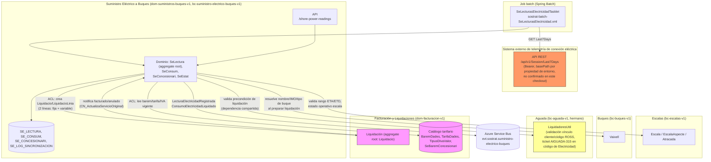

# [IA-GEN] Dossier — Suministro Eléctrico a Buques (Shore Power)

> **Borrador generado por IA** (APB AI Framework — síntesis de apb-disc-spec-gen-v1.0/apb-pm-product-analysis-v1.0/apb-arch-c4-model-v1.0/apb-arch-decompose-v1.0) — pendiente validación humana. No distribuir sin revisión.
>
> **Estado de este documento**: esta verificación contra el código real (`service/suministres/electricitat/`, `mvc/control/suministros/electricitat/`, `dataaccess/dto/suministres/electricitat/`, `dataaccess/views/**/suministres/electricitat/`, `service/liquidacion/impl/LiquidacionSeElecticidadDependencias_Impl.java`, `sostrat-BATCH/.../SeLecturasElectricidadTasklet.java`, `swagger/suministroElectricidad/`) encuentra **evidencia sustancialmente más rica y de mejor calidad que la documentada hasta ahora** en `bc-suministro-electrico-buques-v1.md`, `dossier-07-aguada.md` §7.2 y `specs/openapi-suministro-electrico-buques.yaml`, con dos correcciones de fondo:
>
> 1. **`SeLectura`/`SeConsum` NO son vistas de solo lectura — son tablas transaccionales reales con DAO propio** (`SeLecturaDao`, con `insert`/`update`/`findWhereIdserveiEquals`/`findByPrimaryKey` confirmados en uso real). Las vistas `V_TC_LECTURA_ELECTRICITAT`/`V_TC_CONSUM_ELECTRICITAT` (`VTcSeLectura`/`VTcSeConsum`) **también existen**, como modelo de lectura denormalizado sobre esas mismas tablas — pero el modelo de escritura sí está confirmado campo a campo, a diferencia de Aguada. Esto invierte la situación de riesgo respecto al bounded context hermano: aquí no hay gap de evidencia de escritura.
> 2. **Hallazgo nuevo, no documentado en ningún artefacto previo**: SÒSTRAT no calcula las lecturas de conexión eléctrica localmente — las sincroniza desde un **sistema externo real vía API REST** (`GET /api/v1/Session/Last7Days`, cliente Swagger generado, autenticación Bearer, URL configurada por propiedad de entorno `SWAGGER_SE_LECTURA_BASEPATH`), orquestado por un job batch dedicado (`sostrat-batch-SeLecturasElectricidad.xml`). Los datos de ejemplo hardcodeados en el propio código (`systemName="BEST"`) apuntan a un proveedor de telemetría de conexión eléctrica de buque a muelle (cold-ironing) del entorno de terminal portuario. Esta integración externa **no aparece mencionada en `bc-suministro-electrico-buques-v1.md`, `coverage-audit.md`, `events-catalog.md` ni `specs/openapi-suministro-electrico-buques.yaml`**, y tiene implicaciones directas de arquitectura (ACL obligatorio hacia un tercero, no solo hacia otros BC de SÒSTRAT).
>
> Ver §5, §6 y §14 para el detalle completo.

| Campo | Valor |
|---|---|
| **Nombre de la app** | Suministro Eléctrico a Buques (Shore Power / cold-ironing) |
| **Dominio DDD** | `dom-suministros-buques-v1` (compartido con Aguada — ver §7) |
| **Fase del roadmap** | Fase 6 (nueva, auditoría de cobertura 2026-07-13) — `jira-backlog.md` EPIC-21, evaluar agrupar con EPIC-06 (Aguada) |
| **Estado** | DISCOVERED — evidencia de código fuerte y verificada campo a campo; gap real limitado a los códigos literales de un enum y a la URL del sistema externo (ver §14) |
| **Bounded context de origen** | `proposals/bc-suministro-electrico-buques-v1.md` |
| **Sistema origen** | SÒSTRAT (SOSTRAT-Sostrat-MJ8), ticket `FACTSTD-878` (con referencias cruzadas a `FACTSTD-913` y `AIGUADA-315`) |
| **Fecha de generación** | 2026-07-13 |

---

## 2. Resumen ejecutivo

Suministro Eléctrico a Buques gestiona el ciclo de vida completo del suministro de electricidad a buques atracados (cold-ironing / Shore Power / OPS — Onshore Power Supply): sincronización automática de sesiones de conexión/desconexión desde un sistema externo de telemetría, cálculo de consumo y tiempos, tarifación por concesionario (cuota fija + variable), liquidación (con dos líneas de liquidación por lectura), facturación y auditoría. Es un bounded context de tamaño medio — **6 rutas Struts propias** (confirmado exacto en `struts-config.xml:294-298,301`, coincide con `coverage-audit.md:43` y con la nota `notes` de `bc-suministro-electrico-buques-v1.md`), pero con una god class real de **1.506 líneas** (`CN_SeElectricitat_Impl.java`), la mayor de todo este clúster de suministros auxiliares, por encima de la de Clavegueram (1.494 líneas, `dossier-16-clavegueram.md §6`).

**Corrección central de esta verificación**: la documentación previa (`bc-suministro-electrico-buques-v1.md`, `dossier-07-aguada.md §7.2`, `specs/openapi-suministro-electrico-buques.yaml`) trataba `SeLectura`/`SeConsum` como si fueran, en el mejor de los casos, vistas de solo lectura equivalentes a las de Aguada (`V_TC_LECTURA_ELECTRICITAT`/`V_TC_CONSUM_ELECTRICITAT` citadas siempre como "tabla/vista", nunca confirmadas como una cosa u otra). La lectura completa de `SeLectura.java`/`SeConsum.java` y de sus DAOs confirma que son **tablas transaccionales reales**, con operaciones de escritura activas (`seLecturaDao.insert(...)`, `.update(...)`, `.findWhereIdserveiEquals(...)`) usadas tanto por el propio servicio como por `LiquidacionSeElecticidadDependencias_Impl.java` (el mismo patrón `*Dependencias_Impl` ya documentado para Clavegueram y Aguada). Las vistas `VTcSeLectura`/`VTcSeConsum` sí existen también, pero como modelo de lectura sobre esas tablas — no son, como en Aguada, la única evidencia disponible.

**Hallazgo nuevo de mayor calado**: este bounded context no es un CRUD interno — depende de una **integración REST real con un sistema externo de telemetría de conexión eléctrica**, no documentada en ningún artefacto previo de esta serie. `CN_SeElectricitat_WS_Impl.java` invoca `SessionApi.apiV1SessionLast7DaysGet()` (cliente Swagger generado, `org.apb.sostrat.swagger.suministroElectricidad.client.*`, autenticación `Bearer`, URL vía propiedad `SWAGGER_SE_LECTURA_BASEPATH` no presente en este checkout) para obtener las sesiones de conexión/desconexión de los últimos 7 días, orquestado por el job batch `SeLecturasElectricidadTasklet` (`sostrat-batch-SeLecturasElectricidad.xml`). Los datos de ejemplo hardcodeados en un método auxiliar no invocado (`obtenerConsumosElecFake`, ver §14) referencian `systemName="BEST"`, sugiriendo un proveedor de telemetría del ecosistema de terminales del puerto. **Esta integración debe modelarse como un límite de Anti-Corruption Layer hacia un tercero externo a SÒSTRAT, no solo hacia otros bounded contexts internos** — un tipo de dependencia que ningún otro dossier de esta serie de suministros auxiliares (Aguada, Clavegueram) tiene documentado con esta claridad.

Adicionalmente, esta verificación **cierra parcialmente** el gap más citado en la documentación previa (`bc-suministro-electrico-buques-v1.md notes`, `jira-backlog.md EPIC-21` tarea "SPIKE"): el enum de estados de una lectura. Se confirman **5 constantes de estado reales** (`SE_ELECT_ESTADOLECT_CREADA`, `_PDTE_LIQ`, `_LIQUIDADA`, `_FACTURADA`, `_ANULADA`), citadas literalmente en `CN_SeElectricitat_Impl.java` y `LiquidacionSeElecticidadDependencias_Impl.java` — pero sus **valores de cadena literales siguen sin confirmar**, porque la clase que los declara (`org.apb.sostrat.constantes.Constantes`, la clase de constantes global de toda la aplicación) no existe como fuente en este checkout, el mismo patrón de ausencia ya observado para otras constantes globales (p. ej. las de tipo de operación ferroviaria). Es un cierre parcial, no total, del gap.

## 3. Análisis funcional

### Responsabilidad de negocio
Sincronizar automáticamente las sesiones de conexión/desconexión eléctrica de buques atracados desde un sistema externo de telemetría, agregarlas por escala en una "lectura" de consumo, calcular el tiempo de conexión y su proporción sobre el tiempo total de atraque, tarifar el consumo (cuota fija + variable por concesionario), liquidar, facturar y auditar cada lectura.

### Actores
- **Sistema externo de telemetría de conexión eléctrica** (no identificado por nombre propio en este checkout, dato de ejemplo `"BEST"` — ver §14): origen real de los datos de conexión/desconexión y energía consumida, vía API REST.
- **Job batch de sincronización** (`SeLecturasElectricidadTasklet`, Spring Batch): ejecuta el proceso completo de forma automática, sin intervención manual salvo para liquidar/anular.
- **Gestor de facturación de suministros / operador APB**: revisa lecturas, las liquida (individual o masivamente), desliquida, anula, consulta auditoría.
- **Servicio de Escalas** (`bc-escalas-v1`, vía `CN_Escala`/`EscalaAspecte`/`Atracada`): fuente de la ventana temporal de atraque real (`ETA`/`ETD`) contra la que se valida que las sesiones de conexión recibidas estén dentro de rango, y del estado operativo de la escala (una escala debe estar `FINALIZADA` para que su lectura pase a pendiente de liquidar).
- **Servicio de Buques** (`bc-buques-v1`, vía `CN_Vaixell.obtenerObjeto()`): resuelve nombre/IMO/tipo de buque durante la preparación de datos para liquidar — confirma, desde este lado, la relación ya documentada en `dossier-17-buques.md:132` (`CN_SeElectricitat_Impl.java` inyecta `CN_Vaixell`).
- **Servicio de Liquidación** (`CN_Liquidacion`, vía `cnLiquidacio`, heredado indirectamente de `CN_LiquidadorBase_Impl` a través de `CN_LiquidadorSeLectura_Impl`): destinatario real de la liquidación generada — igual que Aguada y Clavegueram, este BC no posee tabla de liquidaciones propia.

### Casos de uso reales (grounded en `CN_SeElectricitat_Impl.java`, `SeLecturaAction.java`, `SeConsumoAction.java`, `SeLecturaAuditAction.java`, 6 rutas Struts confirmadas)

- **Sincronización automática de lecturas** (`SeLecturasElectricidadTasklet` → `CN_SeElectricitat.procesarConsumosElectricidadBATCH()`, sin ruta Struts, proceso batch puro): (1) marca como "pendiente de liquidar" (`SE_ELECT_ESTADOLECT_PDTE_LIQ`) las lecturas en estado "creada" cuya escala ya está `FINALIZADA` (`asignaSeLecturasPendientesLiquidar`); (2) llama al WS externo (`obtenerConsumosElecDeWS` → `SessionApi.apiV1SessionLast7DaysGet`) para obtener las sesiones de los últimos 7 días; (3) valida campo a campo cada sesión recibida (`validarConsumosWS`, con más de 15 validaciones distintas: campos vacíos, formato de fecha, existencia y estado de la escala, existencia de `EscalaAspecte`, fechas de conexión/desconexión dentro del rango real de atraque `ETA`/`ETD`); (4) crea una `SeLectura` nueva por escala (primera sesión) o añade el `SeConsum` a una lectura existente en estado `CREADA`/`PDTE_LIQ`; (5) recalcula, por cada lectura tocada, el consumo total, el tiempo de conexión agregado, el tiempo total de atraque (sumando todos los `AtracadaAspecte` no anulados/denegados/en trámite de la escala), el porcentaje de tiempo conectado sobre el atraque, y el importe (cuota fija + variable × consumo, según el barem vigente del concesionario, más IVA si aplica).
- **Listado y ficha de lecturas** (`/seLecturasElectricidad`, `/seLecturasElectricidad_popup` → `SeLecturaAction.obtenerListadoLocal`, vista `VTcSeLectura`).
- **Listado de lecturas pendientes de liquidar** (`/seLecturasElectricidadLiq` → misma `SeLecturaAction`, filtro fijo por fecha de liquidación vía `PARAMSFILTROFIJO`).
- **Auditoría de lecturas** (`/seLecturasElectricidadAudit`, `/seLecturasElectricidadAudit_popup` → `SeLecturaAuditAction`, tabla `SeLecturaAudit`, que extiende `SeLectura` y añade `seq`/`dataudit`/`idproces`/`idoperador`/`idtipoperacio`).
- **Listado de consumos (sesiones individuales) de una lectura** (`/seConsumosElectricidad` → `SeConsumoAction`, delegando en `CN_SeElectricitat.obtenerListaConsumosLectura`).
- **Liquidar una lectura, individual o masiva** (acciones de UI `LIQ_SUM`/`SIMLIQ_SUM`, confirmadas en `SeLecturaAction.obtenerListadoLocal:82-83`, sobre permiso `LIQSUMINI`) → `CN_SeElectricitat.liquidar()` → `CN_LiquidadorSeLectura.liquidar()` → genera una `Liquidacio` con **dos líneas**: línea 1 tarifa fija (`SE_ELECT_BAREM1_FIJO`) y línea 2 tarifa variable (`SE_ELECT_BAREM2_VARIABLE`, importe = consumo × cuota unitaria del barem vigente del concesionario). Antes de liquidar valida que el consignatario tenga "vínculo cliente"/código ROSS (`LiquidadoresUtil.tieneCodigoRossVincleClient`, ticket `AIGUADA-315` citado literalmente en el código — ver §7 para la implicación de esta referencia cruzada).
- **Desliquidar una lectura** (acción UI `DESLIQUIDARSUMINISTROS`) → `CN_SeElectricitat.desliquidar()` — elimina las `Liquidacio` asociadas a la lectura, **pero no revierte el estado de la lectura** (líneas 1494-1495 de `CN_SeElectricitat_Impl.java`, código de reseteo a `PDTE_LIQ` comentado — ver §14, riesgo de datos).
- **Anular una lectura** (acción UI `ANULARFACTEST`/`ANULARFACTEST_MULT`, individual y múltiple) → `CN_SeElectricitat.anular()` — pasa la lectura a `SE_ELECT_ESTADOLECT_ANULADA` y registra `motivoanulacion`.
- **Notificación de factura/anulación de factura** (`actualizarFacturaEstado`/`anularFacturaEstado`, implementando `CN_ActualizaServicioOriginal`) — cuando la liquidación asociada se factura, la lectura pasa a `SE_ELECT_ESTADOLECT_FACTURADA`; mismo contrato genérico que usan Aguada, Clavegueram, Depotsis y Suministros (`dossier-16-clavegueram.md §2`).

### Reglas de negocio confirmadas en código

- **Máquina de estados de 5 valores, nombres confirmados, códigos literales no confirmados**: `CREADA → PDTE_LIQ → LIQUIDADA → FACTURADA`, con `ANULADA` alcanzable desde varios puntos. Ver §14 para el detalle del gap de los valores de cadena.
- **Doble línea de liquidación por lectura**: cuota fija (`SE_ELECT_BAREM1_FIJO`, unidad = 1) y cuota variable (`SE_ELECT_BAREM2_VARIABLE`, unidad = `consumototal`, importe = consumo × cuota unitaria del barem vigente para el concesionario en la fecha de inicio de la lectura). Las líneas de detalle **no incluyen IVA** (`cnLiquidacio.setImpiva(linLiq, new BigDecimal(0))`, comentario explícito en el código `// FACTSTD-913 Las lineas de detalle no incluyen IVA`) — el IVA solo se aplica a nivel de cabecera de liquidación, no de línea.
- **Tipo de IVA determinado por navegación internacional**: si la escala tiene `nmi="S"` (navegación marítima internacional), `idtipiva="0"` (exento); si no, `idtipiva="1"`.
- **Validación de rango temporal contra la escala real**: una sesión de conexión/desconexión recibida del WS externo solo se acepta si sus timestamps están dentro del rango `ETA`/`ETD` del `EscalaAspecte` actual de la escala — de lo contrario, se rechaza con `SELECTRICITAT.FECHAS.FUERARANGO` y se registra en `SeLogSincronizacion`.
- **Solo se agregan consumos a lecturas en estado `CREADA` o `PDTE_LIQ`**: una sesión que llega para una lectura ya `LIQUIDADA`/`FACTURADA`/`ANULADA` se descarta explícitamente (`SELECTRICITAT.LECTURA.LIQUIDADA`, `continue` sin error bloqueante).
- **Precondición de liquidación compartida con Aguada**: `LiquidadoresUtil.tieneCodigoRossVincleClient`/`obtenerInfoUsuarioLiquidacion`, invocada antes de liquidar, con un mensaje de error (`error.liq.sumin4`) y un comentario de ticket `AIGUADA-315` en el propio código de Electricidad — ver §7 para el análisis de esta dependencia.
- **`desliquidar()` no revierte el estado de la lectura** (líneas de reseteo comentadas) — riesgo de datos documentado en §14, no una regla de negocio deliberada confirmada.

### Qué NO incluye — frontera con Aguada

Confirma en su totalidad la frontera ya documentada en `dossier-07-aguada.md §7.2`: **no comparte agregado, tabla ni paquete de servicio con Aguada** (`SeLectura`/`V_TC_LECTURA_ELECTRICITAT`/`service.suministres.electricitat` vs. `SaSolicitud`/`V_TC_SA_SOLICITUD`/`service.aguada`, prefijos de nomenclatura `Se*` vs. `Sa*`). Esta verificación **matiza, sin contradecir**, esa conclusión de "no solapamiento": ambos módulos comparten, además del patrón arquitectónico genérico ya citado (Struts Action → CN_* → DAO, reutilización de `LiquidacionAction`/`FacturasAction`), una **dependencia concreta y nombrada en código** hacia la misma utilidad de validación de liquidación (`LiquidadoresUtil`, con referencia textual al ticket `AIGUADA-315` dentro del propio código de Electricidad). Es un acoplamiento a nivel de precondición de negocio compartida (validar que el consignatario tiene vínculo/código ROSS antes de liquidar), no de agregado ni de tabla — no invalida la separación en dos bounded contexts, pero sí es una dependencia real adicional a documentar en el diseño destino (ver §7).

No gestiona el suministro de agua (`bc-aguada-v1`) ni Bunkering (combustible, confirmado ausente del código en `dossier-07-aguada.md`). No calcula ni factura por sí mismo — delega en `bc-liquidacion-v1`/`bc-facturacion-v1` a través de los mismos flujos genéricos que Aguada y Clavegueram.

## 4. Alcance de migración — qué se migra y qué NO por no estar en uso

- **Se migran las 6 rutas Struts confirmadas** de `mvc.control.suministros.electricitat` (`struts-config.xml:294-298,301`): `/seLecturasElectricidad`, `/seLecturasElectricidad_popup`, `/seLecturasElectricidadAudit`, `/seLecturasElectricidadAudit_popup`, `/seLecturasElectricidadLiq`, `/seConsumosElectricidad`. Coincide exacto con la cifra ya citada en `bc-suministro-electrico-buques-v1.md` y `coverage-audit.md:43`.
- **2 rutas adicionales con el mismo prefijo de nomenclatura pero que reutilizan Actions genéricas de otro BC** (`struts-config.xml:299-300`): `/seLecturasElectricidadLiquidaciones_popup` (→ `LiquidacionAction`) y `/seLecturasElectricidadFacturas_popup` (→ `FacturasAction`) — mismo patrón de reutilización ya documentado para Aguada; se migran como parte del flujo de Liquidación/Facturación, no como lógica propia de este BC.
- **Se migra íntegro el job batch de sincronización** (`SeLecturasElectricidadTasklet` → `procesarConsumosElectricidad`), incluyendo la integración con el sistema externo de telemetría — es la única fuente real de datos de este BC (no hay alta manual de lecturas confirmada en el código de Action).
- **No se migra `obtenerConsumosElecFake`** (método privado de ~190 líneas en `CN_SeElectricitat_Impl.java`, datos de sesión hardcodeados). No tiene ninguna llamada activa en el código — la única referencia es una línea comentada (`// List<SessionOutputDto> listaConsumosWS = obtenerConsumosElecFake(idioma);`). No cumple el criterio de Confianza ALTA de `dead-code-register.md` (no hay una declaración textual explícita tipo "NO SE USA"), pero sí el patrón objetivo de "sin llamador activo en el código analizado" — se recomienda añadirlo a ese registro como Confianza MEDIA y confirmar con el equipo si es un generador de datos de prueba local o un remanente de una fase de desarrollo anterior a la integración real con el WS.
- **Método comentado en bloque, sin llamador activo**: `getConsumosUltimos7Dias` (líneas 529-536, `CN_SeElectricitat_Impl.java`) — todo el método está comentado; su lógica quedó sustituida por `obtenerConsumosElecDeWS`. Candidato adicional para `dead-code-register.md`, Confianza ALTA (código objetivamente comentado, aunque sin frase textual "NO SE USA" — el patrón coincide con los bloques ya registrados de `CN_Escala_Impl.java` en ese registro).
- **No se migra el bloque de logging de resumen final comentado** (líneas 877-886, `FIN_SINCRO_OK`/`FIN_SINCRO_SIN_CONSUMOS`/`FIN_SINCRO_ERROR`) — lógica de resumen de sincronización sustituida por el logging simple activo (`FISYNCRO`). Menor, no bloqueante.

## 5. Modelo de datos

Todos los campos siguientes están extraídos directamente de los DTOs reales en `sostrat/src/org/apb/sostrat/dataaccess/dto/suministres/electricitat/` del checkout `SOSTRAT-Sostrat-MJ8`, contando literalmente las declaraciones de campo.

### `SeLectura` (agregado raíz, tabla transaccional real — no una vista) — **33 campos de negocio + 8 de auditoría = 41 campos**

Confirmado con DAO transaccional real en uso activo (`SeLecturaDao`: `insert`, `update`, `findByPrimaryKey`, `findWhereIdserveiEquals`, `obtenerLecturaEscala`, `obtenerLecturasEstado`), no solo con la vista de lectura.

| Campo | Tipo Java | Nota |
|---|---|---|
| `idlectura` | Long | PK |
| `idtipussum` | String | Tipo de suministro (constante `SE_ELECT_TIPUS_SUMINISTRE`) |
| `idsubport`, `anyescala`, `numescala` | String, Integer, Integer | Escala/atraque asociado |
| `idconsignatario` | String | Consignatario (resuelto de `EscalaAspecte`) |
| `idarmador` | Integer | Armador (resuelto de `EscalaAspecte`) |
| `idtarifa`, `idsubtarifa`, `extensio` | String | Tarifa aplicada (constantes `SE_ELECT_IDTARIFA`/`SE_ELECT_IDSUBTARIFA`/`SE_ELECT_EXTENSIO`) |
| `idestat` | String | Estado de la lectura — 5 valores confirmados por nombre de constante, ver §14 |
| `idservei` | Long | Correlación con `Liquidacio.idservei` — asignado en el momento de liquidar, no en la creación |
| `idtipiva` | String | `0` (exento, navegación internacional) / `1` (no exento) |
| `datsincronizacion` | Date | Fecha de la última sincronización con el WS externo |
| `idconcesionari` | String | Concesionario del punto de suministro (valor por defecto: constante `SE_ELECT_CONCESIONARI_TERMINAL_CATALUNYA`) |
| `puntosuministro` | String | Identificador del punto de conexión (`cpName` del WS externo) |
| `navinternacional` | String | Indicador S/N |
| `imptotal`, `impivatotal`, `impfinaltotal` | BigDecimal | Importes calculados (base, IVA, total) |
| `impbaremfijo`, `impbaremvariable`, `imptotalvariable` | BigDecimal | Desglose de cuota fija/variable |
| `poriva` | BigDecimal | Porcentaje de IVA aplicado |
| `datinici`, `datfi` | Date | Ventana agregada de conexión (primera conexión / última desconexión de los consumos asociados) |
| `lecturainici`, `lecturafi` | BigDecimal | Lectura inicial y final de contador |
| `consumototal` | BigDecimal | Consumo total en kWh |
| `tiempoconexion`, `tiempoconexiontext` | BigDecimal, String | Tiempo real conectado |
| `tiempoatraque`, `tiempoatraquetext` | BigDecimal, String | Tiempo total de atraque de la escala (suma de todos los `AtracadaAspecte` no anulados/denegados/en trámite) |
| `porctcta` | BigDecimal | % de tiempo conectado sobre tiempo de atraque |
| Auditoría (8) | — | `idopealta`, `idopemodificacio`, `datalta`, `datmodificacio`, `idprocalta`, `idprocmodificacio`, `guid`, `motivoanulacion` |

### `SeConsum` (entidad, una fila por sesión de conexión/desconexión recibida del WS externo) — **19 campos de negocio + 7 de auditoría = 26 campos**

| Campo | Tipo Java | Nota |
|---|---|---|
| `idlectura` | Long | FK a `SeLectura` (PK compuesta con `idconsumo`) |
| `idconsumo` | Long | PK parte 2 |
| `idfield` | String | Identificador único de la sesión en el sistema externo — usado para detectar duplicados en re-sincronizaciones |
| `vaicodimo`, `vainom`, `vaitipus` | String | Datos de buque **denormalizados del propio payload del WS externo** (`ShipImo`/`ShipName`/`CEscTipusVaixell`), no de un join a `Vaixell` — la resolución real contra el maestro de Buques ocurre aparte, en `populateDTO` (ver más abajo), no aquí |
| `conexion`, `desconexion` | Date | Timestamps de la sesión |
| `duracionhoras`, `duraciontext` | BigDecimal, String | Duración de la sesión |
| `consumo` | BigDecimal | Consumo del intervalo (`LoadEnergy` del WS) |
| `lecturainicial`, `lecturafinal` | BigDecimal | Lecturas de contador del intervalo |
| `terminal` | String | Nombre del sistema origen (`SystemName` del WS, ejemplo de código: `"BEST"`) |
| `puntosuministro` | String | Punto de conexión (`CpName` del WS) |
| `idsubport`, `anyescala`, `numescala` | String, Integer, Integer | Escala asociada |
| `datacarrega` | Date | Fecha de carga del dato en el sistema externo |
| Auditoría (7) | — | `idopealta`, `idopemodificacio`, `datalta`, `datmodificacio`, `idprocalta`, `idprocmodificacio`, `guid` |

### `SeConcesionari` (catálogo, tabla real) — 2 campos de negocio + 6 de auditoría
`idconcesionari` (PK), `dsssystemname` (nombre del sistema del concesionario — semántica no confirmada), más auditoría estándar (6 campos).

### `SeLogSincronizacion` (log de errores/eventos de sincronización) — 6 campos
`idlog` (PK), `datelog`, `datesync`, `idfield` (referencia a la sesión externa que originó el log), `error` (texto ya traducido), `idopealta`, `idprocalta`. Poblada por `crearErrorSync()` en cada paso relevante del proceso batch (inicio, sin datos, error de conexión, fin) y persistida al final (`cn_SeElectricitatLog.persisteErrores`).

### `SeEstat` / `SeEstatIdioma` (catálogo de estados, con traducción)
`SeEstat.idestat` (tipo `Integer`) y `SeEstatIdioma.idestat` (tipo `String`) — **inconsistencia de tipo entre ambas clases del mismo catálogo**, no explicable sin acceso al esquema real de la tabla; posible artefacto de generación de DTOs, no confirmado. `SeEstatIdioma` añade `codidioma`/`descestat`, consistente con el par `idestat`/`descestat` ya visto en la vista `VTcSeLectura`.

### Vistas de lectura confirmadas (modelo de consulta, no de escritura)
`VTcSeLectura` (`V_TC_LECTURA_ELECTRICITAT`, ~38 campos incluyendo descripciones desnormalizadas: `desctipus`, `nomarmador`, `nomconsignatari`, `nomconcesionari`, `descestat`), `VTcSeConsum` (`V_TC_CONSUM_ELECTRICITAT`), `VTcSeLecturaAudit` — las tres con DAO/JDBC completos. Usadas para listados (`SeLecturaAction.obtenerListadoLocal`) y para preparar los datos de liquidación (`SeLecturaDTOV`, obtenido de `vTcSeLecturaDao.obtenerDatosParaLiquidar`).

### Integración externa — payload real del sistema de telemetría (`SessionOutputDto`, cliente Swagger)
Campos confirmados en `SessionOutputDto` (usados en `validarConsumosWS`): `idField`, `cSubport`, `cAnyEscala`, `cNumEscala`, `shipImo`, `shipName`, `cEscTipusVaixell`, `connectedIso8601`, `disconnectedIso8601`, `durationHours`, `durationReadable`, `loadEnergy`, `initialEnergy`, `finalEnergy`, `systemName`, `cpName`, `cDataCarrega`. Endpoint real: `GET /api/v1/Session/Last7Days` (header `Accept-Language`, autenticación `Bearer`, `ApiClient` con base path configurado por la propiedad de entorno `SWAGGER_SE_LECTURA_BASEPATH`, valor no presente en este checkout).

### Mapeo a Azure SQL
Migración directa tabla-a-tabla: `SE_LECTURA` (o equivalente), `SE_CONSUM`, `SE_CONCESIONARI`, `SE_LOG_SINCRONIZACION`, `SE_ESTAT`/`SE_ESTAT_IDIOMA`. A diferencia de Aguada, **no hay gap de modelo de escritura** — el diseño del esquema destino puede basarse directamente en `SeLectura.java`/`SeConsum.java` con confianza alta.

## 6. Arquitectura técnica

Stack DOCKS (.NET, Azure SQL, EntraID, Service Bus, APIM) — servicio de tamaño medio con **tres tipos de dependencia externa que deben tratarse todas como Anti-Corruption Layer**, no solo la de Liquidación:

1. **Sistema externo de telemetría de conexión eléctrica (nuevo hallazgo, sin ACL diseñado hasta hoy)**: hoy es una llamada REST síncrona (`GET /api/v1/Session/Last7Days`, `Bearer`) orquestada por un job batch. En destino, este es el punto de integración de mayor riesgo del BC — su disponibilidad/latencia condiciona toda la sincronización de lecturas, y no hay evidencia de reintentos ni circuito de resiliencia en el código actual (`obtenerConsumosElecDeWS` captura la excepción, la registra en `SeLogSincronizacion` y continúa sin datos, sin reintento). Debe diseñarse un conector dedicado con manejo explícito de fallos, no un wrapper directo del cliente Swagger legacy.
2. **Escritura del agregado `Liquidacio`** (igual que Aguada, Clavegueram, Depotsis): `CN_LiquidadorSeLectura_Impl` extiende `CN_LiquidadorBase_Impl` e invoca directamente `cnLiquidacio.crearLiquidacion()`/`anyadirLiquidacion()`/`crearLinea()`/`anyadirLinea()`. En destino, llamada a la API de Liquidación (`POST /settlements`) si se despliega como servicio separado.
3. **Lectura de catálogo tarifario compartido** (`BaremDades`, `BaremDadesIdioma`, `TarifaDades`, `TarifaDadesIdioma`, `TipusDIvaValor`) — mismo patrón que Clavegueram (`dossier-16-clavegueram.md §6`), más una tabla propia adicional (`SeBaremConcesionari`) que vincula el concesionario del punto de suministro con su barem específico.
4. **Dependencia de datos maestros**: `CN_Vaixell` (Buques, confirmado y consistente con `dossier-17-buques.md`), `Escala`/`EscalaAspecte`/`Atracada`/`AtracadaAspecte` (Escalas), `Usuari`/`Armador` (Operadores Portuarios) — mayor acoplamiento a datos maestros de buque/escala que Clavegueram, consistente con lo ya señalado en `bc-suministro-electrico-buques-v1.md`.
5. **Dependencia de utilidad compartida con Aguada** (`LiquidadoresUtil`, ver §3/§7) — a diferencia de las anteriores, no es una dependencia de datos ni de agregado, sino de una regla de precondición de negocio (validación de vínculo cliente/código ROSS) que hoy vive en una clase de utilidad común a ambos BC.

**God class real del módulo**: `CN_SeElectricitat_Impl.java` (1.506 líneas, recuento exacto), la mayor de todo el clúster de suministros auxiliares de este roadmap (por encima de las 1.494 líneas de `CN_Clvg_Fitxers_Impl.java` en Clavegueram). Concentra sincronización WS, validación, cálculo de importes/tiempos, liquidación y auditoría en una sola clase — candidata clara a descomponer en destino (p. ej. separar el conector WS, el motor de cálculo y el CRUD de lectura). `SeLecturaAction.java` (590 líneas) es la segunda clase más grande del módulo.

## 7. Dominio DDD

- **Dominio padre**: `dom-suministros-buques-v1`, compartido con `bc-aguada-v1` (Shore Power / cold-ironing y Aguada son ambos servicios auxiliares al buque atracado, pero con agregados y tablas propios, tal y como concluyó `dossier-07-aguada.md §7.2`).
- **Bounded context**: `bc-suministro-electrico-buques-v1`. Aggregate root `SeLectura` (confirmado campo a campo con DAO transaccional real — a diferencia de `SaSolicitud` en Aguada, que sigue sin DTO fuente). Entidad `SeConsum`. Catálogos: `SeConcesionari`, `SeEstat`/`SeEstatIdioma`. Log técnico: `SeLogSincronizacion`.

### Verificación de solapamiento/no-duplicación con `bc-aguada-v1`

Se reconfirma la tabla comparativa de `dossier-07-aguada.md §7.2` (aggregate root, tabla base, paquete de servicio y de control, prefijo de nomenclatura — todos distintos entre `SaSolicitud`/`service.aguada`/`Sa*` y `SeLectura`/`service.suministres.electricitat`/`Se*`) y se añade un matiz nuevo:

| | Aguada (`bc-aguada-v1`) | Suministro Eléctrico (`bc-suministro-electrico-buques-v1`) |
|---|---|---|
| Aggregate root | `SaSolicitud` (⚠️ sin DTO fuente) | `SeLectura` (✅ confirmado campo a campo, DAO transaccional real) |
| Origen del dato | Alta manual vía UI (solicitud) | Sincronización automática desde sistema externo de telemetría (sin alta manual confirmada en las Actions) |
| Dependencia de utilidad de liquidación | `LiquidadoresUtil` (implícito, no verificado en esta pasada desde el lado Aguada) | `LiquidadoresUtil.tieneCodigoRossVincleClient`, con comentario de ticket `AIGUADA-315` en el propio código de Electricidad |

**Conclusión de esta verificación**: no hay solapamiento de agregados, tablas ni paquetes — la separación en dos bounded contexts sigue siendo correcta. Pero **hay una dependencia real y nombrada en código hacia una utilidad de validación compartida** (`LiquidadoresUtil`) que no estaba documentada en ninguno de los dos dossiers hermanos. Es un acoplamiento de nivel "regla de precondición de negocio compartida", no de agregado — se recomienda que el diseño destino extraiga esa validación (vínculo cliente/código ROSS) a un servicio o librería compartida explícita entre ambos BC (o hacia el propio servicio de Liquidación/Operadores Portuarios), en vez de que cada microservicio la reimplemente o dependa de una clase legacy común. La referencia textual al ticket `AIGUADA-315` dentro del código de Electricidad es evidencia directa de que esta lógica se originó en Aguada y se reutilizó aquí — vale la pena confirmar con el equipo funcional si esa reutilización fue deliberada o incidental antes de decidir dónde vive en destino.

### Patrón de integración con Liquidación

`shared-kernel` bidireccional (igual que documenta `bc-suministro-electrico-buques-v1.md`), confirmado por `CN_LiquidadorSeLectura_Impl extends CN_LiquidadorBase_Impl` y por `LiquidacionSeElecticidadDependencias_Impl implements Liquidacion_Dependencias` (`service/liquidacion/impl/`, 94 líneas) — la contraparte de Electricidad de las clases `*Dependencias_Impl` ya documentadas para Clavegueram (`LiquidacionConsumsAGBARDependencias_Impl`, `dossier-16-clavegueram.md §7`) y mencionadas para Aguada. Esta clase confirma el mismo mecanismo genérico de despacho de Liquidación hacia el servicio de origen (`obtenerNegocioServicioOriginal()` devuelve `cn_SeElectricitat`) y contiene el mismo tipo de lógica post-eliminación de liquidación ya vista como incompleta en otros BC (ver §14).

## 8. Pantallas UI

`ui-screens-backlog.md` §"App: Suministro Eléctrico a Buques" (Fase 6) propone 2 pantallas:
1. **Listado de Lecturas** (`dxDataGrid`) — columnas: `numescala/anyescala`, `idarmador`, `consumototal`, `tiempoconexion/tiempoatraque`.
2. **Ficha de Lectura** (`dxForm`) — acciones "Liquidar"/"Desliquidar"/"Anular".

**Gap frente al backlog de UI, confirmado por esta verificación**: no hay pantalla propuesta para el listado de **Consumos** (sesiones individuales, `/seConsumosElectricidad` → `SeConsumoAction`, la única acción sin cubrir de las 6 confirmadas) ni para la **Auditoría de Lecturas** (`/seLecturasElectricidadAudit`), pese a que ambas están activas y registradas en `struts-config.xml`. Tampoco hay ninguna pantalla ni indicador de **estado de la última sincronización con el sistema externo** (éxito/error, número de sesiones procesadas, errores de `SeLogSincronizacion`) — dado que este BC depende de una integración externa con fallos silenciosos observables solo en logs (ver §6), se recomienda añadir un panel de monitorización de sincronización antes de dar por completo el backlog de pantallas, mismo patrón de gap ya señalado en otros dossiers de esta serie (`dossier-16-clavegueram.md §8`, `dossier-05-pps.md §8`).

## 9. APIs

Fuente: `specs/openapi-suministro-electrico-buques.yaml` (`v1.0.0`).

| Método | Ruta | Descripción | Grounded en |
|---|---|---|---|
| GET | `/shore-power-readings` | Listar lecturas, filtro `numescala`/`anyescala`/`idarmador`, paginado por `cursor` | `SeLectura.java` |
| POST | `/shore-power-readings` | Registrar una lectura de consumo | `SeLectura.java` |
| GET | `/shore-power-readings/{idlectura}` | Consultar una lectura | `SeLecturaPk` |
| POST | `/shore-power-readings/{idlectura}/settle` | Liquidar (grounded: `liquidacionMasiva`) | `CN_SeElectricitat.liquidar` |
| POST | `/shore-power-readings/{idlectura}/unsettle` | Desliquidar (grounded: `desliquidar`) | `CN_SeElectricitat.desliquidar` |

**Verificación de grounding del spec — con reservas, patrón recurrente en esta serie**:
- El spec no modela ni `SeConsum` (sesiones individuales) ni `SeConcesionari`/`SeEstat` como recursos — solo `ShorePowerReading` (subconjunto de `SeLectura`, sin `idestat`, sin los campos de desglose de importe `impbaremfijo`/`impbaremvariable`/`imptotalvariable`). Dado que `idestat` es el campo que gobierna toda la máquina de estados del BC, su ausencia del schema es un gap real, no solo un recorte de campos secundarios.
- **`POST /shore-power-readings` no está grounded en ningún flujo de alta manual confirmado en el código real** — esta verificación no ha encontrado ninguna acción de "crear lectura manualmente" en `SeLecturaAction.java`; la única vía de creación confirmada es automática, vía el job batch de sincronización (§3). El spec debería documentar `POST /shore-power-readings` como un endpoint de uso interno del conector de sincronización (o eliminarlo del contrato público), no como una operación de alta manual equivalente a la de otros BC — riesgo de diseñar una capacidad que el negocio real no usa así.
- **No existe ningún endpoint para exponer las sesiones individuales (`SeConsum`)** ni para consultar el histórico de sincronización (`SeLogSincronizacion`) — mismo patrón de gap de cobertura de API ya señalado para Clavegueram (`dossier-16-clavegueram.md §9`).
- El endpoint `/settle` está correctamente marcado en el spec como bloqueado por la falta de un enum de estados confirmado — esta verificación **confirma que los nombres del enum sí están cerrados** (5 constantes, §3/§14), aunque los valores de cadena sigan sin confirmar; el spec debería actualizarse para reflejar este cierre parcial.

## 10. Eventos

Fuente: `events-catalog.md` §"Fase 6" (`LecturaElectricidadRegistrada`/`ConsumoElectricidadLiquidado`).

| Evento | Trigger | Payload (resumen) | Fuente |
|---|---|---|---|
| `LecturaElectricidadRegistrada` | Alta automática de una lectura desde el job de sincronización (`crearNuevaLectura`) | `anyescala`, `numescala`, `idarmador`, `lecturainici`, `lecturafi`, `consumototal`, `tiempoconexion`, `tiempoatraque` | `SeLectura.java` |
| `ConsumoElectricidadLiquidado` | Liquidación de una lectura (`CN_SeElectricitat.liquidar`) | Igual que el anterior + resultado de la liquidación | `SeLectura.java` |

**Gap de cobertura de eventos, no señalado hasta ahora**: no existe ningún evento para (a) el resultado de cada ejecución del job de sincronización (éxito/número de sesiones procesadas/errores — hoy solo vive en `SeLogSincronizacion`, sin publicación), (b) el fallo de conexión con el sistema externo de telemetría (`SELECTRICITAT.PROCESLEC.ERRORCONEX`, hoy solo logging interno), ni (c) la desliquidación o anulación de una lectura. Dado que este BC depende de una integración externa cuya disponibilidad no está garantizada, se recomienda evaluar un evento de tipo `SincronizacionLecturasElectricidadFallida` (o equivalente) para que otros sistemas/operadores puedan reaccionar a fallos de sincronización sin depender de revisar logs manualmente.

**Estado del enum de `idestat`**: `events-catalog.md` ya marca explícitamente *"Sin confirmar: enum de estados de una lectura"* — esta verificación confirma los 5 **nombres** de constante (§3/§14) pero no cierra completamente el gap, porque los valores de cadena reales siguen sin evidencia de código en este checkout.

## 11. Diagrama topológico (C4 nivel 1)

**Nota de diseño**: a diferencia del resto de dossiers de suministros auxiliares de esta serie, este diagrama tiene una dependencia externa real (naranja) que ningún otro documento previo había señalado — es el punto de mayor riesgo de disponibilidad del BC en destino, no la escritura hacia Liquidación (que sigue el mismo patrón ya conocido y mitigable con ACL estándar).

## 12. Estrategia de convivencia con el modelo actual

1. **A diferencia de Aguada, sí es viable diseñar el modelo de escritura definitivo desde ya** — `SeLectura`/`SeConsum` están confirmados campo a campo con DAO transaccional real, sin el bloqueo de evidencia que afecta a `SaSolicitud`. No hay motivo para retrasar el diseño de datos de este BC.
2. **El conector hacia el sistema externo de telemetría es el primer strangler fig candidato, no el último**: al ser la única fuente real de datos del BC (sin alta manual confirmada), migrar primero un conector dedicado y resiliente (con reintentos, circuito de fallo, y publicación de evento de fallo de sincronización — ver §10) desacopla el riesgo de disponibilidad del sistema externo del resto de la migración. Se recomienda **confirmar primero con el equipo de infraestructura/terminal qué sistema real hay detrás de `SWAGGER_SE_LECTURA_BASEPATH`** antes de diseñar el ACL definitivo — sin ese dato, cualquier diseño de conector es una hipótesis.
3. **Evaluar desplegar junto con Aguada (EPIC-06/EPIC-21), pero como dos agregados independientes** — mismo dominio padre, sin solapamiento de agregados (§7), pero con una dependencia real hacia `LiquidadoresUtil` que conviene resolver antes de decidir el despliegue: si se despliegan como servicios separados, esa utilidad debe convertirse en un servicio compartido explícito (o en lógica duplicada deliberadamente, documentada como tal) en lugar de una clase legacy compartida implícita.
4. **Liquidación y catálogo tarifario, mismo patrón ACL que Clavegueram** (`dossier-16-clavegueram.md §12`): la escritura de `Liquidacio`/`LiquidacioLinia` y la lectura de `BaremDades`/`TarifaDades`/`TipusDIvaValor` deben convertirse en llamadas a la API de Liquidación, nunca en acceso directo a su base de datos.
5. **Cerrar el gap del enum de estados y de la URL del sistema externo antes de comprometer fecha de cutover** — ambos son bloqueantes de diseño reales, aunque de naturaleza distinta (uno es una constante de código no localizable en este checkout, el otro es una configuración de entorno).
6. **Corregir el bug de `desliquidar()` (§14) como parte de la migración, no replicarlo** — el comportamiento correcto (revertir el estado a `PDTE_LIQ`) debe implementarse en el nuevo servicio aunque el legacy no lo haga, dado que es una inconsistencia de datos confirmada, no una regla de negocio deliberada.

## 13. Testing y seguridad

### 13.1 Testing
- **Unit**: `validarConsumosWS` con una sesión cuyo rango de fechas cae fuera de `ETA`/`ETD` del `EscalaAspecte` debe rechazarse (`SELECTRICITAT.FECHAS.FUERARANGO`) sin crear `SeConsum`; una lectura en estado `LIQUIDADA` no debe aceptar nuevos consumos (`SELECTRICITAT.LECTURA.LIQUIDADA`); `desliquidar()` debe (en destino) revertir `idestat` a `PDTE_LIQ`, corrigiendo el bug del legacy (§14).
- **Integration**: el conector hacia el sistema externo de telemetría **debe testearse con test doubles, nunca contra el sistema real en CI** — mismo principio ya exigido a Kaba/PortIC en PPS (`dossier-05-pps.md §13`) y reforzado aquí porque, a diferencia de esos casos, este conector es la única fuente de datos de todo el BC (un fallo no testeado bloquea toda la sincronización).
- **Contract**: validar que el payload de `LecturaElectricidadRegistrada` no incluya campos de importe todavía no calculados en el momento del alta automática (la lectura se crea antes de liquidar, sin importes cerrados).

### 13.2 Seguridad
- El cliente Swagger generado (`ApiClient.java`) usa autenticación `Bearer` hacia el sistema externo — **el mecanismo de gestión/rotación de ese token no está documentado en este checkout** (no se ha localizado el fichero de propiedades con el valor real de `SWAGGER_SE_LECTURA_BASEPATH` ni del secreto asociado). En destino, este secreto debe gestionarse vía Key Vault/EntraID, nunca vía fichero de propiedades plano como en el legacy.
- `SeConsum`/`VTcSeLectura` contienen datos de identificación de buque (IMO, nombre) pero no datos personales de persona física — menor superficie de riesgo RGPD que Clavegueram (`nif`/`titular`/`direccio`) o PPS.
- No hay mención a Suministro Eléctrico a Buques en `threat-model-fase2-4.md` ni en ningún threat model revisado en esta pasada — **gap a cubrir explícitamente antes de producción**, con especial atención a la superficie de ataque nueva que introduce la integración con el sistema externo de telemetría (autenticación, disponibilidad, integridad de los datos de consumo recibidos — un dato de consumo manipulado afecta directamente al importe facturado).

## 14. Riesgos y gaps de evidencia conocidos

- **Corrección de máxima prioridad (positiva)**: `SeLectura`/`SeConsum` son tablas transaccionales reales con DAO confirmado, no vistas de solo lectura — corrige la ambigüedad "tabla/vista" de `bc-suministro-electrico-buques-v1.md` y `specs/openapi-suministro-electrico-buques.yaml`. Este BC **no tiene** el gap de evidencia de escritura que sí bloquea a Aguada.
- **Hallazgo nuevo, no cerrado**: integración REST real con un sistema externo de telemetría de conexión eléctrica (`SessionApi`, `GET /api/v1/Session/Last7Days`), no documentada en ningún artefacto previo de esta serie. La URL real del sistema (`SWAGGER_SE_LECTURA_BASEPATH`) no está en este checkout — **se necesita confirmar con el equipo de infraestructura/terminal qué sistema es realmente** (los datos de ejemplo hardcodeados apuntan a `"BEST"`, pero es una hipótesis a partir de datos de prueba, no una confirmación).
- **Cierre parcial del gap de enum de estados**: 5 nombres de constante confirmados (`SE_ELECT_ESTADOLECT_CREADA`/`_PDTE_LIQ`/`_LIQUIDADA`/`_FACTURADA`/`_ANULADA`), pero sus valores de cadena literales no lo están — la clase `org.apb.sostrat.constantes.Constantes` (constantes globales de toda la aplicación, no solo de este BC) no existe como fuente en este checkout. Mismo patrón de ausencia sistemática ya observado para otras constantes globales (p. ej. `OPERACIONES_FERROVIARIAS_TIPO_OPERACION_*` de Ferrocarril, citadas por `Comparable<OperacioFerroviaria>` en `events-catalog.md §3` sin que la clase esté confirmada como leída). Se recomienda tratar esta ausencia como un ítem de `dead-code-register.md`/gap sistemático transversal, no solo de este BC.
- **Bug de datos confirmado en el legacy**: `desliquidar()` elimina las `Liquidacio` asociadas pero no revierte `idestat` de la lectura (código de reseteo comentado, `CN_SeElectricitat_Impl.java:1494-1495`) — una lectura desliquidada queda con estado `LIQUIDADA` sin ninguna liquidación real asociada. No confirmado si es un defecto conocido o si algún proceso no localizado en esta pasada lo corrige después — mismo patrón de honestidad ya aplicado al `TODO` de importe de cabecera de Clavegueram (`dossier-16-clavegueram.md §14`).
- **Candidatos de código muerto no recogidos aún en `dead-code-register.md`**: `obtenerConsumosElecFake` (sin llamador activo, Confianza MEDIA — no hay declaración textual explícita) y `getConsumosUltimos7Dias` (método completo comentado, Confianza ALTA). Ver §4.
- **Dependencia no documentada hacia `LiquidadoresUtil` compartida con Aguada** (ticket `AIGUADA-315` citado literalmente en el código de Electricidad) — no forma parte de ninguna relación ya documentada en `dossier-07-aguada.md` ni en `bc-suministro-electrico-buques-v1.md`. Ver §7.
- **Gap de API confirmado**: el spec `specs/openapi-suministro-electrico-buques.yaml` no modela `SeConsum`, `SeConcesionari`, `SeEstat` ni `SeLogSincronizacion` como recursos, y su `POST /shore-power-readings` no está grounded en ningún flujo de alta manual real (la única vía de creación es automática vía batch). Ver §9.
- **Inconsistencia de tipo menor**: `SeEstat.idestat` es `Integer`, `SeEstatIdioma.idestat` es `String` — mismo catálogo, tipos distintos entre ambas clases DTO; no se puede explicar sin el esquema real de la tabla.
- **Semántica no confirmada**: `SeConcesionari.dsssystemname` — nombre de campo sin contexto suficiente en el código leído para inferir su propósito exacto más allá de "nombre de sistema del concesionario".

## 15. Estimación de esfuerzo

`jira-backlog.md` EPIC-21 (2 historias, 13 pts): registrar lectura de consumo (8 pts) y liquidar/desliquidar/anular con spike de confirmación de estados (5 pts). **Esta verificación confirma que la tarea técnica "[SPIKE] Confirmar con negocio el enum real de estados de una lectura" sigue siendo necesaria, pero ahora es más acotada**: ya no hace falta descubrir *qué* estados existen (5 nombres confirmados, §3/§14), solo sus *valores literales* y la validación funcional del flujo `CREADA→PDTE_LIQ→LIQUIDADA→FACTURADA`/`ANULADA` — un spike más pequeño que el que asumía el backlog original.

**No estimado en `jira-backlog.md` EPIC-21 y que debe añadirse**:
1. **Conector hacia el sistema externo de telemetría** (nuevo hallazgo, §5/§6) — no hay historia de usuario ni story points para esta integración en el backlog actual; es la pieza de mayor riesgo técnico del BC (dependencia de disponibilidad de un tercero, sin resiliencia confirmada en el legacy) y debe estimarse por separado, después de confirmar qué sistema real es.
2. **Job de sincronización automática completo** (`procesarConsumosElectricidad`, con toda su lógica de recálculo de tiempos/importes) — el backlog actual solo cubre "registrar una lectura" y "liquidar/desliquidar/anular" como si fueran operaciones manuales; la realidad es que la creación es automática y bastante más compleja (validación de rango temporal, cálculo agregado de múltiples sesiones por escala, cálculo de tiempo de atraque cruzando `Atracada`/`AtracadaAspecte`).
3. **Resolución de la dependencia compartida con Aguada** (`LiquidadoresUtil`) antes de decidir el despliegue final — impacta el esfuerzo de ambos BC, no solo de este.

## 16. Checklist de validación

**Funcional**:
- [ ] Confirmar con el equipo de infraestructura/terminal qué sistema real hay detrás de la integración `GET /api/v1/Session/Last7Days` (`SWAGGER_SE_LECTURA_BASEPATH`) — bloqueante para diseñar el ACL definitivo.
- [ ] Confirmar los valores de cadena literales de los 5 estados de lectura (`SE_ELECT_ESTADOLECT_*`) — los nombres ya están confirmados, faltan los códigos reales.
- [ ] Confirmar si `desliquidar()` debería revertir `idestat` a `PDTE_LIQ` (comportamiento esperado, código comentado en el legacy) o si hay una razón de negocio para no hacerlo.
- [ ] Confirmar si la reutilización de `LiquidadoresUtil` (ticket `AIGUADA-315`) entre Aguada y Electricidad fue una decisión deliberada de negocio o un atajo técnico incidental.
- [ ] Validar si `SeConcesionari.dsssystemname` tiene un propósito funcional relevante para el modelo de datos destino.

**Desarrollo**:
- [ ] Diseñar un conector resiliente (reintentos, circuito de fallo, evento de fallo de sincronización) para el sistema externo de telemetría, en lugar de replicar el manejo de excepción silencioso del legacy.
- [ ] Añadir `obtenerConsumosElecFake` (Confianza MEDIA) y `getConsumosUltimos7Dias` (Confianza ALTA, bloque comentado completo) a `dead-code-register.md`.
- [ ] Ampliar `specs/openapi-suministro-electrico-buques.yaml` con `idestat`, y evaluar si `POST /shore-power-readings` debe documentarse como endpoint interno del conector de sincronización en vez de alta manual pública.
- [ ] Diseñar recursos de API para `SeConsum` (sesiones individuales) y para el histórico de sincronización (`SeLogSincronizacion`).
- [ ] Evaluar un evento `SincronizacionLecturasElectricidadFallida` (o equivalente) para el fallo de conexión con el sistema externo.
- [ ] Refactorizar `CN_SeElectricitat_Impl.java` (1.506 líneas) separando conector WS, motor de cálculo y CRUD antes de portar a .NET.
- [ ] Ejecutar threat model STRIDE dedicado sobre la integración con el sistema externo de telemetría (autenticación Bearer, integridad de datos de consumo recibidos).

## 17. Historial de cambios

| Versión | Fecha | Autor | Cambio |
|---------|-------|-------|--------|
| 1.0.0 | 2026-07-13 | APB AI Framework | Dossier inicial, a petición explícita del usuario. Verificación exhaustiva contra el checkout real de `SOSTRAT-Sostrat-MJ8` (`service/suministres/electricitat/`, `mvc/control/suministros/electricitat/`, `dataaccess/dto`/`views`/`suministres/electricitat/`, `service/liquidacion/impl/LiquidacionSeElecticidadDependencias_Impl.java`, `sostrat-BATCH/.../SeLecturasElectricidadTasklet.java`, `swagger/suministroElectricidad/`, `struts-config.xml`). Corrige `bc-suministro-electrico-buques-v1.md`: `SeLectura`/`SeConsum` son tablas transaccionales reales con DAO confirmado, no vistas ambiguas. Descubre una integración REST no documentada previamente con un sistema externo de telemetría de conexión eléctrica (`SessionApi`, `GET /api/v1/Session/Last7Days`). Cierra parcialmente el gap de enum de estados de `jira-backlog.md EPIC-21` (5 nombres de constante confirmados, valores literales pendientes). Encuentra una dependencia no documentada hacia `LiquidadoresUtil`, compartida con Aguada (ticket `AIGUADA-315`). Confirma la relación con Buques ya documentada en `dossier-17-buques.md`. Identifica un bug de datos en `desliquidar()` y dos candidatos de código muerto no recogidos en `dead-code-register.md`. **Última app de la serie de 22 dossiers de aplicación final de la descomposición DDD de SÒSTRAT.** |
