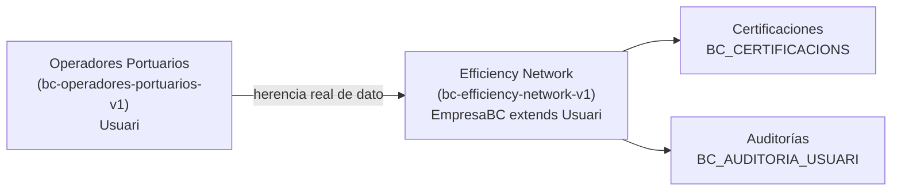

# [IA-GEN] Dossier — Efficiency Network (Business Club)

> **Borrador generado por IA** (APB AI Framework — síntesis de apb-disc-spec-gen-v1.0/apb-pm-product-analysis-v1.0/apb-arch-c4-model-v1.0/apb-arch-decompose-v1.0) — pendiente validación humana. No distribuir sin revisión.
>
> **Estado de este documento**: la app ya tiene bounded context real (`bc-efficiency-network-v1.md`, corregido 2026-07-13) y evidencia de código completa, pero **hereda el mismo bloqueante que Operadores Portuarios** (`parent_domain` tentativo) — las secciones de arquitectura/API/eventos son un diseño provisional coherente con esa evidencia, no definitivo hasta resolver ese bloqueante.

## 1. Cabecera

- **Nombre**: Efficiency Network (Business Club)
- **Dominio DDD**: `dom-operaciones-maritimas-v1` (tentativo — mismo bloqueante que `bc-operadores-portuarios-v1`)
- **Fase del roadmap**: 6 (nueva, auditoría de cobertura 2026-07-13)
- **Estado**: PROVISIONAL — bloqueante de dominio compartido con EPIC-17, corregido el mismo día tras verificación adicional (ya no "sin bounded context")
- **Bounded context**: `proposals/bc-efficiency-network-v1.md`
- **Épica**: `jira-backlog.md` EPIC-22

## 2. Resumen ejecutivo

Efficiency Network es el programa de certificaciones y auditorías de sostenibilidad del "Business Club" del puerto: empresas que se adhieren, obtienen certificaciones, pasan auditorías y registran formaciones ("coneixements") de sus contactos. **Hallazgo clave de esta auditoría**: la clase `EmpresaBC.java` **extiende** `Usuari.java` (herencia real de código, confirmada leyendo el fichero fuente) — es decir, toda empresa del Business Club es, estructuralmente, un Operador Portuario con datos adicionales del programa. Esto significa que Efficiency Network no es un dominio de negocio aislado sino una **extensión/especialización** de `bc-operadores-portuarios-v1`.

## 3. Análisis funcional

### Responsabilidad de negocio
Gestión del ciclo de vida de una empresa adherida al Business Club: alta, certificaciones, auditorías periódicas y registro de conocimientos/formaciones de sus contactos, con importación masiva desde fichero.

### Actores
- Gestor del programa Efficiency Network (rol de negocio dentro de APB).
- Empresa adherida (`EmpresaBC` — a la vez Operador Portuario).
- Contacto de la empresa (sujeto de "coneixements").

### Casos de uso reales (grounded en las 18 rutas Struts confirmadas)
- Alta/gestión de empresas (`/empresesEfficiencyNetwork` → `EmpresaENAction`).
- Alta/gestión de auditorías (`/auditoriesEfficiencyNetwork` → `AuditoriaENAction`, `/auditoriaNewEfficiencyNetwork` → `AuditoriesEmpresaNewAction`).
- Alta/gestión de certificados (`/certificatsEfficiencyNetwork` → `CertificatENAction`, `/certificatNewEfficiencyNetwork` → `CertificatsEmpresaNewAction`).
- Alta/gestión de conocimientos (`/coneixementsEfficiencyNetwork` → `ConeixementENAction`, `/coneixementNewEfficiencyNetwork` → `ConeixementsEmpresaNewAction`).
- Gestión de contactos (`/contactesEfficiencyNetwork` → `ContacteENAction`).
- Importación masiva desde fichero de auditorías/certificados/conocimientos (`ImportarAuditoriaENAction`/`ImportarCertificatENAction`/`ImportarConeixementENAction`).
- Mantenimiento de catálogos (`TipusAuditoriaAction`, `TipusConeixementAction`).

### Qué NO incluye
No gestiona el alta de un Operador Portuario "normal" (eso es `bc-operadores-portuarios-v1`) — solo la extensión de datos/procesos propios del programa Business Club sobre un operador ya existente.

## 4. Alcance de migración — qué se migra y qué NO por no estar en uso

- **Se migran las 18 rutas Struts confirmadas** (conteo exacto vía `grep` sobre `struts-config.xml`), sin duplicados ni huérfanas detectadas en este ámbito.
- **No se ha encontrado código muerto en este ámbito** en `dead-code-register.md` — no hay hallazgos de alta ni media confianza para `efficiencyNetwork`.
- **No se migra ninguna capacidad de gestión de terceros genérica aquí** — eso pertenece íntegramente a `bc-operadores-portuarios-v1`, para evitar duplicar el maestro.

## 5. Modelo de datos

`EmpresaBC` (extiende `Usuari`, hereda tabla `USUARI` + añade columnas propias no confirmadas 1:1 con nombre de tabla en esta pasada — el legacy usa una única tabla extendida, a decidir en destino si se modela como tabla de extensión o subtipo):
`raosocialbc`, `codibc`, `codiactivitatbc`, `anybc`, `visitesport`, `newsletters`, `tipviabc`, `nomcarrerbc`, `numcasabc`, `escalabc`, `pisbc`, `portabc`, `codpostalbc`, `poblaciobc`, `provinciabc`, `telfixbc`, `faxbc`, `mobilbc`, `emailbc`, `observacionsbc`, `paisbc`, `codildap`.

`BCCertificacions` (tabla `BC_CERTIFICACIONS`): `idusuari` (FK a `USUARI`/`EmpresaBC`), `idtipactivitat`, `seqbccertificat`, `datainici`, `datafi`, `datafivalidesa`, `codicertif` (ticket SOSBRAN-14), `datacertif`.

`BCAuditoriaUsuari` (tabla `BC_AUDITORIA_USUARI`) — no se ha extraído campo a campo en esta pasada, pendiente.

`TipusAuditoriaBC`/`TipusConeixementBC` (+ variantes `*Idioma`) — catálogos de tipos.

## 6. Arquitectura técnica

Stack DOCKS (.NET, Azure SQL, EntraID, Service Bus, APIM). Patrón: extensión/especialización de un agregado ya existente (`Usuari`/Operador Portuario) — en destino, evaluar modelar como **tabla de extensión 1:1** con el agregado `PortOperator` (mismo patrón que perfil extendido), en vez de un microservicio totalmente independiente.

## 7. Dominio DDD

- **Bounded context**: `bc-efficiency-network-v1`, downstream directo de `bc-operadores-portuarios-v1` (relación de herencia real, no solo referencia).
- **`parent_domain`**: mismo valor tentativo que `bc-operadores-portuarios-v1` — `dom-operaciones-maritimas-v1`, pendiente de confirmación de Arquitectura APB.
- **Recomendación de despliegue**: dado el acoplamiento estructural (herencia), evaluar desplegar Efficiency Network como parte del mismo servicio que Operadores Portuarios en vez de como microservicio separado — decisión de diseño, no tomada aquí.

## 8. Pantallas UI

Ver `ui-screens-backlog.md` §"App: Efficiency Network":
1. Listado de Empresas Adheridas (`dxDataGrid`).
2. Ficha de Empresa BC (`dxForm` + `dxTabPanel`: Datos generales, Certificaciones, Auditorías, Conocimientos).

## 9. APIs

| Método | Ruta | Descripción |
|---|---|---|
| GET/POST | `/api/v1/efficiency-network-companies` | Listar/dar de alta empresas del programa |
| POST | `/api/v1/efficiency-network-companies/{idusuari}/certifications` | Registrar certificación |
| POST | `/api/v1/efficiency-network-companies/{idusuari}/audits` | Registrar auditoría |

**No se ha generado OpenAPI formal** — pendiente hasta resolver el bloqueante de dominio, para no repetir el patrón de diseñar contratos sobre una jerarquía de dominio no confirmada.

## 10. Eventos

| Evento | Trigger | Consumidores |
|---|---|---|
| EmpresaEfficiencyNetworkRegistrada | Alta de empresa (marca `Usuari.eseffnetwork=true`) | — |
| CertificacionBCRegistrada | Nueva certificación | — |
| AuditoriaBCRegistrada | Nueva auditoría | — |

**No se ha generado AsyncAPI formal** — mismo motivo que en APIs.

## 11. Diagrama topológico (C4 nivel 1, provisional)

## 12. Estrategia de convivencia con el modelo actual

Igual que Operadores Portuarios: mientras no se confirme el `parent_domain`, no se debe migrar ni desplegar. Una vez resuelto, la estrategia natural (dada la herencia real) es un **cutover conjunto** con Operadores Portuarios, no dos migraciones independientes — separar ambos añadiría el riesgo de inconsistencia entre el maestro de terceros y su extensión Business Club durante la transición.

## 13. Testing y seguridad

No hay `testing-strategy`/`threat-model` específico — pendiente hasta resolver el diseño de destino. Nota de seguridad heredada de `bc-operadores-portuarios-v1`: ningún campo de credencial en el modelo.

## 14. Riesgos y gaps de evidencia conocidos

- `BCAuditoriaUsuari` no se ha extraído campo a campo.
- El propio bloqueante de `parent_domain` de `bc-operadores-portuarios-v1` se hereda íntegro.
- No confirmado si el modelo de destino debe ser tabla de extensión o subtipo/rol — decisión de diseño pendiente.

## 15. Estimación de esfuerzo

Ver `jira-backlog.md` EPIC-22 (3 historias, ~18 pts). Dependiente de EPIC-17.

## 16. Checklist de validación

**Funcional**:
- [ ] Confirmar que toda empresa Business Club debe seguir siendo, sin excepción, un Operador Portuario (¿hay casos reales de empresa BC sin actividad portuaria?).
- [ ] Validar el alcance real de "coneixements"/formaciones — ¿es relevante para el modelo destino o es funcionalidad a discontinuar?

**Desarrollo**:
- [ ] Confirmar si se despliega junto con Operadores Portuarios o como servicio separado.
- [ ] Extraer campo a campo `BCAuditoriaUsuari` antes de diseñar el modelo de datos definitivo.

## 17. Historial de cambios

| Versión | Fecha | Autor | Cambio |
|---------|-------|-------|--------|
| 1.0.0 | 2026-07-13 | APB AI Framework | Dossier inicial, a petición explícita del usuario. Corrige la clasificación previa de EPIC-22 ("sin dominio de encaje") tras verificación adicional que encontró `EmpresaBC extends Usuari` |
