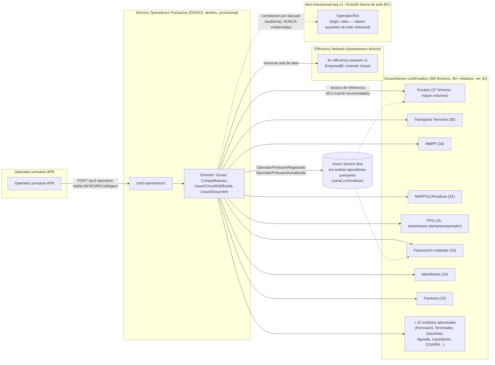

# [IA-GEN] Dossier — Operadores Portuarios / Terceros (Usuari)

> **Borrador generado por IA** (APB AI Framework — síntesis de apb-disc-spec-gen-v1.0/apb-pm-product-analysis-v1.0/apb-arch-c4-model-v1.0/apb-arch-decompose-v1.0) — pendiente validación humana. No distribuir sin revisión.
>
> **Estado de este documento**: la app ya tiene bounded context real (`bc-operadores-portuarios-v1.md`) y evidencia de código completa, pero **tiene `parent_domain` tentativo, bloqueante pendiente de confirmación por Arquitectura APB** (ver `pr-instructions.md §2.3`). Las secciones de arquitectura/API/eventos de este documento son un diseño **provisional coherente con la evidencia**, no definitivo hasta resolver ese bloqueante. `bc-efficiency-network-v1` (`dossier-22-efficiency-network.md`) **hereda este mismo bloqueante** — resolver el de este documento resuelve el de aquel.

## 1. Cabecera

- **Nombre**: Operadores Portuarios / Terceros (Usuari)
- **Dominio DDD**: `dom-operaciones-maritimas-v1` (tentativo — `bc-operadores-portuarios-v1.md:12`)
- **Fase del roadmap**: 6 (nueva, auditoría de cobertura 2026-07-13)
- **Estado**: PROVISIONAL — bloqueante de dominio, `jira-backlog.md` EPIC-17 marcado explícitamente **"requiere confirmación de Arquitectura APB antes de sprint planning"**
- **Bounded context de origen**: `proposals/bc-operadores-portuarios-v1.md`
- **Épica**: `jira-backlog.md` EPIC-17 — Extracción Operadores Portuarios / Terceros (Usuari)
- **Nota de gobernanza**: `pr-instructions.md §2.3` excluye explícitamente `bc-operadores-portuarios-v1.md` (y `bc-efficiency-network-v1.md`, que lo hereda) del PR de catálogo de dominios hasta resolver este bloqueante — a diferencia de `bc-buques-v1.md` (`dossier-17-buques.md`), que ya tiene `parent_domain` confirmado y está listo para enviarse.

## 2. Resumen ejecutivo

Operadores Portuarios mantiene el maestro de negocio de "terceros" del puerto — consignatarios, armadores, agentes de aduanas y cualquier operador económico facturable — en la tabla `USUARI` (`Usuari.java`, **2.252 líneas, 118 atributos `protected` declarados localmente**, confirmados uno a uno por lectura completa del fichero). Es, con diferencia, el dato maestro con el **fan-out de consumidores más amplio de todo el checkout SÒSTRAT**: un grep exhaustivo de `import org.apb.sostrat.dataaccess.dto.Usuari;` sobre todo el repositorio (`sostrat/`, `sostrat-CARGASINICIALES/`, `sostrat-BATCH/`, `sostratWSCXF/`) devuelve **369 ficheros**, repartidos en al menos 30 módulos funcionales distintos — muy por encima incluso del fan-out ya documentado como "excepcionalmente amplio" para Buques (145 ficheros, `dossier-17-buques.md §2`).

**Cuatro hallazgos nuevos de esta verificación, no presentes en la documentación previa**:

1. **El fan-out real (369 ficheros, 30+ módulos) es sustancialmente mayor que el ya amplio conjunto citado por `bc-operadores-portuarios-v1.md`** (que solo cita Escalas/Liquidación/Facturación como `downstream_contexts`). Por volumen de ficheros consumidores: Escalas (37), Transporte Terrestre (36), MMPP (34), Marpol/Residuos (21), PPS (16), Facturación estándar/`factestandar` (15), Manifiestos (14), Facturas (10), Servicios Auxiliares de Cruceros (9), Ferrocarril (8), Terminales (7), Garantías (7), Aguada (7), Liquidación (6), COARRI (5), Suministros (4), Marinas/Pesca (4), Efficiency Network (4), Aduanas (4), Mano de Estiba (3), Depotsis (3), Cruceros (3), Carpeta Cliente (3), PAXLST (2), Liquidador MM (2), Clavegueram (2), y varios módulos con 1 fichero. Es, en la práctica, el segundo maestro de referencia transversal del sistema tras Buques (ver `dossier-17-buques.md`), y ambos comparten consumidores reales (Escalas, PPS, Liquidación).
2. **Tabla de cuenta bancaria real, no documentada antes**: `Usuari` tiene una relación 1:N con `CompteBancari` (tabla `COMPTE_BANCARI`, FK `idusuari`) con campos `banc`, `idsucursal`, `digcontrol`, `compte`, `titcompte`, `iban`, `bic`, `datamandat`, `canvimandat` (mandato SEPA) — es decir, **el operador portuario tiene datos bancarios reales para domiciliación de cobros**, gestionados por `UsuariDelegate.modificarClienteCarpeta`/`CN_Usuari_Impl.anyadirCompte`/`modificarCompte`/`eliminarCompte` (estos tres últimos marcados `@deprecated Utilizar CompteBancariDelegate que captura la Auditoria` — ver §4). Ni `bc-operadores-portuarios-v1.md` ni `specs/openapi-operadores-portuarios.yaml` mencionan esta tabla.
3. **Corrección de tipo**: `Usuari.eseffnetwork` es `String` (valores `"S"`/`"N"`, asignado literalmente así en `CN_Usuari_Impl.java:978-980`), **no `Boolean`** como afirman `bc-operadores-portuarios-v1.md` ("campo booleano"), `dossier-22-efficiency-network.md §10` (`Usuari.eseffnetwork=true`) y `specs/openapi-operadores-portuarios.yaml` (`eseffnetwork: {type: boolean}`). Es una discrepancia de tipo real entre el DTO fuente y los tres documentos que lo citan.
4. **Hallazgo que afecta directamente a la relación con Efficiency Network (§7)**: `EmpresaBC.java` (`extends Usuari`, confirmado — coherente con `dossier-22-efficiency-network.md`) **redeclara como campos propios 22 atributos que ya existen, con el mismo nombre y tipo, como campos `protected` heredados de `Usuari`** (`raosocialbc`, `codibc`, `codiactivitatbc`, `anybc`, `visitesport`, `newsletters`, `tipviabc`, `nomcarrerbc`, `numcasabc`, `escalabc`, `pisbc`, `portabc`, `codpostalbc`, `poblaciobc`, `provinciabc`, `telfixbc`, `faxbc`, `mobilbc`, `emailbc`, `observacionsbc`, `paisbc`, `codildap`). En Java esto es *field hiding*, no herencia de dato: `EmpresaBC` no añade columnas nuevas de negocio con esos 22 nombres — son, en realidad, **columnas que ya viven en la propia tabla `USUARI`** (confirmado por Javadoc de columna en `Usuari.java:341-361`), y la subclase declara una copia local con getters/setters propios en vez de reutilizar los heredados. Esto corrige, con evidencia nueva, la premisa implícita de `dossier-22-efficiency-network.md §5` de que estas 22 columnas son "propias" de la extensión Business Club — son, de hecho, parte del maestro de Operadores Portuarios en el propio legacy, un dato relevante para la decisión de modelado en destino (§7).

Corrección cuantitativa menor: `coverage-audit.md:88` cita "Usuari | 15" rutas para el clúster `org.apb.sostrat.mvc.control.Usuari*`. El recuento exacto por parseo de `struts-config.xml` (acciones cuyo `type` empieza por `org.apb.sostrat.mvc.control.Usuari`) da **15 rutas activas, ninguna comentada** — coincide exactamente.

## 3. Análisis funcional

### Responsabilidad de negocio
Mantiene el maestro de "terceros" del negocio portuario: consignatarios, armadores, agentes de aduanas y cualquier operador económico facturable. Gestiona identificación fiscal (NIF/EORI/CNAE/código de agente), direcciones (fiscal/notificación/física), publicación web del operador, facturación electrónica (FACe), cuentas bancarias/mandato SEPA, lista negra y adhesión al programa Efficiency Network.

### Actores
- Operador portuario APB (alta/modificación/baja del tercero).
- Escalas (asigna consignatario/armador responsable a un servicio marítimo).
- Liquidación/Facturación (resuelve el sujeto facturado).
- Al menos 25 módulos consumidores adicionales que leen el maestro como referencia (ver §2/§7).

### Casos de uso reales (grounded en las 15 rutas Struts confirmadas — `org.apb.sostrat.mvc.control.Usuari*`, `struts-config.xml`)
- **Mantenimiento del operador**: `/usuari` y `/usuari_popup` → `UsuariAction.java` (713 líneas), `/pda/usuari` → misma Action reutilizada desde el módulo PDA.
- **Validaciones de alta en tiempo real** (métodos propios de `UsuariAction`, invocados vía AJAX desde el formulario): `comprobarDNI` (línea 270), `comprobarEORI` (línea 554, delega en `UsuariDelegate.comprobarEORI`), `comprobarCodiAgent` (línea 606, delega en `UsuariDelegate.comprobarCodiAgent`), `existeNifEnBBDD` (línea 697), `verUsuariosMismoNif` (línea 322).
- **Baja lógica y restauración** (mismo patrón que Buques — `dossier-17-buques.md §3`): `restaurar` (línea 468) y `dardeBaixa` (línea 498) en `UsuariAction`, delegando en `UsuariDelegate.restaurar`/`dardeBaixa` → `CN_Usuari_Impl.dardeBaixa(strIdUsuari, pStrOperador, proces)`.
- **Auditoría del maestro**: `/usuariAudit` y `/usuariAudit_popup` → `UsuariAuditAction.java` (145 líneas), sobre la tabla `USUARI_AUDIT`.
- **Dependientes/vínculos del operador**: `/usuariDependent` → `UsuariDependentAction.java` (625 líneas) — gestión de vínculos/actividades/asociaciones del tercero (`mostrarFiltroVinculosActividadesAsociaciones`, `Vincle`).
- **Circuitos EDI del operador**: `/usuariCircuitEDI`, `/usuariCircuitEDIUsuari`, `/usuariCircuitEDICircuit` (+ 3 variantes `_popup`) → `UsuariCircuitEDIAction.java` (798 líneas, 6 rutas) — asignación de terceros a circuitos/bandejas de mensajería EDI, tabla `USUARI_CIRCUIT_EDI`.
- **Baja de expedidor/receptor MMPP**: `/bajaExpedidorReceptorMMPP_popup` → reutiliza `UsuariAction` con `parameter="metodo"` — caso de uso específico de MMPP sobre el mismo maestro.
- **Documentación adjunta**: `/usuariDocs` y `/usuariDocs_popup` → `UsuarioDocsAdjuntosAction.java`, tabla `USUARI_DOCUMENT` (no cuenta como ruta del patrón `Usuari*Action` porque la clase se llama `UsuarioDocsAdjuntosAction`, pero es funcionalmente del mismo módulo).

### Reglas de negocio confirmadas en código
- `Usuari` (tabla `USUARI`, PK `idusuari`) tiene **118 atributos `protected` declarados localmente** en `Usuari.java` (2.252 líneas) — recuento exacto por `grep` de declaraciones de campo, no una estimación. Sensiblemente más que los "60+ campos" citados por `bc-operadores-portuarios-v1.md:54`.
- `UsuariDelegate.crear`/`insertarIndicandoVinculo`/`modificarIndicandoVinculo` gestionan de forma explícita el vínculo (`Vincle`) del tercero con un tipo de vínculo (`pStrIdTipVincle`), no solo el alta simple del maestro.
- `dardeBaixa`/`restaurar` son operaciones reales y distintas de un borrado físico — mismo patrón de baja lógica ya confirmado en Buques.
- `eseffnetwork` (`String`, `"S"`/`"N"`) se calcula/asigna desde `CN_Usuari_Impl.java:978-980` — confirmado como campo de negocio real gestionado por el propio servicio de Operadores Portuarios, no solo un flag de solo lectura para Efficiency Network.
- `CompteBancari` (tabla `COMPTE_BANCARI`, FK `idusuari`) es una relación 1:N real con mandato SEPA (`iban`, `bic`, `datamandat`, `canvimandat`) — ver §5/§13 para la clasificación de sensibilidad.

### Qué NO incluye — frontera con autenticación/EntraID
**No es la capa de autenticación/login.** La gestión de credenciales, sesiones y roles de aplicación vive en el paquete `org.apb.sostrat.core.mvc.control` (clases `OperadorAplicacionAction`, `OperadorAplicacionAuditAction`, `OperadorExternAction`, `RolAction`, `OperadoresRolAction` — **9 rutas Struts confirmadas** por `grep` sobre `struts-config.xml`: `/operador`, `/operador_popup`, `/operadorAudit`, `/operadorAudit_popup`, `/operadorExtern`, `/rol`, `/rol_popup`, `/operadoresRol_popup`, y 1 ruta adicional del mismo prefijo). **Las clases `.java` de ese paquete no están presentes en este checkout** (confirmado por `find` sobre `core/mvc/control/` — el único fichero encontrado bajo ese path es un test, `SdfActionTest.java`, no relacionado con Operador/Rol), consistente con lo ya afirmado en `bc-operadores-portuarios-v1.md notes` y `dossier-22-efficiency-network.md §"Lo que NO incluye"`. Esta capa se cubre en el modelo destino por `dom-transversal-arq-v1`/EntraID, sin necesidad de migrar lógica.

**Confirmado por lectura completa de `Usuari.java` (118 campos, 2.252 líneas)**: cero campos de credencial (`pass`/`password`/`credential`/`contrasenya` — 0 resultados de `grep` case-insensitive sobre el fichero completo). El único campo con apariencia de identificador de sistema externo es `codildap` (String) — un código de correlación con LDAP, no una credencial en sí, y de origen incierto (no hay comentario de negocio que lo explique, ver §14).

## 4. Alcance de migración — qué se migra y qué NO por no estar en uso

- **Se migran las 15 rutas Struts confirmadas** del patrón `org.apb.sostrat.mvc.control.Usuari*` (coincide exactamente con `coverage-audit.md:88`), más `/usuariDocs`/`/usuariDocs_popup` (funcionalmente parte del mismo módulo, aunque la clase se llame `UsuarioDocsAdjuntosAction`).
- **No se ha encontrado código muerto de confianza ALTA específico de Operadores Portuarios** en `dead-code-register.md` — no hay entradas para el módulo `Usuari` en ese registro, y no se han encontrado bloques comentados con declaración explícita ("NO SE USA"/"obsoleto") en `UsuariAction.java`, `UsuariAuditAction.java`, `UsuariCircuitEDIAction.java`, `UsuariDependentAction.java` ni `CN_Usuari_Impl.java`.
- **Hallazgo de esta verificación, no de confianza ALTA (no encaja en el patrón de bloque comentado con justificación) pero relevante para el alcance de migración**: `CN_Usuari_Impl.java` tiene **6 métodos marcados `@deprecated`** (`anyadirCompte`, `eliminarCompte`, `modificarCompte`, `obtenerListaCuentas`, `obtenerCuenta` — todos con la nota `"Utilizar CompteBancariDelegate que captura la Auditoria"` — más `dardeBaixa(String)` y `eliminar(String)` de un solo parámetro, marcados `@deprecated` en favor de las variantes con `pStrOperador` que sí capturan auditoría). **No son código muerto** — siguen siendo overloads de compatibilidad hacia atrás que delegan en la versión nueva, no bloques inertes — pero **no deben migrarse tal cual al servicio destino**: la versión definitiva de cada operación es la que sí recibe `pStrOperador`/usa `CompteBancariDelegate`, y el diseño destino debe partir de esas, no de los overloads deprecados.
- **No se migra ninguna lógica de autenticación/login** (`Operador`/`Rol`) — ver §3.

## 5. Modelo de datos

Todos los campos siguientes están extraídos directamente de los DTOs reales en `sostrat/src/org/apb/sostrat/dataaccess/dto/` del checkout `SOSTRAT-Sostrat-MJ8`.

### `Usuari` (tabla `USUARI`, PK `idusuari`)
**118 atributos `protected` declarados localmente**, confirmados uno a uno por Javadoc de columna (`grep -nP '^\tprotected \S+ \S+;'` sobre `Usuari.java`, 2.252 líneas). Se agrupan a continuación por función de negocio — **la distinción "negocio" vs. "autenticación" es la clave de este dossier: los 118 campos son íntegramente de negocio; cero son de autenticación** (ver §3):

**Identificación fiscal/negocio**: `idusuari` (PK), `tippersona`, `nom`, `cognom1`, `cognom2`, `nomraosocial`, `nomabreujat`, `idgruempresarial`, `idgenere`, `estat`, `nif`, `cnae`, `coddb`, `codiagent`, `eori`, `llista_negra` (`Boolean`), `tipdocument`, `paisdocument` (`Integer`), `datnaix`, `idemprelacionada`, `codrossp`, `codross`.

**Direcciones (3 juegos completos — fiscal `DS`, notificación `DN`, y campos de contacto genéricos)**: `tipviads`/`nomcarrerds`/`numcasads`/`escalads`/`pisds`/`portads`/`codpostalds`/`poblaciods`/`provinciads`/`paisds`/`telfixds`/`faxds`/`mobilds`/`emailds`/`observacionsds`; `nomnotificacio`/`tipviadn`/`nomcarrerdn`/`numcasadn`/`escaladn`/`pisdn`/`portadn`/`codpostaldn`/`poblaciodn`/`provinciadn`/`paisdn`/`telfixdn`/`faxdn`/`mobildn`/`emaildn`/`observacionsdn`; `conprincipal`, `carcontacte`, `actprincipal`, `idiomacom`, `telurgencia1`/`telurgencia2`.

**Auditoría de concurrencia** (mismo patrón que `Solicitud`/`Vaixell` en otros dossiers): `datbaixa`, `datalta`, `datmodificacio`, `idprocalta`, `idopealta`, `idopemodificacio`, `idprocmodificacio`.

**Facturación**: `numcopfactura` (Integer), `compteface` (Integer, FACT-1295 — cuenta FACe de facturación electrónica).

**Efficiency Network (Business Club, ver §7)**: `eseffnetwork` (**`String`, valores `"S"`/`"N"` — no `Boolean`**, ver §2 hallazgo 3), `idtipcompcreuerista` (SOSO-2111), `acronimcreuer` (SOSO-2191), y los **22 campos `*bc`/`codildap` ya listados en §2 hallazgo 4** (`raosocialbc`, `codibc`, `codiactivitatbc`, `anybc`, `observacionsbc`, `codildap`, `visitesport`, `newsletters`, `nomcarrerbc`, `tipviabc`, `numcasabc`, `escalabc`, `pisbc`, `portabc`, `codpostalbc`, `poblaciobc`, `provinciabc`, `paisbc`, `faxbc`, `emailbc`, `telfixbc`, `mobilbc`) — **estas 22 columnas ya viven en `USUARI`, no son una tabla de extensión aparte** (corrección a `dossier-22-efficiency-network.md §5`, ver §2).

**Publicación web del operador**: `logo`/`imgcontenttype` (imagen en BD), `codoc`/`codog`/`codut`, `nomweb`/`adrecaweb`/`codipostalweb`/`poblacioweb`/`numtelfweb`/`numfaxweb`/`emailweb`/`urlweb`/`logoweb`/`observacionsweb`/`datinipublicweb`/`datfinpublicweb`/`esbaixaweb`, `logowebcontent`/`imgwebcontenttype`/`iddocumentlogoweb`.

**Otros**: `infoadicionalef`, `primeralta`/`nompare`/`nommare` (PPS-530 — probablemente ligado a `bc-pps-v1`, no explorado en detalle en esta pasada).

### `CompteBancari` (tabla `COMPTE_BANCARI`, FK `idusuari`) — **hallazgo nuevo de esta verificación, no documentado antes**
`idusuari` (FK), `seqcombancari`, `banc`, `idsucursal`, `digcontrol`, `compte`, `titcompte`, `iban`, `bic`, `idtarifa`, `idsubtarifa`, `extensio`, `datbaixa`/`datalta`/`datmodificacio` + auditoría completa (`idprocalta`/`idprocmodificacio`/`idopealta`/`idopemodificacio`), `datamandat`, `canvimandat` — mandato SEPA de domiciliación bancaria del operador. Gestionado hoy por `CN_Usuari_Impl` (métodos `@deprecated`, ver §4) y, según el propio Javadoc, por `CompteBancariDelegate` (fuera del alcance de esta pasada, no explorado campo a campo).

### `UsuariAudit` (tabla `USUARI_AUDIT`) — mismo patrón que `SolicitudAudit`/`VaixellAudit`
Réplica funcional de los campos más relevantes de `Usuari` con fines de auditoría, más `seq` (PK), `idproces`, `idtipopera`, `idoperador`, `dataudit` — no volcada campo a campo en su totalidad en esta pasada por ser una réplica del maestro.

### `UsuariCares` (tabla `USUARI_CARES`, PK `idusuari`+`usucares`)
Entidad mínima: solo `idusuari` y `usucares` — relación N:N ligera, sin más campos propios ni auditoría. Semántica de negocio de `usucares` no confirmada en esta pasada (nombre sugiere "operador de cares/caras" — no explorado, ver §14).

### `UsuariCircuitEdi` (tabla `USUARI_CIRCUIT_EDI`, PK `idusuari`+`idcircuit`)
`idusuari`, `idcircuit`, `obsusucircuit`, `datbaixa`, `datalta`, `enproves` — asignación del operador a un circuito de mensajería EDI, gestionado por `UsuariCircuitEDIAction`.

### `UsuariCircuitBustia` (tabla `USUARI_CIRCUIT_BUSTIA`, PK `idusuari`+`idcircuit`+`idbustia`)
`idusuari`, `idcircuit`, `idbustia`, `datbaixa` — asignación del operador a una bandeja de mensajería dentro de un circuito.

### `UsuariDocument` (tabla `USUARI_DOCUMENT`, PK `idusuari`+`iddocument`)
`idusuari`, `iddocument`, `tipdoc`, `subtipdoc`, `datalta`/`datmodificacio` + auditoría (`idprocalta`/`idprocmodificacio`/`idopealta`/`idopemodificacio`) — documentación adjunta al operador, gestionada por `UsuarioDocsAdjuntosAction`.

### Mapeo a Azure SQL
Migración directa tabla-a-tabla: `USUARI` → `PortOperators` (o equivalente), `COMPTE_BANCARI` → `PortOperatorBankAccounts` (candidata a cifrado a nivel de columna para `iban`/`compte`, ver §13), `USUARI_AUDIT` → histórico de auditoría (append-only), `USUARI_CARES`/`USUARI_CIRCUIT_EDI`/`USUARI_CIRCUIT_BUSTIA`/`USUARI_DOCUMENT` como entidades propias. No se ha diseñado el esquema Azure SQL definitivo en esta pasada.

## 6. Arquitectura técnica

Stack DOCKS (.NET, Azure SQL, EntraID, Service Bus, APIM), servicio dedicado tras `/port-operators/v1` (`specs/openapi-operadores-portuarios.yaml:25`, servidor APIM).

- **Recomendación de separación negocio/autenticación (confirmada por evidencia, no solo por diseño)**: el maestro `Usuari` no tiene ningún campo de credencial — la separación entre "operador portuario" (dato de negocio, este servicio) y "cuenta de sistema" (`Operador`/`Rol`, IAM técnico) ya existe en el propio legacy como dos paquetes/tablas físicamente distintos, sin solapamiento de columnas. En destino, esto se traduce directamente: `PortOperators` (Azure SQL, este servicio) no debe tener ningún campo de login/rol; la identidad de aplicación la resuelve EntraID íntegramente, correlacionada por `idusuari` solo si negocio confirma que hace falta un puente (`jira-backlog.md:379`, tarea técnica pendiente).
- **Patrón de diseño destino: maestro de referencia con fan-out muy alto (369 ficheros, 30+ módulos, ver §2)** — mismo patrón que Buques (`dossier-17-buques.md §6`), y candidato al mismo tipo de recomendación: caché de solo lectura en cada consumidor o servicio de referencia de alta disponibilidad/baja latencia, no un microservicio transaccional pesado. A diferencia de Buques, Operadores Portuarios **sí tiene god classes reales dentro de su propio módulo**: `CN_Usuari_Impl.java` (2.425 líneas) y `Usuari.java` (2.252 líneas) son considerablemente más grandes que sus equivalentes de Buques (`CN_Vaixell_Impl.java`, 963 líneas) — puede requerir refactor de caracterización antes de la extracción, a confirmar en una sesión de análisis de complejidad dedicada (no realizada en esta pasada).
- **`CompteBancari`/mandato SEPA (§5) debe tratarse como dato financiero sensible**, aunque no sea una "credencial" en el sentido de login — recomendado cifrado a nivel de columna o Azure Key Vault para `iban`/`compte`/`bic`, y **exclusión explícita de cualquier evento de dominio publicado en Service Bus** (ver §10/§13).
- **Los 6 métodos `@deprecated` de `CN_Usuari_Impl` (§4) no deben ser la base del diseño de la API destino** — el contrato `/port-operators/v1` debe modelarse sobre las versiones no deprecadas (las que capturan auditoría vía `pStrOperador`/`CompteBancariDelegate`).

## 7. Dominio DDD

- **Bounded context**: `bc-operadores-portuarios-v1`, `parent_domain: dom-operaciones-maritimas-v1` (**tentativo**, `proposals/bc-operadores-portuarios-v1.md:12`). No confirmado por Arquitectura APB — bloqueante de diseño explícito en `jira-backlog.md` EPIC-17.
- **Motivo del bloqueante (sin cambios respecto a `bc-operadores-portuarios-v1.md notes`, confirmado de nuevo por esta verificación)**: `Usuari` es dato maestro cross-domain — consumido con la misma intensidad por Operaciones Marítimas (Escalas, asignación de consignatario/armador vía `ServeiMaritimVaixellUsuari`/`VaixellUsuariBonificacio`, ambos confirmados presentes en el checkout) y por Facturación/Liquidación (`InfoUsuarioLiquidacionDTO.java`, confirmado presente, extrae NIF/dirección/idioma del maestro para liquidar). El fan-out real de 369 ficheros/30+ módulos confirmado en esta pasada (§2) **refuerza el argumento de "dato maestro transversal"**, no lo resuelve — cuantos más módulos de negocio distintos dependen del maestro, menos evidente es que deba colgar exclusivamente de un único dominio de negocio (Operaciones Marítimas) en vez de tener dominio propio ("Terceros"/"Operadores Económicos", como ya sugiere `bc-operadores-portuarios-v1.md notes`).
- **Relación con Efficiency Network — verificación de solapamiento/no-duplicación**:
  - `bc-efficiency-network-v1` (`dossier-22-efficiency-network.md`) es, por herencia real de código (`EmpresaBC extends Usuari`), downstream directo de este bounded context — confirmado de nuevo en esta pasada, sin contradicción respecto a `dossier-22`.
  - **Matiz nuevo de esta verificación (§2 hallazgo 4, sin contradecir la afirmación central de `dossier-22`)**: las 22 columnas `*bc`/`codildap` que `dossier-22-efficiency-network.md §5` presenta como "añadidas por `EmpresaBC.java`" **ya existen como campos `protected` en el propio `Usuari.java`** — es decir, forman parte del maestro de Operadores Portuarios en el propio legacy, no de una tabla de extensión separada. `EmpresaBC` las redeclara (field hiding de Java, no herencia de dato), lo cual es un patrón de código señal de una migración de modelo (probablemente MMPP/negocio de Business Club moviéndose hacia el propio `USUARI` en algún momento del historial del proyecto) sin limpiar la subclase. **Recomendación de diseño destino, no tomada aquí**: si Arquitectura APB confirma `Efficiency Network` como extensión de `PortOperator`, estas 22 columnas deberían modelarse como parte del propio agregado `PortOperator` (opcionalmente con un sub-objeto `BusinessClubMembership`), no como una tabla de extensión 1:1 aparte — a diferencia de lo que sugiere `dossier-22-efficiency-network.md §6` ("tabla de extensión 1:1").
  - **Sin solapamiento de rutas Struts**: las 15 rutas `Usuari*` (`coverage-audit.md:88`) y las 18 rutas `efficiencyNetwork` (`coverage-audit.md:71`) son conjuntos disjuntos, confirmado por `coverage-audit.md §1.1/§1.3`.
- **Sin solapamiento con `bc-buques-v1`**: confirmado también desde el lado de Buques (`dossier-17-buques.md §7`, "agregado distinto, sin solapamiento — Buques modela el activo físico, Operadores Portuarios modela al tercero de negocio"). La entidad puente `ServeiMaritimVaixellUsuari` (propiedad de Escalas) es el único punto de unión entre ambos maestros, y no vive en ninguno de los dos bounded contexts.
- **Coherencia con `dossier-22-efficiency-network.md`**: este documento no contradice ninguna afirmación central de `dossier-22` — la herencia real `EmpresaBC extends Usuari`, el bloqueante compartido de `parent_domain`, y la recomendación de no migrar/desplegar hasta resolverlo se mantienen sin cambios. Añade evidencia nueva (§2 hallazgo 4) que matiza, no contradice, la sección de modelo de datos de `dossier-22`.

## 8. Pantallas UI

Ver `ui-screens-backlog.md` §"App: Operadores Portuarios" (Fase 6, líneas 128-130, marcada `⚠️ bloqueado por decisión de dominio, ver EPIC-17`):
1. **Listado de Operadores** (`dxDataGrid`) — columnas: `nom`, `nif`, `eori`, `codiagent`, `tippersona`.
2. **Ficha de Operador** (`dxForm`) — datos fiscales, direcciones, facturación electrónica (FACe).

**Gap frente al backlog de UI, encontrado en esta verificación**: no hay pantalla propuesta para `CompteBancari` (cuentas bancarias/mandato SEPA, §5), `UsuariCircuitEdi`/`UsuariCircuitBustia` (circuitos EDI, gestionados hoy por una Action de 798 líneas — la segunda más grande del módulo), `UsuariDependent` (vínculos/actividades/asociaciones, 625 líneas) ni `UsuariDocument` (documentación adjunta) — pese a que estas 4 entidades tienen Actions dedicadas y, en el caso de `UsuariCircuitEDIAction`, es la Action de mayor volumen de código del módulo tras la propia `UsuariAction`. Mismo patrón de gap ya señalado en `dossier-05-pps.md §8` y `dossier-17-buques.md §8` para sus respectivos módulos.

## 9. APIs

| Método | Ruta | Descripción |
|---|---|---|
| GET | `/port-operators` | Listar operadores portuarios (filtros `nif`/`eori`, paginación cursor) |
| POST | `/port-operators` | Dar de alta un operador portuario (valida DNI/EORI/código de agente igual que `comprobarDNI`/`comprobarEORI`/`comprobarCodiAgent`) |
| GET | `/port-operators/{idusuari}` | Consultar un operador portuario |

Contrato completo: `specs/openapi-operadores-portuarios.yaml` (`version: "0.1.0-provisional"`). **No definitivo hasta resolver el bloqueante de dominio** (el propio spec lo declara: `x-blocking-gap: "parent_domain no confirmado — no implementar hasta validación con Arquitectura APB"`).

**Gaps confirmados por esta verificación**:
- **Cobertura de campos muy incompleta**: el esquema `PortOperator`/`PortOperatorCreate` solo modela 10 de los 118 atributos reales de `Usuari.java` (`idusuari`, `tippersona`, `nom`, `cognom1`, `nif`, `eori`, `cnae`, `codiagent`, `comptefaceenlace`, `eseffnetwork`, `llistanegra`) — faltan todas las direcciones (fiscal/notificación), toda la publicación web, los campos de Efficiency Network más allá del flag, y no hay ningún recurso para `CompteBancari` pese a ser dato real y activo (§5).
- **Error de tipo confirmado**: `eseffnetwork` está tipado `boolean` en el spec; el campo real es `String` (`"S"`/`"N"`) — ver §2 hallazgo 3.
- **Nombre de campo inconsistente**: el spec usa `comptefaceenlace`; el campo real en `Usuari.java` es `compteface` (Integer) — no hay ningún campo `comptefaceenlace` en el DTO fuente.
- **Sin endpoints de baja/restauración**: `UsuariAction.dardeBaixa`/`restaurar` son operaciones reales (§3), pero el spec no define `POST /port-operators/{idusuari}/deactivate` ni `/restore` — mismo gap ya señalado para Buques en `dossier-17-buques.md §9`.
- **Sin sub-recurso de cuentas bancarias**: `CompteBancari` (§5) no tiene ningún endpoint propuesto, pese a ser dato financiero real y activo.

## 10. Eventos

| Evento | Trigger | Consumidores |
|---|---|---|
| `OperadorPortuarioRegistrado` | Alta de un tercero (`UsuariDelegate.crear`/`insertarIndicandoVinculo`) | Escalas (asignación de consignatario/armador), Liquidación (sujeto facturado) |
| `OperadorPortuarioActualizado` | Modificación de datos fiscales/facturación (`UsuariDelegate.modificar`) | Mismos que arriba, más Efficiency Network (`eseffnetwork`) si aplica |

**Fuente**: `dataaccess/dto/Usuari.java` (tabla `USUARI`), `events-catalog.md §Fase 6`. Payload documentado: `{ idusuari, nif, eori, codiagent, tippersona }`.

**Nota de seguridad, ya correcta en `events-catalog.md` y `specs/openapi-operadores-portuarios.yaml`, reafirmada por esta verificación**: confirmado por lectura completa del DTO (118 campos, 2.252 líneas) que no existe ningún campo de credencial — este evento nunca debe incluir datos de autenticación. **Añadido por esta verificación**: tampoco debe incluir nunca campos de `CompteBancari` (IBAN/BIC/mandato SEPA, §5/§6) — no estaban en el alcance de la nota de seguridad original porque esa tabla no se había documentado antes.

**No se ha generado AsyncAPI formal de Fase 6 para este canal** — mismo gap ya señalado en `dossier-17-buques.md §10` para `evt.sostrat.buques`; pendiente hasta resolver el bloqueante de dominio, para no repetir el patrón de diseñar contratos sobre una jerarquía no confirmada.

## 11. Diagrama topológico (C4 nivel 1, provisional)

## 12. Estrategia de convivencia con el modelo actual

1. **No migrar ni desplegar hasta resolver `parent_domain`** — mismo razonamiento que `dossier-22-efficiency-network.md §12`: el bloqueante es de decisión de dominio (Operaciones Marítimas vs. dominio propio "Terceros"), no de evidencia de código, que ya está completa en esta pasada.
2. **Cutover conjunto con Efficiency Network**: dado que `EmpresaBC extends Usuari` es herencia real (§7), separar ambas migraciones en el tiempo introduce el mismo riesgo de inconsistencia ya señalado en `dossier-22-efficiency-network.md §12` — resolver el bloqueante de este documento habilita directamente el de Efficiency Network.
3. **Publicar la API de referencia antes que los sub-recursos de menor volumen**: `GET/POST /port-operators` cubre el caso de uso principal (alta/consulta del tercero); `CompteBancari`, `UsuariCircuitEdi`/`Bustia` y `UsuariDocument` pueden migrarse en una segunda ola, igual que el patrón ya aplicado a Buques con certificados/ISPS (`dossier-17-buques.md §12`).
4. **Dado el fan-out de 369 ficheros/30+ módulos, evaluar el mismo argumento que en Buques de "migrar antes o en paralelo con los consumidores, no después"** (`dossier-17-buques.md §12`) — una vez resuelto el bloqueante de dominio, el riesgo de coordinación (no el técnico) es previsiblemente el mayor factor de este BC en todo el catálogo, dado que su fan-out (369) supera incluso al ya documentado como más amplio del catálogo (Buques, 145).
5. **`CompteBancari` requiere su propia decisión de convivencia**: al ser dato financiero (SEPA), cualquier estrategia de dual-write durante la transición debe evaluarse con el equipo de Facturación antes de comprometerse — no se ha hecho en esta pasada (ver §14).

## 13. Testing y seguridad

- **Estrategia de testing**: no se ha localizado una sección dedicada a Operadores Portuarios en `testing-strategy-fase2-4.md` (Fase 2-4; este BC es Fase 6, descubierto después) — mismo gap de evidencia ya señalado en `dossier-17-buques.md §13`.
  - **Recomendado por esta verificación**: tests de contrato explícitos para los consumidores de mayor volumen (Escalas, Transporte Terrestre, MMPP — 37/36/34 ficheros respectivamente), no solo para los 3 ya citados en `bc-operadores-portuarios-v1.md` (Escalas/Liquidación/Facturación).
  - Test de validación de alta: `comprobarDNI`/`comprobarEORI`/`comprobarCodiAgent` deben replicarse exactamente en el servicio destino (criterio de aceptación ya explícito en `jira-backlog.md:373`).
- **Threat model**: no se ha localizado ninguna entrada específica de Operadores Portuarios en `threat-model-fase2-4.md` (mismo motivo, Fase 6) — gap de evidencia explícito.
  - **Superficie nueva a evaluar, no cubierta hoy**: `CompteBancari`/mandato SEPA (§5/§6) es dato financiero real que hoy no tiene ningún análisis de amenazas — clasificarlo como dato sensible (no solo "de negocio") y evaluar cifrado a nivel de columna/Key Vault antes de producción.
- **Nota de seguridad obligatoria (heredada de `bc-operadores-portuarios-v1.md`, reafirmada por lectura completa del DTO en esta pasada)**: **ningún campo de credencial debe migrarse tal cual** — confirmado que `Usuari.java` (118 campos) no contiene ninguno; la autenticación/roles va íntegramente a EntraID (`dom-transversal-arq-v1`), sin migración de lógica de login.
- **Añadido por esta verificación**: los datos bancarios (`CompteBancari`) tampoco deben tratarse como "solo negocio" sin más — aunque no son credenciales de login, sí son datos financieros sujetos a normativa (PSD2/SEPA) y deben excluirse de cualquier evento de dominio (§10) y de cualquier log/caché de solo lectura sin cifrado.

## 14. Riesgos y gaps de evidencia conocidos

- **Bloqueante de dominio (riesgo principal)**: `parent_domain` tentativo, sin confirmar por Arquitectura APB — bloquea el envío al catálogo (`pr-instructions.md §2.3`) y el propio sprint planning de `jira-backlog.md` EPIC-17. Efficiency Network hereda este mismo bloqueante.
- **Fan-out de consumidores (369 ficheros, 30+ módulos) muy superior al documentado por `bc-operadores-portuarios-v1.md`** (que solo cita 3: Escalas/Liquidación/Facturación) — el criterio de éxito de EPIC-17 debería ampliarse explícitamente, mismo patrón de riesgo ya señalado para Buques en `dossier-17-buques.md §14`.
- **`CompteBancari`/mandato SEPA no documentado previamente** en ningún fichero de discovery — no estimado en story points, sin threat model, sin endpoint de API propuesto (§5/§9/§13).
- **Discrepancia de tipo confirmada**: `eseffnetwork` es `String` (`"S"`/`"N"`), no `Boolean`, en tres documentos distintos (`bc-operadores-portuarios-v1.md`, `dossier-22-efficiency-network.md`, `specs/openapi-operadores-portuarios.yaml`) — recomendar corregir los tres.
- **Nombre de campo inconsistente en el spec**: `comptefaceenlace` (spec) vs. `compteface` (DTO real, `Integer` no `String`) — corregir `specs/openapi-operadores-portuarios.yaml`.
- **Matiz sobre `EmpresaBC extends Usuari` (§2/§7)**: las 22 columnas `*bc`/`codildap` que `dossier-22-efficiency-network.md §5` presenta como propias de la extensión ya existen en `Usuari.java` — no contradice la herencia real, pero sí afecta a la decisión de modelado en destino (tabla de extensión vs. campos del propio agregado `PortOperator`), pendiente de una sesión de diseño explícita con Arquitectura APB.
- **6 métodos `@deprecated` en `CN_Usuari_Impl.java`** (§4) — no son código muerto, pero no deben ser la base del diseño de API destino; no están en `dead-code-register.md` porque no encajan en su patrón de bloque comentado con justificación textual.
- **Semántica de `UsuariCares`/`usucares` no confirmada** — entidad mínima (solo 2 campos), sin comentario de negocio en el DTO que explique su propósito real.
- **Origen y propósito de `codildap` no confirmado** — único campo de `Usuari` con apariencia de correlación con un sistema externo de identidad (LDAP); no se ha podido determinar en esta pasada si es un residuo de una integración pasada o un puente activo.
- **`primeralta`/`nompare`/`nommare` (ticket PPS-530)** no explorados en detalle — el ticket sugiere relación con PPS, no confirmado con evidencia adicional en esta pasada.
- **No se ha estimado el esfuerzo de migrar `CompteBancari`, `UsuariCircuitEdi`/`Bustia`, `UsuariDependent` ni `UsuariDocument`** — `jira-backlog.md` EPIC-17 solo cubre el flujo CRUD básico del maestro (§15).

## 15. Estimación de esfuerzo

Ver `jira-backlog.md` EPIC-17 (3 historias, 18 pts: 8+5+5), **explícitamente marcada como bloqueada para sprint planning** hasta resolver `parent_domain`:
1. Dar de alta un tercero (`POST /port-operators`) — 8 pts. Criterio de aceptación: validar DNI/EORI/código de agente igual que el legacy.
2. Asignar consignatario/armador a un servicio marítimo (Escalas) — 5 pts.
3. Obtener datos fiscales/dirección del sujeto facturado (Liquidación) — 5 pts.

**Nota de esta verificación — el alcance real está infravalorado, mismo patrón ya señalado para Buques (`dossier-17-buques.md §15`)**: las 3 historias actuales solo cubren el flujo CRUD básico y 2 de los 30+ consumidores confirmados. No se ha estimado el esfuerzo de:
- (a) migrar `CompteBancari` (cuentas bancarias/mandato SEPA) — hallazgo nuevo de esta verificación, sin story points existentes;
- (b) migrar `UsuariCircuitEdi`/`UsuariCircuitBustia` (circuitos EDI), `UsuariDependent` (vínculos/actividades) y `UsuariDocument` (documentación adjunta) — 4 entidades con Actions propias, sin cobertura de UI/API hoy (§8/§9);
- (c) ampliar el contrato de API a los 118 campos reales y a los sub-recursos correspondientes;
- (d) generar el AsyncAPI de Fase 6, hoy inexistente;
- (e) coordinar la migración de los 28 módulos consumidores adicionales no citados en el criterio de éxito original.
Pendiente de una iteración de refinamiento con el equipo antes de sprint planning — y, en todo caso, **bloqueado hasta resolver `parent_domain`**.

## 16. Checklist de validación

**Funcional**:
- [ ] **[BLOQUEANTE]** Confirmar con Arquitectura APB el `parent_domain` real de Operadores Portuarios (candidato tentativo `dom-operaciones-maritimas-v1` vs. dominio propio "Terceros"/"Operadores Económicos").
- [ ] Confirmar si la capa IAM (`Operador`/`Rol`) necesita algún puente con este maestro más allá de los campos de auditoría genérica (`jira-backlog.md:379`).
- [ ] Confirmar con negocio el propósito real de `UsuariCares`/`usucares`, `codildap` y `primeralta`/`nompare`/`nommare` (ticket PPS-530).
- [ ] Confirmar con Facturación la estrategia de convivencia para `CompteBancari` durante la transición (§12).

**Desarrollo**:
- [ ] Ampliar `jira-backlog.md` EPIC-17 con historias para: `CompteBancari`, `UsuariCircuitEdi`/`Bustia`, `UsuariDependent`, `UsuariDocument`, AsyncAPI de Fase 6.
- [ ] Corregir `specs/openapi-operadores-portuarios.yaml`: tipar `eseffnetwork` como `string` (`"S"`/`"N"`, o mapear a un booleano en la capa de API con transformación explícita), renombrar/corregir `comptefaceenlace`→`compteface` (Integer), añadir los 108 campos ausentes del esquema, añadir endpoints de baja/restauración y sub-recurso de cuentas bancarias.
- [ ] Corregir `bc-operadores-portuarios-v1.md`/`dossier-22-efficiency-network.md`: tipo real de `eseffnetwork` (`String`, no `Boolean`); matizar que las 22 columnas `*bc` de `EmpresaBC` ya existen en `Usuari` (§2/§7).
- [ ] Diseñar el mecanismo de propagación de cambios (evento Service Bus) para los 30+ consumidores confirmados, ninguno de los cuales tiene hoy un mecanismo de invalidación/notificación explícito documentado.
- [ ] No basar el diseño de la API destino en los 6 métodos `@deprecated` de `CN_Usuari_Impl.java` (§4).

## 17. Historial de cambios

| Versión | Fecha | Autor | Cambio |
|---------|-------|-------|--------|
| 1.0.0 | 2026-07-13 | APB AI Framework | Dossier inicial, a petición explícita del usuario. Verificado campo a campo contra el checkout real de `SOSTRAT-Sostrat-MJ8` (`Usuari.java` completo, 118 campos; `UsuariAction.java`/`UsuariAuditAction.java`/`UsuariCircuitEDIAction.java`/`UsuariDependentAction.java`; `CN_Usuari.java`/`CN_Usuari_Impl.java`; `struts-config.xml`; `EmpresaBC.java`; grep exhaustivo de `import dto.Usuari` sobre todo el checkout). Corrige/matiza documentación previa: (1) fan-out real de 369 ficheros/30+ módulos, muy superior a los 3 consumidores citados en `bc-operadores-portuarios-v1.md`; (2) tabla `COMPTE_BANCARI` (cuentas bancarias/mandato SEPA) no documentada antes; (3) `eseffnetwork` es `String` (`"S"`/`"N"`), no `Boolean`, en 3 documentos distintos; (4) las 22 columnas `*bc` que `dossier-22-efficiency-network.md` presenta como "añadidas" por `EmpresaBC` ya existen como campos propios de `Usuari` — `EmpresaBC` las redeclara (field hiding), no las añade. Mantiene sin cambios el bloqueante de `parent_domain` y la relación de herencia real `EmpresaBC extends Usuari` ya afirmados por `dossier-22-efficiency-network.md`. |
